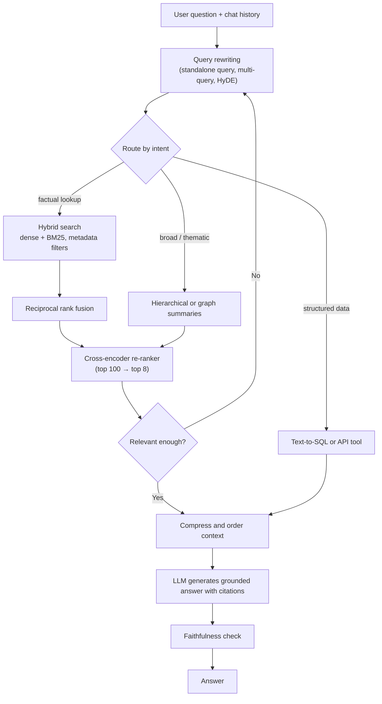
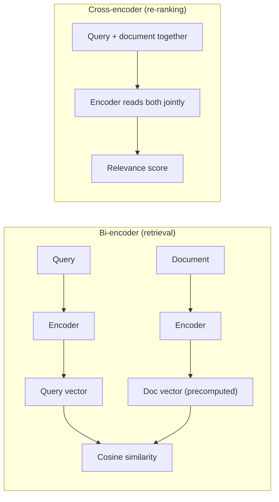
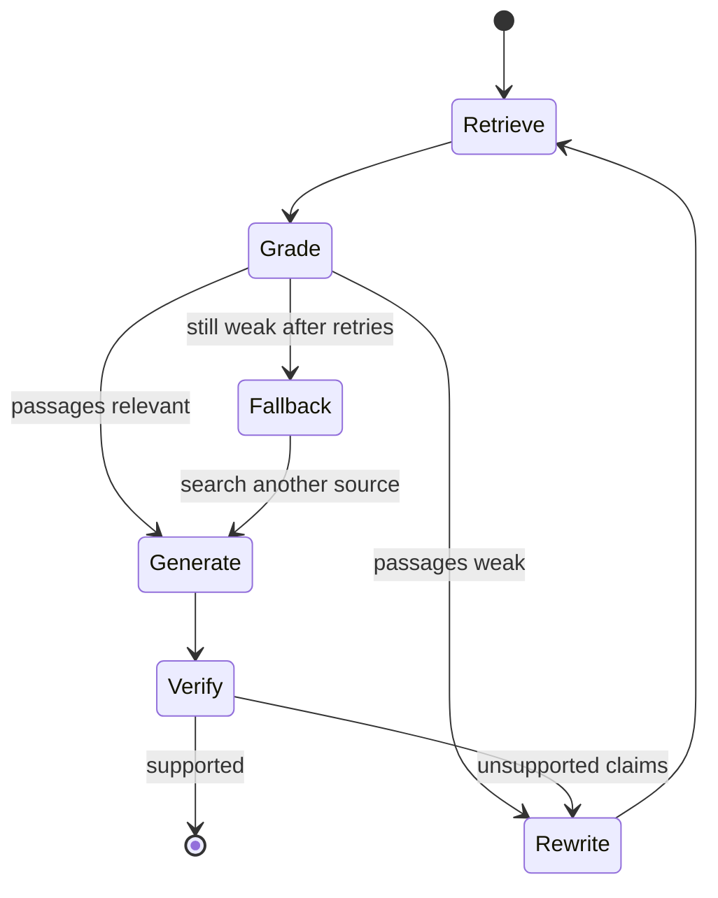

Basic RAG gets a demo working. Interviewers then ask: "Accuracy is 70%; how do you get it to 90%?" This page is the toolbox for that question, organized by where each technique sits in the pipeline.

## TL;DR

- Improve **before retrieval** (better chunks, metadata, query rewriting, HyDE), **during retrieval** (hybrid search, multi-vector, filters) and **after retrieval** (re-ranking, compression, ordering).
- **Hybrid search + a cross-encoder re-ranker** is the highest-value upgrade in most systems.
- **Multi-hop** questions need iterative retrieval or query decomposition.
- **Self-RAG and corrective RAG** let the system judge whether retrieval helped and retry when it did not.
- **Agentic RAG** lets an agent decide when, where and how to search across several sources.
- Every technique adds latency and cost, so each must earn its place on an **evaluation set**.

## The idea in plain English

Basic RAG is asking a librarian one question and taking the first five books they hand you. Advanced RAG is a better research process: rephrase the question in the library's terms, search both the catalogue and the full text, have an expert skim the stack and keep only the best pages, and, for tricky questions, search again based on what you learned from the first pages.

## Core concepts

1. **Better chunks.** Chunk along document structure, attach titles and section headings to each chunk, and store small chunks for matching but return their larger parent section for context ("small-to-big" or parent-document retrieval).

2. **Metadata and filters.** Tag chunks with source, date, product, region and permissions, and filter on them. Many "wrong answers" are really "right answer from the wrong year's document".

3. **Query rewriting.** Use an LLM to turn a conversational question into a standalone, search-friendly query, expand acronyms, or produce several variants (multi-query) and merge the results.

4. **HyDE (hypothetical document embeddings).** Ask the LLM to write a hypothetical answer, then embed that text and search with it. A fake answer often looks more like real documents than a short question does.

5. **Hybrid search.** Run dense vector search and sparse keyword search (BM25) in parallel and merge them, commonly with reciprocal rank fusion. Dense catches meaning; sparse catches exact names, codes and rare terms.

6. **Re-ranking.** A cross-encoder reads the query and each candidate together and scores relevance much more accurately than vector similarity. Retrieve 50 to 100 candidates cheaply, re-rank, keep the top 5 to 10.

7. **Late interaction (ColBERT-style).** Keeps one vector per token and matches token-to-token, between bi-encoders and cross-encoders in cost and quality.

8. **Context compression and ordering.** Strip irrelevant sentences from chunks and put the most relevant passages first or last, since models use the middle of long prompts less reliably.

9. **Multi-hop retrieval.** For questions like "which team owns the service that failed in last week's incident?", retrieve, read, then retrieve again with what you learned, or decompose the question into sub-questions up front.

10. **Self-RAG and corrective RAG (CRAG).** The model (or a small grader) judges whether retrieval is needed and whether retrieved passages are relevant and the answer is supported. Corrective RAG falls back to rewriting the query or searching other sources when retrieval looks poor.

11. **Hierarchical and graph retrieval.** Summaries of document clusters (as in RAPTOR) or knowledge-graph communities (as in GraphRAG) answer broad "what are the main themes" questions that single chunks cannot.

12. **Agentic RAG.** An agent with search tools over several sources decides which to query, reads results, and iterates until it can answer.

## Architecture

The request path:

1. Rewrite the question into one or more search queries.
2. Route it to the right retrieval method for its intent.
3. Retrieve broadly with hybrid search and fuse the result lists.
4. Re-rank candidates and keep a small, high-precision set.
5. If nothing is relevant enough, rewrite and try again, or answer "not found".
6. Compress, order, generate with citations, and optionally verify faithfulness.

## Deep dive

### Bi-encoder vs cross-encoder

Bi-encoders are fast because document vectors are precomputed, but they compress each text separately. Cross-encoders see query and document word by word, so they are far more accurate but too slow to run over a whole corpus. That is why they are paired: retrieve with one, re-rank with the other.

### Corrective retrieval loop

## Trade-offs

| Technique | Quality gain | Cost | When to use |
| --- | --- | --- | --- |
| Hybrid search | High on enterprise data with codes and names | Second index, small latency | Almost always |
| Cross-encoder re-ranking | Often the single biggest gain | Tens to hundreds of ms | When precision of top results matters |
| Query rewriting / multi-query | Good for conversational and vague queries | Extra LLM call | Chat interfaces |
| HyDE | Helps short or abstract queries | Extra LLM call, risk of biased search | Sparse queries, cold-start domains |
| Multi-hop / agentic retrieval | Unlocks complex questions | Several retrieval and LLM rounds | Research-style or cross-document questions |
| Self-RAG / CRAG grading | Fewer unsupported answers | Extra grading calls | High-stakes domains |
| Graph or hierarchical summaries | Answers global, thematic questions | Expensive indexing | Analysis over large corpora |

## Real-world examples

- Re-ranking with cross-encoders is a standard stage in search engines and is widely offered as a managed API by search and LLM providers.
- Microsoft's GraphRAG builds an entity graph and community summaries to answer global questions over a corpus.
- The Self-RAG and CRAG papers showed that grading retrieval and generation reduces unsupported answers compared with always-retrieve RAG.

## Common pitfalls

- Stacking every technique without measuring; latency balloons and gains are unclear.
- Re-ranking too few candidates; the re-ranker cannot rescue documents that were never retrieved.
- Letting query rewriting drift from the user's intent.
- Ignoring structured data; some questions are better answered with SQL than with text chunks.

## How to answer in an interview

1. Start from a baseline and an evaluation set with retrieval and answer metrics.
2. Locate the failure: retrieval, ranking or generation.
3. Apply techniques by stage: rewriting, hybrid search, re-ranking, compression.
4. Handle complex questions with multi-hop or agentic retrieval and self-grading loops.
5. Discuss cost and latency budgets for each added stage.

**What interviewers listen for:** a diagnosis-first approach and knowing which technique fixes which failure.

**Red flags:** listing techniques without evaluation, or proposing a bigger LLM to fix retrieval problems.

## Further reading

- [Precise Zero-Shot Dense Retrieval without Relevance Labels, HyDE (Gao et al., 2022)](https://arxiv.org/abs/2212.10496)
- [Self-RAG (Asai et al., 2023)](https://arxiv.org/abs/2310.11511)
- [Corrective Retrieval Augmented Generation (Yan et al., 2024)](https://arxiv.org/abs/2401.15884)
- [ColBERT: Efficient and Effective Passage Search (Khattab and Zaharia, 2020)](https://arxiv.org/abs/2004.12832)
- [RAPTOR: Recursive Abstractive Processing for Tree-Organized Retrieval (Sarthi et al., 2024)](https://arxiv.org/abs/2401.18059)
- [From Local to Global: A Graph RAG Approach (Edge et al., 2024)](https://arxiv.org/abs/2404.16130)

<InterviewQuestions>
  <InterviewQuestion question="What is hybrid search and why use it?" category="Concepts" level="Junior">
    Hybrid search runs dense vector search and sparse keyword search such as BM25 together and merges the results, often with reciprocal rank fusion. Dense search finds passages with similar meaning even when words differ; keyword search catches exact terms such as product codes, names and error messages that embeddings can miss. Together they give better recall than either alone.
  </InterviewQuestion>
  <InterviewQuestion question="Explain the difference between a bi-encoder and a cross-encoder." category="Concepts" level="Mid">
    A bi-encoder embeds the query and each document separately, so document vectors can be precomputed and searched quickly with similarity. A cross-encoder reads the query and a document together and outputs a relevance score, which is much more accurate because it compares them word by word, but it must run once per pair. So bi-encoders retrieve candidates and cross-encoders re-rank a short list.
  </InterviewQuestion>
  <InterviewQuestion question="What is HyDE?" category="Concepts" level="Mid">
    Hypothetical Document Embeddings: the LLM first writes a plausible answer to the question, and that generated text is embedded and used for search. A full hypothetical answer is often closer in embedding space to real relevant documents than a short query. It helps sparse or abstract queries, at the cost of an extra LLM call and some risk of steering search toward a wrong assumption.
  </InterviewQuestion>
  <InterviewQuestion question="How would you handle multi-hop questions in RAG?" category="Architecture" level="Mid">
    Either decompose the question into sub-questions and retrieve for each, or retrieve iteratively: read the first results, extract the intermediate fact, and issue a new query with it. An agent with a search tool can manage this loop. Graph-based retrieval also helps when the hops follow known relationships between entities.
  </InterviewQuestion>
  <InterviewQuestion question="What are Self-RAG and corrective RAG?" category="Concepts" level="Senior">
    Both add self-assessment to the pipeline. Self-RAG trains the model to decide when to retrieve and to critique whether passages are relevant and whether its output is supported, using special reflection tokens. Corrective RAG uses a retrieval evaluator to grade passages and, when they look weak, rewrites the query or searches other sources such as the web before generating. Both reduce unsupported answers compared with always using whatever was retrieved.
  </InterviewQuestion>
  <InterviewQuestion question="Your RAG accuracy is 70%. Walk me through getting to 90%." category="Failure modes" level="Senior">
    I would label a few hundred failing cases by cause: not retrieved, retrieved but ranked low, retrieved but answered wrongly, or question unanswerable. For retrieval misses, I would improve parsing and chunking, add metadata filters, hybrid search and query rewriting. For ranking, add a cross-encoder re-ranker over a larger candidate set. For generation, tighten grounding instructions, reorder and compress context, and add a faithfulness check. I would re-measure after each change and stop adding stages once gains no longer justify latency.
  </InterviewQuestion>
  <InterviewQuestion question="When would you use agentic RAG instead of a fixed pipeline?" category="Trade-offs" level="Senior">
    When questions vary widely and may need different sources, several searches, or structured lookups, such as research questions spanning documents, databases and APIs. An agent can choose tools and iterate. For high-volume, predictable questions, a fixed pipeline is cheaper, faster and easier to evaluate, so I would use agents only where the extra flexibility measurably improves results.
  </InterviewQuestion>
</InterviewQuestions>
