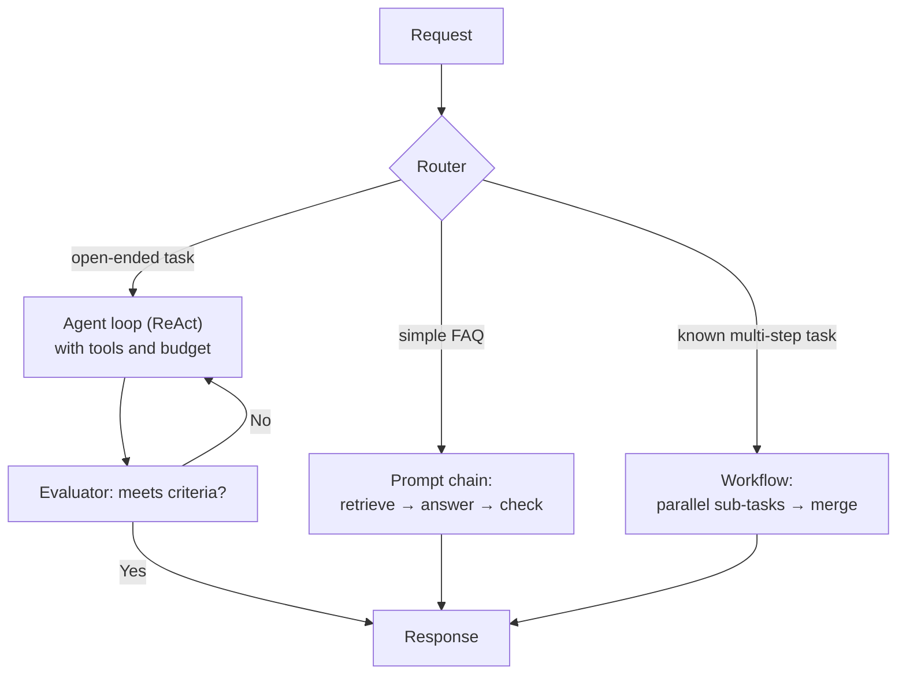
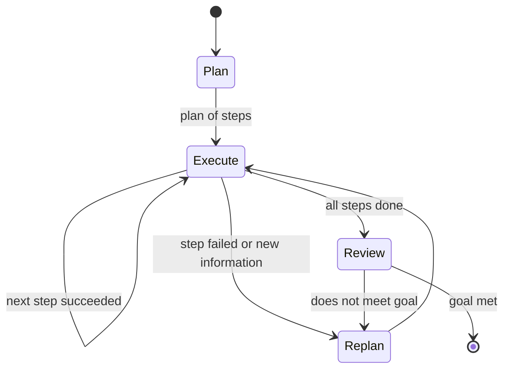

Agent design questions test whether you can choose the simplest structure that solves the problem. Interviewers like candidates who know the patterns by name, can draw the control flow, and explain why they would not use a fully autonomous agent when a workflow will do.

## TL;DR

- Start from an **augmented LLM** (model plus retrieval, tools and memory), then add structure only as needed.
- **Workflows** have code-defined control flow: prompt chaining, routing, parallelization, orchestrator-workers, evaluator-optimizer.
- **Agents** let the model decide the next step in a loop: ReAct, plan-and-execute, reflection.
- **State machines and graphs** (for example with LangGraph) give agents explicit, testable control flow with checkpoints.
- Choose by **predictability vs flexibility**, cost, latency and how verifiable the outcome is.

## The idea in plain English

A workflow is a recipe: the steps are written down, and the cook (the LLM) does each one. An agent is a chef who is told the dish and decides the steps, tasting as they go. Recipes are reliable and cheap; chefs handle new situations. Good kitchens use recipes for routine dishes and let the chef improvise only where needed.

## Core concepts

1. **Augmented LLM.** The building block: an LLM that can call retrieval, tools and memory in a single turn.

2. **Prompt chaining.** Fixed sequence of LLM calls, each handling one sub-task with checks between steps.

3. **Routing.** A classifier (LLM or model) sends each request to the specialized prompt, model or workflow that suits it.

4. **Parallelization.** Independent sub-tasks run at the same time, or several attempts run and are voted on.

5. **Orchestrator-workers.** A central LLM breaks a task into sub-tasks dynamically and delegates them to workers, then combines results.

6. **Evaluator-optimizer.** One call produces output, another critiques it against criteria, and the loop repeats until it passes.

7. **ReAct loop.** The model alternates reasoning, a tool action and an observation until done; the most common autonomous agent.

8. **Plan-and-execute.** Plan all steps first, execute them (possibly with cheaper models), and re-plan on failure.

9. **Reflection.** After an attempt, the agent reflects on feedback (test failures, errors) and retries with that lesson in context.

10. **State machine or graph.** Nodes are steps, edges are transitions decided by code or the model, with persisted state, so runs can pause, resume and be inspected.

## Architecture

How a mixed system handles requests:

1. A router classifies the request.
2. Simple, common requests go through a cheap, fixed chain.
3. Known multi-step tasks run as a workflow with parallel steps.
4. Only genuinely open-ended tasks go to an agent loop with tools and budgets.
5. An evaluator checks output quality before responding.

## Deep dive

### Plan-and-execute as a state machine

Representing the agent as explicit states makes it easier to test each transition, add human approval at specific states, and resume after failures.

### Choosing a pattern

| Situation | Pattern |
| --- | --- |
| Fixed, well-understood steps | Prompt chaining |
| Distinct request types | Routing |
| Independent sub-tasks | Parallelization |
| Unknown sub-tasks, decomposable | Orchestrator-workers |
| Clear quality criteria | Evaluator-optimizer |
| Open-ended, path depends on observations | ReAct agent |
| Long tasks needing structure | Plan-and-execute as a state machine |

## Trade-offs

| Approach | Pros | Cons | When to use |
| --- | --- | --- | --- |
| Workflows | Predictable, cheap, testable | Rigid | Known processes |
| ReAct agent | Flexible, adapts to observations | Can loop, harder to test | Exploratory tasks |
| Plan-and-execute | Efficient, monitorable | Plans can go stale | Long multi-step tasks |
| Reflection loops | Fixes errors using feedback | Extra calls | When feedback signals exist (tests, errors) |
| Graph / state machine frameworks | Explicit state, checkpoints, human-in-the-loop | Framework learning curve | Production agents needing control |

## Real-world examples

- ReAct introduced interleaved reasoning and acting and is the basis of many agent frameworks.
- Reflexion showed agents improve on coding and reasoning tasks by reflecting on feedback across attempts.
- Anthropic's "Building effective agents" guide recommends starting with simple, composable workflow patterns and adding autonomy only when needed.
- LangGraph models agents as graphs with persisted state and human-in-the-loop checkpoints.

## Common pitfalls

- Reaching for a fully autonomous agent when a workflow suffices.
- No step budget or stop condition.
- Hidden control flow inside framework abstractions that nobody can debug.
- Reflection without a real feedback signal, which mostly burns tokens.

## How to answer in an interview

1. Clarify the task and whether its steps are predictable.
2. Propose the simplest pattern that works and explain why.
3. Draw the control flow, including stop conditions and budgets.
4. Add evaluation, human checkpoints and error handling.
5. Explain when you would move to a more autonomous design, based on measured gaps.

**What interviewers listen for:** pattern vocabulary, a bias toward simplicity, and explicit control flow.

**Red flags:** "an agent will figure it out" with no structure, budgets or evaluation.

## Further reading

- [ReAct: Synergizing Reasoning and Acting (Yao et al., 2022)](https://arxiv.org/abs/2210.03629)
- [Reflexion: Language Agents with Verbal Reinforcement Learning (Shinn et al., 2023)](https://arxiv.org/abs/2303.11366)
- [Plan-and-Solve Prompting (Wang et al., 2023)](https://arxiv.org/abs/2305.04091)
- [Building effective agents (Anthropic)](https://www.anthropic.com/research/building-effective-agents)
- [LangGraph documentation](https://langchain-ai.github.io/langgraph/)

<InterviewQuestions>
  <InterviewQuestion question="What is the difference between a workflow and an agent?" category="Concepts" level="Junior">
    In a workflow, code defines the sequence of LLM calls and tool uses, so the path is predictable. In an agent, the model decides the next step at runtime based on what it observes. Workflows are cheaper and easier to test; agents handle open-ended tasks where the steps cannot be known in advance.
  </InterviewQuestion>
  <InterviewQuestion question="Explain the orchestrator-workers pattern." category="Concepts" level="Mid">
    A central LLM analyzes the task, decides which sub-tasks are needed, delegates them to worker LLM calls or agents, and synthesizes their results. Unlike plain parallelization, the sub-tasks are not fixed in advance. It suits tasks like changing many files in a codebase or researching several sub-questions.
  </InterviewQuestion>
  <InterviewQuestion question="When does reflection actually help an agent?" category="Trade-offs" level="Mid">
    When there is concrete feedback to reflect on, such as failing tests, error messages, a verifier's critique or a score. The agent can then diagnose the problem and retry with that lesson. Without new information, self-reflection often just restates the same answer at extra cost.
  </InterviewQuestion>
  <InterviewQuestion question="Why model an agent as a state machine or graph?" category="Architecture" level="Senior">
    Explicit states and transitions make the control flow visible and testable, let you persist state for pause and resume, insert human approval at specific points, retry individual steps, and trace exactly where a run went wrong. Free-form loops are harder to debug and to guarantee safe behavior.
  </InterviewQuestion>
  <InterviewQuestion question="Design the architecture for a customer-support system that handles both FAQs and account actions." category="Architecture" level="Senior">
    Route each message: FAQs go to a cheap retrieval-and-answer chain; account actions go to a structured workflow or a constrained agent with specific tools, permission checks and confirmation before any change; unclear or sensitive cases go to humans. Add an evaluator for answer quality, budgets on agent steps, and an evaluation suite per route.
  </InterviewQuestion>
  <InterviewQuestion question="How do you stop an agent from looping forever?" category="Failure modes" level="Junior">
    Set hard limits on steps, tokens, time and cost; detect repeated identical actions; give the model clear success criteria and a way to declare failure; and escalate to a human or return a partial result when limits are hit. Log loop cases and add them to the evaluation set.
  </InterviewQuestion>
</InterviewQuestions>
