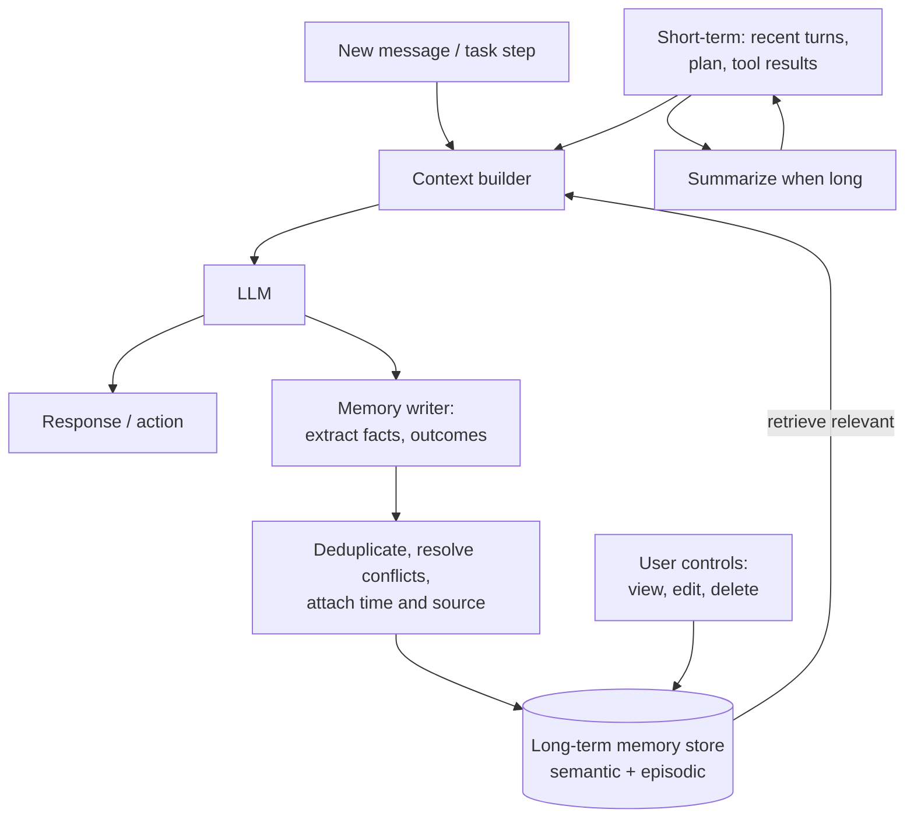
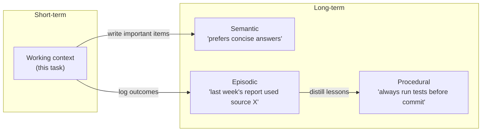

Memory questions ask how an assistant can stay coherent in long tasks and remember users across sessions without drowning its context window or storing the wrong things. Good answers treat memory as a system with explicit write, read and forget rules.

## TL;DR

- **Short-term memory** is what is in the context window now: recent messages, current plan, tool results.
- **Long-term memory** persists across sessions in a store and is retrieved when relevant.
- Common long-term types: **semantic** (facts and preferences), **episodic** (past events and task outcomes), **procedural** (learned instructions or skills).
- The hard parts are **what to write, when to retrieve, how to update conflicts and when to forget**.
- Memory raises **privacy** questions: users must be able to see, correct and delete it.

## The idea in plain English

Short-term memory is the notepad on your desk during a task; when it fills up, you summarize old notes. Long-term memory is your filing cabinet: you file important facts ("the client prefers email"), records of past jobs, and how-to notes, and pull out the relevant folder when a new task starts. A messy cabinet with wrong or outdated files is worse than none.

## Core concepts

1. **Context window as working memory.** Everything the model can use right now. Finite and costly, so it must be curated.

2. **Summarization and compression.** Older turns or steps are summarized; large artifacts are stored outside the context and referenced by id.

3. **Semantic memory.** Stable facts and preferences extracted from interactions, stored as structured records or text with embeddings.

4. **Episodic memory.** Records of past sessions or tasks: what was tried, what worked, outcomes. Useful for agents that repeat similar tasks.

5. **Procedural memory.** Instructions, rules or skills the agent has learned, sometimes written back into its system prompt or a skills library.

6. **Write policy.** Decide what is worth remembering: explicit user statements, confirmed facts, outcomes. Avoid storing guesses or transient details.

7. **Retrieval policy.** Retrieve by relevance to the current task (embeddings plus filters), recency and importance.

8. **Update and conflict handling.** New facts may contradict old ones ("I moved to Berlin"); memories need timestamps, sources and replacement rules.

9. **Virtual context management.** Approaches such as MemGPT treat the context window like RAM and external storage like disk, with the model deciding what to page in and out.

## Architecture

The memory loop:

1. Build the context from recent turns plus retrieved long-term memories.
2. The model responds or acts.
3. A memory writer extracts facts or outcomes worth keeping.
4. New memories are deduplicated, checked for conflicts and stored with timestamps and sources.
5. Short-term history is summarized as it grows.
6. Users can inspect and delete what is stored.

## Deep dive

### Types of memory side by side

## Trade-offs

| Decision | Option A | Option B | Guidance |
| --- | --- | --- | --- |
| Keep full history vs summarize | No information lost | Cheaper, focused | Summarize older parts; keep recent turns verbatim |
| Auto-write memories vs explicit | Personalizes automatically | Users trust it more | Auto-write low-risk preferences; confirm sensitive ones |
| Vector store vs structured records | Flexible recall | Precise updates and deletes | Structured for facts, vectors for fuzzy recall; often both |
| Global vs per-task memory | Cross-task learning | Less interference | Scope memories by user and project |

## Real-world examples

- Generative Agents (Park et al., 2023) used a memory stream with retrieval by recency, importance and relevance, plus reflection to form higher-level memories.
- MemGPT treated context management like an operating system's memory hierarchy.
- Consumer AI assistants now offer user-visible memory that can be reviewed and deleted.

## Common pitfalls

- Storing everything, which makes retrieval noisy and costly.
- Never updating or forgetting, so stale facts override new ones.
- Storing sensitive personal data without consent or deletion support.
- Retrieving memories by similarity alone and missing recency.

## How to answer in an interview

1. Separate short-term context management from long-term memory.
2. Name memory types and give an example of each.
3. Define write, retrieval, update and forget policies.
4. Cover privacy controls and data scoping.
5. Explain how you would evaluate memory: recall of relevant facts, errors from stale memories, user satisfaction.

**What interviewers listen for:** explicit policies rather than "store it in a vector DB".

**Red flags:** no conflict handling and no deletion story.

## Further reading

- [MemGPT: Towards LLMs as Operating Systems (Packer et al., 2023)](https://arxiv.org/abs/2310.08560)
- [Generative Agents: Interactive Simulacra of Human Behavior (Park et al., 2023)](https://arxiv.org/abs/2304.03442)
- [Reflexion (Shinn et al., 2023)](https://arxiv.org/abs/2303.11366)

<InterviewQuestions>
  <InterviewQuestion question="What is the difference between short-term and long-term memory in an agent?" category="Concepts" level="Junior">
    Short-term memory is the information in the current context window, such as recent messages, the plan and tool results. Long-term memory persists outside the model across sessions in a database or vector store and is retrieved into the context when relevant.
  </InterviewQuestion>
  <InterviewQuestion question="How do you keep a long conversation within the context window?" category="Architecture" level="Mid">
    Keep recent turns verbatim, summarize older ones into a running summary, move large artifacts out of the context and reference them, and retrieve specific older details on demand. Track token usage so compression happens before quality drops.
  </InterviewQuestion>
  <InterviewQuestion question="How do you decide what an assistant should remember?" category="Architecture" level="Mid">
    Remember things that are stable and useful later: explicit preferences, confirmed facts about the user or project, and outcomes of tasks. Skip transient details and guesses. Let users see and remove memories, and ask before storing sensitive information.
  </InterviewQuestion>
  <InterviewQuestion question="How do you handle conflicting memories?" category="Failure modes" level="Senior">
    Store memories with timestamps and sources, detect conflicts when writing by checking related existing memories, and replace or mark old ones as superseded rather than keeping both. At retrieval, prefer recent and confirmed facts, and ask the user when a conflict matters.
  </InterviewQuestion>
  <InterviewQuestion question="How would you evaluate an agent's memory system?" category="Evaluation" level="Senior">
    Create multi-session test scenarios where earlier sessions establish facts, then later tasks depend on them. Measure whether relevant memories are retrieved and used, how often stale or wrong memories cause errors, the token cost of memory, and user ratings of personalization, plus checks that deleted memories are truly gone.
  </InterviewQuestion>
  <InterviewQuestion question="What privacy concerns does agent memory raise?" category="Failure modes" level="Mid">
    Memory can accumulate personal and sensitive data over time, possibly from third parties mentioned in conversations. It needs consent, user visibility, editing and deletion, retention limits, encryption and access controls, and it must never leak between users or tenants.
  </InterviewQuestion>
</InterviewQuestions>
