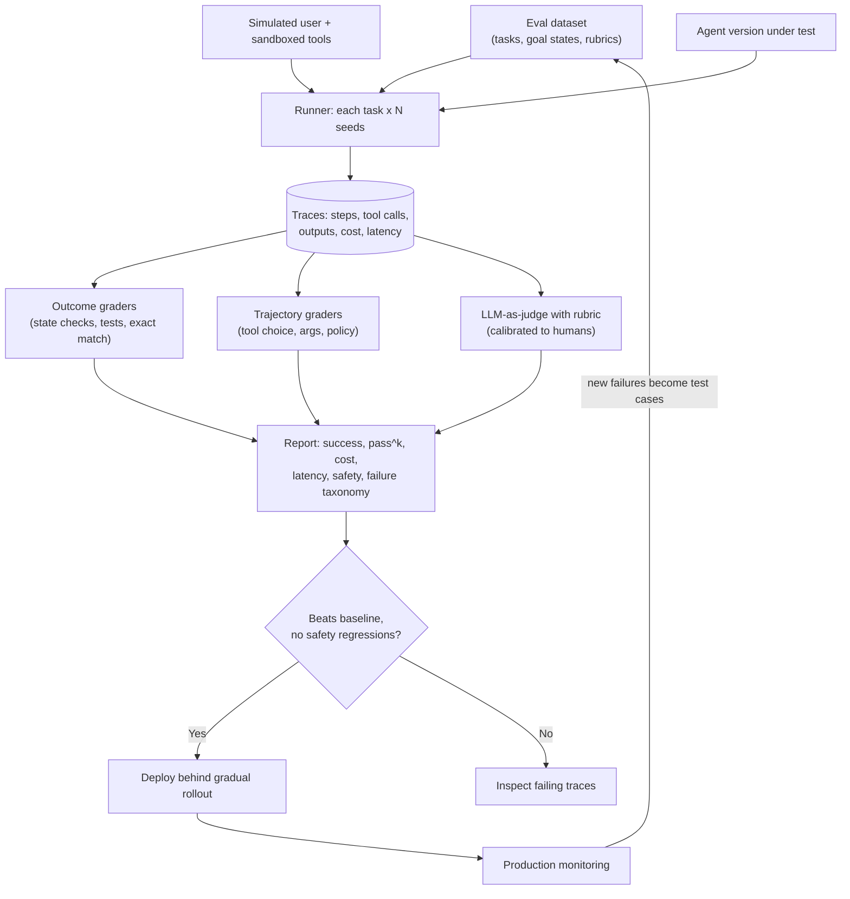
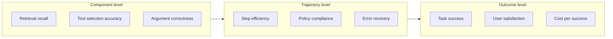

Agents are harder to evaluate than single LLM calls: they take many steps, use tools, change state, and can reach the right answer the wrong way. Interviewers ask "how do you know your agent works?" to see whether you can build a real evaluation system rather than eyeballing demos.

## TL;DR

- Evaluate on **three levels**: the **final outcome** (did the task succeed?), the **trajectory** (were the steps and tool calls sensible?), and **single components** (retrieval, tool selection, argument accuracy).
- Prefer **verifiable outcomes**: unit tests, database state checks, exact answers. Use **LLM-as-judge** with rubrics where outcomes are open-ended, and calibrate it against humans.
- Agents are **non-deterministic**, so run each task several times and report pass rates and consistency (for example pass^k).
- Measure **cost, latency, steps and safety** alongside success.
- Close the loop: **production traces and failures become new test cases**, and every change runs through a regression gate.

## The idea in plain English

Evaluating an agent is like assessing a new employee on real assignments. You check whether the job got done (outcome), look over how they did it (trajectory: did they use the right systems, waste time, take risky shortcuts?), test specific skills separately (components), and watch how they behave when things go wrong or when a customer is difficult (robustness and safety). And you do it more than once, because good days and bad days happen.

## Core concepts

1. **Task success rate.** The share of tasks completed correctly, checked against a goal state or reference answer. The headline metric.

2. **Outcome-based grading.** Check the final state of the environment: tests pass, the database record is correct, the ticket was updated, the email went to the right person. More reliable than judging text.

3. **Trajectory evaluation.** Inspect the sequence of steps: correct tool choice, valid arguments, no unnecessary or repeated calls, no policy violations, sensible order. Useful for diagnosing failures and catching "right answer, dangerous path".

4. **Tool-call metrics.** Tool selection accuracy, argument correctness, error rate, and recovery rate after a tool error.

5. **LLM-as-judge.** A strong model grades outputs or trajectories with a rubric. Fast and scalable, but biased (position, verbosity, self-preference), so calibrate against human labels and use pairwise or rubric scoring with clear criteria.

6. **Simulated users and environments.** For conversational agents, an LLM plays the user with a scripted goal and persona, and the environment (APIs, databases) is mocked or sandboxed so tests are repeatable.

7. **Reliability under repetition.** Run each task several times. pass@k asks whether at least one of k attempts succeeds; pass^k asks whether all k succeed, which better reflects what users experience.

8. **Efficiency metrics.** Steps per task, tokens, cost per successful task, latency, and time to first useful action.

9. **Safety and robustness.** Prompt-injection tests, attempts to exceed permissions, harmful requests, and behavior under tool failures or ambiguous instructions.

10. **Online evaluation.** In production: task completion signals, user feedback, escalation and abandonment rates, sampled human review, and alerts on cost or error spikes.

## Architecture

How an evaluation run works:

1. Load a versioned set of tasks, each with a goal, starting state and grading method.
2. Run the agent on every task several times in a sandbox, with a simulated user where needed.
3. Record full traces.
4. Grade outcomes first, then trajectories, then open-ended quality with a calibrated judge.
5. Compare to the baseline on success, reliability, cost, latency and safety, and block regressions.
6. Feed production failures back into the dataset.

## Deep dive

### Three layers of evaluation

Outcome metrics tell you **whether** the agent works; trajectory and component metrics tell you **why not**.

### Building the dataset

- Start from real user tasks and support logs, not invented examples.
- Cover easy, typical and hard tasks, plus edge cases: ambiguous requests, missing information, tool failures, adversarial inputs.
- Write a grading method per task before running the agent.
- Keep a held-out set that is never used for tuning prompts.

### Public benchmarks and what they measure

| Benchmark | What it tests | Grading |
| --- | --- | --- |
| SWE-bench | Fixing real GitHub issues | Repository tests pass after the patch |
| tau-bench | Customer-service agents with tools and policies, talking to a simulated user | Final database state vs goal; pass^k for reliability |
| GAIA | General assistant tasks needing browsing, files and reasoning | Exact final answer |
| AgentBench | Agents across environments such as OS, databases and web | Task-specific success |

Benchmarks are useful for comparing models, but your own task-specific suite decides whether your agent is ready.

## Trade-offs

| Method | Pros | Cons | When to use |
| --- | --- | --- | --- |
| Outcome / state checks | Objective, cheap at scale | Needs a controllable environment | Whenever the result is verifiable |
| Trajectory grading | Explains failures, catches risky paths | Many valid paths exist; rigid checks penalize good alternatives | Debugging and safety policies |
| LLM-as-judge | Scales to open-ended outputs | Biases, needs calibration, costs tokens | Quality of text, helpfulness, tone |
| Human review | Highest validity | Slow, expensive | Calibration, high-stakes launches, sampling production |
| Simulated users | Repeatable multi-turn tests | Simulator may be unrealistic | Conversational agents |
| Public benchmarks | Comparable across models | May not match your tasks; contamination risk | Model selection, not launch decisions |

## Real-world examples

- SWE-bench grades coding agents by running each repository's own tests after the agent's patch.
- tau-bench evaluates tool-using customer-service agents against a simulated user and checks the final database state, and introduced pass^k to measure consistency across repeated trials.
- The MT-Bench and Chatbot Arena work studied LLM-as-judge and reported strong agreement with human preferences alongside biases such as position and verbosity.

## Common pitfalls

- Judging from a handful of demos instead of a fixed, versioned dataset.
- Reporting a single run; agents vary run to run.
- Using an uncalibrated LLM judge as ground truth.
- Measuring only success, ignoring cost, latency and safety.
- Tuning on the test set until it no longer predicts production.
- Not testing failure modes: tool errors, ambiguous requests, prompt injection.

## How to answer in an interview

1. Define success for the product and how it can be verified.
2. Describe the dataset: real tasks, edge cases, a held-out split, grading methods.
3. Explain the three layers: outcome, trajectory, components.
4. Cover graders: state checks, calibrated LLM judges, human review; multiple runs and pass^k.
5. Add cost, latency, safety tests, a regression gate, and production monitoring that feeds the dataset.

**What interviewers listen for:** verifiable outcomes first, awareness of non-determinism and judge bias, and a continuous evaluation loop.

**Red flags:** "we tried it and it looked good", or relying only on public benchmarks.

## Further reading

- [SWE-bench (Jimenez et al., 2023)](https://arxiv.org/abs/2310.06770)
- [tau-bench: Tool-Agent-User Interaction in Real-World Domains (Yao et al., 2024)](https://arxiv.org/abs/2406.12045)
- [GAIA: A Benchmark for General AI Assistants (Mialon et al., 2023)](https://arxiv.org/abs/2311.12983)
- [AgentBench (Liu et al., 2023)](https://arxiv.org/abs/2308.03688)
- [Judging LLM-as-a-Judge with MT-Bench and Chatbot Arena (Zheng et al., 2023)](https://arxiv.org/abs/2306.05685)

<InterviewQuestions>
  <InterviewQuestion question="Why is evaluating an agent harder than evaluating a single LLM response?" category="Concepts" level="Junior">
    An agent takes many steps, calls tools and changes the state of an environment, so there are many ways to succeed or fail, and the same task can produce different paths on different runs. You need a controllable environment, graders for the final state and the path, multiple runs per task, and metrics for cost and safety, not just a single answer comparison.
  </InterviewQuestion>
  <InterviewQuestion question="What is the difference between outcome and trajectory evaluation?" category="Concepts" level="Junior">
    Outcome evaluation checks whether the task's goal was achieved, for example whether the right order was refunded or the tests pass. Trajectory evaluation checks how the agent got there: tool choices, arguments, unnecessary steps and policy violations. Outcomes measure success; trajectories explain failures and catch cases where the right result came from a risky path.
  </InterviewQuestion>
  <InterviewQuestion question="How do you make LLM-as-judge trustworthy?" category="Evaluation" level="Mid">
    Use a clear rubric with concrete criteria and examples, ask for reasoning before the score, prefer pairwise comparisons or binary checks over vague scales, and randomize answer order to reduce position bias. Most importantly, calibrate it against human labels on a sample and track agreement over time, and avoid letting a model judge its own outputs when possible.
  </InterviewQuestion>
  <InterviewQuestion question="What is pass^k and why does it matter for agents?" category="Evaluation" level="Mid">
    pass^k is the probability that an agent succeeds on all of k independent attempts at the same task, while pass@k measures whether at least one succeeds. Users experience every run, so an agent that succeeds 70% of the time per run is much less dependable than its single-run score suggests. pass^k exposes that inconsistency.
  </InterviewQuestion>
  <InterviewQuestion question="How would you build an evaluation dataset for a customer-support agent?" category="Architecture" level="Senior">
    I would sample real support conversations and resolved tickets, turn them into tasks with a user goal, a persona, the starting account state and the expected end state, and add edge cases: missing information, policy exceptions, angry users, tool failures and injection attempts. Each task gets a grader, mainly a state check plus a rubric for communication quality. I would run it with a simulated user against sandboxed APIs, keep a held-out split, and grow the set from production failures.
  </InterviewQuestion>
  <InterviewQuestion question="Which metrics would you put on a dashboard for an agent in production?" category="Evaluation" level="Senior">
    Task completion rate and escalation-to-human rate, user feedback and abandonment, tool error and retry rates, steps and tokens per task, cost per successful task, latency percentiles, guardrail and policy-violation triggers, and the results of sampled human reviews. Each should be broken down by task type and version so regressions can be traced to a change.
  </InterviewQuestion>
  <InterviewQuestion question="Your agent scores well on public benchmarks but users complain. What do you do?" category="Failure modes" level="Senior">
    Benchmarks measure generic skills, not my users' tasks, and may be contaminated. I would collect the complaints and production traces, categorize the failures, and build them into a task-specific evaluation suite with realistic grading. Then I would fix the most common failure categories, often in context, tools or policies rather than the model, and use the new suite as the release gate going forward.
  </InterviewQuestion>
</InterviewQuestions>
