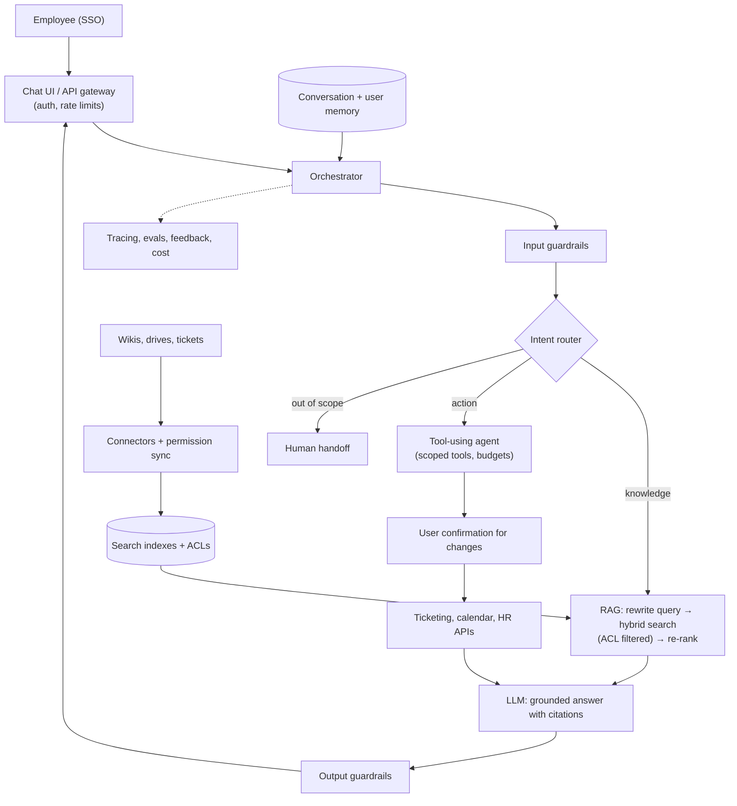
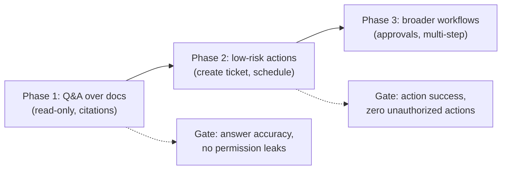

This capstone case study pulls the other topics together: "Design an AI assistant for our employees that answers questions from internal documents and can do simple tasks." It is one of the most common GenAI system design interview prompts.

## TL;DR

- Core loop: **understand the request → retrieve knowledge or call tools → generate a grounded answer → apply guardrails → respond and learn**.
- **RAG with permissions** answers knowledge questions; **scoped tools** handle actions (tickets, calendars, HR systems).
- **Conversation memory** keeps context; **user-visible long-term memory** stores preferences.
- **Guardrails, approvals and audit logs** make actions safe.
- An **evaluation and observability loop** drives quality: test sets per use case, sampled production review, feedback.
- **Phase the launch**: read-only Q&A first, then low-risk actions, then broader automation.

## The idea in plain English

The assistant is a new, very fast colleague with access to the company wiki and a few systems. They answer questions by looking things up and pointing to the source, do simple tasks when allowed and after checking with you, remember how you like things done, and escalate to a human when unsure. Management reviews their work regularly and trains them on mistakes.

## Core concepts

1. **Requirements first.** Users and use cases, data sources, permissions model, latency targets, languages, compliance, and what success looks like (deflected tickets, time saved, satisfaction).

2. **Intent routing.** Classify each message: knowledge question, action request, chit-chat, or out of scope. Route to the right pipeline and model.

3. **Knowledge pipeline.** Connectors to wikis, drives, ticketing and chat; permission-aware ingestion; hybrid retrieval, re-ranking and cited answers.

4. **Action pipeline.** A small set of tools with strict schemas and per-user authorization; confirmation before changes; idempotent operations.

5. **Conversation state.** Recent turns plus a running summary; query rewriting for follow-ups.

6. **Long-term memory.** Preferences and recurring context, viewable and deletable by the user.

7. **Guardrails.** Input and output filters, injection defenses on retrieved content, PII handling, topic scoping.

8. **Human handoff.** Escalate to the right team with a summary when the assistant cannot help.

9. **Evaluation and operations.** Per-use-case test sets, LLM judges calibrated to humans, tracing, cost tracking, staged rollouts.

## Architecture

A request end to end:

1. The employee signs in with SSO; the gateway applies rate limits.
2. The orchestrator loads conversation state and memory, and input guardrails screen the message.
3. The router picks the knowledge, action or handoff path.
4. Knowledge path: rewrite, retrieve with permission filters, re-rank, and generate a cited answer.
5. Action path: the agent selects a tool, the user confirms changes, and the tool runs with the user's permissions.
6. Output guardrails check the response; everything is traced and sampled for evaluation.

## Deep dive

### Phased rollout

Each phase expands only after its evaluation gate passes, which builds trust and limits risk.

### Success metrics

| Area | Metric |
| --- | --- |
| Quality | Answer correctness, faithfulness, citation accuracy (offline and sampled online) |
| Outcomes | Self-service resolution rate, time saved, escalation rate |
| User | Satisfaction, thumbs up/down, retention of weekly users |
| Safety | Permission-leak tests, injection attack success rate, policy violations |
| Efficiency | Latency (TTFT and total), cost per resolved request |

## Trade-offs

| Decision | Option A | Option B | Guidance |
| --- | --- | --- | --- |
| One general agent vs routed pipelines | Flexible | Predictable, cheaper | Route; use an agent only for actions |
| Hosted frontier model vs self-hosted | Best quality, no ops | Data control, cost at scale | Decide by data policy and volume; keep the app model-agnostic |
| Fine-tuning vs prompting + RAG | Consistent style | Faster to build, fresh knowledge | Start with prompting + RAG |
| Auto-actions vs confirmations | Faster | Safer | Confirm all changes initially |
| Build connectors vs platform | Control | Speed | Use existing connectors where they meet security needs |

## Real-world examples

- Enterprise copilots that answer from internal knowledge and integrate with workplace tools are among the most widely deployed generative AI applications.
- Common building blocks across them match this design: permission-aware retrieval, tool calling, safety filters and admin controls.
- See the related deep-dives: [RAG Fundamentals](/ai-system-design/genai-system-design/rag-fundamentals), [Advanced RAG](/ai-system-design/genai-system-design/advanced-rag), [Tool Use and MCP](/ai-system-design/genai-system-design/tool-use-and-mcp), [Guardrails](/ai-system-design/genai-system-design/guardrails-and-safety), [LLMOps](/ai-system-design/genai-system-design/llmops-observability).

## Common pitfalls

- Launching with actions before Q&A quality is proven.
- Indexing documents without syncing permissions.
- No handoff path, so users get stuck in loops.
- Measuring usage but not correctness.
- Letting costs grow unchecked as adoption rises.

## How to answer in an interview

1. Clarify users, use cases, data, permissions and success metrics.
2. Draw the architecture: gateway, orchestrator, router, RAG, tools, memory, guardrails, observability.
3. Go deep on two areas the interviewer cares about, often retrieval quality and action safety.
4. Explain evaluation and phased rollout.
5. Discuss cost, latency and model choice.

**What interviewers listen for:** a complete, phased design with safety and evaluation built in.

**Red flags:** "connect a chatbot to all our data" with no permissions, evaluation or rollout plan.

## Further reading

- [Retrieval-Augmented Generation (Lewis et al., 2020)](https://arxiv.org/abs/2005.11401)
- [ReAct (Yao et al., 2022)](https://arxiv.org/abs/2210.03629)
- [Building effective agents (Anthropic)](https://www.anthropic.com/research/building-effective-agents)
- [OWASP Top 10 for LLM Applications](https://owasp.org/www-project-top-10-for-large-language-model-applications/)

<InterviewQuestions>
  <InterviewQuestion question="What are the main components of an enterprise AI assistant?" category="Architecture" level="Junior">
    Authentication and a gateway, an orchestrator with intent routing, a permission-aware RAG pipeline for knowledge, a tool layer for actions with confirmation, conversation and user memory, input and output guardrails, human handoff, and an observability and evaluation system.
  </InterviewQuestion>
  <InterviewQuestion question="How do you make sure the assistant never reveals documents a user can't access?" category="Failure modes" level="Mid">
    Sync access-control lists from each source system into the index, filter retrieval by the signed-in user's identity and groups, run tools with the user's own delegated permissions, and test with accounts of different roles. Also prevent caches and memories from crossing users.
  </InterviewQuestion>
  <InterviewQuestion question="How would you phase the launch?" category="Trade-offs" level="Mid">
    Start with read-only Q&A over a few high-value sources with citations, measure accuracy and adoption, then add low-risk actions such as creating tickets with confirmation, then expand to broader workflows. Each phase has an evaluation gate and a rollback plan.
  </InterviewQuestion>
  <InterviewQuestion question="How would you measure the assistant's business impact?" category="Evaluation" level="Senior">
    Define outcome metrics with stakeholders, such as self-service resolution rate, reduction in support tickets, and time saved per task, and measure them against a baseline, ideally with a phased or randomized rollout. Pair them with quality metrics and satisfaction, and track cost per resolved request to show return on investment.
  </InterviewQuestion>
  <InterviewQuestion question="How do you handle questions the assistant cannot answer?" category="Architecture" level="Junior">
    Detect low retrieval relevance or low confidence, say clearly that it does not know, and offer a handoff to the right team with a summary of the conversation. Log these cases to find content gaps and improve sources.
  </InterviewQuestion>
  <InterviewQuestion question="Which model would you choose, and how would you avoid lock-in?" category="Trade-offs" level="Senior">
    Choose based on evaluated quality on the assistant's test sets, data-handling requirements, latency and cost, possibly routing simple requests to a cheaper model. Keep prompts, tools and evaluation independent of a specific provider behind an internal model interface, so switching is a configuration change validated by the same evaluation suite.
  </InterviewQuestion>
</InterviewQuestions>
