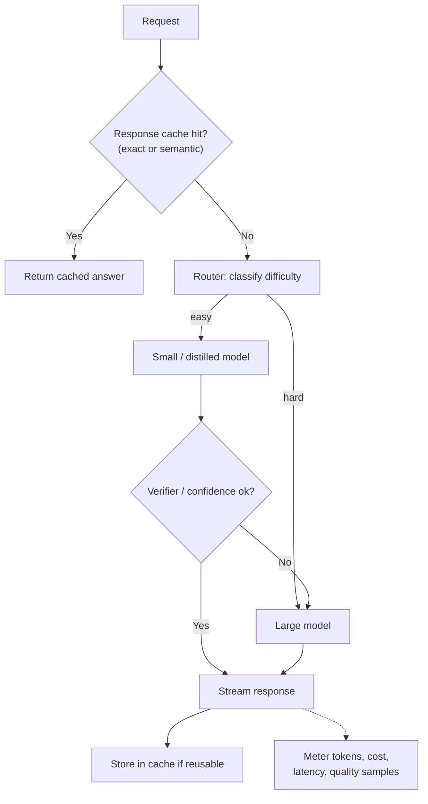
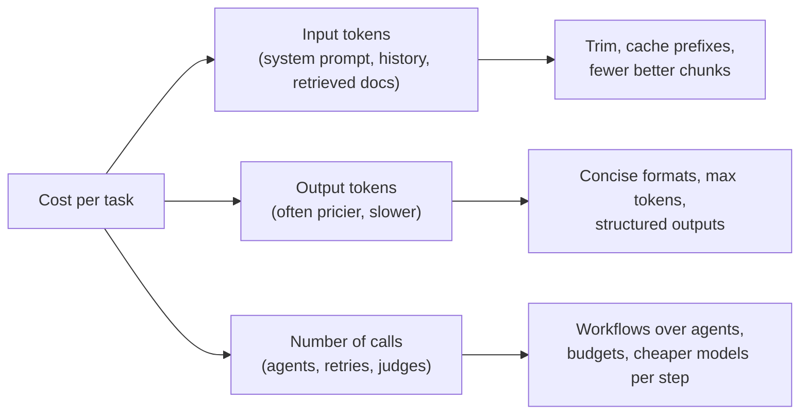

"Your LLM feature costs too much and feels slow. What do you do?" This page is the playbook, ordered roughly from easiest to most involved, with how to measure that quality did not drop.

## TL;DR

- Measure first: **cost per successful task** and latency by step, not just total spend.
- Biggest easy wins: **shorter prompts and outputs**, **prompt (prefix) caching**, **streaming**, and **parallel calls**.
- **Route** easy requests to small models and hard ones to large models, or **cascade** from small to large on low confidence.
- **Cache** exact and semantically similar responses where answers are reusable.
- For high volume, **fine-tune or distill** a small model; for self-hosting, **quantize** and use an efficient serving engine.
- Guard every change with an **evaluation set** so savings do not cost quality.

## The idea in plain English

Not every question needs your most expensive expert. A front desk answers routine questions, specialists handle tricky ones, and frequently asked questions get a printed sheet. Optimizing LLM cost is building that front desk, routing system and FAQ sheet, while checking customers are still happy.

## Core concepts

1. **Token economics.** Cost is roughly input tokens times input price plus output tokens times output price; output tokens are usually pricier and slower.

2. **Prompt trimming.** Remove redundant instructions and examples, retrieve fewer but better chunks, summarize history.

3. **Output control.** Ask for concise formats, set maximum output length, use structured outputs instead of prose where code consumes the result.

4. **Prompt caching.** Providers and serving engines can reuse computation for repeated prompt prefixes; put stable content first.

5. **Response caching.** Exact-match caches for repeated requests; semantic caches return answers to near-identical questions, with careful thresholds and invalidation.

6. **Model routing.** A classifier or rules send each request to the cheapest model likely to succeed.

7. **Cascades.** Try a small model first; escalate to a larger one when confidence or a verifier check fails.

8. **Distillation and fine-tuning.** Train a small model on a large model's outputs for one task.

9. **Batching and async.** Use batch APIs or offline batching for non-interactive work at lower prices.

10. **Latency tactics.** Streaming, parallel independent calls, speculative decoding, smaller models for intermediate steps, and lower time to first token through shorter prompts and cache hits.

## Architecture

The request path:

1. Check exact and semantic caches.
2. Route by predicted difficulty to a small or large model.
3. For the small path, verify output and escalate on failure.
4. Stream the response; store reusable answers.
5. Meter cost, latency and sampled quality per route.

## Deep dive

### Where the money goes

### A sizing example

Suppose a feature handles 1 million requests a day at 3,000 input and 500 output tokens each. Cutting input to 1,500 tokens with better retrieval halves input cost; routing 70% of requests to a model priced ten times lower cuts most of what remains. Always recompute with your provider's actual prices and verify quality on the evaluation set.

## Trade-offs

| Technique | Savings | Risk | When to use |
| --- | --- | --- | --- |
| Prompt trimming | Moderate, immediate | Losing needed context | Always first |
| Prefix caching | Large for long shared prompts | Needs stable prefix layout | Long system prompts or documents |
| Semantic caching | Large for repetitive traffic | Stale or wrong-user answers | FAQs, public content |
| Routing / cascades | Large | Misrouting hard requests | Mixed-difficulty traffic |
| Distillation | Very large at volume | Upfront work, narrower model | Stable, high-volume tasks |
| Quantization (self-hosted) | Memory and speed | Small accuracy loss | Open-weight serving |
| Batch APIs | Lower price | Not real-time | Offline jobs |

## Real-world examples

- FrugalGPT showed LLM cascades can match a top model's accuracy at much lower cost on several benchmarks.
- RouteLLM trained routers that decide between a strong and a weak model, reducing cost while keeping quality.
- Major providers offer prompt caching and discounted batch processing.
- Open-source semantic cache libraries such as GPTCache are used to reuse answers for similar queries.

## Common pitfalls

- Optimizing cost per call while failed tasks and retries rise.
- Semantic caching across users with different permissions.
- Routing without measuring quality per route.
- Agents with no step budget.

## How to answer in an interview

1. Measure: cost and latency per step and per successful task.
2. Apply quick wins: trim, cap outputs, cache prefixes, stream, parallelize.
3. Add routing or cascades with a verifier.
4. Add response caching where safe.
5. For scale, distill or fine-tune a small model and optimize serving. Guard every step with evaluations.

**What interviewers listen for:** measurement first and quality guardrails.

**Red flags:** "switch to the cheapest model" without evaluation.

## Further reading

- [FrugalGPT (Chen et al., 2023)](https://arxiv.org/abs/2305.05176)
- [RouteLLM: Learning to Route LLMs with Preference Data (Ong et al., 2024)](https://arxiv.org/abs/2406.18665)
- [Distilling the Knowledge in a Neural Network (Hinton et al., 2015)](https://arxiv.org/abs/1503.02531)
- [Fast Inference via Speculative Decoding (Leviathan et al., 2022)](https://arxiv.org/abs/2211.17192)
- [GPTCache (GitHub)](https://github.com/zilliztech/GPTCache)

<InterviewQuestions>
  <InterviewQuestion question="What are the quickest ways to cut LLM costs?" category="Concepts" level="Junior">
    Shorten prompts by removing redundant instructions and sending fewer, better retrieved chunks; cap and simplify outputs; enable prompt caching for shared prefixes; cache repeated answers; and use a smaller model where evaluation shows it is good enough. Measure cost per successful task to confirm the gains.
  </InterviewQuestion>
  <InterviewQuestion question="What is an LLM cascade?" category="Concepts" level="Mid">
    A sequence of models from cheap to expensive: a request goes to the cheapest model first, and a verifier or confidence score decides whether to accept the answer or escalate to the next model. Most easy requests stop early, so average cost drops while hard requests still get a strong model.
  </InterviewQuestion>
  <InterviewQuestion question="How do you reduce perceived latency in a chat product?" category="Architecture" level="Junior">
    Stream tokens as they are generated, shorten prompts and use prefix caching to reduce time to first token, run independent steps such as retrieval and classification in parallel, use smaller models for intermediate steps, and show progress for multi-step work.
  </InterviewQuestion>
  <InterviewQuestion question="What are the risks of semantic caching?" category="Failure modes" level="Mid">
    Returning an answer to a question that is similar but meaningfully different, serving stale answers after source data changes, and leaking one user's answer to another when content depends on permissions or personal data. Use conservative similarity thresholds, per-tenant caches, expiry and invalidation on data changes.
  </InterviewQuestion>
  <InterviewQuestion question="When does distilling into a smaller model make sense?" category="Trade-offs" level="Senior">
    When a task is well defined, high-volume and stable, and a large model performs it well. Its outputs, reviewed for quality, become training data for a small model that runs far cheaper and faster. It is not worth it for rare or rapidly changing tasks, where routing or prompting is simpler.
  </InterviewQuestion>
  <InterviewQuestion question="How do you make sure cost optimizations don't hurt quality?" category="Evaluation" level="Mid">
    Run every change against an evaluation set that reflects real traffic, compare quality, cost and latency together, roll out with A/B tests or canaries, and monitor per-route quality in production. Track cost per successful task so cheaper but failing requests do not look like savings.
  </InterviewQuestion>
</InterviewQuestions>
