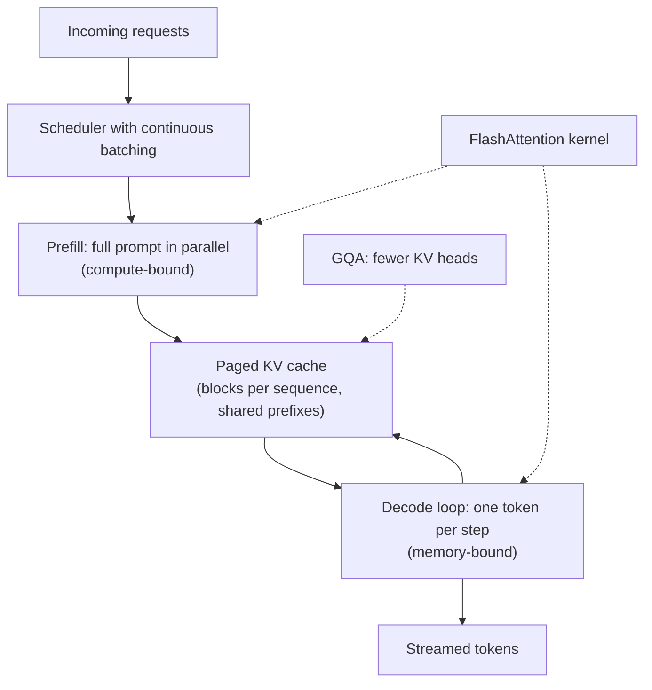
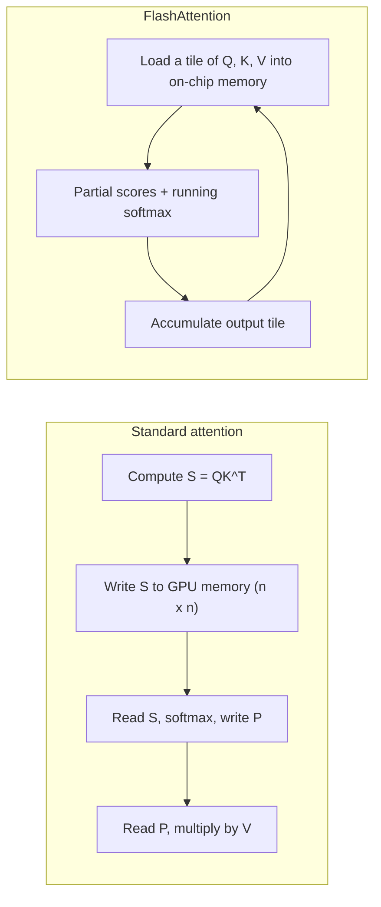
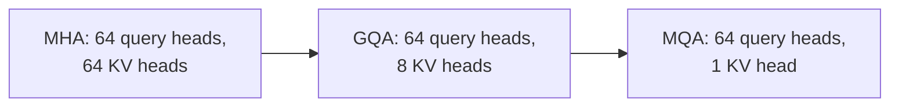

Senior LLM interviews almost always reach the cost of attention: "Why is inference memory-bound?", "How big is the KV cache?", "What does FlashAttention actually change?". This page gives you the numbers and the mechanisms.

## TL;DR

- Attention is **quadratic** in sequence length in compute and, naively, in memory.
- At inference, the **KV cache** stores past keys and values; its size grows linearly with context and batch and often limits throughput.
- **MQA and GQA** share key and value heads to shrink the cache.
- **FlashAttention** computes exact attention without writing the full score matrix to slow GPU memory, which saves memory and time.
- **PagedAttention** (vLLM) manages the KV cache in pages, cutting waste and enabling large batches.
- **Sliding-window and sparse attention** limit which tokens attend to which, trading reach for linear cost.

## The idea in plain English

Imagine each token writes a sticky note (its key and value) the first time it is read, so the model never has to re-read it. That stack of notes is the KV cache. Long conversations and many users at once create mountains of notes, and the GPU spends most of its time fetching them. Efficient attention techniques either write fewer notes (MQA, GQA), fetch them more cleverly (FlashAttention), store them more tidily (PagedAttention), or decide that each token only needs notes from its neighbors (sliding window).

## Core concepts

1. **Compute vs memory bound.** Prefill processes the whole prompt in large matrix multiplications and is mostly compute-bound. Decode produces one token per step, re-reading all weights and the KV cache, so it is mostly memory-bandwidth-bound.

2. **KV cache size.** Per token, the cache stores a key and a value for every layer and every KV head:

   $$
   \text{bytes} = 2 \times L \times H_{kv} \times d_{head} \times \text{seq len} \times \text{batch} \times \text{bytes per value}
   $$

   For a model with 80 layers, 64 heads of size 128 and 16-bit values, that is about 2.6 MB per token with full multi-head attention, or around 10 GB for a single 4,000-token sequence.

3. **Multi-query attention (MQA).** All query heads share one key head and one value head. The cache shrinks by the number of heads, at some quality cost.

4. **Grouped-query attention (GQA).** Query heads are split into groups that each share a key and value head. With 8 KV heads instead of 64, the example above drops from about 2.6 MB to about 0.33 MB per token, with quality close to full attention.

5. **FlashAttention.** Splits Q, K and V into tiles that fit in fast on-chip memory, computes the softmax incrementally (the "online softmax" trick), and never stores the full n-by-n matrix in slow GPU memory. The result is mathematically exact, uses linear memory in sequence length, and runs faster because memory traffic, not arithmetic, was the bottleneck.

6. **PagedAttention.** Stores each sequence's KV cache in fixed-size blocks, like virtual memory pages, instead of one big pre-allocated chunk. This removes fragmentation, allows sharing prefixes between requests, and lets servers fit far more concurrent sequences.

7. **Sliding-window attention.** Each token attends only to the last w tokens. Stacking layers still lets information travel further, because each layer extends the reach by w.

8. **KV cache quantization and eviction.** Storing the cache in 8-bit or lower precision, or dropping less useful entries, trades a little accuracy for memory.

## Architecture

How these pieces combine in a modern serving stack:

1. A scheduler batches requests continuously, adding new ones as others finish.
2. Prefill computes the prompt's keys and values with a FlashAttention kernel.
3. The keys and values go into a paged cache; GQA keeps them small.
4. Each decode step reads the cache, appends one token's entries and emits a token.

## Deep dive

### What FlashAttention avoids

The arithmetic is the same; what disappears is the round trip of an n-by-n matrix through slow memory. That is why it is described as "IO-aware".

### Picking MHA, GQA or MQA

Moving right shrinks the cache and speeds decoding; moving left preserves more quality. GQA is the common compromise.

## Trade-offs

| Technique | Pros | Cons | When to use |
| --- | --- | --- | --- |
| FlashAttention | Exact, faster, linear memory | Needs supported GPUs and kernels | Always, when available |
| GQA | Much smaller KV cache, near-MHA quality | Must be chosen at training time or uptrained | Large models served at long context |
| MQA | Smallest cache, fastest decode | More quality loss | Latency-critical small models |
| PagedAttention | Near-zero cache waste, prefix sharing | Needs a serving engine that supports it | High-throughput serving |
| Sliding window | Linear cost | Limited direct reach | Very long inputs with local structure |
| KV cache quantization | Halves or quarters cache memory | Small accuracy risk | Memory-limited deployments |

## Real-world examples

- FlashAttention and FlashAttention-2 are integrated into major training and inference stacks.
- vLLM introduced PagedAttention and reported large throughput gains over earlier serving systems.
- Llama 2 70B uses grouped-query attention.
- Mistral 7B combines grouped-query attention with sliding-window attention.

## Common pitfalls

- Calling FlashAttention an approximation. It computes exact attention.
- Sizing GPUs by model weights alone and forgetting the KV cache, which can exceed the weights at long context and high batch.
- Assuming long-context models use long context well; retrieval quality in the middle of the prompt often drops.

## How to answer in an interview

1. Split inference into prefill (compute-bound) and decode (memory-bound).
2. Write the KV cache formula and do a quick size estimate.
3. Explain GQA and MQA as cache-shrinking choices.
4. Explain FlashAttention as an IO optimization, exact and tiled.
5. Mention PagedAttention, continuous batching and sliding windows for serving at scale.

**What interviewers listen for:** concrete memory math, the compute vs bandwidth distinction, and knowing which techniques are exact and which trade quality.

**Red flags:** vague "use a bigger GPU" answers, or not knowing what is cached.

## Further reading

- [FlashAttention (Dao et al., 2022)](https://arxiv.org/abs/2205.14135)
- [FlashAttention-2 (Dao, 2023)](https://arxiv.org/abs/2307.08691)
- [Efficient Memory Management for LLM Serving with PagedAttention (Kwon et al., 2023)](https://arxiv.org/abs/2309.06180)
- [GQA (Ainslie et al., 2023)](https://arxiv.org/abs/2305.13245)
- [Mistral 7B (Jiang et al., 2023)](https://arxiv.org/abs/2310.06825)

<InterviewQuestions>
  <InterviewQuestion question="What is the KV cache and why is it needed?" category="Concepts" level="Junior">
    During generation, each new token attends to all previous tokens, which needs their keys and values in every layer. Recomputing them each step would repeat the whole prompt's work for every new token. The KV cache stores them once, so each decode step only computes the newest token's projections. The cost is memory that grows with sequence length, layers, heads and batch size.
  </InterviewQuestion>
  <InterviewQuestion question="Why is LLM decoding memory-bound rather than compute-bound?" category="Scaling" level="Mid">
    Each decode step produces just one token per sequence, so the matrix multiplications are thin while the GPU still has to read all model weights and the whole KV cache from memory. The arithmetic per byte loaded is low, so memory bandwidth limits speed. Batching many sequences raises arithmetic intensity, which is why serving engines batch aggressively.
  </InterviewQuestion>
  <InterviewQuestion question="Estimate the KV cache for a 32-layer model with 32 heads of size 128, 16-bit values, at 8K context." category="Scaling" level="Mid">
    Per token it is 2 for keys and values, times 32 layers, times 32 heads, times 128, times 2 bytes, which is about 524 KB. At 8,192 tokens that is about 4.3 GB per sequence. With grouped-query attention using 8 KV heads it would drop to about 1.1 GB, which is why GQA matters for long contexts and large batches.
  </InterviewQuestion>
  <InterviewQuestion question="What does FlashAttention change, and is it an approximation?" category="Concepts" level="Mid">
    It is exact. FlashAttention reorders the computation so it works on tiles of Q, K and V that fit in fast on-chip memory, keeps running softmax statistics, and accumulates the output without ever writing the full score matrix to slow GPU memory. Fewer memory reads and writes make it faster and reduce memory from quadratic to linear in sequence length.
  </InterviewQuestion>
  <InterviewQuestion question="Compare MHA, MQA and GQA." category="Trade-offs" level="Senior">
    Multi-head attention gives every query head its own key and value head, so it has the best quality and the largest cache. Multi-query attention shares one key and value head across all query heads, shrinking the cache dramatically but losing some quality. Grouped-query attention shares one key and value head per group of query heads, getting most of the memory savings with quality close to multi-head attention, which is why large modern models use it.
  </InterviewQuestion>
  <InterviewQuestion question="How does PagedAttention improve serving throughput?" category="Architecture" level="Senior">
    Without paging, servers reserve a contiguous cache region for each request's maximum length, wasting much of it and fragmenting memory. PagedAttention allocates the cache in small blocks on demand and maps them with a table, so almost no memory is wasted and identical prompt prefixes can share blocks. More sequences fit at once, so batches are larger and throughput rises.
  </InterviewQuestion>
  <InterviewQuestion question="How does sliding-window attention still capture long-range dependencies?" category="Architecture" level="Senior">
    Each layer only attends within a window of w tokens, but stacking layers lets information hop: after k layers, a token can be influenced by tokens up to about k times w positions away. So the direct reach is local but the effective receptive field grows with depth, much like stacked convolutions, at linear cost in sequence length.
  </InterviewQuestion>
</InterviewQuestions>
