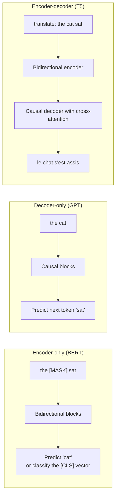
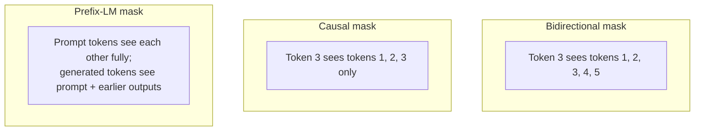

"Would you use BERT or GPT for this?" is one of the most common applied questions. A good answer goes beyond names to attention patterns, training objectives and cost, then maps them to the task.

## TL;DR

- **Encoder-only** (BERT family): bidirectional attention, trained to fill in masked tokens. Best at understanding: classification, tagging, embeddings, re-ranking.
- **Decoder-only** (GPT family): causal attention, trained to predict the next token. Best at open-ended generation, and with scale, almost everything.
- **Encoder-decoder** (T5, BART): bidirectional encoder plus a causal decoder with cross-attention. Natural for input-to-output tasks such as translation and summarization.
- The objective shapes the skill: **masked** objectives learn rich representations; **causal** objectives learn to generate.
- In production, small encoders still win on cost and latency for focused tasks like search ranking and classification.

## The idea in plain English

An **encoder** is a careful reader: it reads the whole page at once, looking both backward and forward, and writes a summary card for every word. A **decoder** is a writer: it can only look at what it has already written and must guess the next word. An **encoder-decoder** is a translator: one person reads the source text fully, then another writes the translation while glancing back at the reader's notes.

## Core concepts

1. **Bidirectional vs causal attention.** Encoders let every token see every other token. Decoders block future tokens with a causal mask so they can generate left to right.

2. **Masked language modeling (MLM).** BERT hides about 15% of tokens and predicts them from both sides. Of the chosen tokens, 80% become a mask token, 10% a random token and 10% stay unchanged, so the model cannot rely on seeing the mask symbol at fine-tuning time.

3. **Next sentence prediction (NSP).** BERT's second objective, predicting whether two sentences are consecutive. RoBERTa later showed removing it and training longer on more data works better.

4. **Causal language modeling.** GPT models predict each next token from all previous ones. Every position is a training example, which makes it very data-efficient for generation.

5. **Span corruption.** T5 replaces random spans with sentinel tokens and trains the decoder to output the missing spans. BART corrupts text in several ways (masking, deletion, shuffling) and trains the decoder to rebuild it.

6. **Text-to-text framing.** T5 casts every task, including classification, as producing a text string, so one model and one loss cover everything.

7. **Embeddings from encoders.** Sentence-embedding models (for example Sentence-BERT) fine-tune encoders so that similar texts get nearby vectors, which powers semantic search and RAG retrieval.

## Architecture

Choosing a family for a task:

1. Is the output a label, a score or a vector? An encoder is usually cheapest and strongest per parameter.
2. Is the output free text conditioned on a clearly separate input? An encoder-decoder is a natural fit, especially at small and medium sizes.
3. Is the task open-ended, conversational or multi-task? A decoder-only LLM, often via prompting or fine-tuning.

## Deep dive

### Attention masks side by side

The prefix-LM pattern, used by some models, sits between the two: it reads the input bidirectionally like an encoder but generates like a decoder, inside a single stack.

### Why decoder-only won the LLM race

- One stack and one objective are simple to scale.
- Next-token prediction turns every token of raw text into training signal.
- With enough scale and instruction tuning, generation subsumes classification ("answer with positive or negative").
- In-context learning emerges naturally from the causal objective.

Encoders did not disappear: they dominate embedding models, re-rankers and high-throughput classifiers where a 100-million-parameter model beats a 70-billion-parameter one on cost by orders of magnitude.

## Trade-offs

| Family | Pros | Cons | When to use |
| --- | --- | --- | --- |
| Encoder-only | Strong representations, fast, cheap, great for embeddings | Cannot generate text naturally | Classification, NER, semantic search, re-ranking |
| Decoder-only | General purpose, in-context learning, scales well | Costly per token, no bidirectional context for the input | Chat, code, agents, general generation |
| Encoder-decoder | Efficient for conditioned generation, input read bidirectionally | Two stacks, less common at very large scale | Translation, summarization, structured text-to-text |

## Real-world examples

- BERT (2018) set new results on GLUE and SQuAD and was widely used in search ranking.
- RoBERTa showed BERT was undertrained: removing NSP and training longer with more data improved results.
- T5 framed all NLP tasks as text-to-text and studied pre-training choices systematically.
- GPT-3 showed that a large decoder-only model can do many tasks from a few examples in the prompt.
- Modern RAG systems commonly pair a small encoder (embeddings and re-ranking) with a large decoder (generation).

## Common pitfalls

- Saying BERT "generates" answers. Extractive QA with BERT predicts start and end positions inside the given text.
- Assuming the biggest decoder is always best. For a fixed label set at high volume, a fine-tuned encoder is often cheaper and as accurate.
- Forgetting that embedding quality depends on training for similarity, not just on using an encoder.

## How to answer in an interview

1. Define the three families by attention pattern.
2. Name each family's pre-training objective.
3. Map tasks to families with a cost argument.
4. Explain why decoder-only dominates general LLMs.
5. Show production sense: encoders for retrieval and ranking, decoders for generation, often in the same system.

**What interviewers listen for:** objectives explained, a task-to-family mapping, and a cost-aware recommendation.

**Red flags:** treating the choice as fashion, or ignoring latency and cost.

## Further reading

- [BERT (Devlin et al., 2018)](https://arxiv.org/abs/1810.04805)
- [RoBERTa (Liu et al., 2019)](https://arxiv.org/abs/1907.11692)
- [Exploring the Limits of Transfer Learning with T5 (Raffel et al., 2019)](https://arxiv.org/abs/1910.10683)
- [BART (Lewis et al., 2019)](https://arxiv.org/abs/1910.13461)
- [Sentence-BERT (Reimers and Gurevych, 2019)](https://arxiv.org/abs/1908.10084)

<InterviewQuestions>
  <InterviewQuestion question="What is masked language modeling, and why does BERT not always replace chosen tokens with the mask token?" category="Concepts" level="Junior">
    Masked language modeling hides some input tokens and trains the model to predict them using context on both sides. BERT selects about 15% of tokens; of those, 80% become the mask token, 10% become random tokens and 10% stay as they are. Because the mask token never appears during fine-tuning, this mix stops the model from relying on it and forces useful representations for every token.
  </InterviewQuestion>
  <InterviewQuestion question="Why can't you simply use BERT for open-ended text generation?" category="Architecture" level="Junior">
    BERT's attention is bidirectional and it was trained to fill in blanks, not to predict the next token from the left. It has no natural left-to-right generation procedure, and outputs would be incoherent if forced. Generation needs a causal objective, which decoder-only and encoder-decoder models have.
  </InterviewQuestion>
  <InterviewQuestion question="When would you choose an encoder-decoder model over a decoder-only model?" category="Trade-offs" level="Mid">
    When the task maps a clearly separate input to an output, such as translation or summarization, and you need a small or medium model. The encoder reads the input bidirectionally once, and the decoder only generates the output, which is efficient. For general-purpose, conversational or very large-scale use, decoder-only models are simpler and benefit more from scaling.
  </InterviewQuestion>
  <InterviewQuestion question="Why did decoder-only architectures become dominant for LLMs?" category="Concepts" level="Mid">
    They use one simple stack and one objective, next-token prediction, that turns every token of raw text into training signal and scales smoothly. At scale they show in-context learning, and with instruction tuning they can frame almost any task as generation. That generality made them the default for foundation models.
  </InterviewQuestion>
  <InterviewQuestion question="Design a semantic search system. Which model families would you use where?" category="Architecture" level="Senior">
    I would embed documents and queries with an encoder trained for similarity, store the vectors in an approximate nearest-neighbor index, and retrieve a candidate set fast. A cross-encoder, also an encoder, would re-rank the top candidates by reading query and document together. If the product needs a written answer, a decoder LLM would generate it from the top passages. Encoders handle the high-volume steps cheaply; the decoder is used only where generation is needed.
  </InterviewQuestion>
  <InterviewQuestion question="What did RoBERTa change compared with BERT, and what does that teach about pre-training?" category="Concepts" level="Senior">
    RoBERTa removed next sentence prediction, trained longer with larger batches on much more data, and used dynamic masking that changes masked positions every epoch. These changes alone gave large gains, showing BERT was undertrained. The lesson is that data, training time and objective details often matter as much as architecture changes.
  </InterviewQuestion>
</InterviewQuestions>
