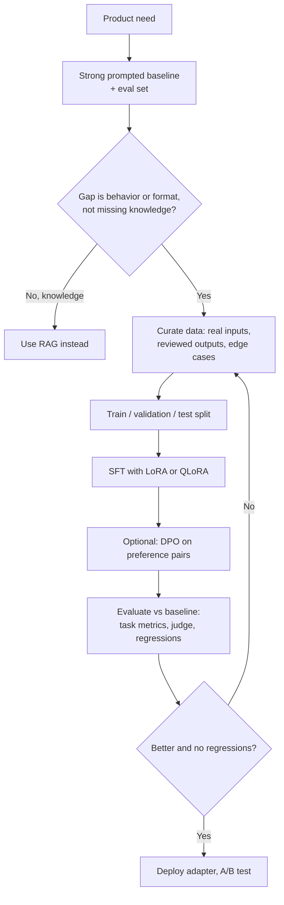
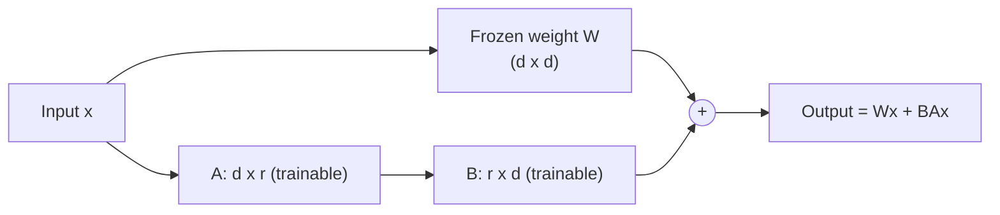

"Should we fine-tune?" is one of the most common LLM product questions. A strong answer starts with when not to, then explains the methods, the data you need, and how you would prove the fine-tuned model is better.

## TL;DR

- Fine-tuning changes **behavior** (format, tone, task skill, domain style) far better than it adds **facts**; use RAG for knowledge.
- **Supervised fine-tuning (SFT)** trains on input-output examples; **preference tuning** (RLHF, DPO) trains on which output is better.
- **LoRA** and **QLoRA** train small adapter weights instead of the whole model, making fine-tuning cheap.
- **Data quality** beats quantity: a few thousand clean, diverse, representative examples often outperform large noisy sets.
- Always compare against a **strong prompted baseline** and check for **regressions** in general ability.

## The idea in plain English

A pre-trained model is a well-read graduate. Prompting is giving them instructions for each task. Fine-tuning is sending them on a short training course so they handle a type of work your way without long instructions every time. The course will not teach them your company's latest price list reliably; for that, you hand them the current document (RAG).

## Core concepts

1. **When to fine-tune.** Consistent output format or style, a narrow task done at high volume where a smaller tuned model can replace a large prompted one, domain-specific reasoning patterns, or prompts so long they hurt cost and latency.

2. **When not to.** Fast-changing knowledge, a need for citations, little or poor data, or when prompting plus retrieval already meets the bar.

3. **Supervised fine-tuning.** Train on pairs of prompt and ideal response with the standard next-token loss, usually computing loss only on the response tokens. Match the chat template the model will use at inference.

4. **Full fine-tuning.** Updates all weights; best quality ceiling but needs a lot of memory (weights, gradients and optimizer states) and risks forgetting general skills.

5. **LoRA.** Freezes the base model and learns two small low-rank matrices per adapted layer whose product is added to the frozen weights. Only a tiny fraction of parameters train, adapters are megabytes in size, and many adapters can share one base model at serving time.

6. **QLoRA.** Keeps the frozen base model quantized to 4 bits while training LoRA adapters, so very large models can be fine-tuned on a single GPU.

7. **Preference tuning.** RLHF trains a reward model on human comparisons and optimizes the policy with reinforcement learning under a KL penalty. DPO optimizes directly on preference pairs without a reward model or RL loop, which is simpler and more stable.

8. **Distillation as fine-tuning.** Generate high-quality outputs with a large model, review them, and fine-tune a small model on them to cut cost for a specific task.

9. **Evaluation.** A held-out test set from real traffic, task metrics, LLM-as-judge or human rubrics, and general-capability checks to catch forgetting.

## Architecture

The workflow:

1. Build an evaluation set and a strong prompted baseline first.
2. Confirm the gap is about behavior, not knowledge.
3. Collect and clean training data that matches production inputs.
4. Fine-tune with LoRA or QLoRA, tracking validation loss and task metrics.
5. Optionally add preference tuning.
6. Compare against the baseline and check general ability, then A/B test.

## Deep dive

### How LoRA works

With rank r much smaller than d, A and B together have far fewer parameters than W. B starts at zero so training begins exactly at the base model. After training, BA can be merged into W for zero extra latency, or kept separate to swap adapters per customer or task.

### Data checklist

- Inputs that look like real production traffic, including messy and edge cases.
- Outputs reviewed for correctness and in the exact target format.
- Diversity across intents; deduplicate near-identical examples.
- A test set never used for tuning, ideally from a later time period.

## Trade-offs

| Approach | Pros | Cons | When to use |
| --- | --- | --- | --- |
| Prompting | No training, fast iteration | Long prompts, less consistent | Default starting point |
| RAG | Fresh knowledge, citations | Retrieval engineering | Knowledge-heavy tasks |
| LoRA / QLoRA SFT | Cheap, small adapters, good quality | Some ceiling vs full tuning | Most fine-tuning needs |
| Full fine-tuning | Highest ceiling | Expensive, forgetting risk | Large data, big shifts in behavior |
| DPO | Aligns to preferences simply | Needs preference pairs | Tone, helpfulness, safety style |
| RLHF | Flexible, reusable reward model | Complex, unstable | Large-scale alignment programs |

## Real-world examples

- InstructGPT showed a 1.3-billion-parameter model tuned with SFT and RLHF was preferred by people over the much larger GPT-3 base model.
- LoRA showed adapter-based tuning can match full fine-tuning on many tasks with far fewer trainable parameters.
- QLoRA fine-tuned a 65-billion-parameter model on a single 48 GB GPU.
- Many hosted LLM providers offer fine-tuning APIs, and open-source tools make LoRA training routine.

## Common pitfalls

- Fine-tuning to add facts, then being surprised by confident wrong answers.
- No baseline, so the gain is unknown.
- Training data that does not match production inputs.
- Wrong or inconsistent chat template between training and serving.
- Overfitting with too many epochs on small data.
- Ignoring regressions on general ability and safety.

## How to answer in an interview

1. Ask what problem fine-tuning would solve, and propose prompting and RAG first.
2. If fine-tuning fits, describe data collection and quality control.
3. Pick a method (LoRA or QLoRA SFT, optionally DPO) and justify it.
4. Explain evaluation against the baseline and regression checks.
5. Cover serving (adapters, merging) and monitoring.

**What interviewers listen for:** knowing fine-tuning is for behavior, a data-first plan, and rigorous comparison.

**Red flags:** "fine-tune on our documents so it knows them", or no evaluation plan.

## Further reading

- [LoRA: Low-Rank Adaptation of Large Language Models (Hu et al., 2021)](https://arxiv.org/abs/2106.09685)
- [QLoRA: Efficient Finetuning of Quantized LLMs (Dettmers et al., 2023)](https://arxiv.org/abs/2305.14314)
- [Direct Preference Optimization (Rafailov et al., 2023)](https://arxiv.org/abs/2305.18290)
- [Training Language Models to Follow Instructions, InstructGPT (Ouyang et al., 2022)](https://arxiv.org/abs/2203.02155)

<InterviewQuestions>
  <InterviewQuestion question="When should you fine-tune instead of prompting or using RAG?" category="Trade-offs" level="Junior">
    Fine-tune when you need consistent behavior, format or style that prompting cannot achieve reliably, when a smaller tuned model can replace an expensive large one for a high-volume task, or when prompts have become very long. Use RAG for knowledge, especially changing or private information, and start with prompting because it is cheapest to try.
  </InterviewQuestion>
  <InterviewQuestion question="How does LoRA reduce the cost of fine-tuning?" category="Concepts" level="Mid">
    It freezes the original weights and learns a low-rank update made of two small matrices for selected layers, so only a tiny fraction of parameters need gradients and optimizer states. Memory and compute drop sharply, checkpoints are small, and the update can be merged into the base weights for serving or swapped per task.
  </InterviewQuestion>
  <InterviewQuestion question="What does QLoRA add?" category="Concepts" level="Mid">
    QLoRA stores the frozen base model in 4-bit precision, using a NormalFloat 4-bit format and double quantization, while training LoRA adapters in higher precision, plus paged optimizers to handle memory spikes. This allows fine-tuning very large models on a single GPU with quality close to 16-bit LoRA.
  </InterviewQuestion>
  <InterviewQuestion question="Compare RLHF and DPO." category="Trade-offs" level="Senior">
    RLHF trains a reward model on preference comparisons and then optimizes the LLM against it with reinforcement learning such as PPO, with a KL penalty to stay close to the reference model. DPO derives a direct loss on preference pairs that targets the same objective without a reward model or RL loop. DPO is simpler and more stable; RLHF is more flexible, for example for online data collection.
  </InterviewQuestion>
  <InterviewQuestion question="How much data do you need to fine-tune an LLM?" category="Data" level="Mid">
    It depends on the task, but for adapting format or a narrow skill, a few hundred to a few thousand high-quality, diverse examples often suffice with LoRA. Quality and coverage of real input variety matter more than volume. Start small, measure on a held-out set, and add data targeted at the failure cases.
  </InterviewQuestion>
  <InterviewQuestion question="How do you evaluate a fine-tuned model?" category="Evaluation" level="Mid">
    Compare it with the prompted base model on a held-out test set drawn from real traffic, using task metrics, rubric-based LLM judges calibrated to humans, and human review. Also run general-capability and safety checks to detect forgetting, measure latency and cost, and confirm with an online A/B test before full rollout.
  </InterviewQuestion>
  <InterviewQuestion question="Your fine-tuned model performs worse than the base model on some tasks. What happened?" category="Failure modes" level="Senior">
    Likely catastrophic forgetting from narrow training data, too many epochs or too high a learning rate, or a mismatch in chat template or system prompt between training and evaluation. Fixes include mixing in general instruction data, lowering the learning rate and epochs, using LoRA with a lower rank, and verifying the prompt format end to end.
  </InterviewQuestion>
</InterviewQuestions>
