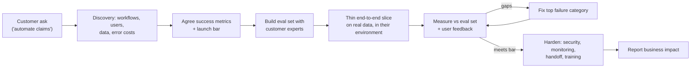
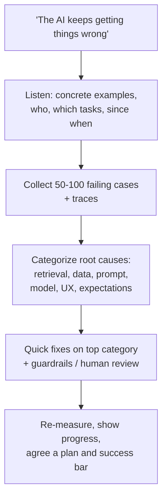

Labs and AI companies hire forward-deployed engineers (FDEs) and applied AI engineers to make AI work inside customers' businesses. Their interviews are scenario-heavy: "A customer says the AI keeps getting things wrong. What do you do in the next 48 hours?" Strong answers combine engineering depth with structured problem decomposition and calm customer handling.

## TL;DR

- Start from the **business outcome**, not the model: what decision or workflow changes, and how will value be measured?
- **Decompose** vague asks into concrete workflows, data sources, users and failure costs.
- Ship a **thin end-to-end slice** fast, with an **evaluation set built with the customer** from their real cases.
- Choose the **simplest architecture** (prompting, RAG, workflow, then agents or fine-tuning) that meets the bar.
- Plan for **security, data residency and permissions** from day one; they kill more pilots than model quality.
- Make systems **model-portable**: evaluations, prompts and tools that survive model upgrades and deprecations.
- When things go wrong, **diagnose with data**, communicate clearly and fix the highest-impact failure first.

## The idea in plain English

A forward-deployed engineer is part consultant, part builder. A customer arrives with "use AI to automate claims" or "the chatbot is bad". The job is to find out what success really means, look at their actual data and workflows, build something small that works on their real cases, prove it with numbers they trust, and then make it robust enough to run without you.

## Core concepts

1. **Problem decomposition.** Break the ask into users, workflows, decisions, inputs, outputs, volumes and the cost of each kind of error. Find where AI adds value and where rules or existing systems suffice.

2. **Success metrics.** Agree on measurable outcomes (handling time, accuracy on key fields, deflection rate, revenue, risk reduction) and on the quality bar for launch, before building.

3. **Customer-built evaluation.** Collect real examples with the customer's experts, including hard and edge cases, and use them as the acceptance test. This turns opinions ("it feels wrong") into numbers.

4. **Thin vertical slice.** Build the smallest version that runs end to end on real data in the real environment, then iterate. Demos on clean sample data mislead everyone.

5. **Architecture choice.** Prompting for simple tasks, RAG for knowledge, deterministic workflows for known processes, agents only where steps vary, fine-tuning for scale or style once data exists.

6. **Enterprise constraints.** Identity and permissions, data residency (on-premise or in the customer's cloud), compliance, audit, integration with existing systems, and change management for the people affected.

7. **Model portability.** Keep prompts, tools and evaluations independent of one model so you can swap models when quality, cost or deprecation demands it, and verify with the same evaluation suite.

8. **Rescue playbook.** When a deployment struggles: collect failing examples, categorize root causes (data, retrieval, prompts, model, UX, expectations), fix the biggest category, show measured improvement and reset expectations honestly.

## Architecture

How an engagement typically runs:

1. Discovery workshops and shadowing to understand the real workflow and data.
2. A written scope with success metrics and a launch bar the customer signs off on.
3. An evaluation set built from real cases with their experts.
4. A thin slice running in their environment within days or weeks.
5. Iteration driven by measured failures.
6. Hardening, documentation, training and handoff, then impact reporting.

## Deep dive

### Rescuing a struggling pilot: the first 48 hours

The key moves are taking the complaint seriously, replacing anecdotes with a categorized failure set, fixing the largest category first, and resetting the success criteria together.

### Swapping a deprecated model safely

What must already exist: a versioned evaluation suite from real usage, prompts and tools that are not tied to one provider's quirks, traces of production traffic, and a canary rollout path. The swap then becomes: run the suite on candidate models, adapt prompts where behavior differs, compare cost and latency, shadow or canary the new model, monitor, and switch over before the deadline.

## Trade-offs

| Decision | Option A | Option B | Guidance |
| --- | --- | --- | --- |
| Custom build vs product configuration | Fits the customer exactly | Maintainable, scalable | Configure the product first; custom only where value is unique |
| Fine-tune vs RAG for customer knowledge | Customer feels ownership | Fresh, citable, cheaper to maintain | Show evaluation results for both before deciding |
| Hosted API vs on-premise | Best models, less ops | Data control, compliance | Driven by the customer's security and residency rules |
| Full automation vs human-in-the-loop | Bigger savings | Lower risk, faster trust | Start assisted, automate proven cases |
| Speed vs completeness in pilots | Fast feedback | Fewer surprises later | Thin slice early, harden before scale |

## Real-world examples

- Palantir popularized the forward-deployed engineer role, embedding engineers with customers to build on their data.
- Frontier AI labs and AI startups now hire forward-deployed and applied AI engineers to deliver enterprise deployments of their models and agents.
- Common FDE interview formats include decomposition case studies, timed build sessions with AI tools, and customer escalation role-plays.

## Common pitfalls

- Building what was asked instead of what is needed.
- Demoing on clean sample data and failing on real data.
- No agreed success metric, so the pilot ends in opinions.
- Ignoring security review until the end.
- Tying everything to one model, then scrambling when it changes.
- Overpromising to win the deal.

## How to answer in an interview

1. Clarify the business goal, users, constraints and what success means.
2. Decompose the problem and pick the simplest architecture that could work.
3. Describe a thin slice and an evaluation set built with the customer.
4. Address enterprise constraints: security, permissions, integration, people.
5. Explain how you measure, iterate, communicate and hand off, with a timeline.

**What interviewers listen for:** structured decomposition, pragmatism, evaluation discipline and customer empathy.

**Red flags:** jumping straight to fine-tuning or agents, or ignoring how the customer will judge success.

## Further reading

- [Building effective agents (Anthropic)](https://www.anthropic.com/research/building-effective-agents)
- [Agentic AI Evaluation (this site)](/ai-system-design/genai-system-design/agentic-ai-evaluation)
- [Case Study: Enterprise AI Assistant (this site)](/ai-system-design/genai-system-design/conversational-assistant-design)
- [LLMOps and Observability (this site)](/ai-system-design/genai-system-design/llmops-observability)

<InterviewQuestions>
  <InterviewQuestion question="What does a forward-deployed AI engineer do?" category="Concepts" level="Junior">
    They work directly with customers to turn business problems into working AI systems: understanding workflows and data, scoping, building and integrating solutions in the customer's environment, proving value with measured results, and feeding product gaps back to their own company.
  </InterviewQuestion>
  <InterviewQuestion question="How do you scope a vague request like 'use AI to automate our claims'?" category="Architecture" level="Mid">
    Break it down: which claim types, which steps (intake, extraction, validation, decision, communication), who does them today, volumes, data sources, and the cost of each kind of error. Pick the steps where AI clearly helps and errors are tolerable or reviewable, define metrics, and build a thin slice on real claims with a human in the loop.
  </InterviewQuestion>
  <InterviewQuestion question="Why build the evaluation set with the customer?" category="Evaluation" level="Mid">
    The customer's experts know what correct looks like and which cases matter, and an evaluation they helped build is one they trust. It turns subjective complaints into measurable failures, guides what to fix, and becomes the agreed acceptance test for launch and for future model changes.
  </InterviewQuestion>
  <InterviewQuestion question="A customer wants to fine-tune because 'we want our own model', but RAG would work. What do you do?" category="Trade-offs" level="Senior">
    Understand the real motivation, such as control, privacy, cost or differentiation, and address it directly. Then run both options on their evaluation set and show results, cost, latency and maintenance effort. Often RAG wins on knowledge tasks, with fine-tuning added later for style or cost, and the customer can still own the deployment, data and evaluation.
  </InterviewQuestion>
  <InterviewQuestion question="What must be in place before a model deprecation forces a swap?" category="Architecture" level="Senior">
    A versioned evaluation suite from real usage, production traces, prompts and tools abstracted from one provider, configuration-based model selection, and a canary or shadow rollout path with monitoring. With these, a swap is a measured engineering task; without them, it is a risky scramble.
  </InterviewQuestion>
  <InterviewQuestion question="How do you handle an executive who wants to cancel a pilot because 'the AI keeps getting things wrong'?" category="Failure modes" level="Senior">
    Acknowledge the concern and ask for concrete examples, then collect and categorize failures within a day or two. Fix the largest failure category quickly, add safeguards such as human review where risk is high, and come back with measured progress, a clear plan and agreed success criteria, being honest about what AI can and cannot do for their case.
  </InterviewQuestion>
</InterviewQuestions>
