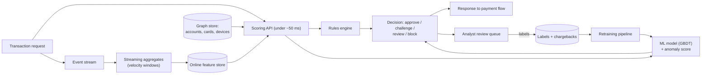
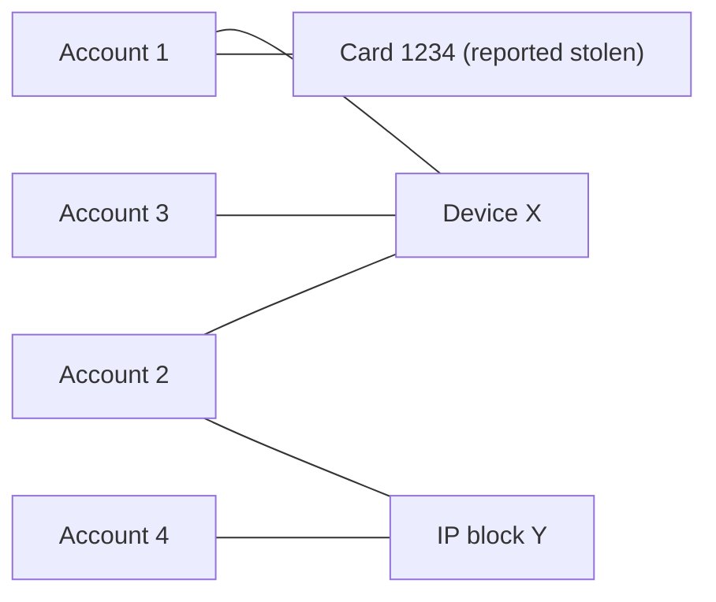

Fraud detection is a favorite ML system design question because it combines real-time constraints, extreme imbalance, delayed and noisy labels, and an adversary who adapts. Good answers balance catching fraud against blocking good customers.

## TL;DR

- Score each transaction in **real time** (tens of milliseconds) with **rules + ML**, and act: approve, challenge (for example extra verification), review or block.
- Features: **transaction attributes**, **velocity aggregates**, **deviation from the user's normal behavior**, **device and network signals**, and **graph links** between accounts, cards and devices.
- Fraud is **rare** (often well under 1%), so use **PR-AUC, recall at a fixed false-positive rate, and expected cost**, not accuracy.
- Labels arrive **late** (chargebacks can take weeks) and are **biased by past decisions**.
- Fraudsters **adapt**, so monitor drift, retrain often and keep **analyst feedback** in the loop.

## The idea in plain English

Picture a bank's security desk. Every card swipe passes the desk. Simple rules catch obvious cases ("card used in two countries within ten minutes"). A trained model weighs many subtle signals for the rest. Suspicious cases get a second check, like a text message to the cardholder, or go to an investigator. Investigators' findings teach the system, and since criminals change tactics, the desk keeps learning.

## Core concepts

1. **Decisioning.** Scores map to actions with thresholds tuned to business costs: friction for good users vs losses from fraud.

2. **Rules engine.** Fast, explainable rules for known patterns, regulatory requirements and emergency blocks; complements ML.

3. **Real-time features.** Counts and sums over sliding windows (transactions per card in the last hour, distinct merchants today), computed by a streaming system and served from a low-latency store.

4. **Behavioral baselines.** How unusual this transaction is for this user: amount vs typical, new device, new country, time of day.

5. **Graph features.** Shared devices, IPs, addresses or cards connect accounts; fraud rings show up as dense clusters. Graph features or graph neural networks capture this.

6. **Models.** Gradient-boosted trees are a strong default for tabular fraud features; anomaly detection (such as isolation forests or autoencoders) helps with new patterns lacking labels.

7. **Imbalance handling.** Class weights, careful sampling, threshold tuning and metrics focused on the rare class.

8. **Label delay and bias.** Confirmed fraud may arrive weeks later via chargebacks; blocked transactions never get a true label. Use maturity windows, and keep a small randomized or reviewed sample to reduce selection bias.

9. **Adversarial drift.** Fraudsters probe and adapt; distributions shift quickly. Frequent retraining, drift monitoring and rule hot-fixes are required.

## Architecture

Scoring one transaction:

1. The payment flow calls the scoring API with the transaction.
2. The API fetches real-time aggregates, the user's profile features and graph signals.
3. Rules and the model score in parallel.
4. A decision policy maps scores to approve, challenge, review or block.
5. Reviewed cases and chargebacks become labels for retraining.

## Deep dive

### Fraud rings in a graph

Accounts sharing a device or IP with a known fraudulent card inherit risk, even if each account alone looks normal.

### Choosing the threshold

Plot the cost curve: for each threshold, expected fraud losses missed plus the cost of false declines and manual reviews (including lost customers). Pick the minimum, subject to review team capacity and customer friction limits, and revisit it as fraud rates change.

## Trade-offs

| Decision | Option A | Option B | Guidance |
| --- | --- | --- | --- |
| Rules vs ML | Explainable, instant to change | Catches subtle patterns | Both: rules for known and urgent, ML for scale |
| Block vs challenge | Stops fraud | Less friction for good users | Challenge in the gray zone |
| Supervised vs anomaly detection | Accurate on known fraud | Finds new patterns | Combine; anomalies feed review |
| Retrain often vs stable model | Tracks adversaries | Easier validation | Frequent retraining with automated checks |
| Graph features | Catch rings | Infrastructure cost | Worth it for account and payment fraud |

## Real-world examples

- Payment processors and banks commonly combine rule engines with machine learning scores and manual review queues.
- Gradient-boosted trees such as XGBoost are a common choice for fraud scoring on tabular features.
- Isolation forest is a widely used anomaly detection method for finding unusual transactions without labels.
- Graph analysis is used to uncover fraud rings that share devices, identities or payment instruments.

## Common pitfalls

- Using accuracy as the metric.
- Training on labels that only exist for transactions you previously allowed, ignoring selection bias.
- Features computed differently in training (batch) and serving (streaming).
- Evaluating with random splits instead of time-based splits.
- No fast path for analysts to add rules during an attack.

## How to answer in an interview

1. Clarify the fraud type, volume, latency budget and the costs of each error.
2. Draw the real-time scoring architecture with rules, model and decision policy.
3. Detail features: velocity, behavioral, device, graph.
4. Handle imbalance, delayed labels and selection bias.
5. Cover monitoring, retraining, analyst feedback and threshold tuning.

**What interviewers listen for:** real-time feature engineering, cost-based thresholds and awareness of adversarial drift.

**Red flags:** batch-only designs or accuracy-based evaluation.

## Further reading

- [XGBoost: A Scalable Tree Boosting System (Chen and Guestrin, 2016)](https://arxiv.org/abs/1603.02754)
- [Isolation Forest (Liu et al., 2008)](https://doi.org/10.1109/ICDM.2008.17)
- [SMOTE: Synthetic Minority Over-sampling Technique (Chawla et al., 2002)](https://arxiv.org/abs/1106.1813)
- [Feature Engineering & Data Prep interview questions (this site)](/interviews/data-science/feature-engineering)

<InterviewQuestions>
  <InterviewQuestion question="Why is fraud detection hard from an ML perspective?" category="Concepts" level="Junior">
    Fraud is rare, so data is highly imbalanced; labels arrive late and only for some transactions; decisions must happen in milliseconds; and fraudsters actively change behavior to evade detection. The costs of mistakes are also asymmetric: missed fraud loses money, false declines lose customers.
  </InterviewQuestion>
  <InterviewQuestion question="Which features would you build for card fraud?" category="Architecture" level="Mid">
    Transaction amount, merchant and category, channel and location; velocity features such as counts and sums per card, device and merchant over minutes to days; deviations from the cardholder's normal amount, location and time; device, IP and account-age signals; and graph features linking cards, devices and accounts to known fraud.
  </InterviewQuestion>
  <InterviewQuestion question="How do you choose a decision threshold?" category="Trade-offs" level="Mid">
    Estimate the cost of missed fraud and the cost of false declines and reviews, then choose the threshold that minimizes expected total cost, subject to constraints such as review capacity and acceptable customer friction. Use multiple thresholds for approve, challenge, review and block, and retune as fraud rates change.
  </InterviewQuestion>
  <InterviewQuestion question="How do delayed labels affect training and evaluation?" category="Failure modes" level="Senior">
    Recent transactions look legitimate until chargebacks arrive weeks later, so training on them mislabels fraud and evaluation on recent periods overstates precision. Use a label maturity window, train on matured data, track metrics by cohort age, and use faster proxies such as analyst decisions where available.
  </InterviewQuestion>
  <InterviewQuestion question="What is selection bias in fraud labels and how do you reduce it?" category="Failure modes" level="Senior">
    Transactions the current system blocked never get a true outcome, so the model only learns from what was allowed, reinforcing past decisions. Reduce it by sending a small random sample of would-be blocks to review or challenge instead, and by labeling reviewed cases, so training data includes the high-risk region.
  </InterviewQuestion>
  <InterviewQuestion question="How do you keep the system effective as fraudsters adapt?" category="Architecture" level="Mid">
    Monitor score distributions, feature drift, fraud rates and analyst feedback; retrain frequently on recent matured data; use anomaly detection to surface new patterns; and give analysts tools to deploy rules quickly during attacks. Evaluate with time-based splits that mimic the future.
  </InterviewQuestion>
</InterviewQuestions>
