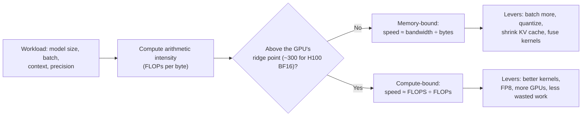
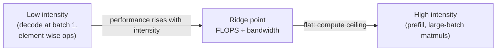

Inference and performance interviews (NVIDIA, Together AI, Groq, and most frontier labs) expect you to do quick hardware math: will this model fit, how many tokens per second can one GPU produce, and why does batching help? This page gives you the mental model and the numbers.

## TL;DR

- Every kernel is limited by either **compute** (FLOPs per second) or **memory bandwidth** (bytes per second). The **roofline model** tells you which.
- **Arithmetic intensity** = FLOPs per byte moved. Below the GPU's ridge point you are bandwidth-bound; above it, compute-bound.
- LLM **decode at small batch is bandwidth-bound**: each token re-reads all weights. **Batching** raises intensity because one weight read serves many sequences.
- **Prefill is compute-bound**: many tokens share each weight read.
- **Quantization** cuts bytes per parameter, so it speeds up bandwidth-bound decode almost proportionally.
- **Kernel fusion**, **FlashAttention** and **CUDA graphs** remove wasted memory traffic and launch overhead.
- Multi-GPU serving trades memory capacity for **communication**, so interconnect bandwidth (NVLink vs network) shapes the parallelism plan.

## The idea in plain English

A GPU is a kitchen with a huge number of fast cooks (compute) and a narrow pantry door (memory bandwidth). If each dish needs lots of ingredients but little cooking, the cooks wait at the door: you are memory-bound. Generating one token for one user is like cooking a single dish that requires carrying the entire pantry (all model weights) through the door. Batching means cooking for many guests from the same trip to the pantry.

## Core concepts

1. **Peak compute and bandwidth.** An H100 SXM offers roughly 990 TFLOPS of dense BF16 compute and about 3.35 TB/s of HBM bandwidth, with 80 GB of memory. Their ratio, about 300 FLOPs per byte, is the **ridge point**.

2. **Arithmetic intensity.** For a matrix multiply of an (m×k) by (k×n) matrix: FLOPs ≈ 2mkn, bytes ≈ the size of the inputs and outputs. Large square matmuls have high intensity; matrix-vector products have about 1 FLOP per byte at 16-bit precision.

3. **Decode intensity.** At batch size B, each weight read does about 2B FLOPs, so intensity is roughly B FLOPs per byte at 16-bit. Until B approaches the ridge point, decode is bandwidth-bound and tokens per second per sequence are capped by bandwidth ÷ model bytes.

4. **The batch-1 speed limit.** Single-stream tokens/sec ≈ memory bandwidth ÷ bytes of weights read per token. A 70B model in 16-bit weighs 140 GB, so on two H100s with tensor parallelism (about 6.7 TB/s combined) the ceiling is roughly 48 tokens/sec. In 8-bit on one H100 (70 GB) it is also about 48 tokens/sec, before overheads.

5. **KV cache traffic.** Decode also reads the KV cache, which grows with context and batch. At long contexts this can rival the weight reads, which is why GQA, MLA and cache quantization matter for speed, not just memory.

6. **Kernel fusion.** Combining several element-wise operations (bias, activation, normalization, residual add) into one kernel avoids writing and re-reading intermediates. FlashAttention is fusion applied to attention.

7. **Launch overhead and CUDA graphs.** At small batch, thousands of tiny kernel launches per token waste time; CUDA graphs record the sequence once and replay it with minimal CPU overhead.

8. **Number formats.** BF16 is the training default. FP8 halves bytes with small quality loss on modern GPUs. INT8 and INT4 weight-only quantization (GPTQ, AWQ) target decode speed and memory. FP4 formats on newer hardware push further. Lower bits lose accuracy on outlier values, so scaling granularity (per-channel, per-group) matters.

9. **Communication.** Tensor parallelism needs an all-reduce after every layer, so it lives inside an NVLink-connected node (hundreds of GB/s per GPU). Pipeline parallelism sends activations between stages and tolerates slower links. Expert parallelism needs all-to-all exchanges for MoE models.

## Architecture

How to reason about any serving question:

1. Size the memory: weights + KV cache + activations + framework overhead.
2. Compute arithmetic intensity for the dominant operations at the planned batch.
3. Place it on the roofline to see the bottleneck.
4. Estimate throughput from the binding limit.
5. Pick levers that attack that limit, then measure.

## Deep dive

### The roofline

Below the ridge, performance grows linearly with intensity (memory roof). Above it, performance is flat at peak compute (compute roof). Real kernels sit below both lines; the gap is inefficiency to hunt down.

### Worked example: will a 70B model fit on one 80 GB GPU?

- **16-bit weights:** 140 GB. Does not fit; needs at least two GPUs.
- **8-bit weights:** about 70 GB, leaving roughly 10 GB for KV cache and runtime. Fits, but only short contexts or small batches.
- **4-bit weights:** about 35–40 GB, leaving room for a meaningful KV cache.
- **KV cache for a Llama-style 70B with GQA** (80 layers, 8 KV heads of size 128, 16-bit): about 0.33 MB per token, so 32K tokens of total context across all sequences is about 10 GB.
- **Single-stream speed at 8-bit:** about 3.35 TB/s ÷ 70 GB ≈ 48 tokens/sec as an upper bound; real numbers are lower after cache reads and overheads.

## Trade-offs

| Lever | What it improves | Cost | When to use |
| --- | --- | --- | --- |
| Larger batches | Throughput, cost per token | Per-request latency, KV memory | Shared serving with latency headroom |
| Weight quantization (INT8/INT4) | Decode speed, memory | Some accuracy loss | Bandwidth-bound decode |
| FP8 compute | Prefill and training speed | Needs supporting hardware and calibration | Modern GPUs, compute-bound work |
| Kernel fusion / FlashAttention | Memory traffic, speed | Engineering or library support | Always where available |
| CUDA graphs | CPU launch overhead | Static shapes, capture complexity | Small-batch decode |
| More GPUs (TP) | Memory capacity, latency | Communication, cost | Models too large for one GPU |
| Speculative decoding | Latency at low batch | Extra draft compute | Latency-sensitive, low-batch traffic |

## Real-world examples

- FlashAttention showed that IO-aware tiling, not fewer FLOPs, makes attention faster.
- vLLM's PagedAttention and continuous batching raised serving throughput by keeping GPUs full.
- GPTQ and AWQ made 4-bit weight-only inference practical for LLMs.
- Groq's LPU keeps weights in on-chip SRAM rather than HBM, which changes the decode roofline: bandwidth per chip is far higher, but capacity is tiny, so models are spread across many chips.

## Common pitfalls

- Quoting FLOPs to estimate decode speed; decode is usually bandwidth-bound.
- Forgetting the KV cache in memory and bandwidth estimates.
- Assuming 4-bit means a 4x speedup everywhere; compute-bound prefill gains much less.
- Ignoring interconnect: tensor parallelism across slow network links destroys latency.
- Benchmarking with unrealistic prompt and output lengths or batch sizes.

## How to answer in an interview

1. State the bottleneck model: roofline, intensity, ridge point.
2. Do the memory math: weights, KV cache, overhead.
3. Do the speed math: bandwidth ÷ bytes for decode, FLOPs ÷ peak for prefill.
4. Pick levers that target the binding constraint, with their costs.
5. Say how you would verify: profilers (Nsight), measured tokens/sec, latency percentiles.

**What interviewers listen for:** quick, correct arithmetic and knowing which resource is binding.

**Red flags:** "use a bigger GPU" without numbers, or confusing training and inference bottlenecks.

## Further reading

- [Roofline: An Insightful Visual Performance Model (Williams et al., 2009)](https://doi.org/10.1145/1498765.1498785)
- [FlashAttention (Dao et al., 2022)](https://arxiv.org/abs/2205.14135)
- [GPTQ (Frantar et al., 2022)](https://arxiv.org/abs/2210.17323)
- [AWQ (Lin et al., 2023)](https://arxiv.org/abs/2306.00978)
- [Efficient Memory Management for LLM Serving with PagedAttention (Kwon et al., 2023)](https://arxiv.org/abs/2309.06180)

<InterviewQuestions>
  <InterviewQuestion question="What is the roofline model?" category="Concepts" level="Junior">
    It plots achievable performance against arithmetic intensity, the FLOPs done per byte moved from memory. Below the ridge point, performance is capped by memory bandwidth and rises with intensity; above it, performance is capped by peak compute. It tells you whether to optimize memory traffic or computation.
  </InterviewQuestion>
  <InterviewQuestion question="Why is LLM decoding at batch size 1 memory-bound?" category="Concepts" level="Mid">
    Generating one token multiplies each weight matrix by a single vector, about 2 FLOPs per parameter, while reading each 2-byte parameter from memory. That is roughly 1 FLOP per byte, far below the ~300 FLOPs per byte an H100 needs to be compute-bound, so the GPU spends most of its time waiting on memory.
  </InterviewQuestion>
  <InterviewQuestion question="Why does batching increase throughput so much for decoding?" category="Concepts" level="Mid">
    One read of the weights can be reused for every sequence in the batch, so FLOPs per byte rise roughly in proportion to batch size. Until the batch is large enough to reach the compute roof, adding sequences costs almost no extra time per step, so total tokens per second grows nearly linearly. KV cache memory is what eventually limits batch size.
  </InterviewQuestion>
  <InterviewQuestion question="Estimate single-stream tokens per second for a 70B model in 8-bit on one H100." category="Scaling" level="Senior">
    The weights are about 70 GB and must be read once per token, and HBM bandwidth is about 3.35 TB/s, so the upper bound is roughly 3.35e12 ÷ 70e9 ≈ 48 tokens per second. Reading the KV cache, kernel inefficiency and other overheads lower it in practice, often to 60–80% of the bound.
  </InterviewQuestion>
  <InterviewQuestion question="What is kernel fusion and why does it help?" category="Concepts" level="Mid">
    It combines several operations, such as a matmul's bias, an activation and a residual add, into one GPU kernel so intermediate results stay in registers or on-chip memory instead of being written to and read back from HBM. For memory-bound operations this removes most of the cost, and it also cuts kernel launch overhead.
  </InterviewQuestion>
  <InterviewQuestion question="Why should tensor parallelism stay within a node?" category="Trade-offs" level="Senior">
    Tensor parallelism splits each layer's matrices across GPUs and needs an all-reduce of activations after every layer, many times per token. Inside a node, NVLink provides hundreds of gigabytes per second per GPU; across nodes, network bandwidth is far lower and latency higher, so communication would dominate. Across nodes, pipeline or data parallelism is used instead.
  </InterviewQuestion>
</InterviewQuestions>
