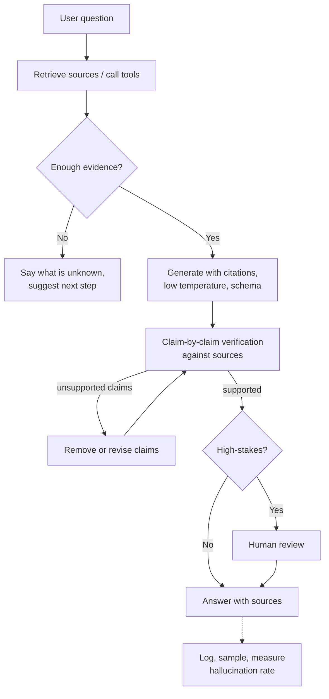
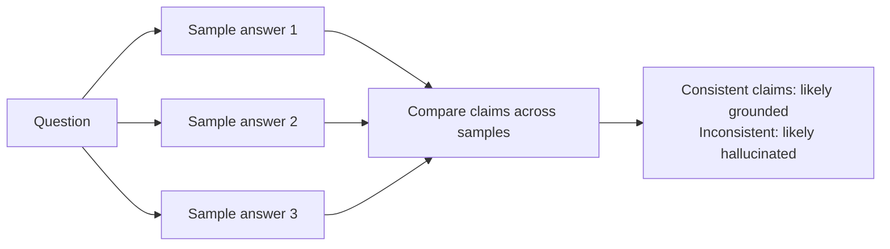

Every LLM product interview eventually asks "how do you stop it making things up?". There is no single fix. The strong answer is a layered design: ground the model, constrain it, verify it, let it say "I don't know", and measure the rate in production.

## TL;DR

- Hallucinations are **fluent outputs not supported by facts or the provided context**.
- They come from how models are trained: they predict **plausible** text, not **verified** text, and lack a reliable sense of what they do not know.
- Reduce them in layers: **grounding** (RAG, tools), **instructions and abstention**, **constrained outputs**, **verification passes**, and **human review** for high stakes.
- Distinguish **factuality** (true in the world) from **faithfulness** (supported by the given context).
- Measure the **hallucination rate** on a test set and monitor it in production.

## The idea in plain English

An LLM is like a very confident storyteller who has read a lot. Ask about something they half-remember and they will fill the gaps with something that sounds right. To keep them honest, you hand them the source documents, ask them to quote where each claim came from, let them say "I'm not sure", and have a fact-checker review important answers.

## Core concepts

1. **Intrinsic vs extrinsic hallucination.** Intrinsic contradicts the provided source; extrinsic adds claims the source does not support.

2. **Causes.** Gaps or errors in training data, outdated knowledge, ambiguous prompts, decoding randomness, pressure to always answer, and long contexts where relevant facts are missed.

3. **Grounding.** Retrieve relevant documents or call tools (search, databases, calculators) so answers rest on evidence, not memory.

4. **Citations.** Require the model to cite a source for each claim; unsupported claims become visible and checkable.

5. **Abstention.** Explicitly allow and instruct "not enough information" answers, and reward them in evaluation instead of penalizing them.

6. **Constrained generation.** Structured outputs, enumerated options and lower temperature for factual tasks reduce free-form invention.

7. **Verification.** A second pass checks each claim against the sources (natural language inference models, an LLM judge, or rules); self-consistency across samples flags uncertain answers.

8. **Human in the loop.** For medical, legal or financial outputs, route uncertain or high-impact answers to review.

## Architecture

The flow:

1. Ground the request with retrieval or tools.
2. If evidence is insufficient, abstain clearly.
3. Generate with citations and constraints.
4. Verify each claim against the sources and fix unsupported ones.
5. Send high-stakes answers to human review.
6. Log and measure continuously.

## Deep dive

### Detecting hallucinations without references

The idea behind methods such as SelfCheckGPT: if the model really knows a fact, independent samples tend to agree; invented details vary between samples.

### Chain-of-verification

The model drafts an answer, writes verification questions about its own claims, answers those questions independently, and revises the draft. It catches some errors without external sources, but grounding in real sources is stronger.

## Trade-offs

| Technique | Reduces hallucination by | Cost | When to use |
| --- | --- | --- | --- |
| RAG grounding | Supplying evidence | Retrieval infrastructure | Knowledge questions |
| Tool calls | Exact data and computation | Integration work | Numbers, live data, math |
| Citations | Making claims checkable | Slight prompt complexity | Almost always |
| Abstention instructions | Avoiding forced answers | Some unanswered queries | Always, with a clear fallback |
| Verification pass | Catching unsupported claims | Extra calls and latency | High-value answers |
| Self-consistency checks | Flagging uncertainty | Several samples | Offline evaluation, high-stakes items |
| Human review | Final safety net | People time | Regulated domains |

## Real-world examples

- Surveys of hallucination in natural language generation catalogue intrinsic and extrinsic types across summarization, dialogue and QA.
- SelfCheckGPT showed sampling-based consistency can detect hallucinated sentences without external references.
- Chain-of-Verification reduced hallucinations in list-based and long-form generation by having the model plan and answer its own verification questions.
- Production assistants increasingly show sources next to answers so users can verify claims.

## Common pitfalls

- Assuming RAG eliminates hallucination; models can still ignore or misread the context.
- Evaluating only answer correctness, not faithfulness to sources.
- Penalizing "I don't know" in metrics, which trains the system to guess.
- Letting LLMs do arithmetic or look up figures from memory instead of using tools.

## How to answer in an interview

1. Define hallucination, and separate factuality from faithfulness.
2. Explain the causes briefly.
3. Present the layered design: ground, constrain, verify, abstain, review.
4. Explain measurement: a labeled test set, faithfulness metrics, production sampling.
5. Tie the strictness to the risk of the domain.

**What interviewers listen for:** layered defenses and a measurement plan.

**Red flags:** "use a better model" or "set temperature to zero" as the whole answer.

## Further reading

- [Survey of Hallucination in Natural Language Generation (Ji et al., 2022)](https://arxiv.org/abs/2202.03629)
- [SelfCheckGPT (Manakul et al., 2023)](https://arxiv.org/abs/2303.08896)
- [Chain-of-Verification Reduces Hallucination (Dhuliawala et al., 2023)](https://arxiv.org/abs/2309.11495)
- [Retrieval-Augmented Generation (Lewis et al., 2020)](https://arxiv.org/abs/2005.11401)

<InterviewQuestions>
  <InterviewQuestion question="Why do LLMs hallucinate?" category="Concepts" level="Junior">
    They are trained to produce likely continuations of text, not to check facts, so when knowledge is missing or uncertain they still generate fluent, plausible content. They have no reliable internal signal of what they do not know, and training often rewards answering over abstaining. Outdated data, ambiguous prompts and sampling randomness add to it.
  </InterviewQuestion>
  <InterviewQuestion question="What is the difference between factuality and faithfulness?" category="Concepts" level="Mid">
    Factuality is whether a statement is true in the real world. Faithfulness is whether it is supported by the context the model was given, such as retrieved documents. A RAG answer can be faithful to an outdated document yet not factual, or factual but unsupported by the sources, so both need checking.
  </InterviewQuestion>
  <InterviewQuestion question="Does setting temperature to zero stop hallucinations?" category="Failure modes" level="Junior">
    No. Lower temperature makes outputs more deterministic and can reduce some random errors, but the most likely continuation can still be wrong. Hallucination comes from missing or wrong knowledge, which needs grounding, abstention and verification.
  </InterviewQuestion>
  <InterviewQuestion question="How would you measure hallucination rate?" category="Evaluation" level="Mid">
    Build a test set with questions and source documents, including unanswerable ones. Break answers into claims and check each against the sources, using human labels for a calibration set and an NLI model or LLM judge at scale. Report the share of unsupported claims and correct abstentions, and sample production traffic the same way.
  </InterviewQuestion>
  <InterviewQuestion question="How can a model detect its own hallucinations without external data?" category="Concepts" level="Senior">
    Sampling-based methods compare multiple independent answers: consistent claims are more likely grounded, inconsistent ones likely invented. Chain-of-verification has the model ask and answer verification questions about its own claims. Token probabilities give a weak signal. These help, but checking against real sources remains more reliable.
  </InterviewQuestion>
  <InterviewQuestion question="Design a hallucination-resistant assistant for legal research." category="Architecture" level="Senior">
    Retrieve from authoritative legal databases with hybrid search and re-ranking, require citations to specific passages for every claim, verify that each cited passage exists and supports the claim, and abstain when sources are insufficient. Show sources prominently, log everything, evaluate on expert-labeled cases including trick questions, and keep a lawyer as the final reviewer.
  </InterviewQuestion>
</InterviewQuestions>
