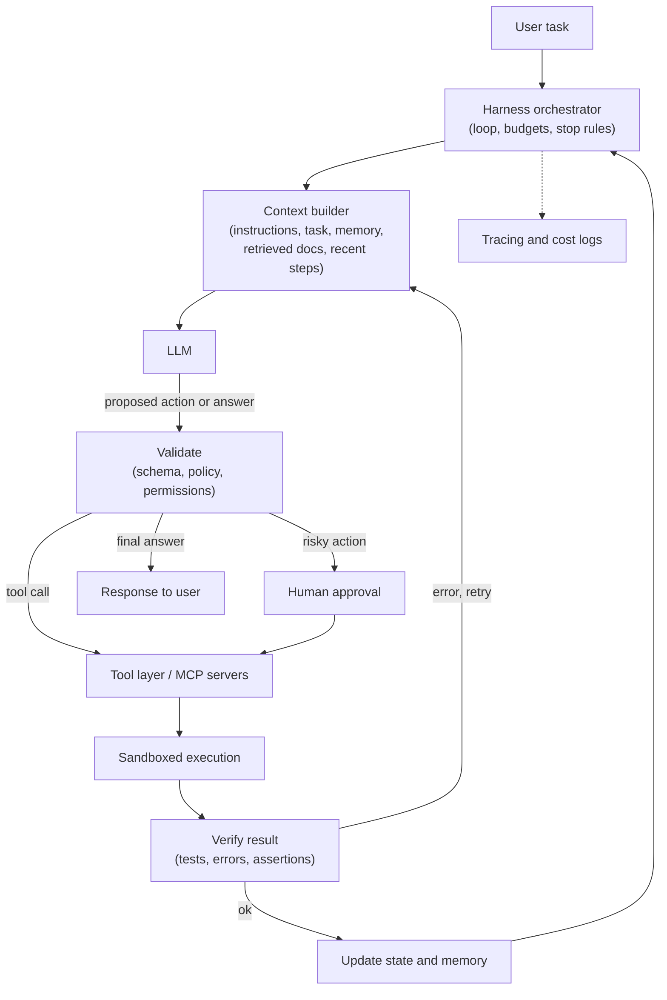
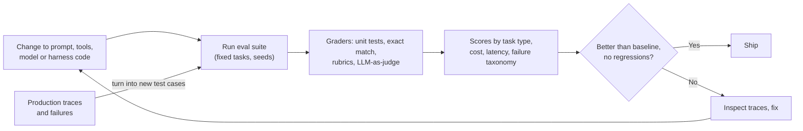

"Agent = model + harness." As models became capable, teams found that most of the reliability of an AI product comes from the code around the model: what goes into its context, which tools it can call, how its actions are checked, and how failures are retried or escalated. Designing that layer is now called **harness engineering**, and interviewers use it to see whether you can ship an LLM feature, not just prompt one.

## TL;DR

- A **harness** is everything around the model except its own reasoning: context assembly, tools, execution sandbox, state, verification, retries, guardrails, logging and evaluation.
- Two meanings show up in interviews: the **agent harness** (runtime scaffolding that lets a model act) and the **evaluation harness** (the test rig that measures it). Good teams build both together.
- The model proposes; the harness **constrains, verifies and records**.
- Reliability comes from **feedback loops**: run the code, check the output against a schema or a test, and feed errors back to the model.
- Treat the harness like product code: version it, test it with regression suites, and measure it with traces and evals.

## The idea in plain English

A brilliant new hire still needs a desk, logins to the right systems, a checklist, someone reviewing their work, and a record of what they did. The model is the hire; the harness is the desk, the access, the checklist and the review. Give a strong model a bad harness and it flails. Give an average model a great harness and it can be dependable.

## Core concepts

1. **Context assembly.** The harness decides what the model sees on each step: system instructions, the task, retrieved documents, tool results, memory and a summary of earlier steps. This is also called context engineering, and it is the biggest lever on quality.

2. **Tool layer.** Tools are described with names, descriptions and JSON schemas so the model can call them. The harness validates arguments, executes the call, handles timeouts and returns results in a compact form. Protocols such as MCP standardize how tools are exposed.

3. **Execution sandbox.** Code and shell commands run in an isolated environment (container or VM) with limited network and file access, so a wrong action cannot damage real systems.

4. **State and memory.** The harness keeps the agent's working state: the plan, completed steps, files changed and facts learned, and decides what to persist between sessions.

5. **Verification and feedback loops.** After each action, the harness checks results: does the output parse against the schema, do the tests pass, did the API return an error? Failures are fed back to the model with the error message so it can fix them, up to a retry budget.

6. **Guardrails and permissions.** Risky actions (sending email, deleting data, spending money) need allow-lists, human approval, or both. Inputs and outputs are filtered for prompt injection, sensitive data and policy violations.

7. **Budgets and stopping rules.** Limits on steps, tokens, time and cost stop runaway loops. Clear success criteria let the agent stop when the job is done.

8. **Observability.** Every model call, tool call, input, output, latency and cost is traced, so failures can be replayed and debugged.

9. **Evaluation harness.** A fixed set of tasks with expected outcomes and graders (exact match, unit tests, rubric scoring, LLM-as-judge), run automatically on every change to the prompt, tools, model or harness code.

## Architecture

One step of the loop:

1. The orchestrator checks budgets and decides whether to continue.
2. The context builder assembles exactly what the model needs for this step.
3. The model proposes either a tool call or a final answer.
4. The harness validates the proposal against schemas, policies and permissions, routing risky actions to a human.
5. The tool runs inside a sandbox, and the result is verified.
6. Errors go back into the context for a retry; successes update the state, and the loop continues.

## Deep dive

### The evaluation harness that guards the agent harness

The flywheel is the point: real failures from production become new test cases, so the harness gets measurably better over time instead of being tuned by feel.

### Example: a coding agent harness

For a "fix this bug" task, a good harness:

- gives the model the issue, the relevant files (found by search, not the whole repo) and repository conventions;
- exposes a small set of tools: search, read file, edit file, run tests;
- runs everything in a container with a copy of the repo;
- runs the test suite after every edit and feeds failures back;
- stops when tests pass or after a step budget, and asks for review before merging.

## Trade-offs

| Decision | Option A | Option B | Guidance |
| --- | --- | --- | --- |
| Many tools vs few tools | Flexible, covers more cases | Simpler choices, fewer mistakes | Start small; add tools when evals show a gap |
| Model-driven loop vs fixed workflow | Handles open-ended tasks | Predictable, cheaper, easier to test | Use workflows for known processes, agents for open-ended ones |
| Full context vs retrieved context | Nothing missed | Cheaper, more focused, less distraction | Retrieve, then summarize old steps |
| Auto-execute vs human approval | Fast | Safe | Approve anything irreversible or external |
| Strict schemas vs free text | Parseable, verifiable | More expressive | Structured outputs for anything the code consumes |

## Real-world examples

- Coding agents run edits inside sandboxes and use test results as their feedback signal; benchmarks such as SWE-bench evaluate them by whether the repository's tests pass after the change.
- EleutherAI's open-source **lm-evaluation-harness** is a widely used evaluation harness for running language models on many benchmarks with one interface.
- Platforms describing "agent harnesses" emphasize the same layers: tool access, permissions, approvals for irreversible actions, and observability.

## Common pitfalls

- Blaming the model for failures caused by missing context or vague tool descriptions.
- Letting the agent loop without step, token or cost limits.
- Giving agents broad credentials instead of narrow, task-scoped permissions.
- Evaluating by eyeballing a few outputs instead of a fixed, versioned test suite.
- Changing the prompt, model and tools at once, so you cannot tell what helped.

## How to answer in an interview

1. Define the harness: everything around the model that lets it act reliably.
2. Draw the loop: context, model, validation, tools in a sandbox, verification, state.
3. Explain safety: permissions, human approval, guardrails, budgets.
4. Explain measurement: an eval harness with graders and a regression gate, fed by production failures.
5. Give a concrete example, such as a coding agent that uses tests as its feedback signal.

**What interviewers listen for:** you see reliability as a systems problem; you have verification loops and evals, not just prompts.

**Red flags:** "we just use a better model", no sandboxing, no evaluation plan.

## Further reading

- [Agent Harness Engineering Guide (DataCamp)](https://www.datacamp.com/tutorial/agent-harness-engineering)
- [What is an AI Agent Harness? (Databricks)](https://www.databricks.com/blog/ai-harness)
- [lm-evaluation-harness (EleutherAI, GitHub)](https://github.com/EleutherAI/lm-evaluation-harness)
- [SWE-bench: Can Language Models Resolve Real-World GitHub Issues? (Jimenez et al., 2023)](https://arxiv.org/abs/2310.06770)
- [Model Context Protocol documentation](https://modelcontextprotocol.io)

<InterviewQuestions>
  <InterviewQuestion question="What is an agent harness, and how is it different from the model?" category="Concepts" level="Junior">
    The model generates text, including decisions about what to do next. The harness is the software around it that makes those decisions useful and safe: it builds the context, exposes tools, executes actions in a sandbox, validates outputs, retries on errors, keeps state, enforces permissions and logs everything. The same model can perform very differently depending on the harness.
  </InterviewQuestion>
  <InterviewQuestion question="How is harness engineering different from prompt engineering?" category="Concepts" level="Junior">
    Prompt engineering shapes the instructions and examples in one model call. Harness engineering designs the whole system around many calls: what context each step sees, which tools exist, how results are checked, how failures are retried, what needs approval and how quality is measured. The prompt is one part of the harness.
  </InterviewQuestion>
  <InterviewQuestion question="How would you make an agent's tool calls reliable?" category="Architecture" level="Mid">
    Keep the tool set small and well described, with strict JSON schemas and clear examples. Validate arguments before execution and return precise error messages so the model can correct itself. Make tools idempotent where possible, add timeouts and retries for transient failures, and cap the number of attempts. Then measure tool-call accuracy in an eval suite and fix the tools or descriptions that fail most.
  </InterviewQuestion>
  <InterviewQuestion question="Design a harness for a coding agent that fixes bugs in a repository." category="Architecture" level="Senior">
    I would run the agent in a container with a copy of the repo and no production credentials. It gets the issue text, repository conventions and files found by code search, plus tools to search, read, edit and run tests. After each edit the harness runs the relevant tests and feeds failures back. There are budgets on steps, tokens and time, and the final diff goes to human review. Every run is traced, and an eval suite of historical issues with known fixes gates changes to the harness.
  </InterviewQuestion>
  <InterviewQuestion question="What is an evaluation harness and what should it contain?" category="Evaluation" level="Mid">
    It is the automated test rig for the system: a versioned set of tasks with inputs and expected outcomes, graders for each task type such as exact match, unit tests, rubrics or an LLM judge, and a runner that executes everything with fixed settings. It reports scores by category, cost and latency, and compares against a baseline so regressions block a release.
  </InterviewQuestion>
  <InterviewQuestion question="How do you prevent an agent from taking a harmful irreversible action?" category="Failure modes" level="Mid">
    Use least-privilege credentials scoped to the task, an allow-list of permitted actions, and mandatory human approval for anything irreversible or external, such as payments, deletes or sending messages. Run code in a sandbox, filter inputs for prompt injection from retrieved content, and log every action so it can be audited and rolled back where possible.
  </InterviewQuestion>
  <InterviewQuestion question="Your agent's success rate dropped after a model upgrade. How do you investigate?" category="Failure modes" level="Senior">
    I would rerun the eval suite on both versions with the same harness and compare failures by category. Then I would read traces of newly failing tasks to see whether the new model formats tool calls differently, ignores certain instructions, or stops early. Often the fix is in the harness, such as tighter schemas, clearer tool descriptions or prompt adjustments, and those changes are validated against the full suite before rollout.
  </InterviewQuestion>
</InterviewQuestions>
