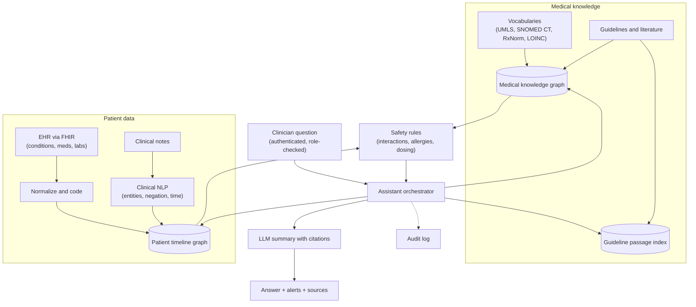
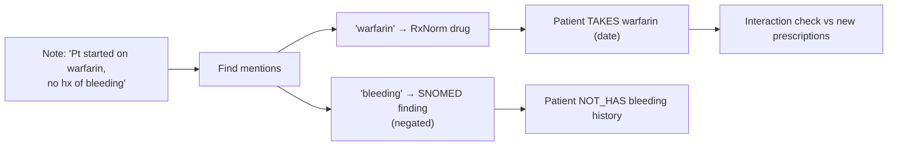
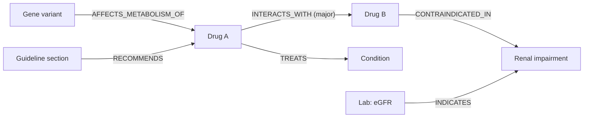

Healthcare is a classic knowledge-graph domain: medicine is a web of diseases, drugs, genes, symptoms and procedures, coded in standard vocabularies. This design exercise covers a clinician-facing assistant that answers questions about a patient and the medical literature while staying safe, auditable and private.

## TL;DR

- **Two graphs work together:** a **medical knowledge graph** (diseases, drugs, interactions, guidelines) and a **patient graph** (each patient's timeline of conditions, medications, labs and encounters).
- **Standard vocabularies** such as UMLS, SNOMED CT, RxNorm, LOINC and ICD codes are the backbone for linking terms.
- The LLM **summarizes and explains**, while safety-critical checks (drug interactions, allergies, dosing limits) run as **deterministic graph queries and rules**.
- **Privacy and compliance** (for example HIPAA in the US) shape the architecture: access control, audit logs, minimum necessary data, and controlled model hosting.
- Output is **decision support with citations**, never an autonomous diagnosis.

## The idea in plain English

A doctor has two references: the medical textbooks (general knowledge about diseases and drugs) and the patient's chart (what happened to this person). Both are full of connections. The knowledge graph links them: "this patient takes drug A, drug A interacts with drug B, and the new prescription is drug B". The LLM is the assistant who reads the connections and the notes and explains them clearly, while a rule engine makes sure no dangerous combination slips through.

## Core concepts

1. **Clinical vocabularies.** SNOMED CT for clinical terms, ICD-10 for diagnoses and billing, RxNorm for medications, LOINC for lab tests, and UMLS as a meta-thesaurus that maps between them. Linking text to these codes is what makes data comparable.

2. **Medical knowledge graph.** Nodes for diseases, drugs, genes, symptoms, procedures and guidelines; edges such as TREATS, CONTRAINDICATED_WITH, INTERACTS_WITH, CAUSES_SIDE_EFFECT, ASSOCIATED_GENE. Public resources such as Hetionet and PrimeKG show this structure at research scale.

3. **Patient graph or timeline.** Built from electronic health records (often via FHIR APIs): conditions, medications, allergies, labs, vitals, encounters and notes, each with dates.

4. **Clinical NLP.** Extracts conditions, medications, dosages, negations ("no history of diabetes") and temporal information from notes, and links them to codes.

5. **Deterministic safety checks.** Drug-drug interactions, drug-allergy conflicts and dose limits are computed with curated rules over the graph, not by LLM judgment.

6. **Grounded generation.** The LLM receives the patient subgraph, relevant guideline passages and interaction results, and must cite each claim.

7. **Privacy controls.** Role-based and purpose-based access, de-identification for analytics, audit logs of every access, and models deployed where protected health information is allowed to go.

## Architecture

A question such as "Is it safe to start this patient on drug X?":

1. The clinician's identity and role are checked; access is logged.
2. The assistant pulls the patient's current medications, allergies, conditions and recent labs from the patient graph.
3. Safety rules check drug X against interactions, allergies, kidney function thresholds and dosing limits in the medical graph.
4. Relevant guideline passages are retrieved.
5. The LLM writes a concise summary of findings, citing each interaction and guideline, with clear alerts first.
6. The clinician decides; the decision can be recorded back to the chart.

## Deep dive

### Linking a note to the graph

Handling negation and time is essential: "no history of bleeding" must not become "has bleeding".

### Medical knowledge graph slice

## Trade-offs

| Decision | Option A | Option B | Guidance |
| --- | --- | --- | --- |
| LLM judgment vs rules for safety | Flexible | Verifiable, predictable | Rules for safety-critical checks; LLM explains |
| Public vs curated commercial drug knowledge | Free, broad | Maintained, validated, licensed | Curated sources for clinical use |
| Cloud vs on-premise model hosting | Faster, more capable models | Tighter data control | Follow the organization's compliance requirements and agreements |
| Full chart vs minimal context | Complete picture | Less exposure, cheaper | Minimum necessary data for the question |
| Real-time vs batch graph updates | Current medications always | Simpler | Real-time for meds and allergies; batch for literature |

## Real-world context

- UMLS, maintained by the US National Library of Medicine, integrates many biomedical vocabularies, including SNOMED CT, RxNorm and LOINC.
- Hetionet and PrimeKG are public biomedical knowledge graphs used in research such as drug repurposing.
- FHIR is the widely adopted standard for exchanging health records through APIs.
- This design is a reference blueprint; any clinical deployment requires regulatory, privacy and clinical-safety review.

## Common pitfalls

- Letting the LLM decide whether a drug combination is safe.
- Ignoring negation, uncertainty and timing in notes.
- Mapping terms to the wrong code system or an outdated vocabulary version.
- Sending protected health information to services that are not approved for it.
- No audit trail of who accessed which patient's data and why.

## How to answer in an interview

1. Separate general medical knowledge from patient data, and explain how they link through vocabularies.
2. Describe ingestion: FHIR data, clinical NLP with negation and time, coding.
3. Put safety checks in deterministic rules over the graph.
4. Use the LLM for retrieval, summarization and explanation, with citations.
5. Make privacy, audit, evaluation with clinicians and regulatory review explicit.

**What interviewers listen for:** safety-first division of labor, standard vocabularies, and privacy built in.

**Red flags:** an LLM giving diagnoses or dosing without rules, or ignoring privacy rules.

## Further reading

- [Unified Medical Language System (US National Library of Medicine)](https://www.nlm.nih.gov/research/umls/index.html)
- [HL7 FHIR overview](https://hl7.org/fhir/overview.html)
- [Hetionet (Himmelstein et al., 2017)](https://doi.org/10.7554/eLife.26726)
- [PrimeKG (Chandak et al., 2023)](https://doi.org/10.1038/s41597-023-01960-3)
- [HIPAA Privacy Rule summary (US HHS)](https://www.hhs.gov/hipaa/for-professionals/privacy/laws-regulations/index.html)

<InterviewQuestions>
  <InterviewQuestion question="Why are standard vocabularies like SNOMED CT and RxNorm important for a healthcare knowledge graph?" category="Concepts" level="Junior">
    The same concept appears under many names across systems and notes, such as brand and generic drug names or different phrasings of a diagnosis. Mapping everything to standard codes gives each concept one identity, so facts from different sources connect correctly and rules such as interaction checks work reliably. UMLS helps map between vocabularies.
  </InterviewQuestion>
  <InterviewQuestion question="How would you structure the graph for a clinical assistant?" category="Architecture" level="Mid">
    Two connected layers. A medical knowledge graph holds general facts: drugs, conditions, interactions, contraindications, genes and guidelines. A patient graph holds each patient's coded timeline: conditions, medications, allergies, labs and encounters with dates. Both use the same vocabulary codes, so a patient's medication node links directly to its interactions in the knowledge layer.
  </InterviewQuestion>
  <InterviewQuestion question="Why shouldn't the LLM decide whether a drug combination is safe?" category="Trade-offs" level="Mid">
    Safety decisions must be correct, consistent and auditable. LLMs can hallucinate or miss an interaction, and their answers can vary between runs. Curated interaction and contraindication data applied by deterministic rules gives verifiable results. The LLM's job is to explain those results clearly and cite them, while the clinician makes the decision.
  </InterviewQuestion>
  <InterviewQuestion question="What clinical NLP challenges matter when extracting facts from notes?" category="Failure modes" level="Mid">
    Negation ("no history of diabetes"), uncertainty ("possible pneumonia"), temporality ("history of" versus current), who the fact is about (family history), abbreviations and misspellings, and linking mentions to the correct codes. Getting negation or subject wrong turns a note into a dangerous false fact, so these must be evaluated explicitly.
  </InterviewQuestion>
  <InterviewQuestion question="How do you handle privacy and compliance in this design?" category="Architecture" level="Senior">
    Enforce authentication, role-based and purpose-based access so clinicians only see patients they treat, pass only the minimum necessary data into prompts, and log every access and question for audit. Host the model and data stores where protected health information is permitted under the organization's agreements, de-identify data used for analytics or evaluation, and review the system with privacy and compliance teams before use.
  </InterviewQuestion>
  <InterviewQuestion question="How would you evaluate a clinical knowledge-graph assistant?" category="Evaluation" level="Senior">
    Measure component accuracy: entity extraction and coding, negation handling, and interaction-check recall on curated test cases. Then evaluate end-to-end answers with clinicians using rubrics for correctness, completeness, citation accuracy and harmful omissions, including adversarial cases. Track alert precision to avoid alarm fatigue, and roll out gradually with monitoring and a feedback channel.
  </InterviewQuestion>
</InterviewQuestions>
