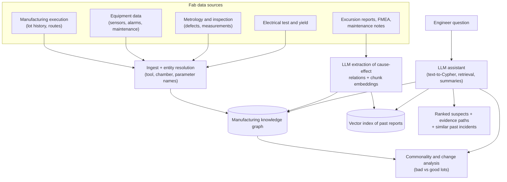
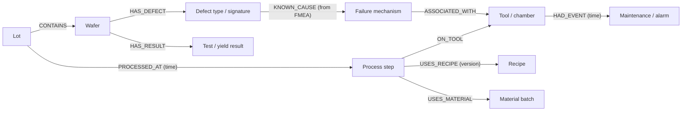

This is a design exercise, not a description of any one company's system. It shows how to apply knowledge graphs to a high-value industrial problem: when a batch of wafers comes out with low yield, engineers need to find the cause quickly across thousands of process steps, tools and measurements.

## TL;DR

- **Problem:** yield excursions cost money every hour; root-cause analysis means connecting lots, process steps, tools, recipes, chambers, materials, measurements and defects.
- **Why a graph:** the questions are about **shared history**: "which tool, chamber or material did the bad lots have in common that good lots did not?"
- **Design:** an ontology of manufacturing entities, a graph built from manufacturing execution and metrology data, statistical commonality analysis, plus an LLM assistant that queries the graph and past failure reports.
- **LLM role:** translate engineers' questions into graph queries, summarize evidence, and retrieve similar past incidents and FMEA knowledge, always with links to data.
- **Guardrails:** read-only access, provenance on every claim, engineers make the final call.

## The idea in plain English

A chip passes through hundreds of steps on many machines. When a lot fails, finding the culprit is like tracing which kitchen, oven and ingredient batch a set of food-poisoning cases have in common. The knowledge graph is the record of every lot's journey. Statistics find suspicious common points. The LLM is the assistant who lets an engineer ask in plain language and pulls up similar past incidents.

## Core concepts

1. **Entities.** Wafer, lot, product, process step, route, recipe, tool, chamber, consumable or material batch, metrology measurement, inspection defect, electrical test result, engineer, maintenance event.

2. **Relationships.** Lot PROCESSED_AT step ON tool (chamber, time); step USES recipe; tool HAD maintenance event; wafer HAS defect of type; lot TESTED_WITH yield result; material batch USED_IN step.

3. **Commonality analysis.** For bad lots vs good lots in a time window, compute which tools, chambers, recipes or material batches are over-represented among the bad lots, with statistical tests. The graph makes these "shared path" queries cheap.

4. **Temporal context.** Edges carry timestamps so you can ask what changed just before the excursion: a recipe revision, a maintenance event, a new material lot.

5. **Knowledge from documents.** Past excursion reports, FMEA tables and maintenance logs hold cause-effect knowledge ("chamber seasoning issues cause particle defects"). LLM extraction turns these into graph relations or retrievable chunks.

6. **Data integration.** Sources include the manufacturing execution system (lot history), equipment data (sensor and fault logs), metrology and inspection systems, and test data. Entity resolution aligns tool and parameter names across systems.

## Architecture

An excursion investigation:

1. Test data flags a set of low-yield lots.
2. The engineer asks: "What do lots with the edge-ring defect signature this week have in common?"
3. The assistant identifies the lots, queries their process paths in the graph and runs commonality analysis against good lots.
4. It checks for changes near the excursion: recipe edits, maintenance on suspect chambers, new material batches.
5. It retrieves similar past excursion reports and FMEA entries.
6. It returns ranked suspects, each with the graph path, statistics and source documents, for the engineer to confirm.

## Deep dive

### Ontology sketch

### Example graph question

"Which chambers processed more than 80% of the failing lots this week but under 20% of passing lots?" becomes a graph traversal from failing and passing lots through their process steps to chambers, followed by a count and comparison. The LLM writes the query from the schema, the harness validates it, and the statistics are computed in code, not by the LLM.

## Trade-offs

| Decision | Option A | Option B | Guidance |
| --- | --- | --- | --- |
| Graph DB vs data warehouse joins | Fast path queries, flexible schema | Familiar, strong for aggregates | Graph for lineage and path questions; warehouse for heavy statistics; link them |
| LLM-computed vs code-computed statistics | Flexible | Correct and reproducible | Always compute statistics in code; LLM explains them |
| Fully automated root cause vs decision support | Faster | Safer, trusted | Decision support with evidence; engineers decide |
| Real-time vs batch graph updates | Faster detection | Simpler | Near-real-time for lot history; batch for documents |

## Real-world context

- Ontology-based approaches to yield analysis and fault-symptom identification have been studied in semiconductor manufacturing research for over a decade.
- Research groups have explored extracting causal knowledge from FMEA documents with language models and graph methods to support root-cause analysis.
- The reference design here combines these ideas with modern LLM assistants; treat it as an interview-ready blueprint rather than a specific vendor's product.

## Common pitfalls

- Letting the LLM "guess" a root cause instead of computing commonality statistics.
- Inconsistent tool and parameter naming across systems, which breaks traversals unless resolved.
- Ignoring time; a shared tool only matters if the timing lines up.
- Exposing sensitive process data broadly; fab data is highly confidential and needs strict access control.

## How to answer in an interview

1. Frame the business problem: time to root cause for yield excursions.
2. Explain why the questions are graph-shaped: shared paths and changes over time.
3. Present the ontology and data sources.
4. Show the analysis split: statistics in code, the LLM for questions, summaries and past-incident retrieval.
5. Address trust: provenance, read-only access, engineer in the loop, and evaluation on past excursions with known causes.

**What interviewers listen for:** domain framing, a clear ontology, and correct division of labor between analytics and the LLM.

**Red flags:** "the LLM figures out the root cause" with no data model or statistics.

## Further reading

- [Unifying Large Language Models and Knowledge Graphs: A Roadmap (Pan et al., 2023)](https://arxiv.org/abs/2306.08302)
- [From Local to Global: A Graph RAG Approach (Edge et al., 2024)](https://arxiv.org/abs/2404.16130)
- [Knowledge Graph Systems for AI (this site)](/ai-system-design/genai-system-design/knowledge-graph-systems)

<InterviewQuestions>
  <InterviewQuestion question="Why is semiconductor root-cause analysis a good fit for a knowledge graph?" category="Concepts" level="Mid">
    The key questions are about shared history and relationships: which tools, chambers, recipes or materials the failing lots have in common, and what changed along those paths before the failure. Each lot's journey is naturally a path through a graph, and comparing paths of bad and good lots is a traversal plus counting problem that graphs handle well and text retrieval does not.
  </InterviewQuestion>
  <InterviewQuestion question="What entities and relationships would you put in the ontology?" category="Architecture" level="Mid">
    Lots, wafers, products, process steps, recipes with versions, tools and chambers, material batches, maintenance and alarm events, defects and test results. Relationships include lot processed at step on a tool at a time, step uses recipe and material, tool had maintenance event, wafer has defect and result, and defect type linked to known failure mechanisms from FMEA. Timestamps on edges are essential.
  </InterviewQuestion>
  <InterviewQuestion question="What role should the LLM play, and what should it not do?" category="Trade-offs" level="Senior">
    The LLM should translate engineers' questions into validated graph queries, retrieve similar past incidents and FMEA knowledge, and summarize evidence in plain language with links. It should not compute statistics or declare a root cause on its own; commonality analysis and significance tests run in code, and engineers confirm the conclusion. That keeps results reproducible and trustworthy.
  </InterviewQuestion>
  <InterviewQuestion question="How would you evaluate this system before rollout?" category="Evaluation" level="Senior">
    Replay historical excursions with known root causes and measure whether the true cause appears in the top suspects and how quickly. Separately check text-to-query accuracy on a set of engineer questions, and extraction quality on sampled reports. Then run it alongside engineers on live excursions, tracking time to root cause and how often its suggestions were accepted.
  </InterviewQuestion>
  <InterviewQuestion question="How do you handle data quality issues across fab systems?" category="Failure modes" level="Senior">
    Build entity resolution for tool, chamber and parameter names, using master data where it exists and mapping tables maintained with engineers. Validate incoming data against the ontology, quarantine records that do not fit, and monitor completeness, for example lots without full step history. Keep provenance so engineers can see which system each fact came from.
  </InterviewQuestion>
  <InterviewQuestion question="How would you keep confidential process data secure in an LLM assistant?" category="Architecture" level="Mid">
    Host the model in a controlled environment with no data leaving the company, enforce role-based access on graph queries and document retrieval, use read-only credentials, log every query, and filter outputs for restricted parameters. Recipe details and yield numbers are among the most sensitive data a fab has, so access must follow existing data-governance rules.
  </InterviewQuestion>
</InterviewQuestions>
