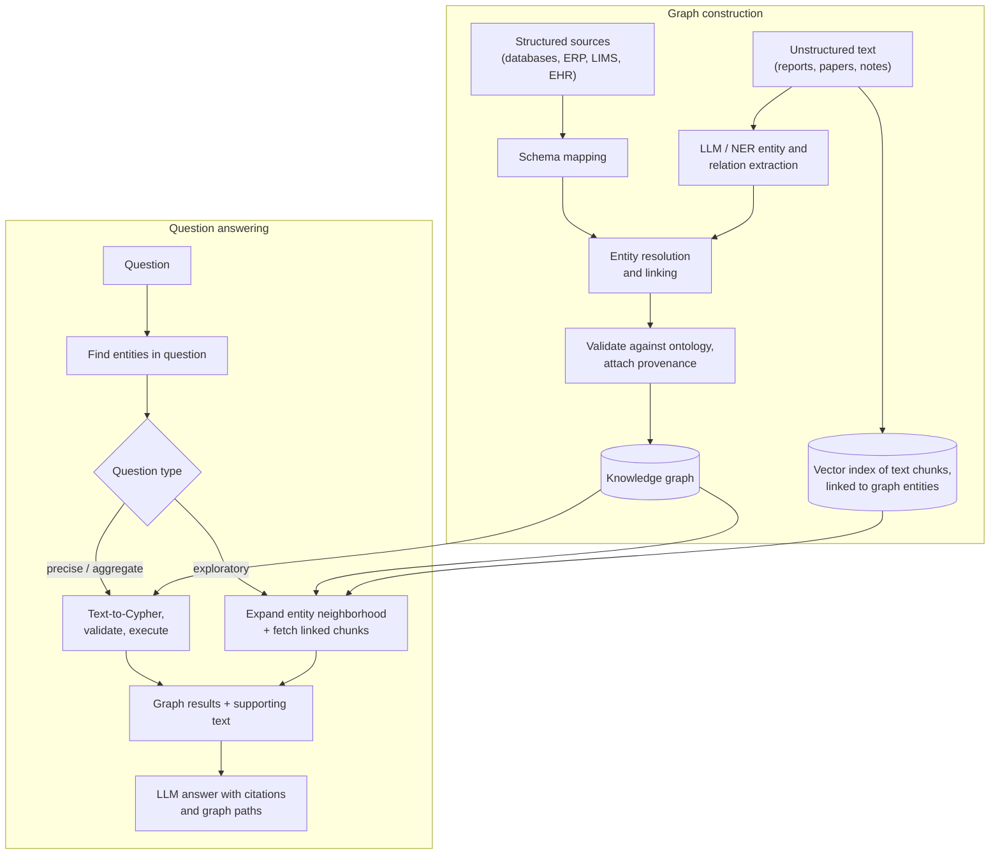
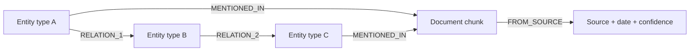

Knowledge graphs come up when a domain is full of entities and relationships that matter: parts and suppliers, drugs and interactions, customers and accounts. Interviewers want to know when a graph beats plain vector RAG, how you would build one, and how an LLM uses it.

## TL;DR

- A **knowledge graph (KG)** stores facts as nodes (entities) and edges (relationships), with a **schema or ontology** that defines types.
- Graphs shine at **multi-hop, relationship and aggregation questions** that text chunks answer poorly.
- Building one: **ingest sources, extract entities and relations, resolve duplicates, validate against the ontology, store, keep fresh.**
- LLMs help both ways: they **extract** graph facts from text and **query** graphs (text-to-Cypher or SPARQL, or graph-guided retrieval).
- The best systems combine **graph + vector**: the graph gives structure and exactness, vectors give coverage of unstructured text.

## The idea in plain English

Vector search is like having every page of a library cut into paragraphs and finding paragraphs that sound similar to your question. A knowledge graph is like a detective's evidence board: photos of people, places and objects connected by labeled strings ("works at", "supplied", "caused"). If your question is about connections, such as "which suppliers' parts were in every failed batch?", following strings on the board is far more reliable than hoping one paragraph says it all.

## Core concepts

1. **Nodes, edges and properties.** Nodes are entities (a wafer lot, a drug); edges are typed relationships (PROCESSED_ON, INTERACTS_WITH); both carry properties (timestamps, measurements, sources).

2. **Property graphs vs RDF.** Property graphs (queried with Cypher or Gremlin) are popular for applications. RDF triple stores (queried with SPARQL) follow web standards and suit formal ontologies and data integration.

3. **Ontology.** The schema of the domain: entity types, relationship types, allowed connections and constraints. A good ontology is the difference between a useful graph and a hairball.

4. **Entity extraction and linking.** Named-entity recognition finds mentions in text; entity linking maps each mention to a canonical node ("Tylenol", "acetaminophen" and "paracetamol" are one drug).

5. **Relation extraction.** Identifies relationships between entities from text, now often with an LLM prompted with the ontology and asked for structured triples, followed by validation.

6. **Entity resolution.** Merging duplicates across sources using identifiers, fuzzy matching and embeddings.

7. **Provenance.** Every fact keeps its source and confidence so answers can be cited and errors traced.

8. **Graph querying with LLMs.** Text-to-Cypher or text-to-SPARQL translates questions into graph queries; the schema is given to the model, and generated queries are validated before running.

9. **GraphRAG.** Uses the graph to guide retrieval: find entities in the question, expand their neighborhood, and pass the relevant subgraph and linked text to the LLM. Microsoft's GraphRAG also builds community summaries for corpus-wide questions.

10. **Graph ML.** Embeddings and graph neural networks support link prediction (likely missing relations), node classification and similarity.

## Architecture

How a question flows:

1. Identify entities in the question and link them to graph nodes.
2. For precise or aggregate questions, generate a graph query from the schema, validate it, and run it.
3. For open questions, expand the neighborhood of the linked entities and pull the text chunks attached to those nodes.
4. Give the LLM the subgraph, the supporting text and provenance, and ask for an answer that cites both.

## Deep dive

### A minimal ontology pattern

Linking entities to the text chunks that mention them is what lets a graph and a vector index work together: the graph finds the right entities, and the chunks supply detail and citations.

### When to use a graph

| Question style | Vector RAG | Knowledge graph |
| --- | --- | --- |
| "What does policy X say about Y?" | Strong | Unnecessary |
| "Which customers bought A and later B?" | Weak | Strong |
| "How are entity P and entity Q connected?" | Weak | Strong |
| "How many batches used supplier S last quarter?" | Weak (counting from text) | Strong (exact aggregation) |
| "Summarize the main themes across 10,000 reports" | Weak | Strong with community summaries |

## Trade-offs

| Decision | Option A | Option B | Guidance |
| --- | --- | --- | --- |
| Graph vs vector only | Exact relations, multi-hop, aggregation | Fast to build, covers all text | Add a graph when questions are about relationships |
| LLM extraction vs rules / NER | Flexible, handles new phrasing | Cheaper, more predictable | LLM for recall, rules and validation for precision |
| Property graph vs RDF | Developer-friendly, fast traversals | Standards, reasoning, integration | Property graph for apps; RDF for heavy ontology work |
| Text-to-query vs graph-guided retrieval | Exact answers | More forgiving of vague questions | Use both, routed by question type |
| Full rebuild vs incremental updates | Simple | Fresh, cheaper | Incremental with periodic consistency checks |

## Real-world examples

- Industry KGs are used for product catalogs, fraud rings, supply chains and drug discovery.
- Public biomedical graphs such as Hetionet and PrimeKG connect genes, diseases, drugs and side effects for research.
- Microsoft's GraphRAG paper showed graph community summaries improve answers to global questions over a corpus compared with standard RAG.
- See the [semiconductor](/ai-system-design/genai-system-design/kg-semiconductor-case-study) and [healthcare](/ai-system-design/genai-system-design/kg-healthcare-case-study) case studies for end-to-end designs.

## Common pitfalls

- Building the graph before agreeing on the ontology and the questions it must answer.
- Trusting LLM-extracted triples without validation, deduplication or provenance.
- No entity resolution, so the same thing appears as many nodes.
- Letting LLMs run unvalidated, unbounded graph queries in production.
- Expecting a graph to replace text; most answers still need supporting passages.

## How to answer in an interview

1. Ask which questions the system must answer, and show which need relationships.
2. Define the ontology for those questions.
3. Describe construction: sources, extraction, resolution, validation, provenance, refresh.
4. Describe querying: text-to-query for precise questions, graph-guided retrieval plus vectors for open ones.
5. Cover evaluation (extraction precision and recall, answer accuracy) and operations (freshness, access control).

**What interviewers listen for:** a reason to use a graph, an ontology-first approach, and a hybrid graph-plus-vector design.

**Red flags:** "put everything in a graph database" without a schema, or no plan for entity resolution.

## Further reading

- [From Local to Global: A Graph RAG Approach (Edge et al., 2024)](https://arxiv.org/abs/2404.16130)
- [Unifying Large Language Models and Knowledge Graphs: A Roadmap (Pan et al., 2023)](https://arxiv.org/abs/2306.08302)
- [Systematic integration of biomedical knowledge, Hetionet (Himmelstein et al., 2017)](https://doi.org/10.7554/eLife.26726)
- [Building a knowledge graph to enable precision medicine, PrimeKG (Chandak et al., 2023)](https://doi.org/10.1038/s41597-023-01960-3)

<InterviewQuestions>
  <InterviewQuestion question="What is a knowledge graph, and how is it different from a relational database?" category="Concepts" level="Junior">
    A knowledge graph stores entities as nodes and relationships as typed edges, with a schema called an ontology. Relational databases can store the same facts in tables, but multi-hop questions require many joins that get slow and complex. Graphs make relationships first-class, so traversals such as "friends of friends" or "parts used in failed lots" are natural and fast, and the schema can evolve more easily.
  </InterviewQuestion>
  <InterviewQuestion question="When would you choose a knowledge graph over vector RAG?" category="Trade-offs" level="Mid">
    When the important questions are about relationships, paths or exact aggregates, such as how two entities are connected, which items share a property, or how many events match conditions. Vector RAG retrieves similar passages and struggles to combine facts across many documents or count reliably. For questions answered by a single passage, vector RAG is simpler and enough.
  </InterviewQuestion>
  <InterviewQuestion question="How would you build a knowledge graph from unstructured documents with an LLM?" category="Architecture" level="Mid">
    Define the ontology first. Chunk the documents and prompt an LLM with the ontology to extract entities and typed relationships as structured output. Link entities to canonical ids and resolve duplicates, validate triples against the ontology's rules, and store each fact with its source and confidence. Measure extraction precision and recall on a labeled sample and add rule-based checks for high-value relations.
  </InterviewQuestion>
  <InterviewQuestion question="What is entity resolution and why does it matter?" category="Concepts" level="Mid">
    It is deciding when different records or mentions refer to the same real-world entity, such as a drug's brand and generic names, or a supplier with slightly different spellings. Without it, facts about one entity are scattered across several nodes, so traversals and counts are wrong. It combines identifiers, fuzzy matching, embeddings and sometimes human review.
  </InterviewQuestion>
  <InterviewQuestion question="How does GraphRAG differ from standard RAG?" category="Architecture" level="Mid">
    Standard RAG retrieves text chunks by similarity. GraphRAG uses a graph built from the corpus: it finds entities in the question, follows relationships to gather connected facts and their source text, and can use precomputed summaries of graph communities to answer corpus-wide questions. It handles multi-hop and global questions better, at the cost of an expensive indexing step.
  </InterviewQuestion>
  <InterviewQuestion question="How do you make text-to-Cypher safe and reliable?" category="Failure modes" level="Senior">
    Give the model the schema and examples, generate the query, then validate it before execution: parse it, check it only uses known labels and relationships, enforce read-only access, add limits and timeouts, and reject unbounded traversals. Run it with least-privilege credentials. If execution fails or returns nothing, feed the error back for a retry, and keep an evaluation set of questions with expected results.
  </InterviewQuestion>
  <InterviewQuestion question="How do you evaluate a knowledge-graph question-answering system?" category="Evaluation" level="Senior">
    At the construction level, measure extraction precision and recall and entity-resolution accuracy on labeled samples. At the query level, measure whether generated graph queries are valid and return the expected results. End to end, measure answer correctness and citation accuracy on a test set of real questions, broken down by question type, and monitor graph freshness against the sources.
  </InterviewQuestion>
</InterviewQuestions>
