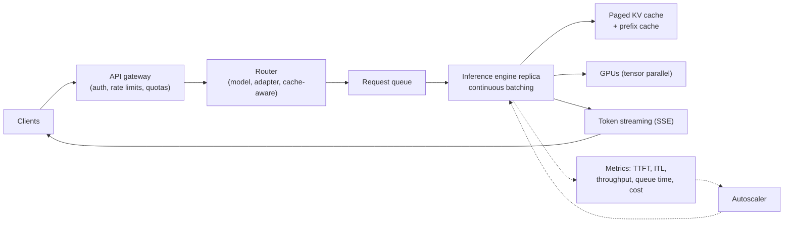
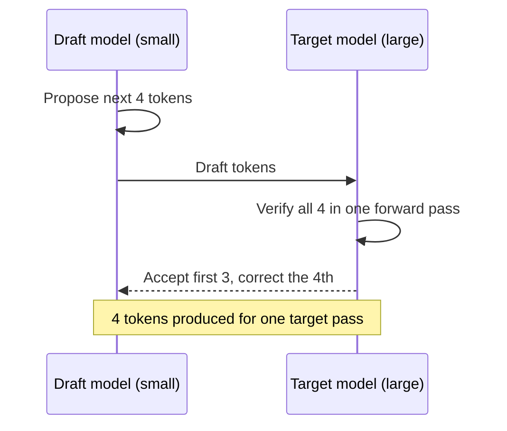

"Design the serving system for an LLM" is a standard senior question. Interviewers want the latency and throughput model (prefill vs decode), the optimizations that matter (batching, KV cache, quantization, speculative decoding), and an operational plan with the right metrics.

## TL;DR

- Serving cost and latency are shaped by two phases: **prefill** (compute-bound, sets time to first token) and **decode** (memory-bandwidth-bound, sets tokens per second).
- **Continuous batching** and a **paged KV cache** are the biggest throughput wins.
- **Quantization** (8-bit, 4-bit) shrinks memory and raises speed with small quality loss.
- **Speculative decoding** cuts latency by having a small model draft tokens for the big model to verify.
- Large models are split with **tensor and pipeline parallelism**; replicas scale with traffic.
- Track **TTFT, inter-token latency, throughput, GPU utilization, queue time and cost per million tokens**.

## The idea in plain English

An LLM server is a busy kitchen. Prefill is reading the whole order before cooking; decode is plating one item at a time. Continuous batching means the chef starts new orders as soon as any station frees up, instead of waiting for a whole table to finish. The KV cache is the prep each order leaves on the counter; paging stops the counter filling with half-used space. A junior chef pre-plating likely items (speculative decoding) speeds things up when the senior chef usually agrees.

## Core concepts

1. **Prefill vs decode.** Prefill processes the prompt in parallel; decode produces one token per step and re-reads weights and cache each time.

2. **Static vs continuous batching.** Static batching waits for every sequence in a batch to finish. Continuous (in-flight) batching adds and removes sequences at each step, keeping the GPU busy.

3. **KV cache management.** The cache grows with context and concurrent requests. Paged allocation (PagedAttention) avoids fragmentation and lets requests share common prefixes.

4. **Prefix caching.** Reuse the cached keys and values for shared prompt prefixes such as system prompts.

5. **Quantization.** Weight-only quantization (GPTQ, AWQ) to 4 or 8 bits, or weights and activations in 8-bit or FP8. Saves memory and bandwidth; must be evaluated per task.

6. **Speculative decoding.** A draft model proposes several tokens; the target model verifies them in one pass; accepted tokens are kept. Output distribution is preserved with the standard acceptance rule.

7. **Parallelism.** Tensor parallelism splits each layer across GPUs in a node; pipeline parallelism splits layers across nodes; expert parallelism spreads MoE experts.

8. **Disaggregated serving.** Running prefill and decode on separate GPU pools so each is tuned for its bottleneck.

9. **Autoscaling and routing.** Scale replicas on queue depth and latency, route by model and adapter, and use cache-aware routing to hit existing prefix caches.

## Architecture

A request's life:

1. The gateway authenticates, applies rate limits and quotas.
2. The router picks the model, adapter and replica, preferring replicas with a matching prefix cache.
3. The engine's scheduler adds the request to the running batch.
4. Prefill fills the KV cache; decode streams tokens back as they are generated.
5. Metrics feed autoscaling and capacity planning.

## Deep dive

### Speculative decoding

Gains depend on how often the draft is accepted, so drafts must match the target's style; variants use extra heads on the target model or n-gram lookups instead of a separate draft model.

### Latency budget for a chat response

| Component | What drives it |
| --- | --- |
| Queue time | Load vs capacity, batching policy |
| Time to first token | Prompt length, prefill speed, prefix cache hits |
| Inter-token latency | Model size, quantization, batch size, memory bandwidth |
| Total time | TTFT plus output length times inter-token latency |

## Trade-offs

| Technique | Benefit | Cost | When to use |
| --- | --- | --- | --- |
| Continuous batching | Much higher throughput | Slightly more variable latency | Always for shared serving |
| Larger batches | Lower cost per token | Higher per-request latency | Offline and bulk jobs |
| 4-bit weight quantization | Fits bigger models, faster decode | Small accuracy loss | Cost- or memory-limited serving |
| Speculative decoding | Lower latency | Extra draft compute, complexity | Latency-sensitive chat |
| Tensor parallelism | Fits large models, lower latency | Inter-GPU communication | Models larger than one GPU |
| Disaggregated prefill/decode | Better utilization at scale | Operational complexity | Large, mixed workloads |

## Real-world examples

- vLLM introduced PagedAttention and continuous batching and is widely used for open-model serving.
- The Orca system popularized iteration-level scheduling, the idea behind continuous batching.
- GPTQ and AWQ are common post-training weight quantization methods for LLMs.
- Speculative decoding was shown to speed up large model inference without changing outputs.

## Common pitfalls

- Sizing GPUs by weights only and running out of KV cache memory.
- Measuring only average latency; tail latency (p95, p99) and TTFT matter for users.
- Quantizing without task-level evaluation.
- No rate limits or quotas, so one client can starve others.

## How to answer in an interview

1. Clarify model size, traffic, latency targets and prompt and output lengths.
2. Explain prefill vs decode and what each means for latency.
3. Propose the engine optimizations: continuous batching, paged KV cache, prefix caching, quantization, speculative decoding.
4. Size hardware: weights plus KV cache, parallelism, replicas.
5. Cover the platform: gateway, routing, autoscaling, metrics and cost tracking.

**What interviewers listen for:** a correct performance model and concrete sizing.

**Red flags:** "put it behind a load balancer" with no batching or memory reasoning.

## Further reading

- [Efficient Memory Management for LLM Serving with PagedAttention (Kwon et al., 2023)](https://arxiv.org/abs/2309.06180)
- [Fast Inference from Transformers via Speculative Decoding (Leviathan et al., 2022)](https://arxiv.org/abs/2211.17192)
- [GPTQ: Accurate Post-Training Quantization (Frantar et al., 2022)](https://arxiv.org/abs/2210.17323)
- [AWQ: Activation-aware Weight Quantization (Lin et al., 2023)](https://arxiv.org/abs/2306.00978)
- [Orca: A Distributed Serving System for Transformer-Based Generative Models (Yu et al., OSDI 2022)](https://www.usenix.org/conference/osdi22/presentation/yu)

<InterviewQuestions>
  <InterviewQuestion question="What are time to first token and inter-token latency, and what drives each?" category="Concepts" level="Junior">
    Time to first token is how long until the first output token appears; it is driven by queue time and the prefill pass over the prompt, so long prompts raise it. Inter-token latency is the time between subsequent tokens, driven by the decode step, which depends on model size, memory bandwidth, batch size and quantization.
  </InterviewQuestion>
  <InterviewQuestion question="What is continuous batching and why does it help?" category="Concepts" level="Mid">
    Instead of waiting for every sequence in a batch to finish, the scheduler adds new requests and removes finished ones at every decode step. GPUs stay full even when outputs have very different lengths, which greatly increases throughput compared with static batching.
  </InterviewQuestion>
  <InterviewQuestion question="How does quantization speed up LLM inference?" category="Concepts" level="Mid">
    Decoding is limited by how fast weights are read from memory. Storing weights in 8 or 4 bits instead of 16 means fewer bytes to move per token, so decode is faster and larger models or batches fit in memory. Quality must be checked because aggressive quantization can hurt some tasks.
  </InterviewQuestion>
  <InterviewQuestion question="Explain speculative decoding." category="Concepts" level="Senior">
    A smaller draft model proposes several tokens, and the large target model checks them all in one forward pass. Tokens are accepted up to the first disagreement, where the target supplies its own token. With the standard acceptance rule, the output distribution matches the target model's, and when the draft is often right, several tokens are produced per expensive pass.
  </InterviewQuestion>
  <InterviewQuestion question="How would you size GPUs for serving a 70B model?" category="Architecture" level="Senior">
    At 16-bit, weights take about 140 GB, so they need at least two 80 GB GPUs with tensor parallelism, or one GPU with 4-bit quantization at around 35 to 40 GB. Then add KV cache memory for the target concurrency and context length, which can be tens of GB more. Finally, choose replicas from peak tokens per second and the measured throughput per replica, with headroom.
  </InterviewQuestion>
  <InterviewQuestion question="Which metrics would you monitor for an LLM serving platform?" category="Evaluation" level="Mid">
    Request rate, queue time, time to first token and inter-token latency at p50, p95 and p99, output tokens per second, error and timeout rates, GPU utilization and memory, KV cache usage and prefix-cache hit rate, and cost per million tokens, broken down by model and customer.
  </InterviewQuestion>
</InterviewQuestions>
