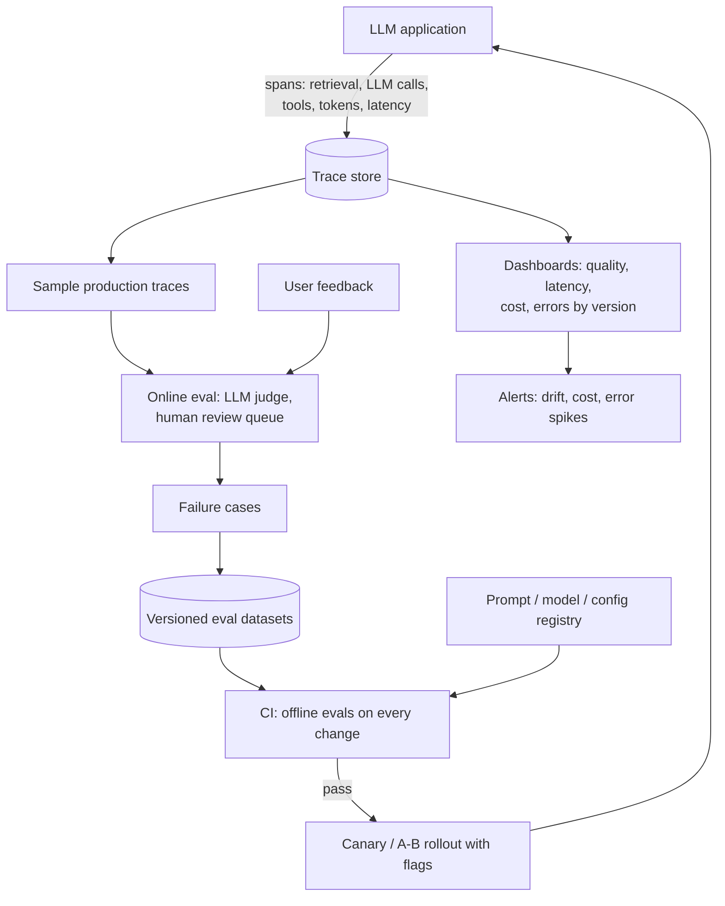
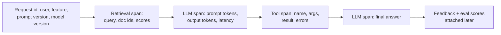

LLMOps is MLOps for systems whose behavior is shaped by prompts, retrieved data, tools and third-party models that change underneath you. Interviewers want to hear how you would know when quality drops, why it dropped, and how you ship changes safely.

## TL;DR

- **Trace everything**: each request's prompts, model versions, retrieved documents, tool calls, outputs, latency, tokens and cost.
- **Version everything**: prompts, models, retrieval settings, tools and evaluation sets.
- **Evaluate offline** on every change, **evaluate online** with sampling, feedback and experiments.
- Watch for **drift**: changing user queries, changing data, and provider model updates.
- **Release safely** with canaries, A/B tests, feature flags and fast rollback.

## The idea in plain English

Running an LLM app without observability is like running a restaurant without receipts or customer feedback. Tracing is the receipt for every order; evaluations are taste tests before a new menu; online feedback is the customer reviews; versioning lets you go back to yesterday's recipe when today's goes wrong.

## Core concepts

1. **Tracing.** Each request becomes a trace with spans for retrieval, each model call and each tool call, recording inputs, outputs, timing and token counts. Open standards such as OpenTelemetry's GenAI conventions help.

2. **Prompt management.** Prompts in version control or a registry, linked to evaluation results, reviewed and deployed like code.

3. **Offline evaluation.** Fixed test sets with graders run in CI on every change to prompts, models, retrieval or tools.

4. **Online evaluation.** LLM-judge scoring on sampled production traffic, user feedback (thumbs, edits, retries), task success signals, and human review queues.

5. **Feedback loop.** Failures and negative feedback become new test cases and training or prompt improvements.

6. **Drift.** Query distributions change, documents change, and hosted models get updated. Monitor input topics, retrieval scores and quality metrics over time.

7. **Cost and latency tracking.** Per feature, customer and model; alerts on spikes.

8. **Release practices.** Feature flags, canary rollouts, A/B tests, pinned model versions, and quick rollback.

## Architecture

The operating loop:

1. The app emits traces for every request.
2. Dashboards and alerts watch quality, latency, cost and errors by version.
3. Sampled traces and feedback are scored and reviewed.
4. Failures become test cases in versioned datasets.
5. Every change runs offline evals in CI, then rolls out gradually with flags.

## Deep dive

### What a single trace contains

### Key metrics

| Area | Metrics |
| --- | --- |
| Quality | Task success, judge scores, faithfulness, user feedback rate, escalation rate |
| Reliability | Error and timeout rates, tool failures, guardrail triggers |
| Performance | TTFT, total latency p50/p95/p99 |
| Cost | Tokens and cost per request, per successful task, per customer |
| Drift | Query topic distribution, retrieval scores, no-answer rate |

## Trade-offs

| Decision | Option A | Option B | Guidance |
| --- | --- | --- | --- |
| Log full content vs metadata only | Best debugging | Privacy, storage | Full content with redaction and retention limits where allowed |
| Pinned model versions vs latest | Stable behavior | New capabilities | Pin in production; upgrade via eval and canary |
| LLM judge vs human review | Scale | Accuracy | Judge for coverage, humans for calibration and high-stakes |
| Build vs buy observability | Control | Speed | Use open standards to avoid lock-in |

## Real-world examples

- OpenTelemetry defines semantic conventions for generative AI spans and metrics.
- Many LLM observability platforms provide tracing, evaluation datasets and prompt management.
- The classic "Hidden Technical Debt in Machine Learning Systems" paper warned that ML systems accumulate maintenance debt in data dependencies and configuration, which applies even more to LLM apps.

## Common pitfalls

- No link between a response and the prompt or model version that produced it.
- Evaluating only before launch, never in production.
- Silent provider model updates changing behavior.
- Tracking total cost but not cost per successful task.
- Storing sensitive prompts and outputs without access control or retention rules.

## How to answer in an interview

1. Describe tracing and what each trace contains.
2. Explain versioning of prompts, models and datasets.
3. Explain offline evaluation in CI and online evaluation with sampling and feedback.
4. Cover drift, cost tracking and alerts.
5. Describe safe rollout and rollback.

**What interviewers listen for:** a closed loop from production data to tests to safe releases.

**Red flags:** "we check the outputs manually sometimes".

## Further reading

- [OpenTelemetry semantic conventions for generative AI](https://opentelemetry.io/docs/specs/semconv/gen-ai/)
- [Hidden Technical Debt in Machine Learning Systems (Sculley et al., 2015)](https://papers.nips.cc/paper/5656-hidden-technical-debt-in-machine-learning-systems)
- [Judging LLM-as-a-Judge (Zheng et al., 2023)](https://arxiv.org/abs/2306.05685)
- [RAGAS (Es et al., 2023)](https://arxiv.org/abs/2309.15217)

<InterviewQuestions>
  <InterviewQuestion question="What should you log for every LLM request?" category="Concepts" level="Junior">
    A request id, user or tenant, feature, prompt and model versions, the assembled prompt or a reference to it, retrieved document ids and scores, tool calls with arguments and results, the output, token counts, latency, cost, guardrail decisions and any later feedback, with sensitive content redacted according to policy.
  </InterviewQuestion>
  <InterviewQuestion question="How is LLMOps different from traditional MLOps?" category="Concepts" level="Mid">
    Behavior is controlled by prompts, retrieval and tools as much as by model weights, and the model is often a third-party API that can change. Outputs are open-ended, so evaluation relies on rubrics, judges and human review rather than simple accuracy. Cost per token and latency are first-class metrics, and safety concerns such as prompt injection are new.
  </InterviewQuestion>
  <InterviewQuestion question="How do you safely roll out a new prompt or model version?" category="Architecture" level="Mid">
    Run the offline evaluation suite and compare with the current version, then release behind a feature flag to a small canary share of traffic, monitor quality, latency, cost and errors, run an A/B test on key metrics if the change matters, and keep one-click rollback. Pin model versions so upgrades are deliberate.
  </InterviewQuestion>
  <InterviewQuestion question="How do you detect quality drift in production?" category="Evaluation" level="Senior">
    Continuously score sampled traffic with calibrated judges and human review, track user feedback, retries and escalations, and monitor input topic distributions, retrieval scores and the no-answer rate. Compare against baselines by version and segment, and alert on sustained changes. Provider model updates and new user behaviors are common causes.
  </InterviewQuestion>
  <InterviewQuestion question="How do production failures improve the system over time?" category="Architecture" level="Mid">
    Failures found through feedback, review or alerts are triaged, labeled with a root cause, and added to the versioned evaluation set. Fixes to prompts, retrieval, tools or models must pass that set, so the same failure cannot silently return. Over time the evaluation set mirrors real usage.
  </InterviewQuestion>
  <InterviewQuestion question="How would you attribute and control LLM costs across teams?" category="Failure modes" level="Senior">
    Tag every request with team, feature and customer, aggregate tokens and cost per tag, set budgets and alerts, and show cost per successful task next to quality. Use quotas and rate limits per tenant, and review the most expensive features for routing, caching or prompt reductions.
  </InterviewQuestion>
</InterviewQuestions>
