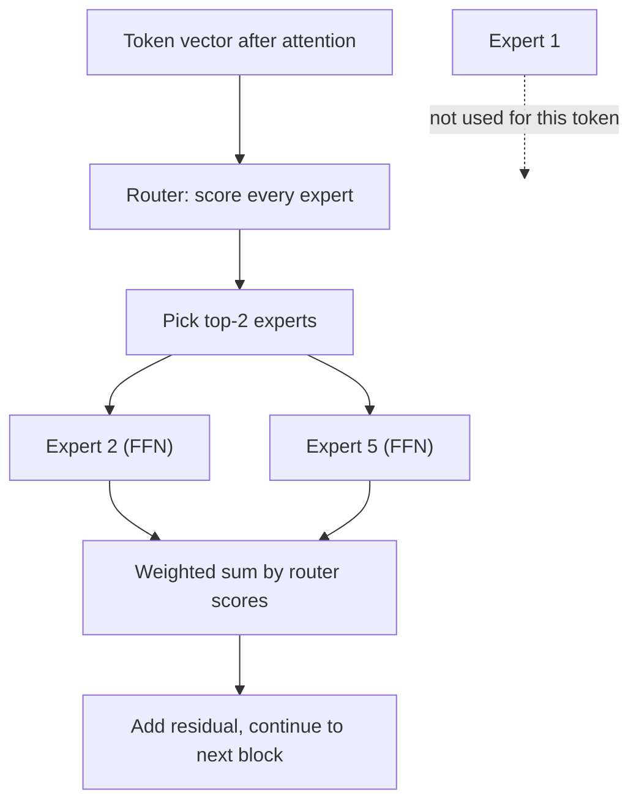
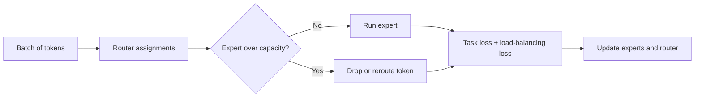

Mixture of experts is how many frontier and open models grow their parameter count without growing per-token compute at the same rate. Interviewers ask about routing, load balancing, and the difference between total and active parameters.

## TL;DR

- An MoE layer replaces one feed-forward network with **many expert networks** plus a small **router**.
- For each token, the router picks the **top-k experts** (often 1 or 2), so only a fraction of parameters run per token.
- **Total parameters** set memory; **active parameters** set compute per token.
- Without care, the router sends most tokens to a few experts, so training adds a **load-balancing loss** and **capacity limits**.
- Serving is harder: all experts must be in memory, and **expert parallelism** spreads them across GPUs.

## The idea in plain English

A hospital does not send every patient to every doctor. A triage nurse (the router) looks at each patient (token) and sends them to the one or two most suitable specialists (experts). The hospital can employ many specialists, so it has a lot of knowledge, but each patient only takes the time of two of them. The hard part is stopping the nurse from sending everyone to the same popular doctor.

## Core concepts

1. **Expert.** Usually a standard feed-forward network. A layer might have 8, 64 or more of them.

2. **Router (gating network).** A small linear layer that scores every expert for each token. A softmax over the top-k scores gives mixing weights.

3. **Top-k routing.** Switch Transformer uses k = 1; Mixtral uses k = 2. Larger k gives smoother mixing at more compute.

4. **Sparse activation.** Only the chosen experts run. A model can have many times more parameters than it uses per token.

5. **Load balancing.** An auxiliary loss pushes the router to spread tokens evenly. Without it, a few experts get most tokens, train more, get chosen more, and the rest wither.

6. **Capacity factor.** Each expert accepts at most a fixed number of tokens per batch. Overflow tokens are dropped from that layer (passed through by the residual) or sent to another expert.

7. **Expert parallelism.** Experts live on different GPUs, and tokens are sent to them with all-to-all communication. That communication is a main cost of MoE training and serving.

8. **Fine-grained and shared experts.** Some designs use many small experts plus one or more always-on "shared" experts that capture common knowledge, so routed experts can specialize.

## Architecture

For each token in an MoE block:

1. Attention runs as usual.
2. The router scores all experts and keeps the top k.
3. The token is sent to those experts, possibly on other GPUs.
4. Their outputs are combined with the router weights and added to the residual stream.

## Deep dive

### Training loop concerns

Common instabilities include router collapse (one expert dominates) and large router logits; fixes include the balancing loss, a router z-loss that keeps logits small, and noise in routing early in training.

### Total vs active parameters

Mixtral 8x7B has about 47 billion total parameters, since attention layers are shared and only feed-forward layers are duplicated, but only about 13 billion are active per token. It needs memory for 47 billion parameters while costing compute closer to a 13-billion-parameter dense model.

## Trade-offs

| Aspect | Dense model | MoE model |
| --- | --- | --- |
| Compute per token | All parameters | Only active parameters |
| Memory | Proportional to parameters | Proportional to total parameters (higher) |
| Quality per training FLOP | Baseline | Often better |
| Training stability | Simpler | Needs balancing and routing care |
| Serving | Simple batching | Expert parallelism, all-to-all traffic, uneven load |
| Fine-tuning | Straightforward | Can overfit; experts may need special handling |

## Real-world examples

- Shazeer et al. (2017) introduced sparsely gated MoE layers with thousands of experts in LSTM models.
- GShard and Switch Transformer scaled MoE in transformers; Switch uses top-1 routing.
- Mixtral 8x7B uses 8 experts per layer with top-2 routing.
- DeepSeek's MoE models use many fine-grained experts plus shared experts.

## Common pitfalls

- Quoting total parameters as if they set compute cost.
- Forgetting the memory cost: every expert must be loaded even if most are idle per token.
- Ignoring load balance, which wastes hardware and harms quality.
- Assuming experts specialize by human topic. Analyses often find routing patterns based on syntax or token types rather than clean subjects.

## How to answer in an interview

1. Define MoE as replacing the feed-forward layer with routed experts.
2. Explain top-k routing and sparse activation.
3. Contrast total and active parameters with an example.
4. Explain load balancing and capacity limits.
5. Discuss serving costs: memory, expert parallelism and communication.

**What interviewers listen for:** clarity on what is shared and what is duplicated, balancing mechanisms, and system-level costs.

**Red flags:** "MoE is an ensemble of models" or no mention of load balancing.

## Further reading

- [Outrageously Large Neural Networks: Sparsely-Gated MoE (Shazeer et al., 2017)](https://arxiv.org/abs/1701.06538)
- [GShard (Lepikhin et al., 2020)](https://arxiv.org/abs/2006.16668)
- [Switch Transformers (Fedus et al., 2021)](https://arxiv.org/abs/2101.03961)
- [Mixtral of Experts (Jiang et al., 2024)](https://arxiv.org/abs/2401.04088)
- [DeepSeekMoE (Dai et al., 2024)](https://arxiv.org/abs/2401.06066)

<InterviewQuestions>
  <InterviewQuestion question="What is a mixture-of-experts layer?" category="Concepts" level="Junior">
    It replaces a transformer block's single feed-forward network with several expert networks and a router. For each token, the router picks a few experts, usually one or two, runs only those, and combines their outputs with the router's weights. The model gains capacity without running every parameter for every token.
  </InterviewQuestion>
  <InterviewQuestion question="What is the difference between total and active parameters?" category="Concepts" level="Junior">
    Total parameters are everything stored in the model, including every expert, and they determine memory needs. Active parameters are those used for one token: shared layers plus the selected experts, and they determine compute per token. An MoE model can have a few times more total than active parameters.
  </InterviewQuestion>
  <InterviewQuestion question="Why do MoE models need a load-balancing loss?" category="Failure modes" level="Mid">
    The router learns from the same gradients as the experts, so an expert that gets slightly more tokens early improves faster and gets chosen even more. Left alone, routing collapses onto a few experts, wasting capacity and hardware. An auxiliary loss that rewards even token distribution keeps all experts trained and the load spread across devices.
  </InterviewQuestion>
  <InterviewQuestion question="What is the capacity factor and what happens when an expert overflows?" category="Architecture" level="Mid">
    The capacity factor sets how many tokens each expert can accept per batch, relative to an even share. It keeps compute predictable and lets tensors have fixed shapes. When an expert is full, extra tokens are dropped from that layer, meaning they pass through on the residual connection only, or rerouted, depending on the implementation. Too low a factor drops many tokens; too high wastes compute on padding.
  </InterviewQuestion>
  <InterviewQuestion question="What makes serving MoE models harder than dense models?" category="Scaling" level="Senior">
    All experts must be in memory even though each token uses a few, so memory needs follow total parameters. Experts are usually spread across GPUs, and tokens travel to them with all-to-all communication every MoE layer, which adds latency. Load is uneven from batch to batch, so some GPUs idle while others are busy. Batching strategy and expert placement matter a lot for throughput.
  </InterviewQuestion>
  <InterviewQuestion question="Would you choose a dense or an MoE model for an on-device assistant?" category="Trade-offs" level="Senior">
    Usually a dense model. On-device, memory is the hardest limit, and MoE requires storing every expert while only saving compute. A small dense model, possibly quantized, uses memory more efficiently. MoE shines in data centers where memory is plentiful across many GPUs and the goal is better quality per unit of compute.
  </InterviewQuestion>
</InterviewQuestions>
