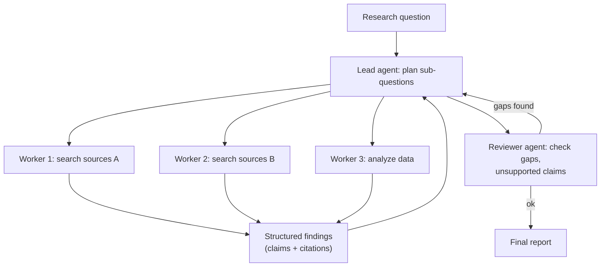
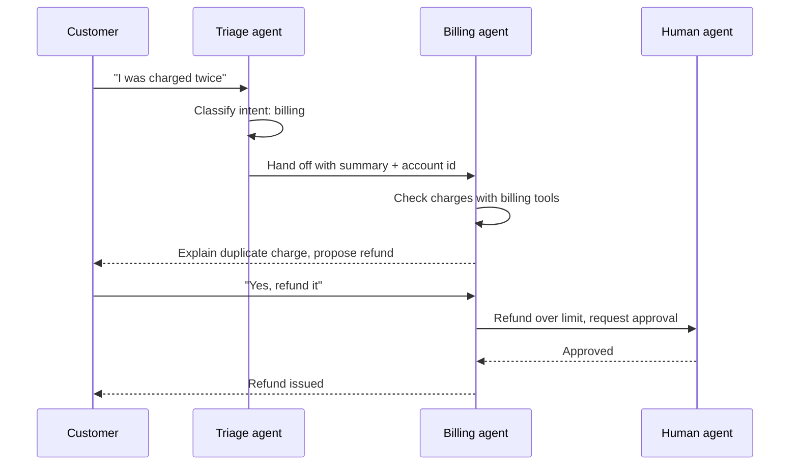

Multi-agent systems are popular in demos and frequent in interviews. The best answers are skeptical: they explain when splitting work across agents helps, how to coordinate them, and why a single well-equipped agent is often the better default.

## TL;DR

- Use multiple agents when work splits into parts that benefit from **separate context, tools or instructions**, or can run **in parallel**.
- Main patterns: **orchestrator-workers (supervisor)**, **sequential pipeline**, **parallel fan-out and merge**, **debate or reviewer**, **hand-offs** between specialists.
- Coordination needs explicit **interfaces**: task specs going down, structured results coming up, shared state with clear ownership.
- Costs: more tokens, more latency, **error compounding** and harder debugging.
- Evaluate against a **single-agent baseline**.

## The idea in plain English

One very capable person can do a lot alone. A team helps when the job is big enough to split, when parts need different expertise, or when several things can happen at once. But teams add meetings and miscommunication. Multi-agent design is about building the smallest team with the clearest hand-offs.

## Core concepts

1. **Context isolation.** Each agent has its own focused context, which avoids one huge, confusing prompt.

2. **Specialization.** Different system prompts, tools and even models per role (researcher, coder, reviewer).

3. **Orchestrator-workers.** A lead agent plans, delegates sub-tasks to workers, and synthesizes results. Workers usually do not talk to each other.

4. **Sequential pipeline.** Agents pass work along a fixed chain, such as draft, then review, then format.

5. **Parallel fan-out.** Independent sub-tasks run concurrently and are merged, cutting wall-clock time.

6. **Debate or critique.** Agents propose and critique answers; a judge decides. Useful when there is no ground truth to check against.

7. **Hand-offs.** A triage agent transfers a conversation to a specialist agent with the relevant context, common in customer service.

8. **Shared state.** A blackboard, task list or document that agents read and write, with clear rules about who updates what.

9. **Failure compounding.** Each extra agent call is another chance to misunderstand; errors early in a pipeline propagate.

## Architecture

The flow of an orchestrated research system:

1. The lead agent turns the question into independent sub-questions.
2. Workers research in parallel, each with its own context and tools.
3. Workers return compact, structured findings with citations, not raw transcripts.
4. The lead synthesizes; a reviewer checks for gaps and unsupported claims.
5. The loop repeats within a budget, then the report is produced.

## Deep dive

### Hand-off pattern for support

### Why multi-agent systems fail

Studies of multi-agent LLM systems group failures into poor task specification and role design, misalignment between agents (ignoring each other's output, repeating work, losing information in hand-offs), and weak verification of the final result. Most fixes are interface fixes: precise task specs, structured outputs, shared state rules and a verifier.

## Trade-offs

| Design | Pros | Cons | When to use |
| --- | --- | --- | --- |
| Single agent with tools | Simplest, cheapest, easiest to debug | Context can get crowded | Default |
| Orchestrator-workers | Parallelism, context isolation | Token cost multiplies; synthesis is hard | Broad research, large codebase changes |
| Sequential pipeline | Clear stages, testable | Errors propagate; no backtracking | Content production with review |
| Debate / critique | Better answers without ground truth | Costly, can converge on wrong answers | High-stakes reasoning |
| Hand-offs to specialists | Focused prompts and tools per domain | Context lost in transfer | Customer service, multi-domain assistants |

## Real-world examples

- AutoGen and CAMEL popularized conversational multi-agent frameworks with role-playing agents.
- MetaGPT assigned software-company roles (product manager, architect, engineer) with standardized documents passed between them.
- Research on multi-agent failures has catalogued how coordination problems, not model capability, cause many breakdowns.
- Production research assistants often use a lead agent that spawns parallel sub-agents for search, then synthesizes.

## Common pitfalls

- Using many agents for a task one agent could do.
- Passing full transcripts between agents instead of structured summaries.
- No owner for shared state, causing conflicting edits.
- No verification step at the end.
- Ignoring token cost, which can grow many times over.

## How to answer in an interview

1. Ask whether the task truly splits; propose a single-agent baseline.
2. If it does, pick a pattern and draw it.
3. Define interfaces: task specs, structured results, shared state.
4. Add verification, budgets and observability across agents.
5. Evaluate against the single-agent baseline on quality, cost and latency.

**What interviewers listen for:** justified use, clean interfaces and awareness of costs.

**Red flags:** many agents "chatting" with no structure or evaluation.

## Further reading

- [AutoGen: Enabling Next-Gen LLM Applications via Multi-Agent Conversation (Wu et al., 2023)](https://arxiv.org/abs/2308.08155)
- [CAMEL: Communicative Agents for "Mind" Exploration (Li et al., 2023)](https://arxiv.org/abs/2303.17760)
- [MetaGPT: Meta Programming for a Multi-Agent Collaborative Framework (Hong et al., 2023)](https://arxiv.org/abs/2308.00352)
- [Why Do Multi-Agent LLM Systems Fail? (Cemri et al., 2025)](https://arxiv.org/abs/2503.13657)
- [Building effective agents (Anthropic)](https://www.anthropic.com/research/building-effective-agents)

<InterviewQuestions>
  <InterviewQuestion question="When is a multi-agent system better than a single agent?" category="Trade-offs" level="Mid">
    When the task splits into sub-tasks that benefit from separate contexts, tools or instructions, or that can run in parallel to save time, such as researching many independent sub-questions. If the task is sequential and tightly coupled, a single agent with good tools is usually better, cheaper and easier to debug.
  </InterviewQuestion>
  <InterviewQuestion question="Describe the orchestrator-workers pattern." category="Concepts" level="Junior">
    A lead agent plans the work, delegates sub-tasks to worker agents with focused context and tools, collects their structured results, and synthesizes the final output, often with a review step. Workers typically do not coordinate with each other directly.
  </InterviewQuestion>
  <InterviewQuestion question="How should agents pass information to each other?" category="Architecture" level="Mid">
    Through well-defined, compact, structured messages: a clear task specification going down, and results with key findings, sources and confidence coming back, rather than full transcripts. Shared state such as a task board needs ownership rules so agents do not overwrite each other.
  </InterviewQuestion>
  <InterviewQuestion question="What are common failure modes of multi-agent systems?" category="Failure modes" level="Senior">
    Ambiguous task specs and overlapping roles, agents ignoring or misreading each other's outputs, duplicated work, information lost during hand-offs, endless back-and-forth without termination, errors propagating through pipelines, and no final verification. Token costs and latency also balloon.
  </InterviewQuestion>
  <InterviewQuestion question="How do you debug a multi-agent system?" category="Failure modes" level="Senior">
    Trace every agent's inputs, outputs, tool calls and messages with a shared run id, visualize the message flow, and replay failing runs. Evaluate each agent's role in isolation with its own test cases, then end to end, and categorize failures by where information was lost or misinterpreted.
  </InterviewQuestion>
  <InterviewQuestion question="How do you control the cost of multi-agent systems?" category="Trade-offs" level="Mid">
    Limit the number of agents and rounds, use cheaper models for workers and stronger ones for planning and synthesis, pass summaries instead of transcripts, run sub-tasks in parallel only when they are truly independent, and stop early when the answer meets the criteria. Compare cost per successful task with a single-agent baseline.
  </InterviewQuestion>
</InterviewQuestions>
