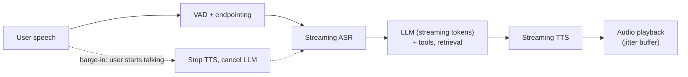
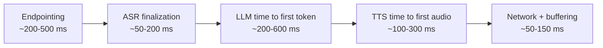
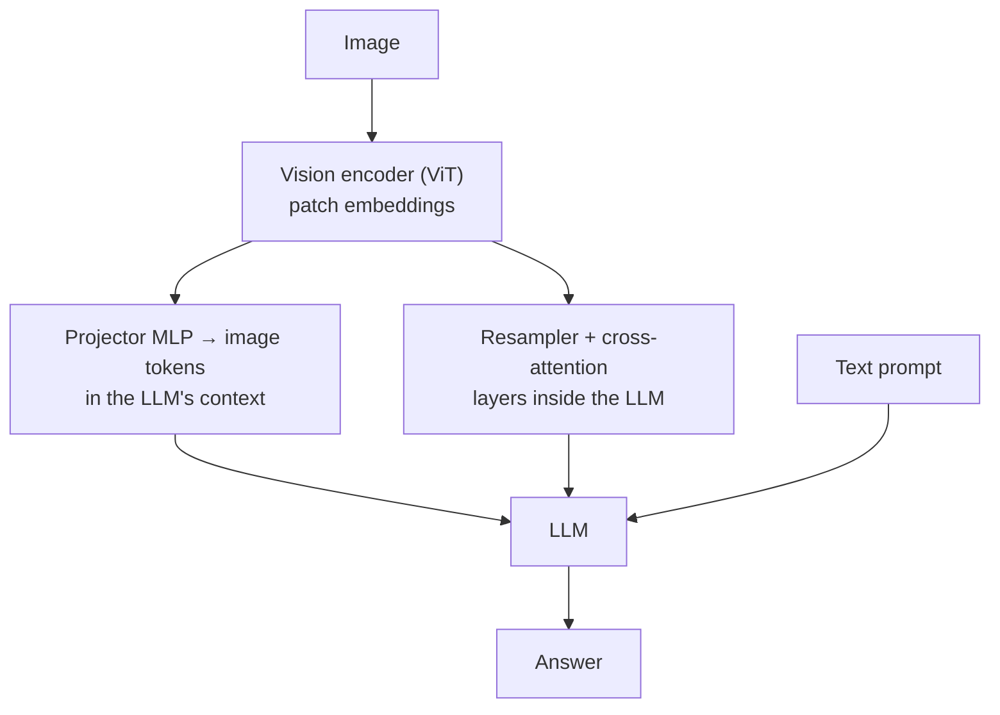

Multimodal questions now appear across labs, voice-AI startups, healthcare scribes and robotics companies. Interviewers want to know how images and audio get into a language model, how real-time voice agents hit their latency targets, and how you evaluate outputs that have no single right answer.

## TL;DR

- **Vision-language models** turn images into tokens with a vision encoder, then connect them to an LLM through a **projector**, **cross-attention** or **native multimodal tokens**.
- **ASR** (speech to text) and **TTS** (text to speech) are the building blocks of voice products; **streaming** versions of both are essential for real time.
- A **real-time voice agent** must respond in well under a second end to end, so every stage (VAD, ASR, LLM, TTS, network) gets a latency budget.
- **Cascaded** voice systems (ASR + LLM + TTS) are controllable and debuggable; **native speech-to-speech** models are faster and more expressive but harder to control.
- Evaluate beyond single numbers: **WER** misses meaning-critical errors, and TTS quality needs **human ratings** and targeted tests.
- **Vision-language-action models** extend VLMs to output robot actions, often with **action chunking** and a fast low-level controller.

## The idea in plain English

A language model only understands tokens. Multimodal AI is about translating other senses into tokens it can read and translating its output back into the world. A vision encoder is the model's eyes, turning pictures into a sequence of "visual words". Speech recognition is its ears; text-to-speech is its voice. For a robot, an action decoder is its hands. The hard engineering problems are doing these translations fast, accurately and safely.

## Core concepts

1. **Vision encoders.** A Vision Transformer splits an image into patches and outputs one embedding per patch. Encoders trained contrastively on image-text pairs, such as CLIP, give features aligned with language.

2. **Connecting vision to an LLM.**
   - **Projector:** a small MLP maps patch embeddings into the LLM's embedding space, and they are inserted as tokens (the LLaVA approach). Simple and effective.
   - **Cross-attention:** the LLM attends to image features through extra cross-attention layers, and a resampler compresses many patches into a few tokens (the Flamingo approach). Keeps the LLM's context short.
   - **Native tokens / early fusion:** images are tokenized and trained jointly with text from the start, so one model reads and can generate both.

3. **Resolution and token count.** More pixels mean more patches and more tokens. Dynamic resolution, tiling and token merging trade detail against cost.

4. **Video.** Sample frames, encode each, and compress over time; add temporal position information. Video multiplies token counts, so frame selection and pooling are central.

5. **ASR.** Models such as Whisper are encoder-decoder transformers trained on large amounts of labeled audio. Streaming ASR emits partial transcripts as audio arrives. Word error rate (WER) is the standard metric.

6. **TTS.** Text normalization (numbers, abbreviations, units), then an acoustic model and vocoder, or a single neural codec language model, generates audio. Streaming TTS starts playing before the whole sentence is synthesized.

7. **VAD and turn-taking.** Voice activity detection finds speech; endpointing decides when the user has finished speaking. Barge-in lets the user interrupt the agent.

8. **Diarization.** Splitting audio by speaker using speaker embeddings and clustering, then labeling roles (for example clinician vs patient).

9. **Vision-language-action models.** A VLM is fine-tuned to output actions (as discretized tokens or continuous values) for a robot. Action chunking predicts a short sequence of future actions at once for smoother, more consistent control.

## Architecture

The real-time voice loop:

1. VAD detects speech; streaming ASR transcribes as the user talks.
2. Endpointing decides the turn is over (or a model predicts it), and the transcript goes to the LLM.
3. The LLM streams tokens; text is cut into speakable chunks (clauses or sentences).
4. Streaming TTS converts each chunk to audio as soon as it arrives.
5. Audio plays through a small jitter buffer; if the user speaks, playback stops and the LLM is cancelled.

## Deep dive

### A latency budget for a voice agent

Totals of roughly 700 ms to 1.5 s are typical; good systems aim for under about a second. Endpointing is often the biggest single item, which is why semantic turn-detection models that recognize a finished thought help so much. Time to first audio, not full response time, is what users feel.

### Connecting images to an LLM

## Trade-offs

| Decision | Option A | Option B | Guidance |
| --- | --- | --- | --- |
| Cascaded vs speech-to-speech | Controllable, debuggable, swap components, use any LLM and tools | Lower latency, keeps tone and emotion, natural interruptions | Cascaded for enterprise and regulated use; native for expressive consumer voice |
| Projector vs cross-attention | Simple, strong, but image tokens fill the context | Compact, keeps LLM context short, more complex training | Projector is the common default |
| Higher image resolution | Reads small text and details | More tokens, cost and latency | Dynamic resolution per task |
| Aggressive endpointing | Faster responses | Cuts users off | Semantic turn detection plus tuning |
| Larger ASR/TTS models | Better accuracy and naturalness | Latency and cost per stream | Size per latency budget; specialize for domain |

## Real-world examples

- CLIP aligned images and text with contrastive learning on image-caption pairs and enabled zero-shot image classification.
- LLaVA connected a CLIP vision encoder to an LLM with a projection layer and visual instruction tuning.
- Flamingo used a perceiver resampler and gated cross-attention layers to add vision to a frozen language model.
- Whisper was trained on about 680,000 hours of multilingual, weakly supervised audio and showed strong robustness across accents and noise.
- RT-2 fine-tuned vision-language models to output robot actions as tokens; ACT introduced action chunking for fine-grained manipulation.

## Common pitfalls

- Measuring only WER, which treats a wrong drug name the same as a dropped "um".
- Ignoring text normalization in TTS, so numbers, dates and units are read wrongly.
- Optimizing LLM latency while endpointing adds most of the delay.
- Feeding very high-resolution images or many video frames without budgeting tokens.
- No barge-in, so users cannot interrupt a long answer.

## How to answer in an interview

1. Explain how the modality becomes tokens (encoder, connector) or audio (TTS).
2. For real-time systems, draw the pipeline and give a stage-by-stage latency budget.
3. Discuss cascaded vs end-to-end trade-offs for the product.
4. Cover evaluation beyond a single metric, including human ratings and critical-error rates.
5. Address safety and privacy, such as voice cloning consent or medical data handling.

**What interviewers listen for:** concrete latency numbers, correct connector designs and evaluation nuance.

**Red flags:** treating voice as "just add speech recognition" or quoting only WER.

## Further reading

- [Learning Transferable Visual Models From Natural Language Supervision, CLIP (Radford et al., 2021)](https://arxiv.org/abs/2103.00020)
- [Visual Instruction Tuning, LLaVA (Liu et al., 2023)](https://arxiv.org/abs/2304.08485)
- [Flamingo: a Visual Language Model for Few-Shot Learning (Alayrac et al., 2022)](https://arxiv.org/abs/2204.14198)
- [Robust Speech Recognition via Large-Scale Weak Supervision, Whisper (Radford et al., 2022)](https://arxiv.org/abs/2212.04356)
- [RT-2: Vision-Language-Action Models (Brohan et al., 2023)](https://arxiv.org/abs/2307.15818)
- [Learning Fine-Grained Bimanual Manipulation with Low-Cost Hardware, ACT (Zhao et al., 2023)](https://arxiv.org/abs/2304.13705)

<InterviewQuestions>
  <InterviewQuestion question="How does a vision-language model read an image?" category="Concepts" level="Junior">
    A vision encoder, usually a Vision Transformer, splits the image into patches and turns each into an embedding. A connector, often a small projection network, maps those embeddings into the language model's token space, and the LLM processes them alongside the text tokens to answer questions about the image.
  </InterviewQuestion>
  <InterviewQuestion question="What is word error rate and why is it not enough?" category="Evaluation" level="Junior">
    WER counts substitutions, deletions and insertions needed to turn the transcript into the reference, divided by the number of reference words. It weighs every word equally, so a wrong medication name or negation counts the same as a missed filler word. Production systems add critical-term error rates, entity accuracy and task-level checks.
  </InterviewQuestion>
  <InterviewQuestion question="Why is endpointing so important for voice agents?" category="Architecture" level="Mid">
    The agent cannot respond until it decides the user has finished speaking. Waiting for a long silence adds hundreds of milliseconds to every turn, while cutting in too early interrupts people mid-thought. Semantic turn-detection models that judge whether an utterance is complete reduce latency without cutting users off.
  </InterviewQuestion>
  <InterviewQuestion question="What does streaming TTS change about latency?" category="Architecture" level="Mid">
    Instead of waiting for the whole response and synthesizing it at once, the system sends text in small chunks as the LLM generates it, and the TTS starts producing audio from the first chunk. Users hear the answer within a few hundred milliseconds, and the rest is synthesized while earlier audio plays.
  </InterviewQuestion>
  <InterviewQuestion question="When would you choose a cascaded voice pipeline over a native speech-to-speech model?" category="Trade-offs" level="Senior">
    When you need control and reliability: inspectable transcripts for logging and compliance, the ability to use any LLM with tools and retrieval, deterministic text normalization, and independent upgrades of each component. Native speech-to-speech models win on latency and preserving tone and emotion, which matters more for expressive consumer conversations.
  </InterviewQuestion>
  <InterviewQuestion question="What is action chunking in robot learning?" category="Concepts" level="Senior">
    Instead of predicting one action per control step, the policy predicts a short sequence of future actions at once and executes them, often blending overlapping predictions. It reduces compounding errors and jitter, captures smooth multi-step motions, and lets a slower model control a fast robot.
  </InterviewQuestion>
</InterviewQuestions>
