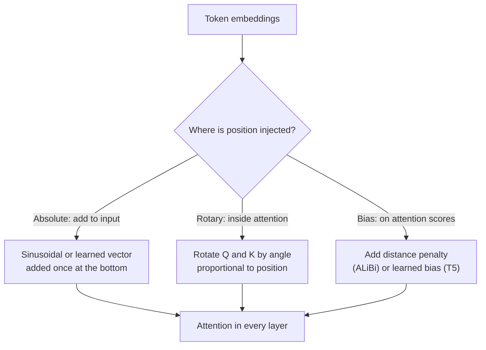
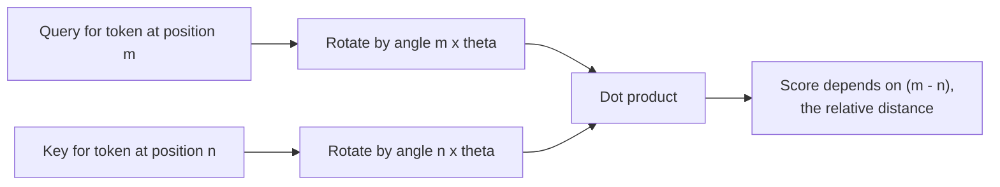

Positional encoding questions test whether you understand that attention is order-blind, and whether you know why almost every modern LLM uses rotary embeddings. They also lead straight into context-window extension, a frequent senior-level topic.

## TL;DR

- Self-attention treats tokens as a set, so order must be injected.
- **Absolute** methods add a position vector to each token (sinusoidal or learned).
- **Relative** methods make attention depend on the distance between tokens (RoPE, ALiBi, T5 relative bias).
- **RoPE** rotates queries and keys by a position-dependent angle and is the default in most open LLMs.
- **ALiBi** adds a distance penalty to attention scores and extrapolates well to longer inputs.
- Context windows are extended mainly by **rescaling RoPE** (position interpolation, NTK-aware scaling, YaRN) plus a short fine-tune.

## The idea in plain English

Imagine shuffling the words of a sentence onto cards and handing them over in a pile. You can see every word, but not the order. Positional encoding is writing a seat number on each card. Absolute methods write "seat 7". Relative methods instead let any two cards tell how far apart they sit, which is usually what language cares about: "the adjective right before this noun" matters more than "word number 4,812".

## Core concepts

1. **Permutation invariance.** Attention outputs a weighted sum, and sums do not care about order. Without positions, the model cannot tell "dog bites man" from "man bites dog".

2. **Sinusoidal encoding.** The original Transformer adds fixed sine and cosine waves of different frequencies to each dimension:

   $$
   PE_{(pos, 2i)} = \sin\!\left(\frac{pos}{10000^{2i/d}}\right), \quad PE_{(pos, 2i+1)} = \cos\!\left(\frac{pos}{10000^{2i/d}}\right)
   $$

   It needs no parameters, and a fixed offset between positions corresponds to a linear transformation, which helps the model learn relative patterns.

3. **Learned absolute embeddings.** BERT and GPT-2 learn one vector per position. Simple and effective, but the model has nothing for positions beyond the training length.

4. **Relative position bias.** T5 adds a learned bias to each attention score based on the (bucketed) distance between the two tokens.

5. **RoPE (rotary position embedding).** Each pair of dimensions in the query and key is rotated by an angle proportional to the position. When a rotated query meets a rotated key, the dot product depends only on the **difference** of their positions. It adds no parameters and keeps the vector norm unchanged.

6. **ALiBi.** Adds no position vectors at all. Instead, each head subtracts a penalty proportional to the distance between query and key, with a different slope per head. Models trained this way handle sequences longer than they saw in training better than sinusoidal or learned encodings.

7. **Context extension.** RoPE models trained on 4K tokens see unfamiliar rotation angles beyond that. Position interpolation squeezes new positions into the trained range; NTK-aware scaling and YaRN rescale frequencies unevenly so local detail survives. A short fine-tune on long documents then adapts the model.

## Architecture

Where each method acts:

1. Absolute methods change the token vectors once, before the first layer.
2. RoPE acts in every attention layer, on queries and keys only, not on values.
3. Bias methods act on the attention score matrix in every layer.

## Deep dive

### How RoPE turns absolute positions into relative ones

Rotating two vectors and taking their dot product gives the same result as rotating one of them by the angle difference. So even though each token is encoded at its absolute position, attention only "sees" relative distance. Different dimension pairs rotate at different frequencies: fast ones capture local order, slow ones capture long-range position.

### Extending a context window

## Trade-offs

| Method | Pros | Cons | When to use |
| --- | --- | --- | --- |
| Sinusoidal | No parameters, simple | Weak extrapolation in practice | Teaching, small models |
| Learned absolute | Easy, flexible | Hard limit at the trained length | Fixed-length encoders like BERT |
| T5 relative bias | Relative by design | Extra parameters, bucketed distances | Encoder-decoder models |
| RoPE | Relative, no parameters, works with fast attention kernels, extendable by rescaling | Needs rescaling plus fine-tuning to go beyond the trained length | Default for decoder LLMs |
| ALiBi | Strong length extrapolation, trivial to implement | Distance penalty can underweight far tokens | Models that must handle longer inputs than trained |

## Real-world examples

- The 2017 Transformer used sinusoidal encodings; BERT and GPT-2 used learned absolute positions.
- T5 uses a learned relative position bias.
- Llama, Mistral, Qwen and many other open models use RoPE.
- BLOOM and MPT use ALiBi.
- Long-context variants of RoPE models are commonly built with position interpolation or YaRN followed by long-document fine-tuning.

## Common pitfalls

- Saying RoPE is "added" to embeddings. It is a rotation of queries and keys inside attention.
- Assuming a bigger advertised context means the model uses it well. Accuracy often drops for information in the middle of long inputs.
- Forgetting that learned absolute positions cannot handle any position beyond the table.

## How to answer in an interview

1. Explain why: attention is permutation invariant.
2. Contrast absolute, relative-bias and rotary approaches in one sentence each.
3. Explain RoPE's key property: rotations make the score depend only on relative distance.
4. Mention extrapolation and ALiBi.
5. Close with context extension: rescale RoPE, fine-tune briefly, then evaluate on long-context retrieval tests.

**What interviewers listen for:** the permutation-invariance argument, a correct description of RoPE, and practical knowledge of extending context.

**Red flags:** treating context length as a pure hardware limit, or not knowing which method current models use.

## Further reading

- [Attention Is All You Need (Vaswani et al., 2017)](https://arxiv.org/abs/1706.03762)
- [RoFormer: Enhanced Transformer with Rotary Position Embedding (Su et al., 2021)](https://arxiv.org/abs/2104.09864)
- [Train Short, Test Long: ALiBi (Press et al., 2021)](https://arxiv.org/abs/2108.12409)
- [Extending Context Window via Positional Interpolation (Chen et al., 2023)](https://arxiv.org/abs/2306.15595)
- [YaRN: Efficient Context Window Extension (Peng et al., 2023)](https://arxiv.org/abs/2309.00071)

<InterviewQuestions>
  <InterviewQuestion question="Why can't a transformer infer word order on its own?" category="Concepts" level="Junior">
    Self-attention computes each output as a weighted sum over all tokens, and the weights depend only on the content of queries and keys. Shuffling the input shuffles the outputs the same way, so the model has no signal about order. Positional information has to be added to the inputs or to the attention computation.
  </InterviewQuestion>
  <InterviewQuestion question="Why does the sinusoidal encoding use many different frequencies?" category="Concepts" level="Mid">
    Each pair of dimensions oscillates at a different wavelength, from very short to very long. Short wavelengths distinguish neighboring positions, long ones distinguish far-apart positions, so together they give every position a unique pattern. Because shifting position is a fixed rotation for each frequency, relative offsets can be expressed linearly, which makes them easy for the model to use.
  </InterviewQuestion>
  <InterviewQuestion question="How does RoPE work, and why is it relative?" category="Architecture" level="Mid">
    RoPE splits the query and key vectors into pairs of dimensions and rotates each pair by an angle equal to the token position times a pair-specific frequency. When a rotated query at position m is dotted with a rotated key at position n, the result depends only on the angle difference, which is proportional to m minus n. So each token is encoded absolutely, yet the attention score reflects relative distance.
  </InterviewQuestion>
  <InterviewQuestion question="What is ALiBi and what problem does it solve?" category="Architecture" level="Mid">
    ALiBi skips position vectors and instead subtracts a penalty from each attention score proportional to the distance between query and key, with a different slope for each head. Because the penalty is a simple function of distance, it applies naturally to longer sequences than seen in training, which gives better length extrapolation than sinusoidal or learned absolute encodings.
  </InterviewQuestion>
  <InterviewQuestion question="How would you extend a 4K-context RoPE model to 32K?" category="Scaling" level="Senior">
    I would rescale the rotary frequencies so the new positions map into angles the model has seen, using position interpolation or, better, an uneven scheme like NTK-aware scaling or YaRN that preserves high-frequency local detail. Then I would run a short continued-training phase on long documents. Finally I would evaluate with needle-in-a-haystack and long-document QA across positions, and check that short-context quality has not regressed.
  </InterviewQuestion>
  <InterviewQuestion question="A model supports 128K tokens but answers poorly about facts in the middle of long prompts. Why, and what do you do?" category="Failure modes" level="Senior">
    Supporting a length is not the same as using it well; models often attend most to the beginning and end of the context, a pattern known as "lost in the middle". I would put the most relevant content at the start or end, keep prompts shorter through better retrieval and re-ranking, and measure accuracy by position. If I control training, long-context fine-tuning with information placed at varied positions helps.
  </InterviewQuestion>
</InterviewQuestions>
