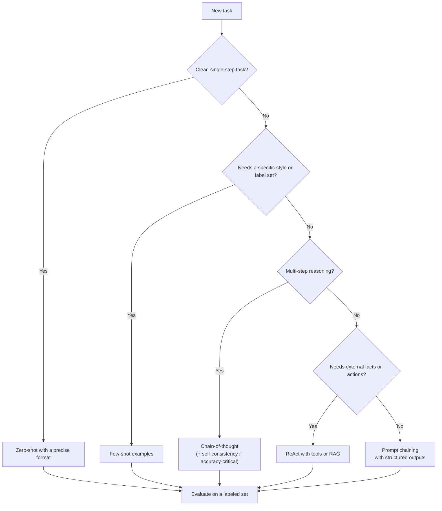
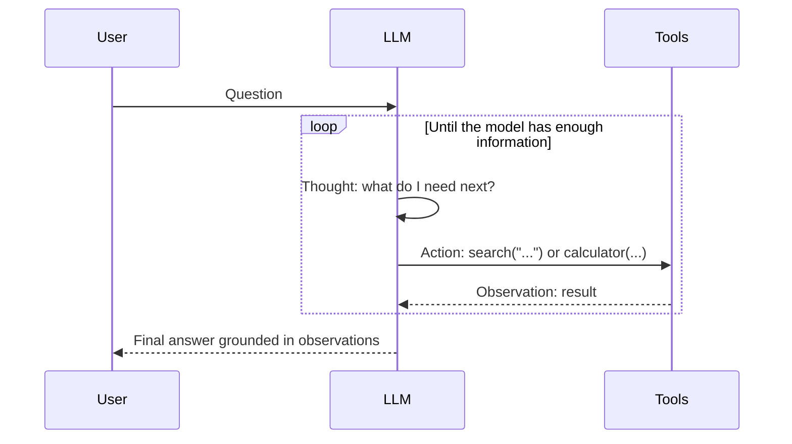
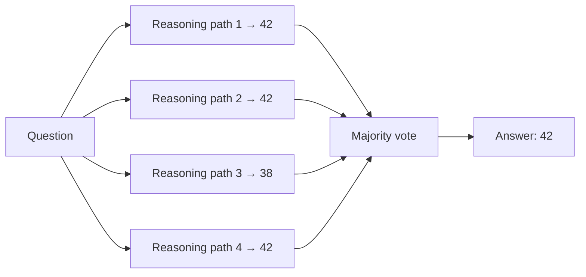

Prompt engineering questions test whether you know the main techniques by name, understand why they work, and can pick the cheapest one that solves the problem. Strong answers always connect a technique to cost, latency and how you would evaluate it.

## TL;DR

- **Zero-shot**: just instructions. Cheapest; works well for clear tasks on strong models.
- **Few-shot**: add examples to show format and style.
- **Chain-of-thought (CoT)**: ask the model to reason step by step before answering; helps multi-step problems.
- **Self-consistency**: sample several reasoning paths and take the majority answer.
- **ReAct**: interleave reasoning with tool calls and observations; the basis of most agents.
- **Tree-of-thought**: explore and evaluate several partial solutions, backtracking when needed.
- **Structured output** and **prompt chaining** make outputs machine-readable and break big tasks into reliable steps.

## The idea in plain English

Prompting is briefing a capable contractor. Zero-shot is "please do X". Few-shot is "here are three examples of what good looks like". Chain-of-thought is "show your working". Self-consistency is "solve it five times and go with the answer you got most often". ReAct is "you may use these tools; think, act, look at the result, and continue". Prompt chaining is splitting a big job into a checklist of smaller jobs, each with its own brief.

## Core concepts

1. **Zero-shot prompting.** Clear role, task, constraints and output format, no examples. Modern instruction-tuned models handle many tasks this way.

2. **Few-shot (in-context) learning.** A handful of input-output examples in the prompt. GPT-3 showed large models can pick up tasks from examples alone. Example choice, order and label balance all affect results.

3. **Chain-of-thought.** Prompting the model to write intermediate reasoning improves accuracy on arithmetic, logic and multi-step questions, especially for larger models. A simple "think step by step" instruction (zero-shot CoT) also works. Many current models are trained to reason internally, which reduces the need for explicit CoT prompts.

4. **Self-consistency.** Sample several CoT answers at a non-zero temperature and pick the most common final answer. Accuracy rises, and so does cost, in proportion to the number of samples.

5. **Least-to-most and decomposition.** Ask the model to break a problem into sub-questions, then solve them in order.

6. **ReAct (reason + act).** The model alternates thoughts, actions (tool calls) and observations (tool results). Grounding steps in real observations reduces hallucination and enables agents.

7. **Tree-of-thought.** Generate several candidate next steps, score them, and search the tree (breadth-first or depth-first) with backtracking. Powerful for puzzles and planning, but expensive.

8. **Structured output.** Ask for JSON matching a schema, ideally with the provider's structured-output or tool-calling feature so the output is guaranteed to parse.

9. **Prompt chaining.** Split a workflow into steps (extract, then classify, then draft, then check), each with a focused prompt and validated output.

10. **System prompts and roles.** Durable instructions, persona, policies and formatting rules live in the system prompt; per-request data goes in the user turn, clearly delimited.

11. **Prompt injection awareness.** Untrusted content (web pages, emails, retrieved documents) can contain instructions. Delimit it, tell the model to treat it as data, and never grant tools based on it alone.

## Architecture

How to choose in practice:

1. Start with the cheapest technique, zero-shot, and a small labeled evaluation set.
2. Add examples if the format or labels are inconsistent.
3. Add reasoning if multi-step questions fail.
4. Add tools or retrieval if answers need facts the model does not have.
5. Split into a chain if one prompt is doing too many jobs. Re-measure after every change.

## Deep dive

### The ReAct loop

### Self-consistency in one picture

### Anatomy of a production prompt

A robust prompt usually has: a role and goal; the task in one sentence; explicit constraints (length, tone, what to do when unsure); delimited inputs; a few examples if needed; and an exact output format. Saying what to do when information is missing ("answer 'unknown'") is one of the cheapest ways to reduce hallucination.

## Trade-offs

| Technique | Pros | Cons | When to use |
| --- | --- | --- | --- |
| Zero-shot | Cheapest, simplest | Format and edge cases can drift | Clear tasks on strong models |
| Few-shot | Teaches format and labels fast | More tokens; sensitive to example choice | Classification, extraction, house style |
| Chain-of-thought | Better multi-step accuracy | More output tokens and latency | Math, logic, planning |
| Self-consistency | Higher accuracy, a confidence signal | N times the cost | High-stakes answers with a single correct output |
| ReAct | Grounded in tools and data | More calls, needs a harness | Questions needing fresh facts or actions |
| Tree-of-thought | Solves search-like problems | Very expensive | Puzzles, complex planning |
| Prompt chaining | Each step testable and reliable | More orchestration code | Multi-stage workflows |

## Real-world examples

- GPT-3's paper popularized few-shot, in-context learning.
- The chain-of-thought paper reported large gains on math word problems for big models; "Let's think step by step" showed a zero-shot version.
- ReAct combined reasoning traces with actions such as Wikipedia lookups and became a template for agent frameworks.
- Most LLM APIs now offer structured outputs or tool calling with JSON schemas, so JSON formatting no longer has to be enforced by prompt wording alone.

## Common pitfalls

- Tuning prompts by eye on a few examples instead of measuring on a test set.
- Huge prompts that mix instructions, data and examples without clear delimiters.
- Using chain-of-thought where latency matters and the task is simple.
- Treating prompts as untracked strings; they should be versioned and reviewed like code.
- Trusting instructions found inside retrieved or user-provided content.

## How to answer in an interview

1. List the main techniques and what each adds.
2. Explain why CoT and self-consistency work, and what they cost.
3. Present a decision path from cheapest to most complex.
4. Show engineering discipline: evaluation sets, versioning, structured outputs.
5. Mention prompt injection and how you contain it.

**What interviewers listen for:** a cost-aware choice of technique and a measurement loop.

**Red flags:** "prompt engineering is just trial and error", or no awareness of injection risks.

## Further reading

- [Language Models are Few-Shot Learners (Brown et al., 2020)](https://arxiv.org/abs/2005.14165)
- [Chain-of-Thought Prompting Elicits Reasoning (Wei et al., 2022)](https://arxiv.org/abs/2201.11903)
- [Large Language Models are Zero-Shot Reasoners (Kojima et al., 2022)](https://arxiv.org/abs/2205.11916)
- [Self-Consistency Improves Chain of Thought Reasoning (Wang et al., 2022)](https://arxiv.org/abs/2203.11171)
- [ReAct: Synergizing Reasoning and Acting (Yao et al., 2022)](https://arxiv.org/abs/2210.03629)
- [Tree of Thoughts (Yao et al., 2023)](https://arxiv.org/abs/2305.10601)

<InterviewQuestions>
  <InterviewQuestion question="What is the difference between zero-shot and few-shot prompting?" category="Concepts" level="Junior">
    Zero-shot prompting gives only instructions, relying on what the model already knows. Few-shot prompting adds a small number of input-output examples so the model can infer the task, format and labels from them. Few-shot costs more tokens but usually gives more consistent outputs for tasks with a specific format or label set.
  </InterviewQuestion>
  <InterviewQuestion question="Why does chain-of-thought prompting improve reasoning?" category="Concepts" level="Junior">
    Writing out intermediate steps gives the model extra computation and lets later tokens condition on earlier results, instead of jumping straight to an answer. Each step is a simpler prediction than the whole problem. The gains are largest on multi-step tasks such as math and logic, and with larger models.
  </InterviewQuestion>
  <InterviewQuestion question="What is self-consistency, and what does it cost?" category="Trade-offs" level="Mid">
    You sample several chain-of-thought answers with some randomness and take the most common final answer. Different reasoning paths make different mistakes, so voting cancels many of them out, and the agreement rate is a useful confidence signal. The cost is linear in the number of samples, so it suits high-value questions rather than every request.
  </InterviewQuestion>
  <InterviewQuestion question="Explain the ReAct pattern." category="Architecture" level="Mid">
    ReAct alternates a thought, where the model reasons about what it needs, an action, where it calls a tool like search or a calculator, and an observation, where the tool result is added to the context. The loop continues until the model can answer. Grounding each step in real observations reduces hallucination and is the core loop behind most tool-using agents.
  </InterviewQuestion>
  <InterviewQuestion question="How do you reliably get JSON out of an LLM?" category="Architecture" level="Mid">
    Use the provider's structured-output or tool-calling feature with a JSON schema, so decoding is constrained to valid output. Keep the schema small and well described, validate the result in code, and on failure retry with the validation error included. Relying only on "respond in JSON" in the prompt works most of the time but is not dependable at scale.
  </InterviewQuestion>
  <InterviewQuestion question="When would you use prompt chaining instead of one large prompt?" category="Trade-offs" level="Mid">
    When a task has distinct stages, such as extracting facts, classifying them and drafting a response, or when one prompt is juggling too many rules. Each step in a chain gets a focused prompt and a validated output, so failures are easier to locate and fix, and each step can use a different, cheaper model where appropriate.
  </InterviewQuestion>
  <InterviewQuestion question="How do you evaluate and iterate on prompts in production?" category="Evaluation" level="Senior">
    Build a labeled evaluation set from real traffic, including edge cases and past failures. Define metrics per task, such as exact match, rubric scores or an LLM judge calibrated against human labels. Version prompts like code, run the suite on every change and compare to the baseline, then confirm improvements with an online A/B test. Track cost and latency alongside quality.
  </InterviewQuestion>
  <InterviewQuestion question="What is prompt injection, and how do you defend against it?" category="Failure modes" level="Senior">
    Prompt injection is when untrusted text, such as a web page, email or document, contains instructions that the model follows, for example to leak data or call a tool. Defenses are layered: clearly delimit untrusted content and instruct the model to treat it as data, restrict tools and permissions, require approval for sensitive actions, filter inputs and outputs, and test against known injection attacks. No prompt alone fully prevents it.
  </InterviewQuestion>
</InterviewQuestions>
