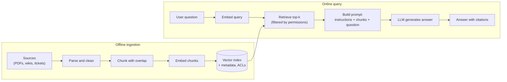
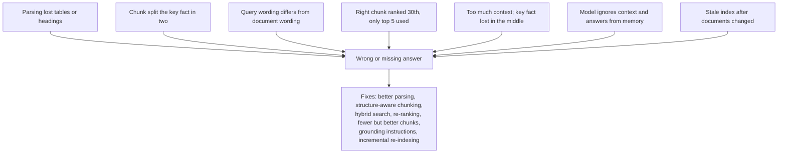

Retrieval-augmented generation (RAG) is the most common LLM system design question. You will be asked to design a "chat with our documents" product, so you need the full pipeline, the main failure points, and how you would measure quality.

## TL;DR

- RAG gives an LLM **fresh, private or specific knowledge** by retrieving relevant passages and putting them in the prompt.
- Two pipelines: **offline ingestion** (parse, chunk, embed, index) and **online query** (embed query, retrieve, build prompt, generate, cite).
- **Chunking and retrieval quality** usually matter more than the choice of LLM.
- Answers should be **grounded and cited**, and the system should say "I don't know" when retrieval finds nothing.
- Evaluate retrieval and generation **separately**: recall of the right passages, then faithfulness and relevance of the answer.

## The idea in plain English

An LLM is like a smart student taking a closed-book exam: it knows a lot, but not your company's policies and nothing after its training cut-off. RAG turns it into an open-book exam. Before answering, a librarian (the retriever) finds the most relevant pages from your documents and hands them over, and the student answers using those pages and points to where each fact came from.

## Core concepts

1. **Why RAG.** Fine-tuning is poor at adding fresh facts, is expensive to refresh, and does not give citations. RAG updates knowledge by updating an index, works with any model, and can cite sources and respect document permissions.

2. **Document parsing.** PDFs, HTML, slides and tables are converted to clean text with structure (titles, headings, tables) preserved. Bad parsing silently ruins everything downstream.

3. **Chunking.** Documents are split into passages, commonly a few hundred tokens with some overlap, ideally along natural boundaries (sections, paragraphs). Chunks that are too small lose context; too large dilute relevance and waste prompt space.

4. **Embeddings.** An embedding model maps each chunk and each query to a vector so semantically similar text lands close together. Query and documents must use the same model.

5. **Vector index.** Approximate nearest-neighbor indexes (such as HNSW) find the closest chunk vectors in milliseconds, even across millions of chunks, with metadata filters for things like tenant, date or access rights.

6. **Retrieval.** Embed the query, fetch the top-k chunks (often 5 to 20). Many systems combine vector search with keyword search (BM25) to catch exact terms like product codes.

7. **Prompt construction.** Put instructions, retrieved chunks with source ids, and the question into the prompt. Instruct the model to answer only from the provided context and cite sources.

8. **Generation with citations.** The model answers and references chunk ids, which the application turns into links.

9. **Access control.** Retrieval must filter by the user's permissions, or RAG becomes a data-leak machine.

## Architecture

The online path, step by step:

1. Receive the question and the user's identity.
2. Embed the question with the same model used for the chunks.
3. Retrieve the top-k chunks, filtered by the user's access rights and any metadata.
4. Build a prompt that contains instructions, the chunks with ids, and the question.
5. Generate an answer that cites chunk ids; if nothing relevant was found, say so.
6. Log the query, retrieved chunks and answer for evaluation.

## Deep dive

### Where RAG fails

Most RAG quality problems are **retrieval** problems. If the right passage is not in the prompt, no model can answer correctly.

### Measuring a RAG system

Evaluate in two layers with a test set of real questions:

- **Retrieval:** recall at k (is a correct passage in the top k?) and ranking metrics such as MRR or nDCG.
- **Generation:** faithfulness (is every claim supported by the retrieved context?), answer relevance, and correctness against reference answers. Frameworks such as RAGAS automate much of this with LLM-based graders.

## Trade-offs

| Decision | Option A | Option B | Guidance |
| --- | --- | --- | --- |
| RAG vs fine-tuning | Fresh facts, citations, access control | Learns style, format, domain behavior | RAG for knowledge; fine-tuning for behavior; often both |
| Small vs large chunks | Precise matches | More context per hit | Start around 300 to 800 tokens with overlap; tune on your eval set |
| Vector only vs hybrid search | Simple, semantic | Also catches exact terms and codes | Hybrid for enterprise data |
| More vs fewer retrieved chunks | Higher recall | Less noise, lower cost | Retrieve many, re-rank, keep a few |
| Long-context stuffing vs retrieval | No retrieval system | Cheaper, more focused, scales to huge corpora | Retrieval once the corpus exceeds what fits comfortably |

## Real-world examples

- The original RAG paper (Lewis et al., 2020) combined a dense retriever with a generator and improved results on open-domain question answering.
- Enterprise assistants that answer from internal wikis, support tickets and policy documents are the most common commercial RAG deployment.
- Research on long contexts ("Lost in the Middle") found models use information at the start and end of the prompt better than in the middle, one reason to send fewer, better-ranked chunks.

## Common pitfalls

- Skipping evaluation and judging quality from a demo.
- Ignoring document permissions in retrieval.
- Embedding queries and documents with different models or versions.
- Letting the index go stale when documents change or are deleted.
- No fallback when nothing relevant is found, which invites hallucination.

## How to answer in an interview

1. Clarify requirements: corpus size and types, freshness, permissions, latency, languages.
2. Draw both pipelines: ingestion and query.
3. Go deep on chunking and retrieval, the main quality levers.
4. Cover grounding, citations, and "I don't know" behavior.
5. Explain evaluation (retrieval recall, faithfulness) and operations (re-indexing, monitoring, cost).

**What interviewers listen for:** a complete pipeline, awareness that retrieval quality dominates, and a concrete evaluation plan.

**Red flags:** "just put the documents in a vector database" with no chunking, permissions or evaluation.

## Further reading

- [Retrieval-Augmented Generation for Knowledge-Intensive NLP Tasks (Lewis et al., 2020)](https://arxiv.org/abs/2005.11401)
- [Dense Passage Retrieval for Open-Domain QA (Karpukhin et al., 2020)](https://arxiv.org/abs/2004.04906)
- [Lost in the Middle: How Language Models Use Long Contexts (Liu et al., 2023)](https://arxiv.org/abs/2307.03172)
- [RAGAS: Automated Evaluation of Retrieval Augmented Generation (Es et al., 2023)](https://arxiv.org/abs/2309.15217)

<InterviewQuestions>
  <InterviewQuestion question="What is RAG and why is it used instead of fine-tuning for knowledge?" category="Concepts" level="Junior">
    RAG retrieves relevant documents at query time and includes them in the prompt so the model answers from them. It keeps knowledge fresh by updating an index rather than retraining, works with private data, supports citations, and can enforce access control per user. Fine-tuning is better at teaching behavior or style than at reliably adding facts.
  </InterviewQuestion>
  <InterviewQuestion question="Walk through the components of a basic RAG pipeline." category="Architecture" level="Junior">
    Offline, documents are parsed, split into chunks, embedded and stored in a vector index with metadata. Online, the user's query is embedded, the closest chunks are retrieved and filtered by permissions, a prompt is built from instructions, chunks and the question, and the LLM generates an answer with citations.
  </InterviewQuestion>
  <InterviewQuestion question="How do you choose a chunk size?" category="Trade-offs" level="Mid">
    It depends on the documents and questions. Small chunks give precise matches but may lose surrounding context; large chunks keep context but dilute relevance and use more prompt space. I would start with structure-aware chunks of a few hundred tokens with overlap, then compare a few sizes on a retrieval evaluation set using recall at k and answer quality.
  </InterviewQuestion>
  <InterviewQuestion question="Your RAG system gives wrong answers. How do you debug it?" category="Failure modes" level="Mid">
    First check whether the right passage was retrieved at all. If not, it is a retrieval problem: look at parsing, chunking, query wording and ranking, and consider hybrid search or re-ranking. If the right passage was retrieved but the answer is still wrong, it is a generation problem: check prompt instructions, context order and length, and whether the model is ignoring the context. Measuring retrieval and generation separately makes this fast.
  </InterviewQuestion>
  <InterviewQuestion question="How do you prevent RAG from leaking documents a user should not see?" category="Architecture" level="Mid">
    Store access-control information as metadata with every chunk and filter at retrieval time using the user's identity and groups, so unauthorized chunks never reach the prompt. Keep permissions in sync with the source systems, and test the filter with users of different roles. Filtering after generation is too late.
  </InterviewQuestion>
  <InterviewQuestion question="How would you evaluate a RAG system?" category="Evaluation" level="Senior">
    Build a test set of real questions with reference answers and the passages that support them. Measure retrieval with recall at k and ranking metrics, and generation with faithfulness to the retrieved context, answer relevance and correctness, using LLM graders calibrated against human labels. Track these on every change, and monitor production with sampled reviews, user feedback and the rate of "no relevant context" responses.
  </InterviewQuestion>
  <InterviewQuestion question="When would you stuff a long context window instead of building retrieval?" category="Trade-offs" level="Senior">
    When the relevant material is small enough to fit comfortably, for example a few documents per conversation, and freshness and permissions are simple. Long contexts cost more per query, add latency, and models use information in the middle of long prompts less reliably. For large or growing corpora, retrieval is cheaper and more accurate, and the two can be combined by retrieving a larger, well-ordered context.
  </InterviewQuestion>
</InterviewQuestions>
