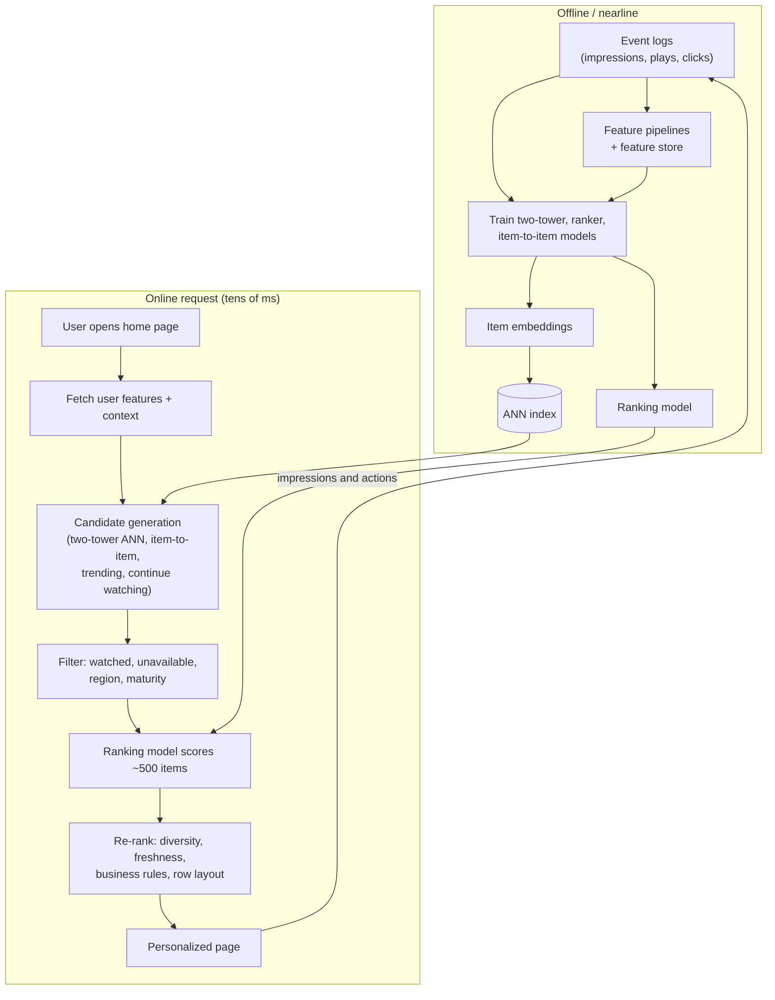
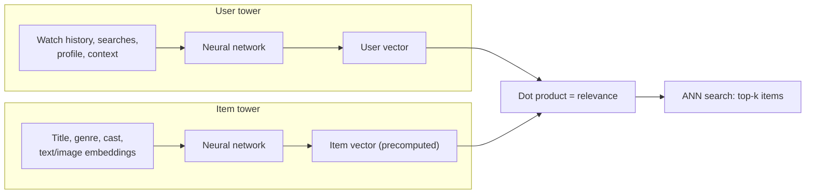

"Design the recommendation system for Netflix (or YouTube, or an online store)" is one of the most frequent ML system design questions. A strong answer follows the funnel: narrow millions of items to a few hundred cheaply, rank them precisely, then adjust the final list for business goals, all measured with online experiments.

## TL;DR

- Recommenders are a **multi-stage funnel**: candidate generation (millions to hundreds), ranking (hundreds to tens), re-ranking (business rules, diversity, freshness).
- **Collaborative filtering** learns from user-item interactions; **content-based** methods use item features; production systems blend both.
- **Two-tower models** embed users and items separately so candidates can be retrieved with fast nearest-neighbor search.
- **Rankers** are richer models (gradient-boosted trees or deep networks) predicting engagement such as click, watch time or purchase.
- **Cold start**, **feedback loops**, **exploration** and **choosing the right objective** are the hard problems.
- Success is measured by **online A/B tests** on long-term metrics such as retention, not just offline accuracy.

## The idea in plain English

Think of a great video-store clerk. They cannot show you every movie, so first they grab a pile of possibly interesting ones based on what people like you enjoyed (candidate generation). Then they look carefully at that pile, considering your mood and what you watched yesterday, and order it (ranking). Finally they make sure the shelf is not all one genre and includes something new (re-ranking). They learn from what you actually pick up.

## Core concepts

1. **Explicit vs implicit feedback.** Ratings are explicit but rare; clicks, plays, watch time, purchases and skips are implicit and plentiful, but noisy (a click is not always satisfaction).

2. **Collaborative filtering.** Users who behaved similarly will like similar items. Matrix factorization learns a vector per user and per item so their dot product predicts interaction.

3. **Item-to-item similarity.** "People who bought this also bought" computed from co-occurrence. Simple, explainable and very scalable.

4. **Content-based features.** Item metadata, text, images and audio embeddings let you recommend items with no interaction history.

5. **Two-tower retrieval.** A user tower (history, context) and an item tower (features) produce embeddings in the same space, trained so engaged pairs score high. Item vectors are precomputed and searched with approximate nearest neighbor (ANN) indexes.

6. **Multiple candidate sources.** Two-tower, item-to-item, trending, "continue watching", new releases and editorial lists all feed the candidate pool.

7. **Ranking model.** Scores each candidate with many features: user history, item features, context (time, device), and cross features. Often multi-task, predicting click, watch time, like and share together and combining them in a weighted score.

8. **Re-ranking.** Applies diversity, freshness, de-duplication, fairness, business rules and page layout (rows, carousels).

9. **Cold start.** New users: ask for preferences, use popularity and context, learn quickly from first actions. New items: use content features and give controlled exposure.

10. **Exploration vs exploitation.** Always showing the predicted best item stops the system from learning about others. Bandit methods (epsilon-greedy, Thompson sampling, contextual bandits) reserve some exposure for learning.

11. **Feedback loops and position bias.** Users click what is shown and what is on top. Logging positions and propensities, and correcting for them, prevents the model from just learning its own past choices.

## Architecture

The request path:

1. Load the user's features (history, preferences) and context (device, time, country).
2. Pull candidates from several sources, a few hundred to a few thousand items in total.
3. Remove ineligible items.
4. Score every candidate with the ranking model.
5. Re-rank for diversity, freshness and business rules, and arrange into rows.
6. Log what was shown and at which position, so training data reflects exposure.

## Deep dive

### Two-tower retrieval

Training uses positive pairs (user engaged with item) and negatives, often other items in the same batch (in-batch negatives) with a correction for popularity bias, since popular items appear as negatives more often.

### Case studies

**Netflix.** Netflix researchers reported that recommendations drive most of what members watch, roughly 80% of hours streamed in their 2015 paper, and estimated the combined effect of personalization and recommendations on retention at over \$1 billion a year. The home page is built from rows, each a ranked list from a different algorithm (top picks, because you watched, trending, continue watching), with row selection itself personalized. Netflix also personalizes the **artwork** shown for each title, framing it as a contextual bandit problem: for each member and title, choose which image to show, learn from plays, and evaluate policies offline with replay-style estimators before A/B tests.

**YouTube.** Covington et al. (2016) described a two-stage deep learning system: a candidate generation network selects hundreds of videos from millions using the user's watch and search history, and a ranking network scores them with richer features. Ranking was trained to predict **expected watch time** rather than clicks, to avoid rewarding clickbait.

**Amazon.** Linden et al. (2003) described item-to-item collaborative filtering: precompute, for each item, which items customers tend to buy together, then recommend based on the items in a user's history. It scales because the expensive work is done offline per item, not per user.

**Pinterest.** PinSage (Ying et al., 2018) applied graph convolutional networks to a graph of billions of pins and boards, producing item embeddings that combine visual, text and graph signals for related-pin recommendations.

## Trade-offs

| Decision | Option A | Option B | Guidance |
| --- | --- | --- | --- |
| Collaborative vs content-based | Captures taste patterns | Handles new items | Hybrid; content features for cold start |
| Optimize clicks vs watch time / satisfaction | Fast feedback | Better long-term value | Optimize for long-term signals, guard against clickbait |
| Single-stage vs multi-stage | Simple | Scales to millions of items | Multi-stage beyond a few thousand items |
| Exploitation vs exploration | Short-term engagement | Learning, freshness, fairness to new items | Reserve controlled exploration traffic |
| Real-time vs batch features | Reacts to the current session | Simpler, cheaper | Real-time for session signals; batch for long-term profile |

## Real-world examples

- Netflix: row-based personalized home page; artwork personalization with contextual bandits; heavy use of A/B testing.
- YouTube: candidate generation plus ranking with deep networks, trained toward watch time.
- Amazon: item-to-item collaborative filtering at catalog scale.
- Pinterest: graph neural network embeddings (PinSage) for related content.
- Google's Wide and Deep and Meta's DLRM are widely cited ranking architectures that combine memorization of feature crosses with deep generalization.

## Common pitfalls

- Optimizing offline accuracy (for example AUC) that does not move online metrics.
- Ignoring position bias and the feedback loop, so the model learns its own past exposure.
- No exploration, which starves new items and narrows recommendations over time.
- Data leakage: features computed with information from after the recommendation was shown.
- Optimizing short-term clicks at the cost of satisfaction and retention.

## How to answer in an interview

1. Clarify the product surface, scale, objective and latency budget.
2. Define the objective and labels carefully (watch time, satisfaction, not just clicks).
3. Draw the funnel: candidate sources, ranking, re-ranking.
4. Detail the models and features, cold start and exploration.
5. Explain evaluation: offline metrics (recall at k, nDCG), then online A/B tests on long-term metrics, plus monitoring.

**What interviewers listen for:** the multi-stage funnel, a thoughtful objective, and awareness of feedback loops and experimentation.

**Red flags:** one giant model scoring every item, or optimizing clicks without discussing quality.

## Further reading

- [The Netflix Recommender System: Algorithms, Business Value, and Innovation (Gomez-Uribe and Hunt, 2015)](https://doi.org/10.1145/2843948)
- [Artwork Personalization at Netflix (Netflix TechBlog)](https://netflixtechblog.com/artwork-personalization-c589f074ad76)
- [Deep Neural Networks for YouTube Recommendations (Covington et al., 2016)](https://doi.org/10.1145/2959100.2959190)
- [Amazon.com Recommendations: Item-to-Item Collaborative Filtering (Linden et al., 2003)](https://doi.org/10.1109/MIC.2003.1167344)
- [Graph Convolutional Neural Networks for Web-Scale Recommender Systems, PinSage (Ying et al., 2018)](https://arxiv.org/abs/1806.01973)
- [Wide and Deep Learning for Recommender Systems (Cheng et al., 2016)](https://arxiv.org/abs/1606.07792)

<InterviewQuestions>
  <InterviewQuestion question="Why are recommenders built as multi-stage systems?" category="Architecture" level="Junior">
    Scoring millions of items with a rich model for every request would be far too slow and expensive. A cheap candidate stage narrows the catalog to a few hundred plausible items using precomputed embeddings and simple sources, a heavier ranking model scores only those, and re-ranking adjusts the final list. Each stage trades accuracy for cost appropriately.
  </InterviewQuestion>
  <InterviewQuestion question="Explain collaborative filtering vs content-based filtering." category="Concepts" level="Junior">
    Collaborative filtering uses patterns in user-item interactions: users with similar histories get similar recommendations, without needing to understand the items. Content-based filtering uses item features such as genre, text or images to recommend items similar to what a user liked. Collaborative filtering captures taste better; content-based methods handle new items. Production systems combine them.
  </InterviewQuestion>
  <InterviewQuestion question="How does a two-tower model work and why is it popular for retrieval?" category="Concepts" level="Mid">
    One network embeds the user and context, another embeds items, and training makes the dot product high for pairs where the user engaged. Because the item tower does not depend on the user, all item vectors can be precomputed and indexed, so retrieval becomes a fast approximate nearest-neighbor search. That makes it practical over millions of items within milliseconds.
  </InterviewQuestion>
  <InterviewQuestion question="How would you handle cold start for new users and new items?" category="Failure modes" level="Mid">
    For new users, use onboarding preferences, context such as country and device, and popular or trending items, then adapt quickly from the first few interactions with session-based signals. For new items, rely on content features through the item tower, and give them controlled exploration exposure so the system collects interaction data before they compete purely on predicted engagement.
  </InterviewQuestion>
  <InterviewQuestion question="Why did YouTube's ranking model predict watch time instead of clicks?" category="Trade-offs" level="Mid">
    Click-through rate rewards attention-grabbing thumbnails and titles even when the video disappoints, which hurts user satisfaction. Expected watch time better reflects whether the user actually valued the recommendation. Choosing the training objective is one of the most important product decisions in a recommender.
  </InterviewQuestion>
  <InterviewQuestion question="How does Netflix choose which artwork to show, and why use bandits?" category="Architecture" level="Senior">
    Netflix frames artwork selection per member and title as a contextual bandit: the context is the member and the title, the actions are candidate images, and the reward comes from whether the member plays the title. Bandits learn online while balancing exploration of images with exploiting the best-known one, which is faster than repeated batch A/B tests. Policies are evaluated offline with replay-style estimators on logged data with randomized exploration before live tests.
  </InterviewQuestion>
  <InterviewQuestion question="What is position bias and how do you correct for it?" category="Failure modes" level="Senior">
    Items shown higher get more clicks regardless of relevance, so naive training data overstates the value of top-placed items and the model learns to repeat its past ranking. Corrections include logging position and adding it as a training feature set to a constant at serving time, inverse propensity weighting with propensities estimated from randomized experiments, and small amounts of randomized exploration.
  </InterviewQuestion>
  <InterviewQuestion question="How do you evaluate a recommender before and after launch?" category="Evaluation" level="Senior">
    Offline, use time-based splits and measure recall at k for candidate generation and nDCG or AUC for ranking, plus coverage and diversity, avoiding leakage from future data. Offline results only filter ideas; the decision comes from online A/B tests on primary metrics such as engagement and retention, with guardrails for latency, diversity and complaints, run long enough to capture novelty effects.
  </InterviewQuestion>
</InterviewQuestions>
