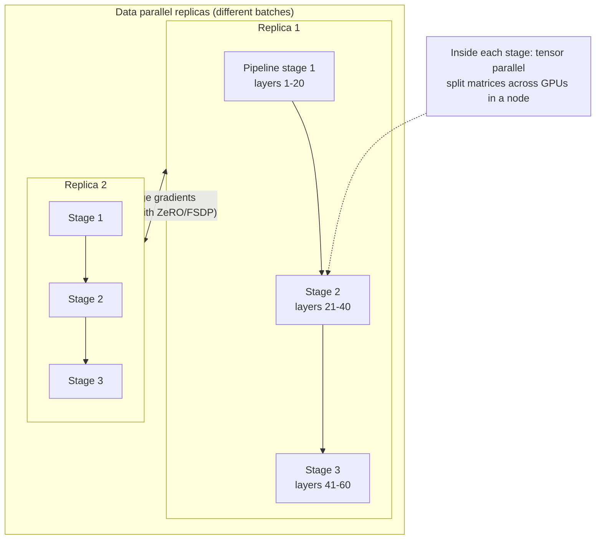

This topic separates people who have used LLMs from people who understand how they are built. Expect questions on the training pipeline, compute-optimal model sizing, and how training is split across thousands of GPUs.

## TL;DR

- LLMs are built in stages: **pre-training** on huge text corpora, then **supervised fine-tuning**, then **preference tuning** (RLHF or DPO).
- **Scaling laws** show loss falls predictably as a power law in parameters, data and compute.
- **Chinchilla** found compute-optimal training uses about **20 tokens per parameter**, much more data than earlier models used.
- Training compute is roughly **6 x parameters x tokens** floating-point operations.
- **Mixed precision** (bf16), **data parallelism with sharding** (ZeRO, FSDP), **tensor parallelism** and **pipeline parallelism** make large-scale training possible.

## The idea in plain English

Training an LLM is like educating a student in three stages. First, they read most of a library (pre-training) and learn language and facts. Then a tutor shows them thousands of good question-and-answer examples (supervised fine-tuning). Finally, people compare two of the student's answers and say which is better, and the student adjusts (preference tuning).

Scaling laws are the school's budget rules: for a fixed amount of teaching time, they tell you how big a brain to train and how many books it should read.

## Core concepts

1. **Pre-training.** Next-token prediction on trillions of tokens of web, code, books and curated data. Data quality, deduplication and mixture matter as much as quantity.

2. **Supervised fine-tuning (SFT).** Training on curated instruction-response pairs so the model follows instructions and adopts a format.

3. **Preference tuning.** RLHF trains a reward model from human comparisons and optimizes the LLM against it with reinforcement learning (often PPO). DPO skips the reward model and optimizes directly on preference pairs, which is simpler and more stable.

4. **Kaplan scaling laws (2020).** Loss falls as a power law in model size, data size and compute, over many orders of magnitude. Their analysis suggested growing models faster than data.

5. **Chinchilla (2022).** Re-ran the analysis with better learning-rate schedules and found parameters and tokens should grow in equal proportion. A 70-billion-parameter model trained on 1.4 trillion tokens outperformed the 280-billion-parameter Gopher with the same compute.

6. **Compute estimate.** Training cost is about 6 floating-point operations per parameter per token: 2 for the forward pass and 4 for the backward pass.

7. **Over-training for inference.** Many production models are trained far past the Chinchilla ratio, because a smaller model trained longer is cheaper to serve for its whole life.

8. **Mixed precision.** Computing in bf16 or fp16 with fp32 master weights halves memory and speeds up math. bf16 has the same exponent range as fp32, so it rarely needs loss scaling.

9. **Parallelism.**
   - **Data parallel:** each GPU has a full model copy and different data; gradients are averaged.
   - **ZeRO and FSDP:** shard optimizer states, gradients and parameters across data-parallel GPUs to save memory.
   - **Tensor parallel:** split individual matrix multiplications across GPUs within a node.
   - **Pipeline parallel:** place different layers on different GPUs and stream micro-batches through them.

## Architecture

```mermaid
flowchart LR
    DATA["Raw corpora<br/>(web, code, books)"] --> CLEAN["Filter, deduplicate,<br/>mix domains"]
    CLEAN --> TOK["Tokenize"]
    TOK --> PT["Pre-training<br/>(next-token prediction)"]:::accent
    PT --> BASE["Base model"]
    BASE --> SFT["Supervised fine-tuning<br/>(instruction data)"]
    SFT --> PREF["Preference tuning<br/>(RLHF or DPO)"]
    PREF --> SAFE["Safety tuning and evals"]
    SAFE --> REL["Released assistant model"]
```

The pipeline stage by stage:

1. Build a large, clean, deduplicated dataset with a deliberate mix of domains.
2. Pre-train with next-token prediction until the compute budget is spent.
3. Fine-tune on instruction data to get a helpful format.
4. Align with preference data so outputs match what people prefer.
5. Evaluate on capability and safety benchmarks before release.

## Deep dive

### How a large training job is split across GPUs

Large jobs combine all three: tensor parallelism inside a server, pipeline parallelism across servers, and data parallelism across replicas. This is often called 3D parallelism.

### A worked compute estimate

A 7-billion-parameter model trained on 2 trillion tokens needs about 6 x 7e9 x 2e12 = 8.4e22 floating-point operations. At an effective 400 teraflops per GPU, that is about 58,000 GPU-hours, or roughly 2.5 days on 1,000 GPUs, before accounting for failures, restarts and lower real-world utilization.

## Trade-offs

| Decision | Option A | Option B | Guidance |
| --- | --- | --- | --- |
| Model size vs data | Bigger model, fewer tokens | Smaller model, more tokens | Chinchilla-optimal for best training loss; over-train smaller models if inference cost dominates |
| RLHF vs DPO | Flexible, strong results, reward model reusable | Simpler, stable, no RL loop | DPO as a default; RLHF when you need online exploration or reusable rewards |
| fp16 vs bf16 | Wider hardware support | No loss scaling, more stable | bf16 on modern GPUs |
| Data parallel only vs sharded | Simple | Fits much larger models | Use ZeRO or FSDP once the model and optimizer stop fitting on one GPU |
| Pipeline parallel | Fits very deep models | Pipeline "bubbles" leave GPUs idle | Use with enough micro-batches to keep the bubble small |

## Real-world examples

- Kaplan et al. (2020) documented power-law scaling for language models.
- Chinchilla (2022) showed many earlier large models were undertrained for their size.
- InstructGPT (2022) showed a 1.3-billion-parameter model tuned with RLHF was preferred by people over the 175-billion-parameter GPT-3 base model.
- Megatron-LM introduced practical tensor parallelism; ZeRO introduced optimizer-state sharding.

## Common pitfalls

- Treating scaling laws as guarantees of specific abilities. They predict loss, not when a skill appears.
- Forgetting that optimizer states (Adam keeps two extra values per parameter) often use more memory than the weights.
- Ignoring data quality; deduplication and filtering often beat raw volume.
- Confusing fine-tuning compute with pre-training compute; fine-tuning is typically orders of magnitude cheaper.

## How to answer in an interview

1. Lay out the pipeline: pre-train, SFT, preference tuning, evaluation.
2. State the scaling-law idea and the Chinchilla ratio.
3. Estimate compute with 6ND.
4. Explain memory: weights, gradients, optimizer states, activations; and mixed precision.
5. Explain how parallelism splits that memory and compute.

**What interviewers listen for:** a correct pipeline, a quick compute estimate, and a clear picture of where memory goes.

**Red flags:** thinking alignment happens during pre-training, or no idea how a model larger than one GPU is trained.

## Further reading

- [Scaling Laws for Neural Language Models (Kaplan et al., 2020)](https://arxiv.org/abs/2001.08361)
- [Training Compute-Optimal LLMs, Chinchilla (Hoffmann et al., 2022)](https://arxiv.org/abs/2203.15556)
- [Training Language Models to Follow Instructions, InstructGPT (Ouyang et al., 2022)](https://arxiv.org/abs/2203.02155)
- [ZeRO: Memory Optimizations Toward Training Trillion Parameter Models (Rajbhandari et al., 2019)](https://arxiv.org/abs/1910.02054)
- [Megatron-LM (Shoeybi et al., 2019)](https://arxiv.org/abs/1909.08053)

<InterviewQuestions>
  <InterviewQuestion question="Describe the stages of training a chat LLM." category="Concepts" level="Junior">
    First, pre-training on a very large text corpus with next-token prediction produces a base model that knows language and facts but does not reliably follow instructions. Then supervised fine-tuning on instruction-response examples teaches format and helpfulness. Finally, preference tuning, using RLHF or DPO on human or AI comparisons, aligns outputs with what people prefer, followed by safety evaluation.
  </InterviewQuestion>
  <InterviewQuestion question="What did the Chinchilla paper change about how models are sized?" category="Scaling" level="Mid">
    It showed that for a fixed compute budget, parameters and training tokens should grow roughly in equal proportion, at around 20 tokens per parameter. Earlier large models had too many parameters and too little data for their compute. Chinchilla, at 70 billion parameters on 1.4 trillion tokens, beat the much larger Gopher at the same compute.
  </InterviewQuestion>
  <InterviewQuestion question="Why do companies train models well beyond the Chinchilla-optimal number of tokens?" category="Trade-offs" level="Mid">
    Chinchilla minimizes training compute for a target loss, but a deployed model's lifetime cost is dominated by inference. Training a smaller model on far more tokens costs more upfront but produces a model that is cheaper and faster to serve for billions of requests, so total cost is lower.
  </InterviewQuestion>
  <InterviewQuestion question="Roughly how much compute does it take to train a 7B model on 2 trillion tokens?" category="Scaling" level="Mid">
    Using about 6 floating-point operations per parameter per token, it is 6 times 7e9 times 2e12, or about 8.4e22 operations. At an effective 400 teraflops per GPU that is about 58,000 GPU-hours, roughly two and a half days on a thousand GPUs, plus overhead for failures, restarts and lower utilization.
  </InterviewQuestion>
  <InterviewQuestion question="Explain data, tensor and pipeline parallelism." category="Architecture" level="Senior">
    Data parallelism gives each GPU a model copy and different data, then averages gradients; ZeRO or FSDP shard the optimizer states, gradients and weights so copies do not each hold everything. Tensor parallelism splits individual weight matrices across GPUs, which needs fast interconnects so it usually stays inside a server. Pipeline parallelism puts different layers on different GPUs and streams micro-batches through, at the cost of idle bubbles. Large runs combine all three.
  </InterviewQuestion>
  <InterviewQuestion question="Where does GPU memory go when training a model with Adam?" category="Scaling" level="Senior">
    With mixed precision, weights and gradients take about 2 bytes per parameter each, and Adam keeps fp32 master weights plus two moment estimates at about 12 bytes per parameter, so roughly 16 bytes per parameter before activations. Activations add memory proportional to batch size, sequence length and depth, which gradient checkpointing reduces by recomputing them. Sharding with ZeRO or FSDP spreads the per-parameter states across GPUs.
  </InterviewQuestion>
  <InterviewQuestion question="Compare RLHF and DPO." category="Trade-offs" level="Senior">
    RLHF trains a separate reward model on human comparisons, then optimizes the LLM with reinforcement learning such as PPO while a KL penalty keeps it close to the starting model. It is flexible but complex and can be unstable. DPO derives a loss directly on preference pairs that achieves a similar objective without a reward model or RL loop, so it is simpler and more stable, and it is a common default today.
  </InterviewQuestion>
</InterviewQuestions>
