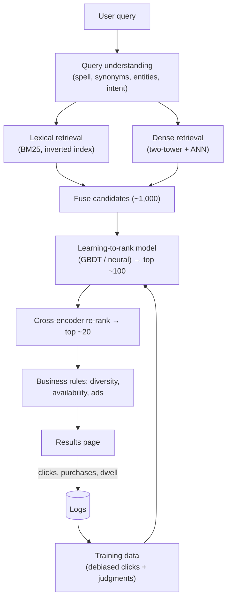
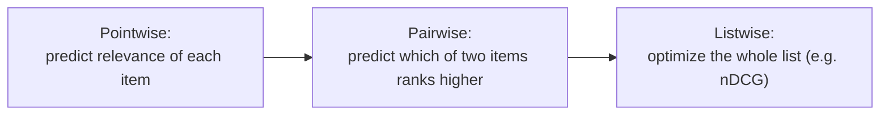

"Design search for an e-commerce site" (or a job board, or a document platform) is a classic ML system design question. The structure mirrors recommendation: retrieve candidates cheaply, rank them precisely, and measure with both offline relevance metrics and online behavior.

## TL;DR

- Pipeline: **query understanding → candidate retrieval (lexical + semantic) → ranking (learning to rank) → re-ranking and business rules**.
- **BM25** catches exact terms; **dense retrieval** catches meaning; production systems use **hybrid** retrieval.
- **Learning to rank** (for example LambdaMART or neural rankers) combines many features into a relevance score.
- Labels come from **human relevance judgments** and **click logs** corrected for **position bias**.
- Evaluate offline with **nDCG and MRR**, online with **A/B tests or interleaving** on success metrics like purchases or successful sessions.

## The idea in plain English

A search engine is a shop assistant who hears a vague request ("comfy running shoes for flat feet"), understands what you mean, grabs a pile of possible products from the stockroom, then arranges the best ones at the front, considering what similar customers bought and what is in stock.

## Core concepts

1. **Query understanding.** Spelling correction, tokenization, synonyms, entity and attribute extraction ("size 10", "under 100 dollars"), intent classification (navigational vs exploratory), and query rewriting.

2. **Inverted index and BM25.** Maps terms to documents; BM25 scores term matches with term frequency, rarity and document length normalization.

3. **Dense retrieval.** Two-tower embedding models for queries and documents with ANN search; strong for paraphrases and long-tail queries.

4. **Hybrid fusion.** Combine lexical and dense candidates, for example with reciprocal rank fusion.

5. **Learning to rank (LTR).** Pointwise (predict a relevance score per item), pairwise (predict which of two items is better, as in RankNet) and listwise (optimize a list metric, as in LambdaMART) approaches.

6. **Ranking features.** Text match scores, semantic similarity, popularity, freshness, price, ratings, personalization, availability, and query-item interaction history.

7. **Cross-encoder re-ranking.** A transformer reads the query and item together for the top results; expensive but precise.

8. **Labels and bias.** Clicks are biased toward top positions and attractive titles. Human-judged relevance sets anchor evaluation; click models and propensity weighting debias training data.

9. **Business re-ranking.** Diversity, de-duplication, sponsored placements, inventory and policy rules.

## Architecture

The query path:

1. Understand and rewrite the query, extracting filters and intent.
2. Retrieve candidates from lexical and dense indexes in parallel and fuse them.
3. Score candidates with a learning-to-rank model using many features.
4. Re-rank the top results with a cross-encoder if latency allows.
5. Apply business rules and render results.
6. Log impressions with positions and outcomes for training and evaluation.

## Deep dive

### Pointwise, pairwise and listwise ranking

LambdaMART, a gradient-boosted tree method using listwise-style gradients, has long been a strong production baseline because it handles heterogeneous features well.

### Offline and online evaluation

- **Offline:** nDCG at 10, MRR, recall of candidate generation, using human judgments and debiased click labels.
- **Online:** click-through, successful sessions, conversion, zero-result rate, query reformulation rate, time to success.
- **Interleaving** compares two rankers on the same users quickly before full A/B tests.

## Trade-offs

| Decision | Option A | Option B | Guidance |
| --- | --- | --- | --- |
| Lexical vs dense retrieval | Exact matches, explainable | Semantic matches | Hybrid in production |
| GBDT vs neural ranker | Strong with tabular features, fast | Better with text and huge data | GBDT first; neural as data grows |
| Cross-encoder re-ranking | Highest precision | Latency and cost | Top results only |
| Clicks vs human labels | Cheap, plentiful | Unbiased, costly | Clicks for training (debiased), humans for evaluation |
| Personalization | More relevant | Privacy, filter bubbles | Light personalization on top of relevance |

## Real-world examples

- BM25 remains a standard baseline in search and in retrieval benchmarks.
- MS MARCO is a widely used large-scale passage ranking benchmark built from real search queries.
- LambdaMART won learning-to-rank competitions and is widely used in production ranking.
- ColBERT and cross-encoders brought transformer-based relevance into search pipelines.

## Common pitfalls

- Training on raw clicks, which reinforces existing ranking (position bias).
- Ignoring zero-result and reformulated queries, the clearest failure signals.
- Ranking features that leak post-click information.
- Optimizing clicks instead of task success.

## How to answer in an interview

1. Clarify the corpus, query types, scale and success metric.
2. Draw the funnel: query understanding, hybrid retrieval, LTR, re-ranking, rules.
3. Detail features and labels, including bias correction.
4. Explain offline metrics and online experiments.
5. Discuss latency budgets, freshness of the index and personalization.

**What interviewers listen for:** a staged pipeline, label quality awareness, and the right metrics.

**Red flags:** one model scoring the whole catalog, or ignoring position bias.

## Further reading

- [The Probabilistic Relevance Framework: BM25 and Beyond (Robertson and Zaragoza, 2009)](https://doi.org/10.1561/1500000019)
- [From RankNet to LambdaRank to LambdaMART: An Overview (Burges, 2010)](https://www.microsoft.com/en-us/research/publication/from-ranknet-to-lambdarank-to-lambdamart-an-overview/)
- [MS MARCO: A Human Generated MAchine Reading COmprehension Dataset (Bajaj et al., 2016)](https://arxiv.org/abs/1611.09268)
- [Dense Passage Retrieval (Karpukhin et al., 2020)](https://arxiv.org/abs/2004.04906)
- [ColBERT (Khattab and Zaharia, 2020)](https://arxiv.org/abs/2004.12832)

<InterviewQuestions>
  <InterviewQuestion question="Walk through the stages of a search ranking system." category="Architecture" level="Junior">
    Query understanding normalizes and interprets the query; candidate retrieval uses lexical and semantic indexes to fetch hundreds or thousands of candidates; a learning-to-rank model scores them with many features; a precise re-ranker refines the top results; and business rules handle diversity, availability and ads before display.
  </InterviewQuestion>
  <InterviewQuestion question="Explain pointwise, pairwise and listwise learning to rank." category="Concepts" level="Mid">
    Pointwise methods predict a relevance score or label for each item independently. Pairwise methods learn from pairs, predicting which item should rank higher, as in RankNet. Listwise methods optimize a measure of the whole ranked list, such as nDCG, as LambdaMART effectively does. Listwise and pairwise methods usually match ranking metrics better.
  </InterviewQuestion>
  <InterviewQuestion question="How do you get training labels for search ranking?" category="Concepts" level="Mid">
    Combine human relevance judgments on sampled queries, which are accurate but limited, with implicit feedback from logs such as clicks, add-to-cart and purchases, which are plentiful but biased. Correct click bias with position-aware models or propensity weighting, and use human labels as the main evaluation set.
  </InterviewQuestion>
  <InterviewQuestion question="How would you handle queries that return zero results?" category="Failure modes" level="Mid">
    Track the zero-result rate by query type, add spelling correction and synonym expansion, relax filters or fall back to semantic retrieval, and show related categories or popular items instead of an empty page. Review frequent zero-result queries to find catalog gaps or vocabulary mismatches.
  </InterviewQuestion>
  <InterviewQuestion question="How do you evaluate a new ranking model?" category="Evaluation" level="Senior">
    Offline, compare nDCG at 10 and MRR on human-judged queries and debiased click data, checking segments such as head and tail queries. Then use interleaving for a fast, sensitive online comparison, followed by an A/B test on success metrics such as purchases per session, with guardrails on latency and zero-result rate.
  </InterviewQuestion>
  <InterviewQuestion question="When would you add semantic retrieval to a keyword search engine?" category="Trade-offs" level="Mid">
    When users phrase queries differently from item text, for long-tail and natural-language queries, or across languages. Keep BM25 for exact matches such as product codes and brands, and fuse both. Measure gains on queries where keyword search had low recall.
  </InterviewQuestion>
</InterviewQuestions>
