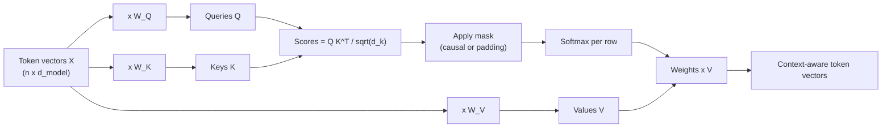
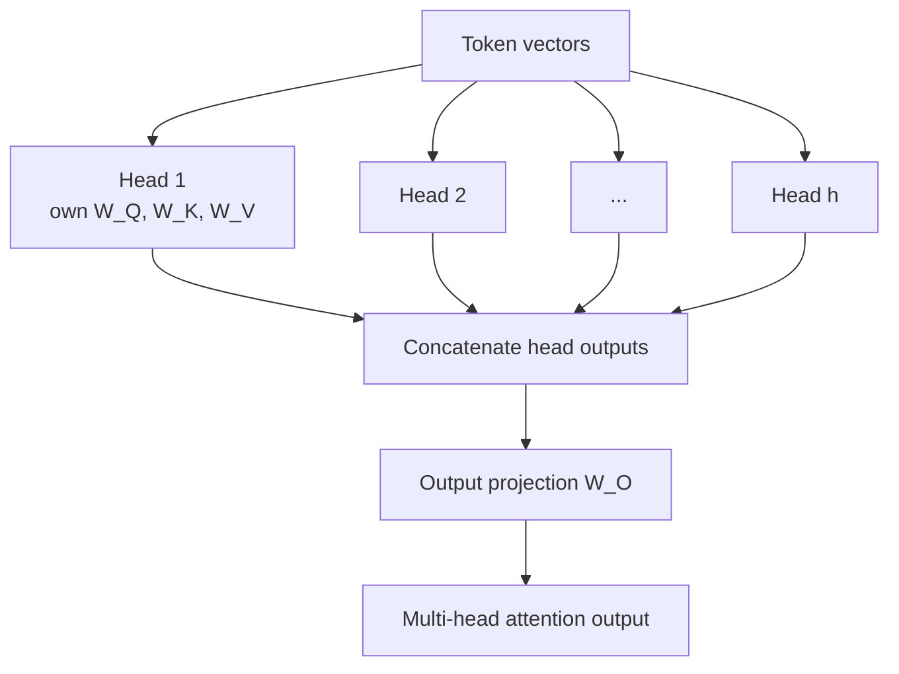

Self-attention is the one mechanism you must be able to derive in an AI interview. Expect to write the formula, explain each matrix, compute a tiny example, and discuss its cost.

## TL;DR

- Every token creates a **query** (what it is looking for), a **key** (what it offers) and a **value** (what it passes on).
- Relevance between two tokens is the **dot product** of one's query and the other's key, scaled and turned into weights with a **softmax**.
- Each token's output is the **weighted average of all values**, so it becomes a context-aware version of itself.
- **Multi-head attention** runs several smaller attentions in parallel so different heads can learn different relationships.
- Cost is **quadratic** in sequence length, which drives most long-context engineering.

## The idea in plain English

Think of a library search. Your **query** is the question you type. Every book has a **key**, its catalogue entry. The **value** is the book's content. You compare your query to every key, decide how relevant each book is, and read a blend of the books in proportion to that relevance.

In self-attention, every word plays all three roles at once. The word "it" in "the animal didn't cross the street because it was tired" issues a query like "who am I referring to?". The key of "animal" matches that query strongly, so the output for "it" ends up containing a lot of "animal".

## Core concepts

1. **Three projections.** For an input matrix $X$ with one row per token, the model computes $Q = XW_Q$, $K = XW_K$ and $V = XW_V$. The three weight matrices are learned, so the model decides what to look for and what to share.

2. **Scores.** $QK^\top$ is an n-by-n matrix where entry (i, j) says how much token i should attend to token j.

3. **Scaling.** Scores are divided by $\sqrt{d_k}$. Without it, large dot products saturate the softmax and kill gradients.

4. **Softmax per row.** Each row of scores becomes a probability distribution that sums to one.

5. **Weighted sum.** Multiplying the weights by $V$ gives each token a blend of the values it attends to:

   $$
   \text{Attention}(Q, K, V) = \text{softmax}\!\left(\frac{QK^\top}{\sqrt{d_k}}\right)V
   $$

6. **Masks.** Before the softmax, blocked positions get a score of minus infinity so their weight becomes zero. A causal mask blocks future tokens; a padding mask blocks empty slots.

7. **Multi-head attention.** With h heads, each head uses projections of size $d_{model}/h$. Outputs are concatenated and multiplied by an output matrix $W_O$. Total cost is about the same as one full-size head.

8. **Self vs cross-attention.** In self-attention, Q, K and V all come from the same sequence. In cross-attention (encoder-decoder models, and many multimodal models), queries come from one sequence and keys and values from another.

## Architecture

Step by step for one token:

1. Project the token into its query, key and value.
2. Dot its query with every key, including its own.
3. Divide by the square root of the key size and apply any mask.
4. Softmax the scores into weights.
5. Sum all value vectors with those weights. That sum is the token's new representation.

## Deep dive

### A worked example

Take three tokens, "the", "cat", "sat", with 2-dimensional queries and keys (so the scale is the square root of 2, about 1.41).

| Token | Query | Key | Value |
| --- | --- | --- | --- |
| the | (1, 0) | (1, 0) | (1, 0) |
| cat | (0, 1) | (0, 2) | (0, 1) |
| sat | (1, 1) | (1, 1) | (1, 1) |

For "sat", the query (1, 1) dotted with each key gives scores 1, 2 and 2. Divided by 1.41 they become about 0.71, 1.41 and 1.41. The softmax of those is roughly 0.20, 0.40 and 0.40. The output is 0.20 x (1, 0) + 0.40 x (0, 1) + 0.40 x (1, 1) = (0.60, 0.80). "Sat" has pulled in mostly "cat" and itself, which is the behavior you want from a verb looking for its subject.

### Multi-head attention

Studies of trained models find heads that specialize: some track the previous token, some follow syntactic dependencies, and "induction heads" copy patterns seen earlier in the context, which is linked to in-context learning. Many heads turn out to be redundant, which is one reason grouped-query attention can share keys and values across heads with little quality loss.

### Cost

For sequence length n and model size d, computing $QK^\top$ costs on the order of n squared times d operations, and the attention matrix has n squared entries per head. Doubling the context roughly quadruples attention work, while the projections and the feed-forward layers only double.

## Trade-offs

| Variant | Pros | Cons | When to use |
| --- | --- | --- | --- |
| Full multi-head attention | Highest flexibility, each head has its own keys and values | Largest KV cache at inference | Training and small models |
| Multi-query attention (MQA) | One shared key and value head, tiny KV cache, fast decoding | Some quality loss, less stable training | Latency-critical serving |
| Grouped-query attention (GQA) | Groups of heads share keys and values; near full quality with a much smaller cache | Slightly more complex | Default for modern large LLMs |
| Sliding-window attention | Linear cost in sequence length | Distant tokens only reachable through stacked layers | Long inputs with mostly local structure |
| Linear attention approximations | Linear cost | Usually weaker quality on language | Research and niche long-sequence tasks |

## Real-world examples

- The original Transformer used 8 heads with 64-dimensional keys and values each.
- BERT-base uses 12 layers with 12 heads; BERT-large uses 24 layers with 16 heads.
- Llama 2 70B and Mistral 7B use grouped-query attention to shrink the KV cache.
- Vision Transformers apply the same self-attention to image patches instead of words.

## Common pitfalls

- Forgetting that a token attends to itself as well as others.
- Applying the softmax over the wrong axis. It runs over keys, so each query's weights sum to one.
- Thinking more heads means more compute. Total width stays the same; heads just split it.
- Treating attention weights as a faithful explanation of the model's reasoning. They are a useful signal, not proof.

## How to answer in an interview

1. Start with the intuition: each token asks a question, every token advertises an answer, and the output is a relevance-weighted blend.
2. Write the formula and name the shapes of Q, K, V and the score matrix.
3. Explain the scale factor and the mask.
4. Explain multi-head attention and what different heads learn.
5. Close with cost: quadratic in length, plus the KV cache at inference, and the variants (GQA, FlashAttention, sliding window) used to manage it.

**What interviewers listen for:** correct shapes, a reason for every step, and awareness of cost.

**Red flags:** "attention looks at important words" with no mechanism, or not knowing where the queries and keys come from.

## Further reading

- [Attention Is All You Need (Vaswani et al., 2017)](https://arxiv.org/abs/1706.03762)
- [Fast Transformer Decoding: One Write-Head is All You Need, MQA (Shazeer, 2019)](https://arxiv.org/abs/1911.02150)
- [GQA: Training Generalized Multi-Query Transformer Models (Ainslie et al., 2023)](https://arxiv.org/abs/2305.13245)
- [Neural Machine Translation by Jointly Learning to Align and Translate (Bahdanau et al., 2014)](https://arxiv.org/abs/1409.0473)

<InterviewQuestions>
  <InterviewQuestion question="What are queries, keys and values, and where do they come from?" category="Concepts" level="Junior">
    They are three learned linear projections of the same token vectors. The query represents what a token is looking for, the key represents what a token can be matched on, and the value is the information it passes on when matched. Because the projection matrices are learned, the model decides during training what counts as relevant and what gets shared.
  </InterviewQuestion>
  <InterviewQuestion question="Why is the softmax applied across keys rather than across queries?" category="Concepts" level="Junior">
    Each query needs a distribution over all the positions it could read from, so its weights must sum to one across keys. That turns the output into a proper weighted average of values. Normalizing across queries would instead make positions compete to be read, which does not match what attention is meant to compute.
  </InterviewQuestion>
  <InterviewQuestion question="How does a causal mask work mechanically?" category="Architecture" level="Junior">
    Before the softmax, every score where the key position is after the query position is set to minus infinity. After the softmax those entries become exactly zero, so no information flows from future tokens. This lets a decoder train on next-token prediction for every position in one parallel pass without cheating.
  </InterviewQuestion>
  <InterviewQuestion question="What is the difference between self-attention and cross-attention?" category="Architecture" level="Mid">
    In self-attention, queries, keys and values all come from the same sequence, so tokens exchange information with each other. In cross-attention, queries come from one sequence and keys and values from another, for example the decoder querying the encoder's output in translation, or text tokens querying image features in a multimodal model.
  </InterviewQuestion>
  <InterviewQuestion question="Does multi-head attention cost more compute than single-head attention?" category="Trade-offs" level="Mid">
    Not meaningfully. With h heads, each head works in a dimension of d divided by h, so the total size of the projections and the total multiply count are about the same as a single head of full width. What changes is expressiveness: several independent attention patterns instead of one.
  </InterviewQuestion>
  <InterviewQuestion question="Explain grouped-query attention and why modern LLMs use it." category="Scaling" level="Senior">
    In grouped-query attention, query heads are split into groups and each group shares one key head and one value head. The KV cache shrinks by the ratio of query heads to KV heads, which makes long-context, high-batch decoding much cheaper because decoding is limited by memory bandwidth. Quality stays close to full multi-head attention, unlike multi-query attention, which shares a single key and value head across all queries and loses more.
  </InterviewQuestion>
  <InterviewQuestion question="Can attention weights be used to explain a model's prediction?" category="Failure modes" level="Senior">
    Only with care. Attention weights show where information was read from in one layer and head, but the final prediction depends on many layers, residual paths and feed-forward computation. Research has shown cases where different attention patterns give the same output. Attention maps are a useful diagnostic, but gradient-based or intervention-based methods give more faithful explanations.
  </InterviewQuestion>
</InterviewQuestions>
