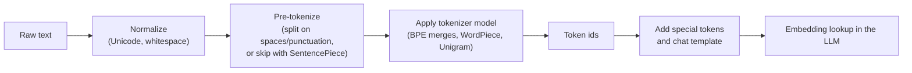
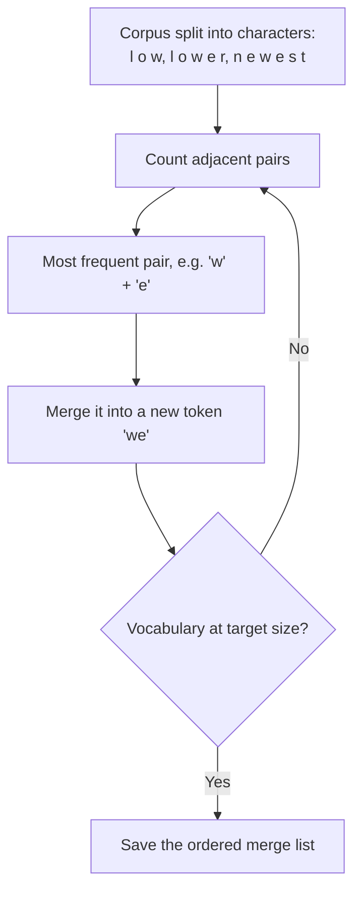

Tokenization looks like preprocessing, but interviewers ask about it because it explains real behavior: why an LLM struggles to count letters, why some languages cost more per sentence, and why prices and context limits are quoted in tokens.

## TL;DR

- Models do not read characters or words; they read **sub-word tokens** from a fixed vocabulary.
- **BPE** builds the vocabulary by repeatedly merging the most frequent adjacent pair of symbols.
- **WordPiece** (BERT) merges pairs that most improve the likelihood of the training data.
- **Unigram LM** (often via SentencePiece) starts big and prunes tokens that matter least.
- **Byte-level BPE** (GPT-2 onward) starts from raw bytes, so no input is ever unknown.
- Token count drives **cost, latency and context usage**, and uneven tokenization makes some languages more expensive.

## The idea in plain English

A vocabulary is a box of building blocks. Whole words as blocks would need millions of them and still miss new words. Single letters would cover everything but make every sentence very long. Sub-word tokenization picks a middle ground: common words get their own block ("the", "model"), rare words are built from pieces ("tokenization" might become "token" + "ization"). The model learns meaning for each block.

## Core concepts

1. **Vocabulary size.** Typical sizes range from about 30,000 (BERT) to 100,000 or more for recent LLMs. Larger vocabularies give shorter sequences but bigger embedding tables and rarer training signal per token.

2. **BPE (byte-pair encoding).** Start from characters. Count all adjacent pairs in the training corpus, merge the most frequent into a new symbol, and repeat until the vocabulary is the target size. At inference, apply the learned merges in order.

3. **WordPiece.** Similar merging, but chooses the pair that most increases the likelihood of the corpus under a language model. BERT uses it, marking word-internal pieces with "##".

4. **Unigram language model.** Start with a large candidate vocabulary, estimate each token's probability, and repeatedly drop the tokens whose removal hurts likelihood least. It can sample different segmentations, which acts as regularization.

5. **SentencePiece.** A library that treats input as a raw character stream including spaces (shown as a special marker), so it needs no language-specific pre-tokenization. It supports BPE and Unigram.

6. **Byte-level BPE.** Runs BPE over UTF-8 bytes. Every possible string can be encoded, so there is no unknown-token problem, at the cost of rare characters taking several tokens.

7. **Special tokens.** Markers such as beginning-of-sequence, end-of-sequence, padding, and chat-template role markers. Getting the chat template wrong is a common cause of poor fine-tuned model behavior.

8. **Rule of thumb.** For English, one token is roughly four characters, or about three-quarters of a word. Code, numbers and many non-Latin scripts use more tokens per word.

## Architecture

The pipeline at inference:

1. Normalize the text so equivalent strings produce the same tokens.
2. Optionally split into rough word chunks.
3. Apply the learned segmentation to produce token ids.
4. Wrap with special tokens and, for chat models, the role template.
5. Feed ids to the embedding table. Decoding reverses the process.

## Deep dive

### Training BPE, one merge at a time

### Why tokenization causes strange failures

- **Counting letters.** "strawberry" may be two or three tokens, so the model never directly sees individual letters.
- **Arithmetic.** Numbers split inconsistently ("1234" vs "12" + "34"), which makes digit-level reasoning harder. Some newer tokenizers split numbers into single digits for this reason.
- **Glitch tokens.** Tokens that were frequent in the tokenizer's corpus but rare in the model's training data can produce bizarre outputs.
- **Multilingual cost.** A sentence in a low-resource language can take several times more tokens than its English translation, which means higher cost, more latency and less effective context.

## Trade-offs

| Choice | Pros | Cons | When to use |
| --- | --- | --- | --- |
| Small vocabulary (around 30K) | Small embedding table, each token well trained | Longer sequences, more compute per text | Small encoders |
| Large vocabulary (100K+) | Shorter sequences, better multilingual coverage | Larger embedding and output layers | Large multilingual LLMs |
| Byte-level BPE | No unknown tokens, any input works | Rare scripts use many tokens | General-purpose LLMs |
| Unigram with sampling | Regularization through varied segmentations | More complex training | Multilingual and robustness-focused models |
| Character or byte models (no merges) | No tokenizer quirks | Much longer sequences | Research, noisy-text tasks |

## Real-world examples

- BERT uses a WordPiece vocabulary of about 30,000 tokens.
- GPT-2 introduced byte-level BPE with a vocabulary of about 50,000.
- T5 and many multilingual models use SentencePiece.
- API pricing for hosted LLMs is quoted per input and output token, so token efficiency directly affects cost.

## Common pitfalls

- Estimating costs in words instead of tokens.
- Changing the tokenizer of a pre-trained model. Embeddings are tied to token ids, so a new tokenizer needs new embeddings and retraining.
- Ignoring the chat template when fine-tuning or serving an instruction model.
- Assuming the same text costs the same in every language.

## How to answer in an interview

1. Explain why sub-words: a balance between vocabulary size and sequence length, and no unknown words.
2. Describe BPE training in three steps: start with characters, merge the most frequent pair, repeat.
3. Contrast WordPiece, Unigram and byte-level BPE in a line each.
4. Connect tokenization to cost, latency, context limits and multilingual fairness.
5. Give one failure mode it explains, such as letter counting or arithmetic.

**What interviewers listen for:** you can explain an algorithm, not just name it, and you link tokenization to product cost and behavior.

**Red flags:** "tokens are words", or no awareness that languages tokenize unevenly.

## Further reading

- [Neural Machine Translation of Rare Words with Subword Units, BPE (Sennrich et al., 2015)](https://arxiv.org/abs/1508.07909)
- [SentencePiece (Kudo and Richardson, 2018)](https://arxiv.org/abs/1808.06226)
- [Subword Regularization, Unigram LM (Kudo, 2018)](https://arxiv.org/abs/1804.10959)
- [BERT: Pre-training of Deep Bidirectional Transformers (Devlin et al., 2018)](https://arxiv.org/abs/1810.04805)

<InterviewQuestions>
  <InterviewQuestion question="Why do LLMs use sub-word tokens instead of words or characters?" category="Concepts" level="Junior">
    Word-level vocabularies would need to be enormous and still fail on new words, typos and names. Character-level input covers everything but makes sequences very long, which raises compute and makes learning harder. Sub-words keep common words whole and break rare ones into reusable pieces, so the vocabulary stays manageable and nothing is unknown.
  </InterviewQuestion>
  <InterviewQuestion question="Explain how BPE builds its vocabulary." category="Concepts" level="Junior">
    BPE starts with every character (or byte) as a symbol. It counts how often each adjacent pair appears in the training corpus, merges the most frequent pair into a new symbol, and repeats until the vocabulary reaches its target size. The ordered list of merges is the tokenizer; encoding new text applies those merges in the same order.
  </InterviewQuestion>
  <InterviewQuestion question="How does WordPiece differ from BPE?" category="Concepts" level="Mid">
    Both build a vocabulary by merging symbols, but BPE merges the most frequent pair, while WordPiece merges the pair that most increases the likelihood of the training data, which favors pairs that are frequent together relative to how frequent they are apart. WordPiece also marks word-internal pieces, for example with a "##" prefix in BERT.
  </InterviewQuestion>
  <InterviewQuestion question="Why is an LLM bad at counting the letters in a word?" category="Failure modes" level="Mid">
    The model never sees individual letters for most words; it sees one or a few sub-word tokens whose spelling is only implicitly learned. Counting characters requires reasoning about information that the input representation hides. Asking the model to spell the word out first, so each letter becomes its own token, usually fixes it.
  </InterviewQuestion>
  <InterviewQuestion question="How does tokenization affect cost and fairness across languages?" category="Trade-offs" level="Mid">
    Tokenizers are trained mostly on high-resource languages, so those languages get efficient tokens while others are split into many small pieces. The same sentence can cost several times more tokens in some languages, which means higher API bills, slower responses and less usable context. Larger, more balanced vocabularies reduce the gap.
  </InterviewQuestion>
  <InterviewQuestion question="You want to add domain terms to a pre-trained model's tokenizer. What are the implications?" category="Architecture" level="Senior">
    Adding tokens means adding rows to the embedding and output matrices, and those new rows start untrained, so the model must be fine-tuned to learn them; initializing them as the average of the sub-word pieces they replace helps. Existing token ids must stay unchanged or every learned embedding breaks. Often the better choice is to keep the tokenizer and let fine-tuning teach the model the multi-token terms.
  </InterviewQuestion>
</InterviewQuestions>
