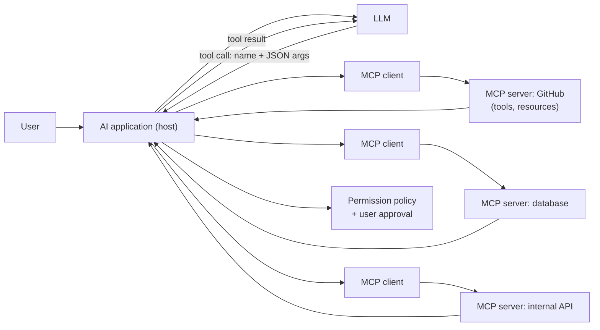
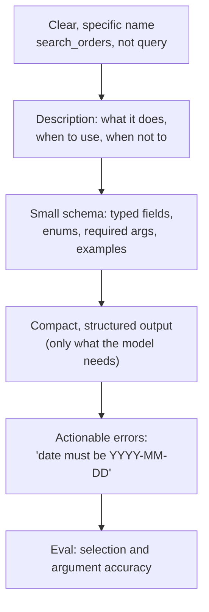

Tool use turns a language model into something that can look things up and take actions. Interviews cover the mechanics of function calling, how to design tools models use correctly, security, and increasingly the Model Context Protocol (MCP).

## TL;DR

- **Function calling**: the model sees tool names, descriptions and JSON schemas, and emits a structured call; your code executes it and returns the result.
- Tool quality depends on **clear descriptions, small strict schemas, useful errors and compact outputs**.
- **MCP** is an open protocol where **servers** expose tools, resources and prompts, and **clients** inside AI applications discover and use them.
- Security matters: tools act with real permissions, and tool outputs can carry **prompt injection**.
- Measure **tool selection accuracy, argument accuracy and error recovery**.

## The idea in plain English

Imagine giving an assistant a phone with a set of apps. Each app has a label explaining what it does and a form to fill in. The assistant decides which app to open, fills in the form, and reads the result. Function calling is that form-filling. MCP is a universal plug standard, so any assistant can use any app that speaks the standard, instead of each pair needing custom wiring.

## Core concepts

1. **Tool definition.** Name, description of when to use it, and a JSON schema for arguments, with types, enums and required fields.

2. **Tool call.** The model emits a structured request (tool name plus arguments). Many APIs support constrained decoding so arguments always match the schema.

3. **Execution and result.** The application validates arguments, runs the tool, and returns the result to the model as a tool message.

4. **Parallel and sequential calls.** Models can request several independent calls at once, or chain calls where one depends on another.

5. **Tool choice control.** You can force a specific tool, require some tool, or let the model decide.

6. **MCP architecture.** A host application (an IDE, a chat app, an agent) runs MCP clients; each connects to an MCP server that exposes **tools** (actions), **resources** (readable data) and **prompts** (templates). Servers can run locally or remotely.

7. **Discovery.** Clients list a server's tools at runtime, so new capabilities can be added without changing the application.

8. **Permissions and approval.** Hosts decide which servers and tools are allowed and can require user confirmation before calls.

## Architecture

A tool call end to end:

1. The host lists available tools from connected MCP servers and passes their schemas to the model.
2. The model decides to call a tool and emits arguments.
3. The host checks policy and, if needed, asks the user to approve.
4. The client sends the call to the server, which executes it.
5. The result returns to the model, which continues or answers.

## Deep dive

### Designing a tool the model uses correctly

Tips that make a big difference:

- Prefer a few well-scoped tools over many overlapping ones.
- Return identifiers and summaries, not huge raw payloads; let the model request details.
- Make tools idempotent or require explicit confirmation tokens for side effects.
- Version tool schemas and test them like APIs.

## Trade-offs

| Decision | Option A | Option B | Guidance |
| --- | --- | --- | --- |
| Many narrow tools vs few general tools | Precise | Fewer choices, less confusion | Group related actions; keep the count manageable |
| Raw SQL tool vs specific query tools | Flexible | Safe, predictable | Specific tools for production; raw SQL only read-only and sandboxed |
| Custom integrations vs MCP | Full control | Reusable across hosts, ecosystem of servers | MCP when tools should work across apps |
| Auto-execute vs confirm | Fast | Safe | Confirm side effects and anything external |

## Real-world examples

- Toolformer showed language models can learn when to call APIs such as calculators and search.
- Major LLM APIs support function calling with JSON schemas and parallel tool calls.
- MCP was introduced as an open standard in late 2024 and is supported by a growing set of clients and servers for code hosts, databases, file systems and business tools.

## Common pitfalls

- Vague tool descriptions, so the model picks the wrong tool.
- Returning thousands of tokens of raw data per call.
- Trusting tool outputs as instructions (indirect prompt injection).
- Broad credentials on servers, which turn one bad call into a big incident.
- No evaluation of tool-call accuracy.

## How to answer in an interview

1. Explain function calling as a loop of schema, call, execute, result.
2. Describe what makes tools reliable.
3. Explain MCP's host, client and server roles and why standardization helps.
4. Cover security: least privilege, approval, injection defenses, logging.
5. Explain how you would evaluate and monitor tool use.

**What interviewers listen for:** concrete schema design, security awareness and evaluation.

**Red flags:** "give the agent admin access to everything", or no validation of arguments.

## Further reading

- [Model Context Protocol documentation](https://modelcontextprotocol.io)
- [Toolformer: Language Models Can Teach Themselves to Use Tools (Schick et al., 2023)](https://arxiv.org/abs/2302.04761)
- [Gorilla: Large Language Model Connected with Massive APIs (Patil et al., 2023)](https://arxiv.org/abs/2305.15334)
- [Not What You've Signed Up For: Indirect Prompt Injection (Greshake et al., 2023)](https://arxiv.org/abs/2302.12173)

<InterviewQuestions>
  <InterviewQuestion question="How does function calling work?" category="Concepts" level="Junior">
    You give the model a list of tools, each with a name, description and JSON schema for its arguments. When the model decides a tool is needed, it outputs a structured call with arguments. Your application validates and executes the call, sends the result back as a message, and the model continues with that information.
  </InterviewQuestion>
  <InterviewQuestion question="What is MCP and what problem does it solve?" category="Concepts" level="Mid">
    The Model Context Protocol is an open standard for connecting AI applications to tools and data. Servers expose tools, resources and prompts through a common interface; clients in host applications discover and use them. It replaces many one-off integrations with reusable servers that work across any compatible application.
  </InterviewQuestion>
  <InterviewQuestion question="What makes a tool easy for an LLM to use correctly?" category="Architecture" level="Mid">
    A specific name, a description that says when to use it and when not to, a small strict schema with enums and examples, compact structured output, and clear error messages the model can act on. Overlapping tools and huge outputs are the most common causes of wrong calls.
  </InterviewQuestion>
  <InterviewQuestion question="How do you secure tool use?" category="Failure modes" level="Senior">
    Give each tool least-privilege credentials, validate arguments in code, require user approval for side effects, sandbox execution, rate-limit and log every call, and treat tool outputs as untrusted data so injected instructions cannot trigger further actions. Review which MCP servers are allowed and how they authenticate.
  </InterviewQuestion>
  <InterviewQuestion question="How would you evaluate tool use?" category="Evaluation" level="Mid">
    Build test prompts with the expected tool and arguments, and measure tool selection accuracy, argument accuracy, unnecessary calls and recovery after errors. Then run end-to-end tasks in a sandbox and check outcomes. Track these per tool to find which descriptions or schemas need work.
  </InterviewQuestion>
  <InterviewQuestion question="What are MCP resources vs tools?" category="Concepts" level="Mid">
    Tools are actions the model can invoke, such as creating an issue or running a query, and may have side effects. Resources are readable data the host can provide as context, such as files or records, identified by URIs. Prompts are reusable templates a server offers. Separating them clarifies what is read-only and what acts.
  </InterviewQuestion>
</InterviewQuestions>
