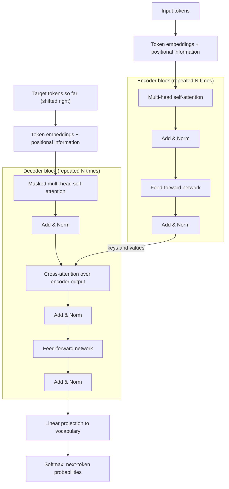
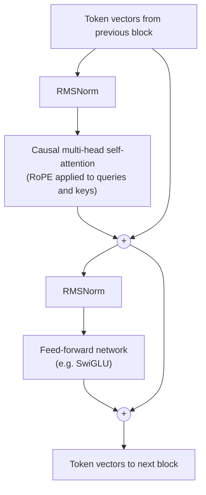
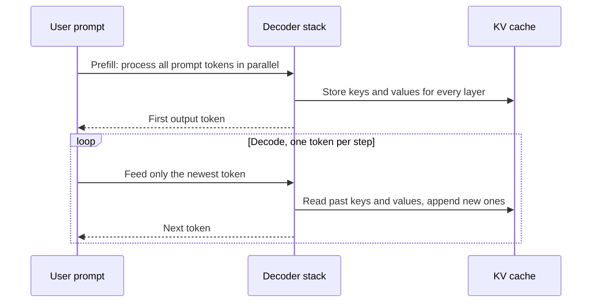

The transformer is the architecture behind GPT, Claude, Llama, BERT and almost every model you will be asked about. Interviewers use it as a depth probe: a strong candidate can draw it from memory, explain why each block is there, and say what changed between the 2017 paper and today's LLMs.

## TL;DR

- A transformer turns tokens into vectors, then refines those vectors through a stack of identical blocks.
- Each block has two sub-layers: **self-attention** (tokens exchange information) and a **feed-forward network** (each token is transformed on its own).
- **Residual connections** and **layer normalization** wrap every sub-layer so very deep stacks still train.
- Attention has no sense of order, so **positional information** is added explicitly.
- The original design is **encoder-decoder** for translation. Modern LLMs are mostly **decoder-only** with a **causal mask**, trained to predict the next token.
- It replaced RNNs because every position is processed **in parallel** during training and any two tokens are one attention step apart.

## The idea in plain English

Picture a meeting where every word in a sentence is a person holding a note card. In each round, every person looks around the room, decides who is relevant to them, and updates their own card using what those people wrote. That is self-attention. Then everyone privately rewrites their card in their own words, which is the feed-forward step.

After a few dozen rounds, the card held by the word "bank" in "she sat by the river bank" clearly says *riverside*, not *money*, because it paid attention to "river". The final cards are rich enough to predict the next word, classify the sentence, or translate it.

Before transformers, recurrent networks passed one note down a line of people, one at a time. Information from the start of a long sentence faded by the end, and the line could not be processed in parallel. The transformer lets everyone talk to everyone at once.

## Core concepts

1. **Tokens and embeddings.** Text is split into tokens (sub-word pieces), and each token id is looked up in an embedding table to get a vector of size $d_{model}$ (512 in the original paper, 4,096 or more in large LLMs).

2. **Positional information.** Self-attention treats its input as a set, so "dog bites man" and "man bites dog" would look identical. The original paper adds fixed sinusoidal position vectors to the embeddings. Modern LLMs mostly use rotary embeddings (RoPE), which rotate queries and keys by an angle that depends on position.

3. **Self-attention.** Each token produces a query, a key and a value by multiplying its vector by three learned matrices. A token's query is compared with every key to get relevance scores, the scores go through a softmax, and the output is the weighted sum of the values:

   $$
   \text{Attention}(Q, K, V) = \text{softmax}\!\left(\frac{QK^\top}{\sqrt{d_k}}\right)V
   $$

4. **Scaling by the square root of the key size.** Dot products grow with the vector dimension. Without the scale, large scores push the softmax into a near one-hot shape where gradients vanish, so training stalls.

5. **Multi-head attention.** Instead of one attention with full-size vectors, the model runs several smaller attention "heads" in parallel (8 in the original paper), each with its own projections. Different heads learn different relationships, such as syntax, coreference or position. Their outputs are concatenated and projected back.

6. **Feed-forward network (FFN).** A two-layer MLP applied to each token independently, usually 4x wider than the model dimension in the middle. Most of a transformer's parameters live here, and research suggests a lot of factual knowledge is stored in these weights.

7. **Residual connections.** Each sub-layer's output is added back to its input. This gives gradients a direct path through dozens of layers and lets each layer learn a small refinement rather than a whole new representation.

8. **Layer normalization.** Normalizes each token's vector to keep activations stable. The original paper normalizes after the residual add (Post-LN). Most modern LLMs normalize before each sub-layer (Pre-LN), often with RMSNorm, because it trains more stably at depth.

9. **Masking.** A **padding mask** hides padding tokens. A **causal mask** stops a token from attending to tokens after it, which is what lets a decoder be trained on next-token prediction for every position in parallel.

10. **Output head.** The final vectors are projected to vocabulary size and turned into probabilities with a softmax. Many models tie this projection to the input embedding table to save parameters.

## Architecture

How a translation request flows through the original encoder-decoder design:

1. The source sentence is tokenized, embedded and given positional information.
2. The encoder stack runs self-attention over the whole source sentence at once, so every source token can see every other one. Its output is one context-rich vector per source token.
3. The decoder receives the target tokens produced so far. Masked self-attention lets each of them see only earlier target tokens.
4. Cross-attention lets each target position query the encoder's output. Queries come from the decoder, keys and values from the encoder. This is how the decoder "looks at" the source sentence.
5. The feed-forward network refines each position, and the final layer turns the last position's vector into a probability for every word in the vocabulary.
6. At inference, the chosen token is appended and the decoder runs again. That loop is autoregressive generation.

## Deep dive

### Inside one decoder-only block

Today's GPT-style LLMs drop the encoder and cross-attention entirely. Each block is just masked self-attention plus an FFN, with normalization applied first:

### What happens during generation

During training, all positions are computed in one pass thanks to the causal mask. During inference, the model generates one token at a time, and a **KV cache** stores each layer's keys and values so earlier tokens are not recomputed.

This split explains two numbers interviewers like to ask about: **time to first token** is dominated by the prefill pass, while **tokens per second** is dominated by decode steps, which are limited by memory bandwidth because each step re-reads the weights and the growing cache.

### The three families

| Family | Attention pattern | Pre-training objective | Typical use | Examples |
| --- | --- | --- | --- | --- |
| Encoder-only | Bidirectional | Masked language modeling | Classification, embeddings, retrieval | BERT, RoBERTa |
| Encoder-decoder | Bidirectional encoder, causal decoder with cross-attention | Span corruption or translation | Translation, summarization | T5, BART, original Transformer |
| Decoder-only | Causal | Next-token prediction | Chat, code, general generation | GPT, Llama, Claude |

## Trade-offs

| Choice | Pros | Cons | When to use |
| --- | --- | --- | --- |
| Transformer vs RNN/LSTM | Parallel training, direct long-range connections, scales well | Attention cost grows with the square of sequence length | Almost always for language today |
| Post-LN vs Pre-LN | Post-LN can reach slightly better quality when it trains | Post-LN needs careful warm-up and is unstable when deep | Pre-LN for deep models |
| Sinusoidal vs learned vs RoPE positions | Sinusoidal needs no parameters, RoPE handles relative positions well and extends with tricks | Learned absolute positions do not extrapolate past training length | RoPE for modern decoder LLMs |
| More heads vs fewer | More heads capture more relation types | Each head gets a smaller dimension, more KV cache | Tune with model size; use GQA to cut cache cost |
| Decoder-only vs encoder-decoder | One stack, simple scaling, great at open-ended generation | Less natural for strongly conditioned input-to-output tasks | Decoder-only for general LLMs |

## Real-world examples

- **The original Transformer** (Vaswani et al., 2017) used 6 encoder and 6 decoder layers, a model size of 512 and 8 heads, and set state-of-the-art results on WMT 2014 English-German and English-French translation.
- **BERT** (2018) kept only the encoder and pre-trained it with masked language modeling, which made it the default for classification and search ranking for years.
- **GPT-3** (2020) kept only the decoder and scaled it to 175 billion parameters, showing that a large next-token predictor can do few-shot learning from the prompt alone.
- **Llama-style models** use the decoder-only layout with Pre-norm RMSNorm, RoPE, SwiGLU feed-forward layers and, in larger versions, grouped-query attention.

## Common pitfalls

- Saying attention is "linear" in sequence length. Standard attention compares every pair of tokens, so it is quadratic in time and, without FlashAttention-style kernels, in memory.
- Forgetting that self-attention is order-blind and needs positional information.
- Mixing up the masks: the causal mask is about the future, the padding mask is about empty slots.
- Saying the decoder sees the whole target during inference. It does during training (with the mask); at inference it only has what it has generated.
- Claiming most parameters are in attention. In standard designs, the feed-forward layers hold roughly two-thirds.

## How to answer in an interview

1. **Start with the shape.** "Tokens become vectors, then a stack of identical blocks refines them, then a projection gives next-token probabilities."
2. **Draw one block.** Attention, add and norm, feed-forward, add and norm. Say what each part is for in one line.
3. **Do the attention math.** Write the formula, explain Q, K and V, and say why there is a square-root scale.
4. **Name the family.** Explain encoder-only, encoder-decoder and decoder-only, and which one the interviewer's product would use.
5. **Bring it to today.** Mention Pre-LN, RoPE, the KV cache and GQA, and the quadratic cost of attention.

**What interviewers listen for:** you know why each piece exists, not just its name; you can connect architecture to cost (KV cache, quadratic attention); you can say what modern models changed.

**Red flags:** reciting the diagram without reasons, confusing training with inference, and not knowing where parameters and compute go.

## Further reading

- [Attention Is All You Need (Vaswani et al., 2017)](https://arxiv.org/abs/1706.03762)
- [BERT: Pre-training of Deep Bidirectional Transformers (Devlin et al., 2018)](https://arxiv.org/abs/1810.04805)
- [Language Models are Few-Shot Learners, GPT-3 (Brown et al., 2020)](https://arxiv.org/abs/2005.14165)
- [On Layer Normalization in the Transformer Architecture (Xiong et al., 2020)](https://arxiv.org/abs/2002.04745)
- [RoFormer: Enhanced Transformer with Rotary Position Embedding (Su et al., 2021)](https://arxiv.org/abs/2104.09864)

<InterviewQuestions>
  <InterviewQuestion question="Why does the transformer scale attention scores by the square root of the key dimension?" category="Concepts" level="Junior">
    The dot product of two random vectors grows with their dimension, so for large key sizes the raw scores have a large spread. A softmax over large scores becomes almost one-hot, and its gradients become tiny, which slows or stalls training. Dividing by the square root of the key dimension keeps the score variance around one, so the softmax stays in a range where it still has useful gradients.
  </InterviewQuestion>
  <InterviewQuestion question="Why do transformers need positional encodings?" category="Concepts" level="Junior">
    Self-attention computes a weighted sum over a set of vectors, and nothing in that calculation depends on order. Without position information, "dog bites man" and "man bites dog" produce the same representations. Positional encodings, whether added sinusoidal vectors, learned position embeddings or rotary embeddings applied to queries and keys, inject order so the model can use it.
  </InterviewQuestion>
  <InterviewQuestion question="What are residual connections and layer normalization doing in each block?" category="Architecture" level="Junior">
    The residual connection adds a sub-layer's input to its output, which gives gradients a direct path through the network and lets each layer learn a small correction. Layer normalization keeps each token's activations at a stable scale. Together they are what make stacks of dozens or hundreds of layers trainable. Modern LLMs usually apply normalization before each sub-layer (Pre-LN) because it is more stable than the original post-residual placement.
  </InterviewQuestion>
  <InterviewQuestion question="Walk me through the difference between encoder-only, encoder-decoder and decoder-only transformers." category="Architecture" level="Mid">
    Encoder-only models like BERT use bidirectional attention and are trained to fill in masked tokens, which makes them strong at understanding tasks such as classification and embeddings. Encoder-decoder models like T5 encode the input bidirectionally and generate the output with a causal decoder that cross-attends to the encoder, which suits translation and summarization. Decoder-only models like GPT use a single causal stack trained on next-token prediction; they are simpler to scale and handle open-ended generation, which is why most modern LLMs use them.
  </InterviewQuestion>
  <InterviewQuestion question="What is the purpose of multi-head attention compared with a single attention head?" category="Concepts" level="Mid">
    A single head produces one weighted average per token, so it can only express one notion of relevance at a time. Multiple heads, each with its own smaller projections, let the model attend to several kinds of relationship at once, for example one head tracking syntax and another tracking coreference. The heads' outputs are concatenated and projected back, so the total compute is similar to one full-size head.
  </InterviewQuestion>
  <InterviewQuestion question="Why is standard attention quadratic in sequence length, and what does that mean in practice?" category="Scaling" level="Mid">
    Every token's query is compared against every token's key, so a sequence of n tokens produces an n-by-n score matrix. Doubling the context length roughly quadruples attention compute, and naive implementations also store that matrix in memory. In practice this limits context length and drives techniques such as FlashAttention, which avoids materializing the full matrix, and sparse or sliding-window attention, which skips most pairs.
  </InterviewQuestion>
  <InterviewQuestion question="How does training a decoder differ from running it at inference time?" category="Architecture" level="Mid">
    In training, the whole target sequence is known, so the model computes predictions for every position in one parallel pass, and the causal mask stops each position from seeing the answer. At inference, the model only has the prompt and what it has generated, so it produces one token per forward pass. A KV cache stores past keys and values so each new step only computes the newest token, which is why decoding is limited by memory bandwidth rather than raw compute.
  </InterviewQuestion>
  <InterviewQuestion question="Where are most of a transformer's parameters, and why does that matter?" category="Trade-offs" level="Senior">
    In a standard block, attention has about 4 times the model dimension squared in parameters (query, key, value and output projections), while a feed-forward layer with a 4x hidden size has about 8 times, so roughly two-thirds of the parameters sit in the feed-forward layers. That is why mixture-of-experts designs replace the feed-forward layer with several experts: it is where adding capacity gives the most knowledge per unit of compute. Attention, in contrast, dominates cost at long context because of its quadratic term and the KV cache.
  </InterviewQuestion>
</InterviewQuestions>
