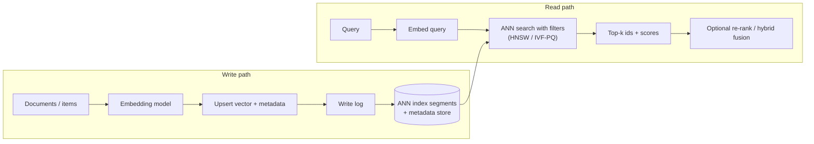
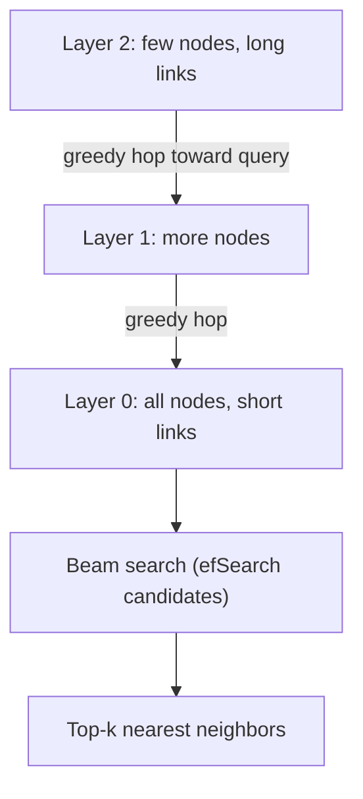

Vector databases sit under every RAG and semantic search system. Interviewers ask how approximate nearest-neighbor search works, how to filter and scale it, and when you need a dedicated vector database at all.

## TL;DR

- A vector database stores **embeddings** and finds the **nearest neighbors** of a query vector quickly.
- Exact search compares the query with every vector; **approximate nearest neighbor (ANN)** indexes trade a little recall for huge speed-ups.
- **HNSW** (graph-based) gives high recall and low latency but uses a lot of memory; **IVF** and **product quantization** compress vectors to scale to billions.
- **Metadata filtering**, **hybrid search**, **updates and deletes**, and **multi-tenancy** are where real systems get hard.
- Options range from libraries (FAISS) to vector features in existing databases (pgvector, Elasticsearch, OpenSearch) to dedicated vector databases.

## The idea in plain English

Every document becomes a point in a space with hundreds of dimensions, placed so that similar meanings are close. A query is another point. Finding relevant documents means finding the closest points. Checking every point is too slow for millions, so ANN indexes are like maps with shortcuts: you jump to the right neighborhood and only look closely there.

## Core concepts

1. **Embeddings and dimensions.** Typical text embeddings have a few hundred to a few thousand dimensions. Storage grows with count times dimension times bytes per value.

2. **Similarity metrics.** Cosine similarity, dot product and Euclidean distance. Use whatever the embedding model was trained for; with normalized vectors they rank the same.

3. **Exact (flat) search.** Brute force; perfect recall; fine up to perhaps hundreds of thousands of vectors, especially on GPUs.

4. **HNSW.** A multi-layer proximity graph. Search enters at the sparse top layer, moves greedily toward the query, and descends to denser layers. Parameters such as M (links per node) and efSearch trade memory and latency for recall.

5. **IVF (inverted file).** Clusters vectors with k-means; at query time only the nearest few clusters (nprobe) are searched.

6. **Product quantization (PQ).** Splits each vector into sub-vectors and replaces each with the id of its nearest centroid, compressing vectors many times over at some accuracy cost. IVF-PQ combines both for billion-scale search.

7. **Disk-based indexes.** Designs such as DiskANN keep most data on SSD to cut memory costs for very large collections.

8. **Filtering.** Restricting results by metadata (tenant, permissions, date). Pre-filtering can break graph search when few vectors match; post-filtering can return too few results. Good engines integrate filters into the search.

9. **Recall at k.** The standard quality metric for ANN: the share of true nearest neighbors found in the top k, measured against exact search.

## Architecture

A query's path:

1. Embed the query with the same model as the documents.
2. Search the ANN index, applying metadata filters during the search.
3. Return the top-k ids, scores and metadata.
4. Optionally merge with keyword results and re-rank.

## Deep dive

### HNSW search, layer by layer

### Scaling choices

| Scale | Typical approach |
| --- | --- |
| Up to about 1 million vectors | Flat search or HNSW in an existing database (for example pgvector) |
| Tens of millions | HNSW with sharding, or IVF with tuned nprobe |
| Billions | IVF-PQ or disk-based indexes, sharded across machines |

## Trade-offs

| Option | Pros | Cons | When to use |
| --- | --- | --- | --- |
| Flat search | Exact, simple | Linear cost | Small collections, ground-truth evaluation |
| HNSW | High recall, low latency | Memory-hungry, slower builds | Most production RAG up to large scale |
| IVF-PQ | Compact, scales to billions | Lower recall, needs training | Huge collections, cost-sensitive |
| Vector extension in your existing DB | One system, transactions, joins | Fewer advanced features | Moderate scale, simpler ops |
| Dedicated vector DB | Built-in filtering, hybrid search, scaling | Another system to run | Large or demanding workloads |
| Library (FAISS) | Fast, flexible | You build persistence, updates, filtering | Batch jobs, custom systems |

## Real-world examples

- FAISS, from Meta AI research, is a widely used library for similarity search including GPU and IVF-PQ indexes.
- HNSW is implemented in most vector databases and search engines.
- PostgreSQL's pgvector extension adds vector columns and ANN indexes to a relational database.
- Benchmarks such as MTEB compare embedding models; ANN benchmarks compare index recall and speed.

## Common pitfalls

- Mixing embeddings from different models or versions in one index.
- Measuring latency without measuring recall.
- Filters that silently return too few results.
- Forgetting deletes and permission changes, which leaves stale or unauthorized vectors.
- Adopting a new database when the existing one with a vector extension would do.

## How to answer in an interview

1. Explain embeddings and nearest-neighbor search.
2. Explain why ANN is needed and how HNSW and IVF-PQ work.
3. Cover filtering, hybrid search, updates and multi-tenancy.
4. Size it: number of vectors, dimensions, memory, latency target.
5. Choose a solution and explain how you would measure recall and latency.

**What interviewers listen for:** index mechanics, recall-latency-memory trade-offs, and practical filtering.

**Red flags:** treating vector search as exact, or ignoring metadata and deletes.

## Further reading

- [Efficient and Robust Approximate Nearest Neighbor Search Using HNSW (Malkov and Yashunin, 2016)](https://arxiv.org/abs/1603.09320)
- [Billion-scale Similarity Search with GPUs, FAISS (Johnson et al., 2017)](https://arxiv.org/abs/1702.08734)
- [Product Quantization for Nearest Neighbor Search (Jégou et al., 2011)](https://doi.org/10.1109/TPAMI.2010.57)
- [MTEB: Massive Text Embedding Benchmark (Muennighoff et al., 2022)](https://arxiv.org/abs/2210.07316)
- [pgvector (GitHub)](https://github.com/pgvector/pgvector)

<InterviewQuestions>
  <InterviewQuestion question="What does a vector database do that a regular database does not?" category="Concepts" level="Junior">
    It indexes high-dimensional vectors so it can quickly find the items most similar to a query vector, using approximate nearest-neighbor algorithms. Regular databases index exact values and ranges, which cannot answer "closest in meaning" queries efficiently. Many regular databases now add vector indexes as extensions.
  </InterviewQuestion>
  <InterviewQuestion question="How does HNSW work?" category="Concepts" level="Mid">
    It builds a hierarchy of proximity graphs: upper layers have few nodes with long-range links, the bottom layer has all nodes with short links. A search starts at the top, greedily moves to the neighbor closest to the query, and drops down a layer when it cannot improve, finishing with a beam search at the bottom. It gives high recall with logarithmic-like search time.
  </InterviewQuestion>
  <InterviewQuestion question="What is product quantization?" category="Concepts" level="Mid">
    It compresses vectors by splitting each into sub-vectors and replacing each sub-vector with the index of its nearest centroid from a small learned codebook. Distances are then approximated with lookup tables. It cuts memory many times over, enabling billion-scale search, at the cost of some accuracy.
  </InterviewQuestion>
  <InterviewQuestion question="How do you handle metadata filtering in vector search?" category="Architecture" level="Senior">
    Ideally the engine applies filters during the ANN traversal, skipping non-matching nodes while still exploring the graph. Pure pre-filtering can break graph connectivity when the filter is very selective, and post-filtering can return fewer than k results, so engines switch strategies based on selectivity, and very selective filters can fall back to exact search over the matching subset.
  </InterviewQuestion>
  <InterviewQuestion question="How do you evaluate an ANN index?" category="Evaluation" level="Mid">
    Compute exact nearest neighbors for a sample of queries with brute force, then measure recall at k of the ANN results against them, together with latency percentiles, throughput, memory and build time. Tune parameters such as efSearch or nprobe to hit the recall target at the lowest cost.
  </InterviewQuestion>
  <InterviewQuestion question="When would you use pgvector instead of a dedicated vector database?" category="Trade-offs" level="Senior">
    When the collection is modest, the data already lives in PostgreSQL, and you benefit from transactions, joins and one system to operate. Dedicated vector databases make sense for very large collections, heavy query loads, advanced filtering and hybrid search, or when the team wants managed scaling.
  </InterviewQuestion>
</InterviewQuestions>
