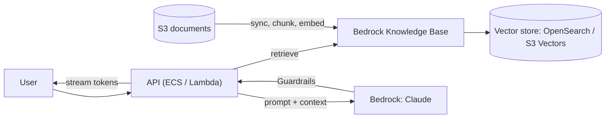

AI on AWS splits into two jobs. **Using foundation models** (Claude and others) goes through **Amazon Bedrock**, with **Knowledge Bases** for RAG, **Guardrails** for safety and **AgentCore** to run agents in production. **Building your own models** goes through **SageMaker AI** on GPUs or **Trainium**. Most product teams only need the first.

## TL;DR

- **Bedrock** for LLM features: one API across model providers, data stays in your account, IAM controls access.
- **Knowledge Bases** for managed RAG (ingest, chunk, embed, retrieve) over S3, with OpenSearch, Aurora or S3 Vectors as the store.
- **AgentCore** to run agents: isolated sessions, memory, a gateway that exposes your APIs as tools, identity and tracing.
- **SageMaker AI** to train, fine-tune and host your own models.
- **Capacity is measured in tokens per minute.** Plan quotas, retries with backoff, and prompt caching early.

## At a glance

<CloudGroupTable group="ai-ml" lead="aws" />

## A RAG assistant on AWS

## Services

### Amazon Bedrock

<CloudServiceProfile id="aws-bedrock" />

### Amazon Bedrock AgentCore

<CloudServiceProfile id="aws-agentcore" />

### Amazon SageMaker AI

<CloudServiceProfile id="aws-sagemaker" />

## Where this shows up in system design

- **[ChatGPT](/system-design-case-studies/case-studies/chatgpt)-style assistants:** streaming responses from Bedrock over SSE or WebSockets; conversations in DynamoDB; per-user token quotas.
- **RAG and agents:** the [GenAI system design](/ai-system-design) articles map directly onto Knowledge Bases, AgentCore and Guardrails.
- **Recommendations and ranking ([TikTok](/system-design-case-studies/case-studies/tiktok), [YouTube](/system-design-case-studies/case-studies/youtube)):** models trained on SageMaker AI, features from the data lake, real-time scoring on endpoints.
- **Media understanding:** Rekognition, Transcribe and Textract for moderation, captions and document extraction.

## Common mistakes

- **Ignoring token quotas.** A launch fails on throttling, not on CPU. Request quota increases and use cross-Region inference.
- **No streaming.** Users wait for the full answer. Stream tokens to the client.
- **Calling the model for everything.** Cache answers to repeated questions and use small models for simple steps.
- **Agents with broad credentials.** Give each tool the user's own scoped identity and log every call.

## Related

[Vector Databases](/system-design/databases/vector-databases) · [Databases on AWS](/cloud/aws/databases) · [Server-Sent Events](/system-design/fundamentals/server-sent-events) · [GenAI & LLM Systems](/ai-system-design)

<InterviewQuestions>
  <InterviewQuestion question="Bedrock or SageMaker AI for a document Q&A feature?" category="Cloud" level="Mid">
    Bedrock with a Knowledge Base: a foundation model plus managed retrieval covers it without training anything. SageMaker AI is for training or fine-tuning your own models, or hosting open models with full control over the serving stack.
  </InterviewQuestion>
  <InterviewQuestion question="How do you handle Bedrock throttling during a traffic spike?" category="Reliability" level="Senior">
    Retry with exponential backoff and jitter, spread load with cross-Region inference, queue non-interactive work (batch inference is cheaper), cache repeated prompts and answers, and shed or degrade low-priority requests (a smaller model, a shorter answer) before interactive ones. For steady high load, buy provisioned throughput.
  </InterviewQuestion>
</InterviewQuestions>
