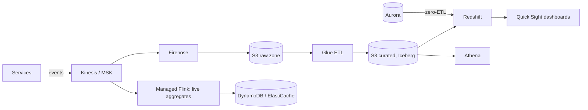

Analytics is the "offline" half of most designs: events and database changes flow into cheap storage, get cleaned and joined, and power dashboards, reports, recommendations and ML. On AWS the usual shape is **S3 as the data lake**, **Glue** for the catalog and ETL, and **Athena** or **Redshift** for SQL. **EMR** runs heavy Spark, and **Managed Flink** computes real-time aggregates.

## The idea

Questions across years of data do not belong on the orders database. They go to files in a cheap bucket, read by an engine billed per byte, or to a warehouse that keeps small, prepared tables for questions asked all day.

<Callout tone="blue" title="Learn the idea">
  New to lakes and warehouses? [Warehouses, Lakes and Query Engines](/cloud/data/warehouses-lakes-and-query-engines) builds Brightpost's sales dashboard step by step, and [Queues, Topics, Streams, Event Buses and Workflows](/cloud/data/streaming-and-messaging-services) shows where the click stream comes from. This page names the AWS pieces.
</Callout>

<AnimatedDiagram spec="animated/cloud/lake-to-warehouse" stepper cloud="aws" minWidth={620} caption="Brightpost's sales dashboard on AWS in seven steps: an S3 lake, Athena over the files, the full-scan bill, Parquet split by date, a Redshift summary table and Lake Formation rules." />

<CloudMapping diagram="cloud/lake-to-warehouse" lead="aws" />

On AWS the lake and the warehouse are separate products, joined by one catalog. In step 3 Athena asks the Glue Data Catalog which S3 folder makes the `clicks` table. Step 4 is the bill: 576 queries a day, each scanning all 18 GB of raw JSON. An Athena workgroup can cap the data one query may scan, which would have stopped that dashboard on its first refresh. In step 5 a Glue job writes Parquet, one folder per day. In step 6 Redshift loads the curated tables and serves the summary. In step 7 Lake Formation grants hide the two address columns from every engine that uses the catalog.

## TL;DR

- **Land everything in S3** as Parquet or Apache Iceberg tables (S3 Tables), partitioned by date.
- **Athena** for ad-hoc SQL, billed per data scanned. **Redshift** for high-concurrency dashboards and heavy joins.
- **Glue** keeps one catalog of tables that every engine uses, and runs serverless ETL. **Lake Formation** adds grants on tables, columns and rows.
- **EMR** for large Spark jobs; **Managed Flink** for windowed aggregations over live streams.
- **Zero-ETL integrations** copy Aurora, RDS and DynamoDB changes into Redshift without pipelines.

## At a glance

<CloudGroupTable group="analytics" lead="aws" />

## Beyond the stepper: the live path

The stepper shows the nightly path. Two AWS paths are missing from it: a live one, where Flink counts events as they arrive, and zero-ETL, where Redshift receives database changes without a pipeline you run.

**Amazon Data Firehose** is the stream-to-lake sink: it buffers a Kinesis stream and writes files to S3, and can convert them to Parquet on the way. Its profile is on [Messaging & Streaming on AWS](/cloud/aws/messaging). **Amazon Quick Sight** (formerly QuickSight) draws the dashboards.

## Services

### Amazon Redshift

<CloudServiceProfile id="aws-redshift" />

### Amazon Athena

<CloudServiceProfile id="aws-athena" />

### AWS Glue

<CloudServiceProfile id="aws-glue" />

### AWS Lake Formation

<CloudServiceProfile id="aws-lake-formation" />

**Pick it when** more than one team reads the lake and some columns, such as customer addresses, must stay hidden from some of them.

### Amazon EMR

<CloudServiceProfile id="aws-emr" />

### Amazon Managed Service for Apache Flink

<CloudServiceProfile id="aws-flink" />

## Where this shows up in system design

- **[Twitter](/system-design/case-studies/twitter) trends and [TikTok](/system-design/case-studies/tiktok) ranking signals:** Flink aggregates counts in sliding windows and writes the top items to a cache.
- **[Metrics and logging](/system-design/case-studies/metrics-and-logging):** recent data in a time-series or search store; history in S3, queried with Athena.
- **[Zillow](/system-design/case-studies/zillow) price estimates:** nightly Spark jobs on EMR train and score models over the property history.
- **[User data export](/system-design/case-studies/user-data-export):** an EMR or Glue job gathers one user's rows across tables into a zip file in S3.

## Common mistakes

- **Querying the production database for analytics.** Long scans slow user requests. Replicate to Redshift with zero-ETL or CDC.
- **Thousands of tiny files in S3.** Every query pays per-file overhead. Compact into larger Parquet files or let Iceberg tables do it.
- **No partitioning.** Athena scans, and bills for, the whole table. Partition by date and filter on it.
- **Lake Formation grants with the bucket still open.** Only engines that use the catalog enforce the grants. Anyone with read access on the S3 bucket can download the raw files.
- **Building a lambda architecture by default.** If one streaming engine can produce both live and historical results, keep one code path.

## Related

[Warehouses, Lakes and Query Engines](/cloud/data/warehouses-lakes-and-query-engines) · [Queues, Topics, Streams, Event Buses and Workflows](/cloud/data/streaming-and-messaging-services) · [Analytics & Data on Google Cloud](/cloud/gcp/analytics) · [Analytics & Data on Azure](/cloud/azure/analytics) · [Messaging & Streaming on AWS](/cloud/aws/messaging) · [Storage on AWS](/cloud/aws/storage) · [Analytical (OLAP) & Columnar](/system-design/databases/analytical-databases) · [CQRS and Event Sourcing](/system-design/patterns/cqrs-event-sourcing) · [System Design](/system-design)

<InterviewQuestions>
  <InterviewQuestion question="Athena or Redshift?" category="Cloud" level="Mid">
    **Short answer.** Athena for occasional, ad-hoc questions over files in S3: nothing runs between queries and you pay for the data each one scans. Redshift for questions asked again and again, such as a dashboard refreshing all day.

    **Why.** Brightpost's dashboard sends 576 queries a day. On Athena over raw JSON each scanned 18 GB, about 10 TB a day. Redshift loads the curated tables once a night and serves a summary table of under 1 MB a month. It bills by node-hours, or by compute used on Redshift Serverless, which a small table barely touches. The finance lead keeps Athena for one-off questions.

    <AnimatedDiagram spec="animated/cloud/lake-to-warehouse" step={6} cloud="aws" highlight={["dashboard", "warehouse", "engine"]} caption="The dashboard reads a Redshift summary table; the finance lead keeps Athena for one-off SQL." />

    **Follow-ups the interviewer may ask.**
    - Redshift provisioned or Redshift Serverless for a dashboard used only in office hours?
    - How can Redshift query the S3 files without loading them?

    **Watch out for.** Calling Athena "free when idle, so always cheaper". Idle is free; a busy, careless dashboard is the most expensive case of all.
  </InterviewQuestion>

  <InterviewQuestion question="How do you stop a contractor seeing customer addresses in Brightpost's lake and warehouse on AWS?" category="Cloud" level="Mid">
    **Short answer.** Register the lake with Lake Formation and grant the contractor's role the orders table without the name and address columns. Give the same role matching column grants on the tables loaded into Redshift. Remove its direct read on the S3 bucket.

    **Why.** Lake Formation grants live with the Glue Data Catalog, so Athena, Redshift Spectrum and EMR all apply them to the lake. One grant covers every engine, instead of a separate rule in each. But the grants cover reads through an engine, not a file downloaded from S3. While a bucket policy still allows reads, that old path stays open.

    <AnimatedDiagram spec="animated/cloud/lake-to-warehouse" step={7} cloud="aws" highlight={["rules", "catalog", "warehouse"]} caption="One set of column rules for the lake, kept with the catalog, and the same rule on Redshift's own tables." />

    **Follow-ups the interviewer may ask.**
    - How would you hide rows, such as one country's customers?
    - How do tags help when there are hundreds of tables?

    **Watch out for.** Making a second, address-free copy in another bucket. Every copy is one more place to secure, and one more place to delete a customer from.
  </InterviewQuestion>

  <InterviewQuestion question="How would you compute trending hashtags in near real time on AWS?" category="Architecture" level="Senior">
    **Short answer.** Publish post events to Kinesis or MSK. A Managed Flink job counts hashtags per region in sliding windows and keeps a top-K list per window. It writes the results to ElastiCache, which the API reads.

    **Why.** A sliding window, for example the last hour updated every minute, needs state kept between events; Flink keeps it and checkpoints it. Querying the lake every minute would rescan the same data and trail by the file buffer. In parallel, Data Firehose lands the raw events in S3 for offline analysis and backfills, so a bug in the Flink job can be replayed and fixed.

    **Follow-ups the interviewer may ask.**
    - One hashtag goes viral. What happens to the partition that carries it?
    - How do you keep spam accounts from pushing a tag into the list?

    **Watch out for.** Building two separate code paths, one live and one batch, that give different counts. Prefer one Flink job that can also replay history from S3.
  </InterviewQuestion>
</InterviewQuestions>
