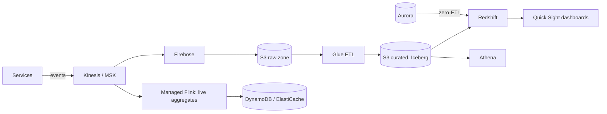

Analytics is the "offline" half of most designs: events and database changes flow into cheap storage, get cleaned and joined, and power dashboards, reports, recommendations and ML. On AWS the usual shape is **S3 as the data lake**, **Glue** for the catalog and ETL, **Athena** or **Redshift** for SQL, **EMR** for heavy Spark, and **Managed Flink** for real-time aggregates.

## TL;DR

- **Land everything in S3** as Parquet or Apache Iceberg tables (S3 Tables), partitioned by date.
- **Athena** for ad-hoc SQL, billed per TB scanned. **Redshift** for high-concurrency dashboards and heavy joins.
- **Glue** keeps one catalog of tables that every engine uses, and runs serverless ETL.
- **EMR** for large Spark jobs; **Managed Flink** for windowed aggregations over live streams.
- **Zero-ETL integrations** copy Aurora, RDS and DynamoDB changes into Redshift without pipelines.

## At a glance

<CloudGroupTable group="analytics" lead="aws" />

## A typical AWS data platform

## Services

### Amazon Redshift

<CloudServiceProfile id="aws-redshift" />

### Amazon Athena

<CloudServiceProfile id="aws-athena" />

### AWS Glue

<CloudServiceProfile id="aws-glue" />

### Amazon EMR

<CloudServiceProfile id="aws-emr" />

### Amazon Managed Service for Apache Flink

<CloudServiceProfile id="aws-flink" />

## Where this shows up in system design

- **[Twitter](/system-design/case-studies/twitter) trends and [TikTok](/system-design/case-studies/tiktok) ranking signals:** Flink aggregates counts in sliding windows and writes the top items to a cache.
- **[Metrics and logging](/system-design/case-studies/metrics-and-logging):** recent data in a time-series or search store; history in S3, queried with Athena.
- **[Zillow](/system-design/case-studies/zillow) price estimates:** nightly Spark jobs on EMR train and score models over the property history.
- **[User data export](/system-design/case-studies/user-data-export):** an EMR or Glue job gathers one user's rows across tables into a zip file in S3.

## Common mistakes

- **Querying the production database for analytics.** Long scans slow user requests. Replicate to Redshift with zero-ETL or CDC.
- **Thousands of tiny files in S3.** Every query pays per-file overhead. Compact into larger Parquet files or let Iceberg tables do it.
- **No partitioning.** Athena scans, and bills for, the whole table. Partition by date and filter on it.
- **Building a lambda architecture by default.** If one streaming engine can produce both live and historical results, keep one code path.

## Related

[Messaging & Streaming on AWS](/cloud/aws/messaging) · [Storage on AWS](/cloud/aws/storage) · [Analytical (OLAP) & Columnar](/system-design/databases/analytical-databases) · [CQRS and Event Sourcing](/system-design/patterns/cqrs-event-sourcing)

<InterviewQuestions>
  <InterviewQuestion question="Athena or Redshift?" category="Cloud" level="Mid">
    Athena for occasional, ad-hoc queries over data in S3: nothing runs between queries and you pay per TB scanned. Redshift when many users run dashboards all day or queries join large tables repeatedly: it keeps data in a tuned columnar format with caching and concurrency scaling, which is faster and cheaper at that usage.
  </InterviewQuestion>
  <InterviewQuestion question="How would you compute trending hashtags in near real time on AWS?" category="Architecture" level="Senior">
    Publish tweet events to Kinesis or MSK, run a Managed Flink job that counts hashtags per region in sliding windows (for example, the last hour, updated every minute), keep a top-K per window, and write results to ElastiCache for the API to read. Raw events also land in S3 through Firehose for offline analysis and backfills.
  </InterviewQuestion>
</InterviewQuestions>
