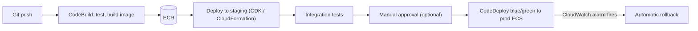

Interviewers rarely ask for a deployment pipeline, but "how do you roll this out safely?" comes up often. On AWS the native answers are **CloudFormation** (or **CDK** on top of it) for infrastructure as code, **CodePipeline**, **CodeBuild** and **CodeDeploy** for releases, and **Systems Manager** to operate servers. Many teams use Terraform and GitHub Actions instead. The ideas are the same.

## TL;DR

- **Everything in code:** CDK or CloudFormation (or Terraform). No console-only resources in production.
- **Immutable deploys:** build an image once, promote the same image through environments.
- **Release gradually:** blue/green for ECS, canary or linear for Lambda, with automatic rollback on alarms.
- **Operate without SSH:** Session Manager, Patch Manager and Parameter Store from Systems Manager.

## At a glance

<CloudGroupTable group="devops" lead="aws" />

## A safe release on AWS



## Services

### AWS CloudFormation

<CloudServiceProfile id="aws-cloudformation" />

### AWS CDK

<CloudServiceProfile id="aws-cdk" />

A CDK construct can describe a whole service from the case studies in a few lines:

```ts
// One ECS service on Fargate behind an ALB, with autoscaling: the "chat servers" of a design.
const service = new ecsPatterns.ApplicationLoadBalancedFargateService(this, "Api", {
  cluster,
  cpu: 1024,
  memoryLimitMiB: 2048,
  desiredCount: 3,
  taskImageOptions: { image: ecs.ContainerImage.fromEcrRepository(repo, "v42") },
});
service.service.autoScaleTaskCount({ minCapacity: 3, maxCapacity: 50 })
  .scaleOnRequestCount("Rps", { requestsPerTarget: 500, targetGroup: service.targetGroup });
```

### AWS CodePipeline, CodeBuild and CodeDeploy

<CloudServiceProfile id="aws-codepipeline" />

### AWS Systems Manager

<CloudServiceProfile id="aws-systems-manager" />

## Where this shows up in system design

- **Schema and data migrations:** expand, migrate, then contract, so old and new versions run side by side during a blue/green deploy.
- **Feature flags with AppConfig:** ship code dark, enable it for a percentage of users, roll back without a deploy.
- **Multi-Region:** the same CDK app or StackSet deploys identical stacks to each Region.

## Common mistakes

- **Rebuilding images per environment.** Build once and promote the same digest, or staging proves nothing.
- **Deploying everything at once.** Use canaries and alarms that roll back automatically.
- **Manual hotfixes in the console.** They drift from the code and are lost on the next deploy.
- **Long-lived CI credentials.** Use OIDC federation from GitHub or GitLab to assume an IAM role per run.

## Related

[Observability on AWS](/cloud/aws/observability) · [Containers on AWS](/cloud/aws/containers) · [Identity & Security on AWS](/cloud/aws/security)

<InterviewQuestions>
  <InterviewQuestion question="How do you deploy a new version of a service with no downtime on ECS?" category="Cloud" level="Mid">
    A rolling update keeps minimum healthy tasks running while new ones start and pass load balancer health checks. For safer releases, CodeDeploy blue/green starts a full new task set, shifts traffic in steps (canary or linear), watches CloudWatch alarms, and rolls back automatically if they fire.
  </InterviewQuestion>
  <InterviewQuestion question="How do you change a database schema during a zero-downtime deploy?" category="Architecture" level="Senior">
    Expand and contract. First add new columns or tables in a backward-compatible way; deploy code that writes both and reads the new; backfill old rows; switch reads fully; and only then remove the old columns in a later release. At every step, the old and new versions of the service work with the schema.
  </InterviewQuestion>
</InterviewQuestions>
