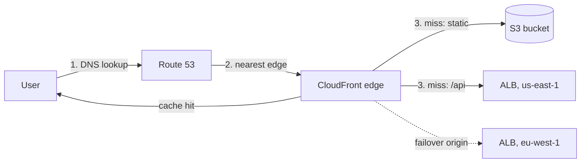

The edge is everything between a user and your Region: DNS, the CDN that caches content near users, and the global entry points that carry traffic onto the AWS backbone. It is where most latency is won or lost for global products, and where multi-Region failover is decided.

## The idea

A managed edge stands in front of everything you serve: copies come from a site near the customer, and bad traffic is stopped before it reaches your servers. DNS decides which edge or Region each user is sent to in the first place.

<Callout tone="blue" title="Learn the idea">
  The cloud-neutral version, with Brightpost's sale-day scraper, is in [CDN, Edge, DDoS & WAF](/cloud/networking/cdn-edge-and-waf). Zones, records and routing policies are in [DNS on the Cloud](/cloud/networking/dns), and steering users between two Regions is in [Multi-Region, Global Routing and Data Replication](/cloud/resilience/multi-region).
</Callout>

<AnimatedDiagram spec="animated/cloud/cdn-request-path" stepper cloud="aws" minWidth={620} caption="Brightpost's sale day on AWS: CloudFront in front of S3 and an ALB, then Shield Standard, AWS WAF and a locked origin." />

<CloudMapping diagram="cloud/cdn-request-path" lead="aws" />

## TL;DR

- **Route 53** for DNS, including latency-based, geolocation, weighted and failover routing across Regions.
- **CloudFront** in front of almost every public app. It caches static and media content, terminates TLS near users, and absorbs floods of packets with Shield Standard, included at no extra charge.
- **AWS WAF** on the distribution for managed rules and rate rules, with the origin locked so nobody can go around it.
- **Global Accelerator** for non-HTTP or uncacheable traffic that needs low latency worldwide and failover in seconds rather than at DNS speed.

## At a glance

<CloudGroupTable group="edge" lead="aws" />

## Getting a request to the right place

The stepper above shows how the edge defends the shop. This chart shows a different part: how DNS, CloudFront and two Regions pick where a request goes.

1. Route 53 answers with the CloudFront distribution's addresses, using an alias record on the bare domain.
2. Anycast and DNS steer the user to a nearby edge location, where TLS ends.
3. Cache hits return immediately. Misses go over the AWS backbone to the origin: S3 for static files, a Regional ALB for the API. An **origin group** names a second origin in another Region, tried when the first one fails.

## Defending the edge on AWS

Three AWS pieces match steps 3 to 5 of the stepper. Their full profiles are on [Identity & Security on AWS](/cloud/aws/security).

- **AWS Shield Standard** is on for every account. It drops floods of packets and half-open connections at the edge, with no rules from you. **Shield Advanced** is the paid tier, with a response team and credit for scaling an attack caused.
- **AWS WAF** attaches a web ACL to the distribution. It holds managed rule groups, rate-based rules and the Bot Control rule group. A web ACL for CloudFront lives in the global scope, which the console shows under US East (N. Virginia).
- **The origin lock.** Origin access control lets only CloudFront read the S3 bucket. An ALB either allows only CloudFront's origin-facing addresses plus a secret header, or sits in a private subnet as a **VPC origin**.

AWS WAF attaches to each resource separately. A public ALB with no lock skips every rule on the distribution.

## Services

### Amazon Route 53

<CloudServiceProfile id="aws-route53" />

| Routing policy | Answers with | Use it for |
|---|---|---|
| **Simple** | One record | Single endpoint |
| **Weighted** | Endpoints in proportion to weights | Canary releases, gradual migrations |
| **Latency-based** | The Region with the lowest measured latency | Active-active multi-Region |
| **Geolocation / geoproximity** | By user location | Data residency, regional content |
| **Failover** | Primary while healthy, else secondary | Active-passive disaster recovery |

Route 53 also offers IP-based and multivalue answer policies. Its health checkers run on the internet, so a private resource needs a check that follows a CloudWatch alarm.

### Amazon CloudFront

<CloudServiceProfile id="aws-cloudfront" />

### AWS Global Accelerator

<CloudServiceProfile id="aws-global-accelerator" />

## Where this shows up in system design

- **Media delivery:** video segments and images for [YouTube](/system-design/case-studies/youtube)-, [Instagram](/system-design/case-studies/instagram)- or [Netflix](/system-design/case-studies/netflix)-style designs come from CloudFront, with S3 as the origin and signed URLs for private content.
- **Uploads:** clients upload straight to S3 with pre-signed URLs, and the CDN serves the result (see [Blob Storage, Chunking and Dedup](/system-design/patterns/blob-storage-and-chunking)).
- **Multi-Region:** Route 53 latency routing or Global Accelerator in front of two Regions, with a replicated data layer behind them.
- **Shielding the origin:** WAF rules and rate-based limits at CloudFront stop abuse before it reaches your servers.

## Common mistakes

- **Cache keys with every header and cookie.** Each variation becomes a separate cache entry and the hit ratio collapses.
- **No cache-busting for static assets.** Put a content hash in file names and cache them for a year instead of invalidating.
- **Leaving the S3 origin public.** Use origin access control so only CloudFront can read the bucket.
- **Leaving the ALB open.** A scraper that finds its address skips AWS WAF on the distribution. Lock it to CloudFront.
- **Expecting DNS failover to be instant.** Clients cache answers for at least the TTL. Use Global Accelerator when seconds matter.

## Related

[CDN, Edge, DDoS & WAF](/cloud/networking/cdn-edge-and-waf) · [DNS on the Cloud](/cloud/networking/dns) · [Multi-Region, Global Routing and Data Replication](/cloud/resilience/multi-region) · [Edge, DNS & CDN on Google Cloud](/cloud/gcp/edge) · [Edge, DNS & CDN on Azure](/cloud/azure/edge) · [Networking on AWS](/cloud/aws/networking) · [Storage on AWS](/cloud/aws/storage) · [Identity & Security on AWS](/cloud/aws/security) · [Caching](/system-design/patterns/caching) · [Load Balancing](/system-design/patterns/load-balancing) · [Object / Blob Storage](/system-design/databases/object-storage)

<InterviewQuestions>
  <InterviewQuestion question="How would you serve user-uploaded images to a global audience on AWS?" category="Cloud" level="Mid">
    **Short answer.** Clients upload straight to S3 with a pre-signed URL, a worker makes resized copies, and CloudFront serves them. The bucket stays private; origin access control lets only CloudFront read it.

    **Why.** A pre-signed URL keeps large uploads off your servers. CloudFront keeps copies near the customer, so the bucket sees about one request per edge location, not one per viewer. File names carry a content hash, so each file can be cached for a year and never needs a purge. Private images use signed URLs or signed cookies with a short expiry.

    <AnimatedDiagram spec="animated/cloud/cdn-request-path" step={1} cloud="aws" path="customers>cdn>bucket" minWidth={620} caption="CloudFront answers from the edge; only a miss reaches the private S3 bucket." />

    **Follow-ups the interviewer may ask.**
    - How do you replace an image CloudFront has already cached?
    - Where does the resize worker run, and what triggers it?

    **Watch out for.** Making the bucket public "so CloudFront can read it". Origin access control reads a private bucket, and a public one lets anyone skip the edge.
  </InterviewQuestion>

  <InterviewQuestion question="A scraper floods your product pages through CloudFront. What do Shield, AWS WAF and the origin each do?" category="Cloud" level="Mid">
    **Short answer.** Shield Standard drops floods of junk packets on its own. AWS WAF on the distribution blocks the scraper with a rate-based rule scoped to product pages. Locking the ALB to CloudFront stops the scraper going around both.

    **Why.** The scraper's requests are valid page views, so Shield lets them through. A rate rule counts requests per address: Brightpost blocks any address over 300 in 5 minutes on `/products/*`, while a busy shopper sends about 40. The web ACL protects only the distribution, so an open ALB is a side door.

    <AnimatedDiagram spec="animated/cloud/cdn-request-path" step={5} cloud="aws" highlight={["bots", "waf", "lb", "lock"]} minWidth={620} caption="The rate rule blocks the scraper at CloudFront; the VPC origin refuses its direct try at the ALB." />

    **Follow-ups the interviewer may ask.**
    - The scraper spreads over 5,000 addresses. What next?
    - When is Shield Advanced worth paying for?

    **Watch out for.** Switching a new managed rule group straight to block. Run it in count mode first, so it cannot stop real payments.
  </InterviewQuestion>

  <InterviewQuestion question="Route 53 failover or Global Accelerator for multi-Region failover?" category="Cloud" level="Senior">
    **Short answer.** Route 53 failover is simple and cheap, but it moves users only as fast as DNS caches expire. Global Accelerator moves them in seconds on the same two anycast addresses. Pick by how fast you must recover.

    **Why.** With Route 53, a health check marks the Region down, and the zone starts giving the other answer. Resolvers that cached the old answer keep it for the TTL, and some keep it longer. Global Accelerator has fixed anycast addresses, runs its own health checks and shifts traffic between endpoint groups, with no DNS change. It costs a fixed hourly fee plus a charge per GB.

    <AnimatedDiagram spec="animated/cloud/global-routing" step={6} cloud="aws" minWidth={620} caption="One anycast entry point in front of both Regions moves shoppers when a Region fails its checks." />

    **Follow-ups the interviewer may ask.**
    - How would CloudFront origin groups fit into this design?
    - Moving users is half a failover. What happens to the database writer?

    **Watch out for.** Assuming either option moves the data. Both steer traffic only; the writer still has to be promoted in the other Region.
  </InterviewQuestion>
</InterviewQuestions>
