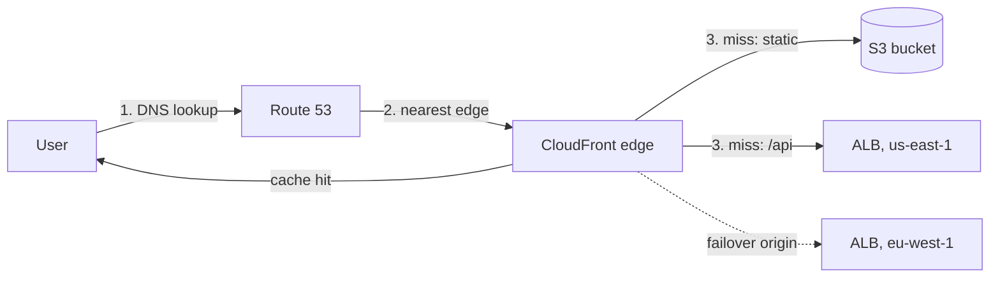

The edge is everything between a user and your Region: DNS, the CDN that caches content near users, and the global entry points that carry traffic onto the AWS backbone. It is where most latency is won or lost for global products, and where multi-Region failover is decided.

## TL;DR

- **Route 53** for DNS, including latency-based, geolocation, weighted and failover routing across Regions.
- **CloudFront** in front of almost every public app. It caches static and media content, terminates TLS near users, and absorbs DDoS traffic (Shield Standard is included).
- **Global Accelerator** for non-HTTP or uncacheable traffic that needs low latency worldwide and failover in seconds rather than at DNS speed.
- **Code at the edge:** CloudFront Functions for lightweight header and URL logic; Lambda@Edge for heavier work.

## At a glance

<CloudGroupTable group="edge" lead="aws" />

## Getting a request to the right place

1. Route 53 returns the CloudFront distribution's address.
2. Anycast and DNS steer the user to a nearby edge location, where TLS ends.
3. Cache hits return immediately. Misses go over the AWS backbone to the origin: S3 for static files, a Regional ALB for the API, with an origin group to fail over to a second Region.

## Services

### Amazon Route 53

<CloudServiceProfile id="aws-route53" />

| Routing policy | Answers with | Use it for |
|---|---|---|
| **Simple** | One record | Single endpoint |
| **Weighted** | Endpoints in proportion to weights | Canary releases, gradual migrations |
| **Latency-based** | The Region with the lowest measured latency | Active-active multi-Region |
| **Geolocation / geoproximity** | By user location | Data residency, regional content |
| **Failover** | Primary while healthy, else secondary | Active-passive disaster recovery |

### Amazon CloudFront

<CloudServiceProfile id="aws-cloudfront" />

### AWS Global Accelerator

<CloudServiceProfile id="aws-global-accelerator" />

## Where this shows up in system design

- **Media delivery:** video segments and images for [YouTube](/system-design-case-studies/case-studies/youtube)-, [Instagram](/system-design-case-studies/case-studies/instagram)- or [Netflix](/system-design-case-studies/case-studies/netflix)-style designs come from CloudFront, with S3 as the origin and signed URLs for private content.
- **Uploads:** clients upload straight to S3 with pre-signed URLs, and the CDN serves the result (see [Blob Storage, Chunking and Dedup](/system-design/patterns/blob-storage-and-chunking)).
- **Multi-Region:** Route 53 latency routing or Global Accelerator in front of two Regions, with a replicated data layer behind them.
- **Shielding the origin:** WAF rules and rate-based limits at CloudFront stop abuse before it reaches your servers.

## Common mistakes

- **Cache keys with every header and cookie.** Each variation becomes a separate cache entry and the hit ratio collapses.
- **No cache-busting for static assets.** Put a content hash in file names and cache them for a year instead of invalidating.
- **Leaving the S3 origin public.** Use origin access control so only CloudFront can read the bucket.
- **Expecting DNS failover to be instant.** Clients cache answers for at least the TTL. Use Global Accelerator when seconds matter.

## Related

[Networking on AWS](/cloud/aws/networking) · [Storage on AWS](/cloud/aws/storage) · [Caching](/system-design/patterns/caching) · [Load Balancing](/system-design/patterns/load-balancing) · [Object / Blob Storage](/system-design/databases/object-storage)

<InterviewQuestions>
  <InterviewQuestion question="How would you serve user-uploaded images to a global audience on AWS?" category="Architecture" level="Mid">
    Clients upload directly to S3 with a pre-signed URL, a worker creates resized variants, and CloudFront serves them with S3 as the origin, protected by origin access control. File names include a content hash so they can be cached for a long time; private images use signed URLs or cookies.
  </InterviewQuestion>
  <InterviewQuestion question="Route 53 failover or Global Accelerator for multi-Region failover?" category="Reliability" level="Senior">
    Route 53 failover is simple and cheap but bounded by DNS caching, so some clients keep using the failed Region until their TTL expires. Global Accelerator gives fixed anycast IPs and moves traffic to the healthy Region in seconds without DNS changes, at an extra hourly and per-GB cost. Pick by how fast you must recover.
  </InterviewQuestion>
</InterviewQuestions>
