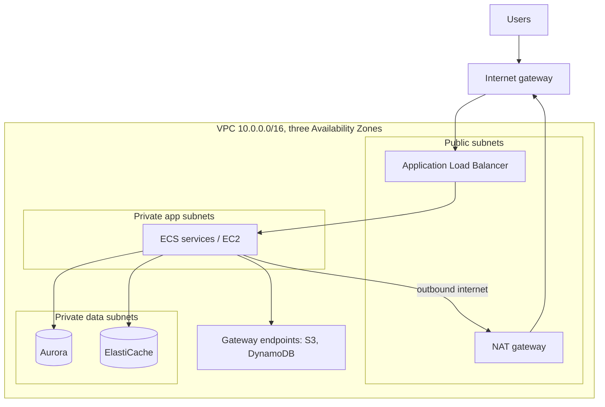

Every AWS architecture diagram sits inside a VPC, even when nobody draws it. Getting the network right decides what can talk to what, what fails together, and a surprising share of the bill (NAT and cross-zone traffic). This page covers the network inside a Region. DNS, CDN and global entry points are in [Edge, DNS & CDN](/cloud/aws/edge).

## TL;DR

- **One VPC per environment per Region**, with **public, private and data subnets in three Availability Zones**.
- **Only load balancers and NAT live in public subnets.** Services and databases stay private.
- **Security groups do the real filtering.** Reference groups by id ("the app tier may reach the database") instead of IP ranges.
- **ALB for HTTP, NLB for TCP and huge connection counts.**
- **Many VPCs:** Transit Gateway. **One service shared privately:** PrivateLink. **Service-to-service:** ECS Service Connect or VPC Lattice. AWS App Mesh support ended September 30, 2026.
- **Watch the data charges:** NAT gateway processing, cross-zone traffic and public IPv4 addresses all cost money.

## At a glance

<CloudGroupTable group="networking" lead="aws" />

## A standard three-tier VPC

| Layer | Security group allows inbound | From |
|---|---|---|
| Load balancer | 443 | The internet (or CloudFront's managed prefix list only) |
| App services | App port | The load balancer's security group |
| Database | 5432 | The app services' security group |
| Cache | 6379 | The app services' security group |

## Services

### Amazon VPC

<CloudServiceProfile id="aws-vpc" />

### Elastic Load Balancing

<CloudServiceProfile id="aws-elb" />

| | Application Load Balancer | Network Load Balancer |
|---|---|---|
| **Layer** | 7 (HTTP/HTTPS, gRPC, WebSocket) | 4 (TCP, UDP, TLS) |
| **Routing** | Host, path, header, query, weighted target groups | Port only |
| **Connections** | Fine for most web traffic | Millions of long-lived connections, static IPs per zone |
| **Extras** | WAF, Cognito/OIDC auth, sticky sessions | Preserves client IP, PrivateLink endpoint services |
| **Pick it for** | APIs and web apps | WebSocket fleets at huge scale, games, IoT, non-HTTP |

### AWS Transit Gateway

<CloudServiceProfile id="aws-transit-gateway" />

### AWS PrivateLink

<CloudServiceProfile id="aws-privatelink" />

### Amazon VPC Lattice

<CloudServiceProfile id="aws-vpc-lattice" />

### AWS Direct Connect

<CloudServiceProfile id="aws-direct-connect" />

## Where this shows up in system design

- **Every case study:** the edge tier (load balancers) sits in public subnets; chat servers, workers and databases in private ones.
- **Connection-heavy servers:** the [Messenger](/system-design-case-studies/case-studies/facebook-messenger) chat tier uses an NLB, which passes millions of WebSocket connections through cheaply.
- **Zone failure:** spreading every tier across three zones is how a design survives losing a data centre. Reliability questions often start here.
- **Multi-account platforms:** a shared network account with Transit Gateway, and teams exposing services to each other through PrivateLink or VPC Lattice.

## Common mistakes

- **Overlapping CIDR ranges** between VPCs or with on-prem. It blocks peering and Transit Gateway later and is painful to fix.
- **Everything in public subnets** "to make it work". Only load balancers and NAT belong there.
- **S3 and DynamoDB traffic through NAT.** Add the free gateway endpoints.
- **Ignoring cross-zone data transfer.** Chatty services that call across zones pay per GB in both directions. Prefer zone-aware routing for heavy flows.
- **One NAT gateway for three zones.** When its zone fails, the others lose outbound access. Use one per zone or a regional NAT gateway.

## Related

[Edge, DNS & CDN on AWS](/cloud/aws/edge) · [Containers on AWS](/cloud/aws/containers) · [Load Balancing](/system-design/patterns/load-balancing) · [Networking fundamentals](/system-design/fundamentals/networking) · [Security fundamentals](/system-design/fundamentals/security)

<InterviewQuestions>
  <InterviewQuestion question="Security groups vs network ACLs?" category="Cloud" level="Junior">
    Security groups are stateful, attach to resources, only allow traffic, and can reference other security groups. Network ACLs are stateless, attach to subnets, have ordered allow and deny rules, and need rules for return traffic. Most designs rely on security groups and leave NACLs at their defaults, using them only for broad subnet-level denies.
  </InterviewQuestion>
  <InterviewQuestion question="ALB or NLB in front of WebSocket servers?" category="Architecture" level="Mid">
    Both support WebSockets. An ALB is fine at moderate scale and adds HTTP routing, auth and WAF. At millions of long-lived connections an NLB is usually better: it passes TCP through with very low overhead, scales without warm-up, keeps static IPs and preserves the client IP.
  </InterviewQuestion>
  <InterviewQuestion question="Your NAT gateway bill is huge. What do you check?" category="Cloud" level="Mid">
    Which traffic goes through it. S3 and DynamoDB traffic should use free gateway endpoints; other AWS APIs can use interface endpoints; container image pulls can come from ECR through endpoints or a pull-through cache. Then check cross-zone paths, since a NAT gateway in another zone adds data transfer charges on top of processing.
  </InterviewQuestion>
</InterviewQuestions>
