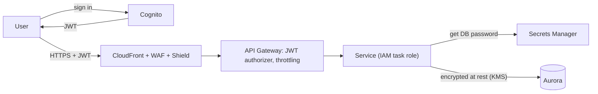

Security comes up in every design review even when it isn't the topic: *who can call this API, how are secrets stored, what stops a flood of bad requests, how is data encrypted?* On AWS the answers are a small set of services used everywhere: **IAM** for permissions, **Organizations** for guardrails across accounts, **Cognito** for your users, **KMS** and **Secrets Manager** for keys and secrets, **WAF** and **Shield** at the edge, and **GuardDuty** and **Security Hub** to watch it all.

## The idea

Every request to a cloud is checked twice: who is calling, and whether that caller may do exactly this. Workloads and people should prove who they are with short-lived credentials from the identity service, never with a key pasted into code.

<Callout tone="blue" title="Learn the idea">
  New to this? [Identity and Access](/cloud/fundamentals/identity-and-access) tells the story of Brightpost's leaked storage key step by step. [Encryption and Keys](/cloud/resilience/encryption-and-keys) and [Secrets Management](/cloud/resilience/secrets-management) cover the other half: protecting the data and the passwords a workload still needs. This page names the AWS pieces.
</Callout>

<AnimatedDiagram spec="animated/cloud/iam-role-chain" stepper cloud="aws" minWidth={620} caption="Brightpost's storage key on AWS in seven steps: a leaked key, an IAM role with short-lived credentials, a narrow policy, Identity Center, a second account and CloudTrail." />

<CloudMapping diagram="cloud/iam-role-chain" lead="aws" />

## TL;DR

- **IAM roles everywhere, never access keys in code.** Each service, task and function gets its own least-privilege role.
- **Cognito** (or another identity provider) for app users; API Gateway or ALB validate its tokens before your code runs.
- **Encrypt with KMS keys** you control; store passwords and API keys in **Secrets Manager** with rotation.
- **WAF on CloudFront or ALB** blocks injection, bots and request floods; **Shield Standard** is on by default.
- **Multi-account by default:** separate prod, staging and security accounts in an Organization, with SCP guardrails, an organisation-wide CloudTrail, and GuardDuty in every account.

## At a glance

<CloudGroupTable group="security" lead="aws" />

## Securing a request end to end

The stepper above shows how the shop's own code gets its permissions. This chart shows a different path: a customer's request, from sign-in to the database.

In AWS words, the stepper's steps map like this. The static key in steps 1 and 2 is an IAM user's access key. In step 3 the EC2 instance gets an **IAM role** through an instance profile, and the Security Token Service (STS) hands it temporary credentials. Step 4 is the role's **IAM policy**. Step 5 is **IAM Identity Center**, step 6 a **service control policy (SCP)** plus a role in the audit account, and step 7 **CloudTrail**.

## Services

### AWS IAM

<CloudServiceProfile id="aws-iam" />

**Pick it when** anything calls AWS: every workload gets a role, and every person signs in through Identity Center.

### AWS Organizations

<CloudServiceProfile id="aws-organizations" />

**Pick it when** you have more than one account, which should be from the start: shop, test and audit apart.

### AWS Control Tower

<CloudServiceProfile id="aws-control-tower" />

**Pick it when** you are starting a multi-account estate and want logging, sign-in and guardrails set up for you.

### Amazon Cognito

<CloudServiceProfile id="aws-cognito" />

**Pick it when** your app's own customers need sign-up, sign-in and tokens that API Gateway or an ALB can check.

### AWS Verified Access

<CloudServiceProfile id="aws-verified-access" />

**Pick it when** staff reach an internal web app, such as an admin tool, and you want an identity and device check instead of a VPN; see [Zero Trust](/cloud/resilience/zero-trust).

### AWS KMS

<CloudServiceProfile id="aws-kms" />

**Pick it when** data at rest must be encrypted under a key whose use you control and can audit.

### AWS Secrets Manager

<CloudServiceProfile id="aws-secrets-manager" />

**Pick it when** a workload still needs a password or third-party API key, especially one that should rotate.

### AWS WAF

<CloudServiceProfile id="aws-waf" />

**Pick it when** a public site or API needs managed rules, bot control or per-address rate limits in front of it.

### AWS Shield

<CloudServiceProfile id="aws-shield" />

**Pick it when** you are on the internet at all (Standard is automatic); pay for Advanced only for high-profile targets.

### Amazon GuardDuty

<CloudServiceProfile id="aws-guardduty" />

**Pick it when** you run any account: turn it on everywhere on day one, and send its findings to a person; see [Threat Detection](/cloud/resilience/threat-detection).

### Amazon Inspector

<CloudServiceProfile id="aws-inspector" />

**Pick it when** you need to know which instances, images or functions carry a newly announced software flaw.

### Amazon Macie

<CloudServiceProfile id="aws-macie" />

**Pick it when** you must find where personal data sits in S3, such as an export bucket full of customer addresses.

### AWS Security Hub

<CloudServiceProfile id="aws-security-hub" />

**Pick it when** several accounts and detectors produce findings and you want one ranked list.

## Where this shows up in system design

- **[Rate limiter](/system-design/case-studies/rate-limiter):** WAF rate-based rules at the edge for abuse, plus an application-level limiter for per-user quotas.
- **[Kindle payments](/system-design/case-studies/kindle-payments) and [Ticketmaster](/system-design/case-studies/ticketmaster):** card data stays with the payment provider; secrets in Secrets Manager; bot control on on-sale traffic.
- **[Dropbox](/system-design/case-studies/dropbox) and [S3](/system-design/case-studies/s3):** encryption at rest with KMS, short-lived pre-signed URLs instead of public objects.
- **Every case study:** services call each other with IAM-authenticated requests or inside private subnets, never with shared static keys.

## Common mistakes

- **`"Action": "*"` policies.** Start from least privilege and use IAM Access Analyzer to trim unused permissions.
- **Secrets in environment variables baked into images or in Git.** Fetch them from Secrets Manager at start-up and cache them.
- **Verifying JWTs only in some services.** Validate at the gateway, and check authorisation (can *this* user see *this* order?) in the service.
- **One AWS account for everything.** A mistake or breach in dev can reach prod. Separate accounts are the strongest boundary AWS offers.
- **GuardDuty in one Region only.** It works per Region, so an attacker can start machines where nobody watches. Turn it on in every allowed Region.

## Related

[Identity and Access](/cloud/fundamentals/identity-and-access) · [Encryption and Keys](/cloud/resilience/encryption-and-keys) · [Secrets Management](/cloud/resilience/secrets-management) · [Threat Detection](/cloud/resilience/threat-detection) · [Identity & Security on Google Cloud](/cloud/gcp/security) · [Identity & Security on Azure](/cloud/azure/security) · [Networking on AWS](/cloud/aws/networking) · [Edge, DNS & CDN on AWS](/cloud/aws/edge) · [Security fundamentals](/system-design/fundamentals/security) · [Rate Limiting](/system-design/patterns/rate-limiting)

<InterviewQuestions>
  <InterviewQuestion question="How does a container on ECS get permission to read from S3?" category="Cloud" level="Junior">
    **Short answer.** Through an IAM task role named in the task definition. The AWS SDK inside the container fetches temporary credentials for that role and renews them before they expire. The role's policy allows only the bucket and actions the service needs, so no access key is stored anywhere.

    **Why.** A key in the code or the image works for anyone who copies it, and it never expires. A task role's credentials come from a local endpoint that only the task can reach, and they expire on their own. Each task definition gets its own role, so the image-resize worker cannot read the orders bucket just because the shop app can.

    <AnimatedDiagram spec="animated/cloud/iam-role-chain" step={3} cloud="aws" highlight={["iam", "svcid", "server", "bucket"]} minWidth={620} caption="The key is deleted. The role attached to the workload gets short-lived credentials, and the old key is refused." />

    **Follow-ups the interviewer may ask.**
    - What is the difference between the task role and the task execution role?
    - How would you check that the role cannot write to the bucket?

    **Watch out for.** Giving the container the instance's role by accident. On EC2-backed clusters, block containers from reaching the instance metadata endpoint, so each task has only its own role.
  </InterviewQuestion>

  <InterviewQuestion question="Where would you enforce rate limits in an AWS design?" category="Architecture" level="Mid">
    **Short answer.** In layers. WAF rate-based rules at CloudFront stop floods per address before they reach the Region. API Gateway throttles and usage plans cap each client's request rate. Per-user business quotas live in the application, with counters in ElastiCache.

    **Why.** Each layer knows something the others do not. The edge sees addresses but not users, so it can only stop crude floods cheaply. The gateway knows the API key or client. Only the application knows the user and their plan, such as 100 messages a minute, so that limit belongs there.

    **Follow-ups the interviewer may ask.**
    - The flood comes from 5,000 addresses at once. Which layer still helps?
    - How do you keep the per-user counter correct across several app servers?

    **Watch out for.** Relying on the edge for per-user limits. Many real users share one address behind an office or mobile network, so a per-address rule that is tight enough to matter blocks them too.
  </InterviewQuestion>

  <InterviewQuestion question="Brightpost's shop must write logs into a separate audit account that the shop team cannot erase. How do you set that up on AWS?" category="Cloud" level="Senior">
    **Short answer.** In the audit account, create a role that may only put objects into the log archive bucket, and make its trust policy name the shop app's role. Allow the shop's role to assume it. Turn on S3 Object Lock for the archive, and add an SCP so nobody in the shop account can stop CloudTrail.

    **Why.** Across accounts both sides must say yes: the shop role's own policy allows `sts:AssumeRole` on the writer role, and the writer role's trust policy accepts the shop role. The writer role allows `s3:PutObject` on one bucket and nothing else, so even the shop's administrators cannot read or delete old logs through it. An organisation trail records every account's API calls into the same archive.

    <AnimatedDiagram spec="animated/cloud/iam-role-chain" step={6} cloud="aws" path="server>role2>archive" minWidth={620} caption="The shop app takes on a write-only role in the audit account. The SCP above both accounts caps every policy below it." />

    **Follow-ups the interviewer may ask.**
    - Would a bucket policy that names the shop role work instead of a second role?
    - Who may change the SCP, and from which account?

    **Watch out for.** Forgetting that an SCP does not restrict the management account. Keep workloads out of it, or your guardrails have a hole at the top.
  </InterviewQuestion>
</InterviewQuestions>
