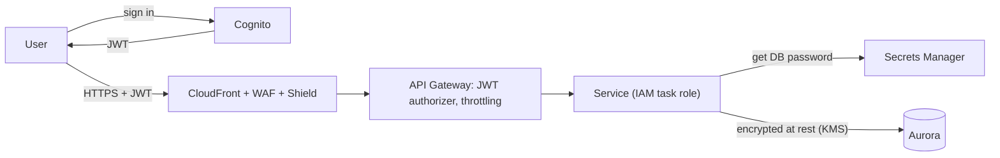

Security comes up in every design review even when it isn't the topic: *who can call this API, how are secrets stored, what stops a flood of bad requests, how is data encrypted?* On AWS the answers are a small set of services used everywhere: **IAM** for permissions, **Cognito** for your users, **KMS** and **Secrets Manager** for keys and secrets, **WAF** and **Shield** at the edge, and **Security Hub** to watch it all.

## TL;DR

- **IAM roles everywhere, never access keys in code.** Each service, task and function gets its own least-privilege role.
- **Cognito** (or another identity provider) for app users; API Gateway or ALB validate its tokens before your code runs.
- **Encrypt with KMS keys** you control; store passwords and API keys in **Secrets Manager** with rotation.
- **WAF on CloudFront or ALB** blocks injection, bots and request floods; **Shield Standard** is on by default.
- **Multi-account by default:** separate prod, staging and security accounts in an Organization, with SCP guardrails and an organisation-wide CloudTrail.

## At a glance

<CloudGroupTable group="security" lead="aws" />

## Securing a request end to end

## Services

### AWS IAM

<CloudServiceProfile id="aws-iam" />

### Amazon Cognito

<CloudServiceProfile id="aws-cognito" />

### AWS KMS

<CloudServiceProfile id="aws-kms" />

### AWS Secrets Manager

<CloudServiceProfile id="aws-secrets-manager" />

### AWS WAF

<CloudServiceProfile id="aws-waf" />

### AWS Shield

<CloudServiceProfile id="aws-shield" />

### AWS Security Hub

<CloudServiceProfile id="aws-security-hub" />

## Where this shows up in system design

- **[Rate limiter](/system-design/case-studies/rate-limiter):** WAF rate-based rules at the edge for abuse, plus an application-level limiter for per-user quotas.
- **[Kindle payments](/system-design/case-studies/kindle-payments) and [Ticketmaster](/system-design/case-studies/ticketmaster):** card data stays with the payment provider; secrets in Secrets Manager; bot control on on-sale traffic.
- **[Dropbox](/system-design/case-studies/dropbox) and [S3](/system-design/case-studies/s3):** encryption at rest with KMS, short-lived pre-signed URLs instead of public objects.
- **Every case study:** services call each other with IAM-authenticated requests or inside private subnets, never with shared static keys.

## Common mistakes

- **`"Action": "*"` policies.** Start from least privilege and use IAM Access Analyzer to trim unused permissions.
- **Secrets in environment variables baked into images or in Git.** Fetch them from Secrets Manager at start-up and cache them.
- **Verifying JWTs only in some services.** Validate at the gateway, and check authorisation (can *this* user see *this* order?) in the service.
- **One AWS account for everything.** A mistake or breach in dev can reach prod. Separate accounts are the strongest boundary AWS offers.

## Related

[Networking on AWS](/cloud/aws/networking) · [Edge, DNS & CDN on AWS](/cloud/aws/edge) · [Security fundamentals](/system-design/fundamentals/security) · [Rate Limiting](/system-design/patterns/rate-limiting)

<InterviewQuestions>
  <InterviewQuestion question="How does a container on ECS get permission to read from S3?" category="Cloud" level="Junior">
    Through an IAM task role attached to the task definition. The AWS SDK inside the container picks up temporary credentials automatically and refreshes them; the role's policy allows only the bucket and actions the service needs. No access keys are stored anywhere.
  </InterviewQuestion>
  <InterviewQuestion question="Where would you enforce rate limits in an AWS design?" category="Architecture" level="Mid">
    In layers. WAF rate-based rules at CloudFront stop floods per IP before they reach the Region. API Gateway usage plans or throttles cap per-client request rates. Per-user business quotas (for example, 100 messages a minute) live in the application with counters in ElastiCache, because only the application knows the user and plan.
  </InterviewQuestion>
</InterviewQuestions>
