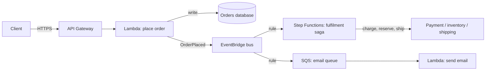

AWS serverless is more than Lambda. Most serverless designs combine four pieces. **API Gateway** takes requests in and **Lambda** runs the code. **EventBridge** or **SQS** passes events between services, and **Step Functions** coordinates anything with more than two steps. Pick each piece for its job, not because "we're going serverless".

## The idea

A <Term id="serverless">serverless</Term> function is code the cloud runs once per event, in as many copies as there are events in flight. You choose the trigger and a cap on copies; AWS owns the machines, the start-up and the scaling.

<Callout tone="blue" title="Learn the idea">
  [Serverless Functions](/cloud/compute/serverless-functions) explains triggers, cold starts and why copies multiply. [API Gateways & API Management](/cloud/networking/api-gateways) covers the front door. [Serverless Containers and Platforms as a Service](/cloud/compute/serverless-containers-and-paas) covers what to use when a function is the wrong shape.
</Callout>

<AnimatedDiagram spec="animated/cloud/serverless-event-triggers" stepper cloud="aws" minWidth={620} caption="Brightpost's resize function in six steps, with AWS names. Step 2 is the 1,500-photo burst; steps 3 and 4 repair it." />

<CloudMapping diagram="cloud/serverless-event-triggers" lead="aws" />

Read with AWS names, the story goes like this. An S3 event starts a Lambda function for each photo, and each copy opens its own connection to the RDS database. Reserved concurrency caps the copies, and RDS Proxy shares a few connections among them. An SQS queue then takes the burst, with a dead-letter queue for photos that keep failing. EventBridge Scheduler and a Lambda function URL are two more ways to start the same code.

## TL;DR

- **Lambda** runs short, event-driven code. It stops being cheap at steady high volume, and each run is capped at 15 minutes.
- **Step Functions** coordinates multi-step processes with retries, waits and compensation. Use **Standard** for long business flows and **Express** for high-volume short ones.
- **EventBridge** routes business events by content to any number of consumers. Use **SQS** for work queues and **Kinesis/MSK** for ordered, replayable streams.
- **API Gateway** fronts public APIs (REST, HTTP or WebSocket). **AppSync** does the same for GraphQL and real-time subscriptions.

## At a glance

<CloudGroupTable group="serverless" lead="aws" />

## How the pieces fit together

The stepper shows one function and its triggers. A business flow, such as what happens after an order, uses the other pieces too.

The API returns as soon as the order is stored. Everything after that is asynchronous: EventBridge fans the event out, the saga runs each step with retries and compensations, and the email worker drains its queue at its own pace. Each consumer can fail and retry without affecting the others.

## Services

### AWS Lambda

<CloudServiceProfile id="aws-lambda" />

Lambda runs one request per execution environment, its word for a copy. 1,000 requests in flight need 1,000 environments. So the Region-wide concurrency pool and the database's connection limit matter more than CPU. Every function in a Region shares that pool. **Reserved concurrency** caps one function and sets its share aside, so a resize burst cannot starve a payment webhook.

For SQS, Kinesis and DynamoDB Streams, an **event source mapping** polls for you and hands Lambda batches. On an SQS mapping, set **maximum concurrency** so a backlog cannot flood the database behind it. The general idea is on [Serverless Functions](/cloud/compute/serverless-functions).

### AWS Step Functions

<CloudServiceProfile id="aws-step-functions" />

Step Functions is the AWS-native way to implement a [saga](/system-design/patterns/saga). Each step has its own retry policy with backoff, a `Catch` routes failures to compensating steps, and the execution history shows exactly where a stuck order is. **Lambda durable functions** give a code-first alternative for teams who prefer workflows in their programming language over a state-machine definition.

### Amazon EventBridge

<CloudServiceProfile id="aws-eventbridge" />

EventBridge has three parts worth knowing apart. **Event buses** route events to targets by rules. **EventBridge Scheduler** starts a target on a schedule, like Brightpost's 04:00 sweep. **Pipes** connect one source to one target, with a filter in between.

### Amazon API Gateway

<CloudServiceProfile id="aws-api-gateway" />

| | REST API | HTTP API | WebSocket API |
|---|---|---|---|
| **Best for** | Public APIs that need usage plans, API keys, request validation, caching | Simple, cheaper proxies to Lambda or HTTP backends | Chat, live dashboards, notifications |
| **Auth** | IAM, Cognito, Lambda authorizers | IAM, JWT, Lambda authorizers | IAM, Lambda authorizer on connect |
| **Price** | Highest per request | Lower per request | Per message and per connection-minute |

For one internal endpoint, such as Brightpost's "redo one photo" button, a **Lambda function URL** is enough. It gives the function its own HTTPS address with IAM auth, but no throttling plans or API keys.

### AWS AppSync

<CloudServiceProfile id="aws-appsync" />

### When a function is the wrong shape

Long jobs, steady heavy traffic and long-lived connections fit containers better. **AWS Fargate** runs containers without servers to manage, under ECS or EKS; its profile is on [Containers on AWS](/cloud/aws/containers#aws-fargate). The trade-off is explained on [Serverless Containers and Platforms as a Service](/cloud/compute/serverless-containers-and-paas).

## Where this shows up in system design

- **Notifications and webhooks:** an event on EventBridge triggers a Lambda that calls APNs, FCM or a partner webhook, with an SQS dead-letter queue for failures.
- **Order and payment flows:** a Step Functions saga with compensations, for flows like [Uber Eats](/system-design/case-studies/uber-eats) ordering (authorise the card, place the order, release the hold if the restaurant declines).
- **Real-time at moderate scale:** API Gateway WebSocket APIs or AppSync Events instead of running connection servers. At [Messenger](/system-design/case-studies/facebook-messenger) scale (100M+ concurrent connections), self-managed WebSocket servers behind an NLB are cheaper.
- **Rate limiting at the door:** API Gateway usage plans and throttles (see [Rate Limiting](/system-design/patterns/rate-limiting)).

## Common mistakes

- **Lambda calling Lambda synchronously.** You pay for both while one waits. Use Step Functions or events.
- **No dead-letter queue.** Async invocations and EventBridge rules retry, then drop. Always attach a DLQ or failure destination.
- **Unbounded concurrency into a database.** Cap Lambda concurrency and put RDS Proxy or a queue in front.
- **Standard workflows for millions of short executions.** Express workflows cost a fraction for high-volume, short flows.
- **Treating EventBridge as a stream.** It has no ordering or consumer offsets. Use Kinesis or MSK when order and replay per key matter.

## Related

[Serverless Functions](/cloud/compute/serverless-functions) · [API Gateways & API Management](/cloud/networking/api-gateways) · [Serverless & Orchestration on Google Cloud](/cloud/gcp/serverless) · [Serverless & Orchestration on Azure](/cloud/azure/serverless) · [Containers on AWS](/cloud/aws/containers) · [Choosing Compute](/cloud/start-here/choosing-compute) · [Saga and Distributed Transactions](/system-design/patterns/saga) · [Message Queues and Pub/Sub](/system-design/patterns/message-queues) · [Idempotency](/system-design/patterns/idempotency) · [WebSockets](/system-design/fundamentals/websockets)

<InterviewQuestions>
  <InterviewQuestion question="On Lambda, why did 300 photos in flight open 300 database connections, and which settings fix it?" category="Cloud" level="Mid">
    **Short answer.** Lambda gives each execution environment one event at a time, and each environment opens its own connection. Reserved concurrency, or maximum concurrency on the SQS mapping, caps the copies. RDS Proxy shares a small set of connections among them.

    **Why.** Connections follow copies, not requests. Brightpost's database takes 200 connections, and the shop's servers need most of them on a sale day. So the cap comes from the database: 20 copies, 20 pooled connections. With an SQS queue in front, the other photos wait instead of failing.

    <AnimatedDiagram spec="animated/cloud/serverless-request" step={3} caption="Two photos at once: copy A is busy, so Lambda starts copy B with its own connection." />

    **Follow-ups the interviewer may ask.**
    - Why use the mapping's maximum concurrency rather than reserved concurrency for an SQS trigger?
    - What else in the account loses out if one function takes the whole concurrency pool?

    **Watch out for.** Fixing it with a bigger database. It costs more every day, and the next burst is bigger.
  </InterviewQuestion>

  <InterviewQuestion question="Step Functions or EventBridge for an order workflow?" category="Cloud" level="Mid">
    **Short answer.** Both, for different parts. EventBridge announces that an order was placed, so any service can react. Step Functions runs the steps that must happen in order, with retries and compensation: charge, reserve, ship.

    **Why.** Events give loose coupling: the order service does not know who listens, and a new consumer is one new rule. A workflow gives control: the sequence, the retries and the undo steps live in one definition with a visible history. Use choreography with events where steps are independent, and orchestration where order and failure handling matter.

    **Follow-ups the interviewer may ask.**
    - How would you find a stuck order in each design?
    - Where does the dead-letter queue go in the EventBridge part?

    **Watch out for.** Building a long chain of events where each consumer publishes the next. Nobody can see the whole flow, and an undo step is hard to add.
  </InterviewQuestion>

  <InterviewQuestion question="Standard or Express workflows?" category="Cloud" level="Mid">
    **Short answer.** Standard for long-running, low-volume business processes. Express for high-volume, short flows such as event processing.

    **Why.** Standard runs each step exactly once, keeps the full history and can wait up to a year for a person or a callback. It is billed per state transition, which adds up at millions of runs. Express is much cheaper for short flows, but can run a step more than once, so every step must be idempotent.

    **Follow-ups the interviewer may ask.**
    - Which one fits a flow that waits for a printing partner to confirm an order?
    - How do you make a "charge the card" step safe to repeat?

    **Watch out for.** Picking Express for a payment flow without idempotent steps. A repeated step can charge a customer twice.
  </InterviewQuestion>

  <InterviewQuestion question="When would you not use API Gateway WebSocket APIs for a chat app?" category="Cloud" level="Senior">
    **Short answer.** At very large scale, or when connections must stay open for long. Then your own WebSocket servers on ECS behind a Network Load Balancer cost less and give more control.

    **Why.** WebSocket APIs bill per connection-minute and per message, cap how long a connection lives, and add a hop for every message. With millions of always-on connections, those costs pass the cost of servers you run. Your own servers also let you control heartbeats and draining during deploys.

    **Follow-ups the interviewer may ask.**
    - How do clients behave when the service closes a connection?
    - Where would AppSync Events fit instead?

    **Watch out for.** Assuming managed is always cheaper. At steady high volume, per-use pricing usually loses to capacity you run yourself.
  </InterviewQuestion>
</InterviewQuestions>
