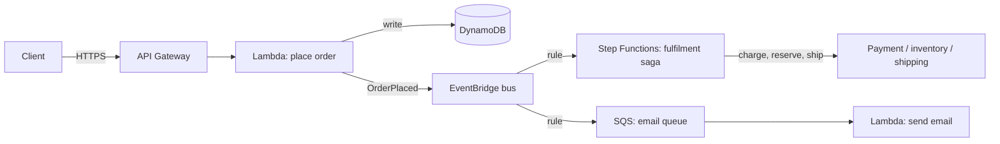

AWS serverless is more than Lambda. Most serverless designs combine four pieces: **API Gateway** takes requests in, **Lambda** runs the code, **EventBridge** or **SQS** passes events between services, and **Step Functions** coordinates anything with more than two steps. Pick each piece for its job, not because "we're going serverless".

## TL;DR

- **Lambda** runs short, event-driven code. It stops being cheap at steady high volume, and each run is capped at 15 minutes.
- **Step Functions** coordinates multi-step processes with retries, waits and compensation. Use **Standard** for long business flows and **Express** for high-volume short ones.
- **EventBridge** routes business events by content to any number of consumers. Use **SQS** for work queues and **Kinesis/MSK** for ordered, replayable streams.
- **API Gateway** fronts public APIs (REST, HTTP or WebSocket). **AppSync** does the same for GraphQL and real-time subscriptions.

## At a glance

<CloudGroupTable group="serverless" lead="aws" />

## How the pieces fit together

The API returns as soon as the order is stored. Everything after that is asynchronous: EventBridge fans the event out, the saga runs each step with retries and compensations, and the email worker drains its queue at its own pace. Each consumer can fail and retry without affecting the others.

## Services

### AWS Lambda

<CloudServiceProfile id="aws-lambda" />

Lambda is one request per execution environment. 1,000 concurrent requests need 1,000 environments, which is why the Region-wide concurrency quota and downstream connection limits matter more than CPU. For event sources such as SQS, Kinesis and DynamoDB Streams, Lambda polls for you and scales consumers with the backlog. Set a **maximum concurrency** so a backlog cannot flood the database behind it.

### AWS Step Functions

<CloudServiceProfile id="aws-step-functions" />

Step Functions is the AWS-native way to implement a [saga](/system-design/patterns/saga). Each step has its own retry policy with backoff, a `Catch` routes failures to compensating steps, and the execution history shows exactly where a stuck order is. **Lambda durable functions** (December 2025) give a code-first alternative for teams who prefer workflows in their programming language over a state-machine definition.

### Amazon EventBridge

<CloudServiceProfile id="aws-eventbridge" />

### Amazon API Gateway

<CloudServiceProfile id="aws-api-gateway" />

| | REST API | HTTP API | WebSocket API |
|---|---|---|---|
| **Best for** | Public APIs that need usage plans, API keys, request validation, caching | Simple, cheaper proxies to Lambda or HTTP backends | Chat, live dashboards, notifications |
| **Auth** | IAM, Cognito, Lambda authorizers | IAM, JWT, Lambda authorizers | IAM, Lambda authorizer on connect |
| **Price** | Highest per request | Lower per request | Per message and per connection-minute |

### AWS AppSync

<CloudServiceProfile id="aws-appsync" />

## Where this shows up in system design

- **Notifications and webhooks:** an event on EventBridge triggers a Lambda that calls APNs, FCM or a partner webhook, with an SQS dead-letter queue for failures.
- **Order and payment flows:** a Step Functions saga with compensations, for flows like [Uber Eats](/system-design-case-studies/case-studies/uber-eats) ordering (authorise the card, place the order, release the hold if the restaurant declines).
- **Real-time at moderate scale:** API Gateway WebSocket APIs or AppSync Events instead of running connection servers. At [Messenger](/system-design-case-studies/case-studies/facebook-messenger) scale (100M+ concurrent connections), self-managed WebSocket servers behind an NLB are cheaper.
- **Rate limiting at the door:** API Gateway usage plans and throttles (see [Rate Limiting](/system-design/patterns/rate-limiting)).

## Common mistakes

- **Lambda calling Lambda synchronously.** You pay for both while one waits. Use Step Functions or events.
- **No dead-letter queue.** Async invocations and EventBridge rules retry, then drop. Always attach a DLQ or failure destination.
- **Unbounded concurrency into a database.** Cap Lambda concurrency and put RDS Proxy or a queue in front.
- **Standard workflows for millions of short executions.** Express workflows cost a fraction for high-volume, short flows.
- **Treating EventBridge as a stream.** It has no ordering or consumer offsets. Use Kinesis or MSK when order and replay per key matter.

## Related

[Containers on AWS](/cloud/aws/containers) · [Choosing Compute](/cloud/start-here/choosing-compute) · [Saga and Distributed Transactions](/system-design/patterns/saga) · [Message Queues and Pub/Sub](/system-design/patterns/message-queues) · [Idempotency](/system-design/patterns/idempotency) · [WebSockets](/system-design/fundamentals/websockets)

<InterviewQuestions>
  <InterviewQuestion question="Step Functions or EventBridge for an order workflow?" category="Cloud" level="Mid">
    Both, for different parts. EventBridge broadcasts that an order was placed so any service can react without the order service knowing about it. Step Functions runs the steps that must happen in order with retries and compensation (charge, reserve, ship). Choreography with events for loose coupling, orchestration with a workflow where the sequence and failure handling matter.
  </InterviewQuestion>
  <InterviewQuestion question="Standard or Express workflows?" category="Cloud" level="Mid">
    Standard for long-running, low-volume business processes: it runs exactly once, keeps full history and can wait up to a year. Express for high-volume, short flows under five minutes such as event processing: it is much cheaper but runs at least once, so every step must be idempotent.
  </InterviewQuestion>
  <InterviewQuestion question="When would you not use API Gateway WebSocket APIs for a chat app?" category="Architecture" level="Senior">
    At very large scale. It bills per connection-minute and per message, caps connections at two hours, and adds a hop for every message. With millions of always-on connections, running your own WebSocket servers on ECS behind an NLB costs far less and gives you control over heartbeats and draining.
  </InterviewQuestion>
</InterviewQuestions>
