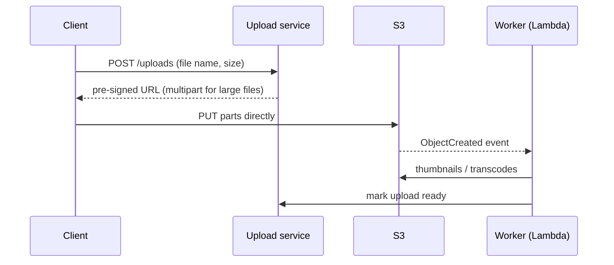

AWS has three kinds of storage, and each case-study component maps to one of them. **Object storage** (S3) holds files addressed by key. **Block storage** (EBS) is a disk attached to one instance. **File storage** (EFS, FSx) is a shared file system many machines mount. Databases sit on top of these and have their own page.

## TL;DR

- **S3 for anything that is a file:** uploads, media, backups, logs, data lakes. Clients upload and download directly with pre-signed URLs.
- **EBS for a disk on one instance:** self-managed databases, Kafka, boot volumes. Default to **gp3**.
- **EFS for shared NFS** across many servers or containers; **FSx** when you need Lustre for ML/HPC, Windows shares or NetApp.
- **Lifecycle rules** move old objects to cheaper classes automatically; **Intelligent-Tiering** does it per object when access is unpredictable.

## At a glance

<CloudGroupTable group="storage" lead="aws" />

## S3 storage classes

| Class | Retrieval | Use for |
|---|---|---|
| **Standard** | Milliseconds | Hot data: current uploads, website assets |
| **Intelligent-Tiering** | Milliseconds (archive tiers optional) | Unknown or changing access patterns |
| **Standard-IA / One Zone-IA** | Milliseconds, per-GB retrieval fee | Backups and older media read occasionally |
| **Glacier Instant Retrieval** | Milliseconds | Archives read a few times a year |
| **Glacier Flexible Retrieval** | Minutes to hours | Compliance archives |
| **Glacier Deep Archive** | Up to about 12 hours | Long-term retention at the lowest price |
| **Express One Zone** | Single-digit milliseconds, one zone | Hot data for analytics and ML jobs |

## Services

### Amazon S3

<CloudServiceProfile id="aws-s3" />

S3 is the default home for blobs in almost every case study. The usual upload pattern keeps large files away from your servers:

### Amazon EBS

<CloudServiceProfile id="aws-ebs" />

### Amazon EFS

<CloudServiceProfile id="aws-efs" />

### Amazon FSx

<CloudServiceProfile id="aws-fsx" />

## Where this shows up in system design

- **Media and uploads:** [Instagram](/system-design/case-studies/instagram), [YouTube](/system-design/case-studies/youtube) and [Messenger](/system-design/case-studies/facebook-messenger) attachments in S3, served through CloudFront.
- **File sync:** [Dropbox](/system-design/case-studies/dropbox) stores content-addressed chunks in S3 and metadata in a database (see [Blob Storage, Chunking and Dedup](/system-design/patterns/blob-storage-and-chunking)).
- **Designing S3 itself:** the [S3 case study](/system-design/case-studies/s3) explains what sits behind this API.
- **Data lakes and exports:** logs and events land in S3 for Athena and Redshift; [user data exports](/system-design/case-studies/user-data-export) are built as zip files in S3 and shared with a time-limited link.

## Common mistakes

- **Proxying uploads through app servers.** Use pre-signed URLs so bytes go straight to S3.
- **Public buckets.** Keep Block Public Access on and serve through CloudFront with origin access control.
- **Small-object churn in archive classes.** Glacier classes have minimum storage durations and per-object overhead; aggregate small files first.
- **Treating EBS as highly available.** A volume lives in one zone. Replicate at the application level or snapshot regularly.
- **No lifecycle rules.** Logs and old versions pile up forever. Expire or tier them from day one.

## Related

[Databases on AWS](/cloud/aws/databases) · [Edge, DNS & CDN on AWS](/cloud/aws/edge) · [Object / Blob Storage](/system-design/databases/object-storage) · [Blob Storage, Chunking and Dedup](/system-design/patterns/blob-storage-and-chunking)

<InterviewQuestions>
  <InterviewQuestion question="How do you let clients upload a 5 GB video without it passing through your servers?" category="Architecture" level="Mid">
    The upload service authenticates the user and returns pre-signed URLs for an S3 multipart upload. The client uploads the parts in parallel straight to S3, retrying failed parts, then completes the upload. An S3 event triggers processing, and the service never handles the bytes.
  </InterviewQuestion>
  <InterviewQuestion question="EBS, EFS or S3 for files that many containers need to read and write?" category="Cloud" level="Junior">
    Not EBS, since a volume attaches to one instance in one zone. EFS if the application needs a shared POSIX file system. S3 if the application can use an object API, which scales further and costs less, and is usually the better choice for new code.
  </InterviewQuestion>
</InterviewQuestions>
