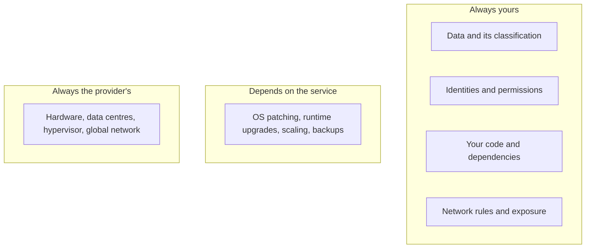

Before choosing services, it helps to know the few ideas every cloud shares: where things physically run and what fails together, what the provider does for you and what stays yours, and how billing pushes a design one way or another. These ideas come up in every cloud design question, whatever the provider.

## TL;DR

- **Region** = a geographic area; **Availability Zone** = one or more data centres in it with separate power and networking. Spread every tier across **at least three zones**; go **multi-Region** only when the requirements demand it.
- **Shared responsibility:** the provider secures the cloud itself; you secure what you put in it (data, identities, network rules, code).
- **The more managed the service, the less you operate and the less you control.** Default to the most managed option that meets the requirement.
- **Pricing is part of the design:** idle capacity, data transfer and per-request fees change which architecture is "right".

## Regions and zones

| Concept | AWS | Google Cloud | Azure |
|---|---|---|---|
| Geographic area | Region | Region | Region |
| Isolated data centre group | Availability Zone | Zone | Availability Zone |
| Small metro edge site | Local Zone | (Edge locations) | Extended Zone |
| Network scope | VPC per Region | VPC is global | VNet per Region |
| Account boundary | Account in an Organization | Project in folders | Subscription in management groups |

**What fails together:** one zone can lose power or networking, so a design survives that by running in several zones with automatic failover, often at no extra latency cost. A whole Region failing is rare but has happened. Surviving it needs data replicated to another Region and a way to move traffic (DNS, global load balancers). That roughly doubles cost and complexity, so tie it to an explicit availability or data-residency requirement.

| Target | Typical layout |
|---|---|
| 99.9% (about 8.8 hours of downtime a year) | Multi-zone in one Region |
| 99.99% (about 53 minutes a year) | Multi-zone, careful dependencies, fast automated failover; often a warm standby Region |
| 99.999% (about 5 minutes a year) | Active-active across Regions with multi-Region data (Aurora DSQL, Spanner, DynamoDB global tables, Cosmos DB) |

## Shared responsibility

The middle layer moves as you pick more managed services. On EC2 you patch the OS; on Fargate, Cloud Run or Container Apps the provider does; on DynamoDB or Spanner the provider also handles replication and backups. See the [who runs what grid](/cloud/start-here/choosing-compute) for compute.

## Managed, serverless, self-managed

| | Self-managed on VMs | Managed service | Serverless |
|---|---|---|---|
| **Example** | Kafka on EC2 | Amazon MSK | Kinesis, MSK Serverless |
| **You operate** | Everything above the VM | Configuration and sizing | Almost nothing |
| **Scales by** | You adding machines | You resizing | The provider, per request |
| **Cost shape** | Cheapest at steady high load, if you have the people | Middle | Cheapest when idle or spiky; can be dearest at steady high load |
| **Pick when** | You need control or a feature the managed service lacks | Most production workloads | Uneven load, small teams |

## How pricing shapes a design

- **Idle capacity:** VMs and provisioned clusters cost the same at 3 a.m. as at peak. Serverless and autoscaling cut that, at a higher unit price.
- **Data transfer:** traffic into the cloud is free; out to the internet, across Regions, and on AWS across zones, is billed per GB. Chatty designs and multi-Region replication pay for it.
- **Requests:** per-request services (S3, DynamoDB on-demand, Lambda, API Gateway) are cheap per call and expensive at billions of tiny calls. Batch where you can.
- **Commitments:** Savings Plans and committed-use discounts lower steady costs by up to about 70%, so baseline load is usually cheaper than it looks on list prices.

## Related

[Service Equivalents](/cloud/start-here/service-equivalents) · [Choosing Compute on AWS](/cloud/start-here/choosing-compute) · [Networking on AWS](/cloud/aws/networking) · [Non-functional requirements](/system-design/fundamentals/non-functional-requirements)

<InterviewQuestions>
  <InterviewQuestion question="When does a design need multiple Regions?" category="Architecture" level="Mid">
    When a requirement says so: an availability target beyond what one Region can promise (around 99.99% and up), users far apart who need low latency, data that must stay in a country, or a disaster-recovery objective that covers losing a whole Region. Otherwise, multiple zones in one Region give high availability at far lower cost and complexity.
  </InterviewQuestion>
  <InterviewQuestion question="What stays your responsibility on a fully serverless stack?" category="Cloud" level="Junior">
    Your data and who can access it, IAM permissions, application code and its dependencies, input validation, secrets, network exposure of endpoints, and configuration such as encryption settings and backups. The provider handles servers, operating systems, runtimes and scaling.
  </InterviewQuestion>
</InterviewQuestions>
