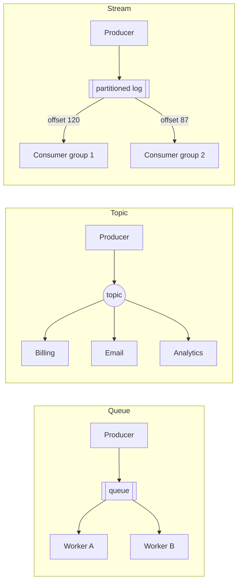

"Put a queue there" is the most common move in system design, and often the wrong word. A **queue** hands each message to one worker and forgets it. A **topic** copies each message to every subscriber. A **stream** keeps an ordered log that any number of readers can replay. Each cloud has all three, under different names and with different models.

## TL;DR

- Ask **what should happen to each message**: done once (queue), heard by several services (topic), or read in order and replayed (stream).
- **Ordering is per key, never global.** Pick the key (order id, conversation id, user id) that must stay ordered.
- **Everything is at-least-once.** Make consumers idempotent regardless of the product.
- **AWS** splits these into SQS, SNS / EventBridge and Kinesis / MSK. **Google Cloud's Pub/Sub** covers all three styles with one product. **Azure** uses Service Bus for queues and topics and Event Hubs for streams.

## Try it: pick a messaging service

<CloudDecisionTree topic="messaging" />

## The three shapes

In the queue, workers A and B **split** the messages. In the topic, every subscriber gets **every** message. In the stream, each consumer group keeps **its own position** and can rewind.

## The same choice on each cloud

| Need | AWS | Google Cloud | Azure |
|---|---|---|---|
| Work queue | SQS | Pub/Sub (pull) or Cloud Tasks | Service Bus queue, Queue Storage |
| Ordered queue per key | SQS FIFO (message group id) | Pub/Sub ordering keys | Service Bus sessions |
| Fan-out to services | SNS → SQS, EventBridge | Pub/Sub topic with many subscriptions, Eventarc | Service Bus topics, Event Grid |
| Ordered stream with replay | Kinesis, MSK | Pub/Sub (seek), Managed Kafka | Event Hubs |
| Kafka API | MSK | Managed Service for Apache Kafka | Event Hubs Kafka endpoint |
| Stream into storage | Firehose | Pub/Sub BigQuery / Cloud Storage subscriptions | Event Hubs Capture |

**Biggest model difference:** Kinesis, Kafka and Event Hubs scale by **partitions**, so ordering lives inside a partition and consumer parallelism is capped by the partition count. Pub/Sub has no partitions to manage. It orders by **ordering key** and scales subscribers automatically, which makes it simpler to operate but gives you less low-level control.

## Delivery guarantees in practice

| Guarantee | Meaning | What you do |
|---|---|---|
| At-most-once | May lose messages, never duplicates | Rarely acceptable; metrics sampling at most |
| At-least-once | Never loses acknowledged messages, may duplicate | The default everywhere; make consumers idempotent |
| Exactly-once *processing* | Effects applied once despite duplicates | Idempotency keys or transactional outbox + dedup on the consumer side; FIFO and Kafka transactions help within their scope |

## Related

[Messaging & Streaming on AWS](/cloud/aws/messaging) · [Message Queues and Pub/Sub](/system-design/patterns/message-queues) · [Fan-out: Push vs Pull](/system-design/patterns/fan-out) · [Idempotency](/system-design/patterns/idempotency) · [Back Pressure and Load Shedding](/system-design/patterns/back-pressure)

<InterviewQuestions>
  <InterviewQuestion question="What is the Google Cloud equivalent of SQS, SNS and Kinesis?" category="Cloud" level="Junior">
    Pub/Sub covers all three: a topic with one pull subscription behaves like a queue, many subscriptions give fan-out, and ordering keys plus seek-to-time give ordered, replayable delivery. Cloud Tasks is the closer match for rate-limited task queues, and Managed Service for Apache Kafka for Kafka workloads.
  </InterviewQuestion>
  <InterviewQuestion question="How do you keep events for one order in order while processing many orders in parallel?" category="Architecture" level="Mid">
    Use the order id as the ordering key: the partition key in Kinesis or Kafka, the message group id in SQS FIFO, the ordering key in Pub/Sub, or the session id in Service Bus. Events for one order stay in sequence, while different orders spread across partitions or groups and run in parallel.
  </InterviewQuestion>
</InterviewQuestions>
