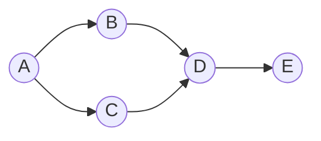

A graph is a set of nodes joined by edges. Most interview graphs are stored as an **adjacency list** (for each
node, the list of its neighbours) or are implicit, like a grid where each cell's neighbours are the cells above,
below, left and right. Breadth-first search (BFS) and depth-first search (DFS) both visit every node reachable
from a start node exactly once; they differ in the *order* they visit them.



From `A`, BFS visits `A, B, C, D, E`: everything one edge away, then everything two edges away. DFS might visit
`A, B, D, E, C`: it follows one path as far as it goes before backing up.

## Breadth-first search

BFS keeps a **queue** of nodes to visit. Take one from the front, then add each unvisited neighbour to the back.
Because nodes leave the queue in order of distance, the first time BFS reaches a node it has found a shortest
path to it (counting edges). Use it for "minimum number of steps", "nearest", or level-by-level questions.

```python
from collections import deque

def bfs(graph, start):
    seen = {start}
    queue = deque([start])
    order = []
    while queue:
        node = queue.popleft()
        order.append(node)
        for nxt in graph[node]:
            if nxt not in seen:
                seen.add(nxt)          # mark when queued, not when popped
                queue.append(nxt)
    return order
```

## Depth-first search

DFS goes deep first. Write it with recursion, or with an explicit **stack** when the graph may be deep enough to
overflow the call stack (Python's default recursion limit is about a thousand frames). Use it to explore whole
regions, detect cycles, order tasks topologically, or enumerate paths.

```javascript
function dfs(graph, start) {
  const seen = new Set([start]);
  const stack = [start];
  const order = [];
  while (stack.length > 0) {
    const node = stack.pop();
    order.push(node);
    for (const next of graph.get(node) ?? []) {
      if (!seen.has(next)) {
        seen.add(next);
        stack.push(next);
      }
    }
  }
  return order;
}
```

## Grids are graphs

In a grid, a cell `(r, c)` has up to four neighbours: `(r ± 1, c)` and `(r, c ± 1)`. Check bounds before you look
at a neighbour, and mark cells as visited either in a separate set or by overwriting them in place (cheaper, but
it changes the input, so say so). Counting connected regions is one outer loop over every cell that starts a BFS
or DFS from each unvisited land cell: see *Number of Islands*.

## Choosing between them

| You need | Use |
| --- | --- |
| Shortest path in an unweighted graph | BFS |
| Every node in a connected region | Either (DFS is usually shorter to write) |
| Cycle detection, topological order | DFS |
| Level-by-level processing | BFS |
| Very deep graphs in Python | BFS, or DFS with an explicit stack |

Both run in O(V + E) time for V nodes and E edges, and use O(V) extra space for the visited set and the queue or
stack. On an `m × n` grid that is O(m · n).

## Pitfalls

- **Marking too late.** Mark a node visited when you *add* it to the queue or stack. Marking when you remove it
  lets the same node be added many times.
- **Forgetting disconnected parts.** A single BFS only reaches one component. Loop over every node to cover the
  whole graph.
- **Weighted edges.** BFS shortest paths only hold when every edge costs the same. With weights, use Dijkstra.
