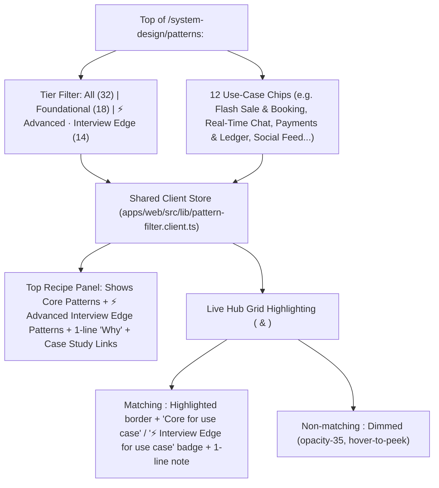

# System Design Patterns: Deep Research, "Advanced · Interview Edge" Tagging & Use-Case Highlighter Plan

## 1. Current State Audit (`/system-design/patterns`)

Inspecting `/system-design/patterns` (`apps/web/content/system-design/patterns.mdx` and `apps/web/content/system-design/_index.yaml`) alongside `/system-design/databases` (`apps/web/content/system-design/databases.mdx`) reveals three opportunities:

1. **No interactive Use-Case selector at the top of `/system-design/patterns`:**
   - `/system-design/databases` opens with `<DatabaseWorkloadMatrix compact />` (`apps/web/src/components/db/workload-matrix.tsx`), letting readers click workload chips at the top to see which database families fit and why.
   - `/system-design/patterns` starts directly with the static `<ModelCategory>` / `<ModelCard>` grid (`apps/web/src/components/mdx/model-grid.tsx`) and has no way to pick a system design use case at the top and highlight the corresponding design patterns used.
2. **Missing advanced distributed systems patterns that give candidates an edge in interviews:**
   - `/system-design/patterns` currently has **18 foundational pages** across 5 categories (`Scaling & Traffic`, `Data & Consistency`, `Messaging & Async`, `Reliability & Resilience`, `Specialised Structures`).
   - The 18 existing patterns cover the baseline every candidate knows (caching, load balancing, sharding, queues, rate limiting). What separates a **Senior / Staff hire** from a borderline pass is naming the **advanced production patterns** that solve subtle failure modes (e.g., **Transactional Outbox + CDC** for dual writes, **High-Contention Locking & Reservations** for flash sales, **Singleflight Request Coalescing & Key Salting** for hot keys, **Durable Workflows & Job Scheduling**, **Stateful Connection Gateways & Presence**, **Bulkheads, Shuffle Sharding & Cell Architecture**, **Gossip & Phi-Accrual Failure Detection**, **Tail-Latency Hedging & Deadline Propagation**, **Hybrid Logical Clocks & TrueTime**, **Streaming Top-K / Count-Min Sketch**, and **Prefix Tries for Typeahead**).
3. **Explicitly tagging these 14 additions as `Advanced · Interview Edge`:**
   - Users should immediately see which patterns are **Foundational** vs **Advanced (`Interview Edge`)**—both on the `/system-design/patterns` hub cards, inside the top Use-Case Explorer, and at the top of each article page—with a clear explanation of *how* bringing up that pattern gives them an edge in an interview.

---

## 2. Deep Research: 14 Advanced Patterns That Give an Interview Edge

We cross-referenced five authoritative industry sources against our existing `apps/web/content/system-design/fundamentals/` (40 pages), `apps/web/content/system-design/databases/` (29 pages), and `apps/web/content/system-design/patterns/` (18 pages):
- **Martin Fowler / Unmesh Joshi** — *Patterns of Distributed Systems* (Replication, Partitioning, Distributed Time, Cluster Management, Node Communication)
- **Chris Richardson** — *Microservices Patterns* (`microservices.io`: Saga, Transactional Outbox, Transaction Log Tailing / CDC, CQRS, Circuit Breaker)
- **Microsoft Azure** — *Cloud Design Patterns* (Cache-Aside, Materialized View, Index Table, Competing Consumers, Priority Queue, Queue-Based Load Leveling, Bulkhead, Valet Key, Throttling)
- **AWS Builders' Library** — (Shuffle Sharding, Cell-Based Architecture, Static Stability, Control vs Data Plane Separation, Load Shedding, Timeouts/Backoff/Jitter, Idempotent APIs)
- **Google SRE Book & *The Tail at Scale*** — (Hedged Requests, Deadline Propagation, Adaptive Throttling, Graceful Degradation)

> **De-duplication against Fundamentals & Databases:**
> Topics already covered as dedicated pages in `/system-design/fundamentals/` (`api-gateway` + BFF, `proxies` + Sidecar/Service Mesh, `cdn`, `webhooks`, `websockets`, `server-sent-events`, `long-polling`) or `/system-design/databases/` (`lsm-trees`, `b-trees`, `inverted-index`, `r-tree`, `single-leader-replication`, `multi-leader-replication`, `leaderless-replication`, `automatic-conflict-resolution` / CRDTs) remain in their existing hubs and are cross-linked rather than duplicated.

### Complete Catalog: 18 Foundational + 14 `Advanced · Interview Edge` Patterns (32 Total)

#### Category 1: Scaling & Traffic *(4 foundational + 2 advanced = 6 patterns)*
| Tier | Slug | Title | Icon | What It Covers & Why It Gives an Interview Edge |
| :--- | :--- | :--- | :--- | :--- |
| Foundational | `load-balancing` | Load Balancing | `network` | L4 vs L7, algorithms, health checks and global balancing. |
| Foundational | `caching` | Caching | `zap` | Cache-aside, write-through, eviction, invalidation and stampedes. |
| Foundational | `consistent-hashing` | Consistent Hashing | `shuffle` | Hash rings and virtual nodes so scaling moves minimal data. |
| Foundational | `sharding` | Sharding and Partitioning | `split` | Range, hash and directory partitioning, hot shards and resharding. |
| **⚡ Advanced** | `hot-keys-and-coalescing` | **Hot Keys, Skew and Request Coalescing** | `flame` | **Interview Edge:** Most candidates stop at "shard by ID and add Redis." Naming **singleflight request collapsing**, **L1 in-process caching with 1–2s TTL**, **key salting (`key#1..N`)**, and **write buffering for viral counters** directly answers the interviewer's celebrity/hot-partition probe. |
| **⚡ Advanced** | `batching-and-pipelining` | **Request Batching, Pipelining and Scatter-Gather** | `layers` | **Interview Edge:** Shows you understand network and IOPS physics—turning 50,000 tiny writes/RPCs per second into **linger-window micro-batches**, **pipelined sockets**, **DataLoader N+1 batching**, and **scatter-gather with partial timeouts**. |

#### Category 2: Data & Consistency *(4 foundational + 4 advanced = 8 patterns)*
| Tier | Slug | Title | Icon | What It Covers & Why It Gives an Interview Edge |
| :--- | :--- | :--- | :--- | :--- |
| Foundational | `consistency-models` | Consistency Models and CAP | `scale` | Strong, eventual and causal consistency, PACELC and quorums. |
| Foundational | `idempotency` | Idempotency | `repeat` | Idempotency keys and deduplication so retries are safe. |
| Foundational | `saga` | Saga and Distributed Transactions | `git-merge` | Compensating workflows instead of two-phase commit. |
| Foundational | `cqrs-event-sourcing` | CQRS and Event Sourcing | `scroll-text` | Separate read and write models and store state as events. |
| **⚡ Advanced** | `outbox-and-cdc` | **Transactional Outbox and Change Data Capture** | `database` | **Interview Edge:** Directly solves the **Dual-Write Problem** ("what if Postgres commits but the Kafka publish fails?"). Explaining an atomic local `outbox` table + **WAL tailing via Debezium CDC** to feed Kafka, Elasticsearch, and Redis is a textbook Senior/Staff signal. |
| **⚡ Advanced** | `concurrency-and-locking` | **Concurrency Control, Locking and Reservations** | `lock` | **Interview Edge:** Crucial for Ticketmaster, Hotel Booking, Uber dispatch, and payments. Contrasts **pessimistic locking (`SELECT FOR UPDATE`)**, **Optimistic Concurrency Control (OCC version CAS)**, **time-bounded inventory holds (`SET NX EX`)**, and **leases with fencing tokens**. |
| **⚡ Advanced** | `materialized-views` | **Materialized Views and Read Projections** | `table` | **Interview Edge:** Shows how to turn expensive multi-join or cross-shard queries into single-key lookups by maintaining **denormalized query tables, secondary index tables, and stream-updated read projections** rebuildable from the source of truth. |
| **⚡ Advanced** | `distributed-time-and-clocks` | **Distributed Time, Clocks and Ordering** | `clock` | **Interview Edge:** When an interviewer asks "what if two servers have clock skew?", explaining **monotonic vs wall clocks**, **Lamport & vector clocks**, **Hybrid Logical Clocks (HLC)**, and **Clock-Bound Wait (Spanner TrueTime)** proves deep distributed systems mastery. |

#### Category 3: Messaging & Async *(3 foundational + 3 advanced = 6 patterns)*
| Tier | Slug | Title | Icon | What It Covers & Why It Gives an Interview Edge |
| :--- | :--- | :--- | :--- | :--- |
| Foundational | `message-queues` | Message Queues and Pub/Sub | `radio` | Queues, topics, partitions, delivery guarantees and dead letters. |
| Foundational | `fan-out` | Fan-out: Push vs Pull | `users` | Fan-out on write, on read and the hybrid for feeds and notifications. |
| Foundational | `back-pressure` | Back Pressure and Load Shedding | `gauge` | Bounded queues, admission control and priority shedding. |
| **⚡ Advanced** | `workflows-and-job-scheduling` | **Durable Workflows and Distributed Job Scheduling** | `workflow` | **Interview Edge:** Replaces hand-wavy "run a cron job" answers with **partitioned delay queues (Redis ZSET / timing wheels)**, **lease-based worker claiming (`visibility_timeout`)**, and **durable state-machine execution (Temporal / Step Functions style)** for long-running jobs. |
| **⚡ Advanced** | `realtime-gateways-and-presence` | **Real-Time Connection Gateways and Presence** | `activity` | **Interview Edge:** Bridges protocol basics (WebSockets/SSE) to 100M-connection architecture: **stateful gateway fleets**, **session routing (`user → gateway` registry vs pub/sub bus)**, **heartbeat aggregation**, **presence fan-out throttling**, and **reconnect catch-up cursors**. |
| **⚡ Advanced** | `stream-processing-and-windowing` | **Stream Processing and Windowed Aggregation** | `bar-chart` | **Interview Edge:** Essential for ad-click attribution, live metrics, fraud signals, and trending feeds: **tumbling, sliding, and session windows**, **watermarks for late-arriving events**, **stateful checkpoints**, and **Kappa vs Lambda pipelines**. |

#### Category 4: Reliability & Resilience *(3 foundational + 3 advanced = 6 patterns)*
| Tier | Slug | Title | Icon | What It Covers & Why It Gives an Interview Edge |
| :--- | :--- | :--- | :--- | :--- |
| Foundational | `circuit-breaker-and-retries` | Circuit Breaker, Retries and Timeouts | `siren` | Backoff with jitter, breakers and bulkheads. |
| Foundational | `rate-limiting` | Rate Limiting | `timer` | Token bucket, sliding window and distributed counters. |
| Foundational | `leader-election` | Leader Election and Consensus | `users` | Raft, quorums, leases and fencing tokens. |
| **⚡ Advanced** | `bulkheads-and-cell-architecture` | **Bulkheads, Shuffle Sharding and Cell Architecture** | `shield-check` | **Interview Edge:** Directly from the AWS Builders' Library: **cell-based architecture** caps the blast radius of any outage to `1/N` of customers, **combinatorial shuffle sharding** isolates noisy tenants across shared workers, and **control-plane vs data-plane separation** keeps recovery independent. |
| **⚡ Advanced** | `gossip-and-failure-detection` | **Gossip Protocols, Heartbeats and Failure Detection** | `share` | **Interview Edge:** Explains how leaderless/large clusters (Dynamo, Cassandra, Consul) track liveness and repair drift without a central bottleneck: **Phi Accrual suspicion scoring**, **SWIM indirect probes**, **`O(log N)` epidemic gossip**, **sloppy quorums / hinted handoff**, and **Merkle-tree anti-entropy**. |
| **⚡ Advanced** | `tail-latency-and-degradation` | **Tail-Latency Hedging, Deadlines and Degradation** | `trending-down` | **Interview Edge:** Solves the math of why a request touching 50 services with 1% p99 spikes has a 40% chance of being slow: **hedged and tied requests**, **deadline budget propagation across RPC hops**, **brownout modes**, and **safe feature degradation**. |

#### Category 5: Specialised Structures *(4 foundational + 2 advanced = 6 patterns)*
| Tier | Slug | Title | Icon | What It Covers & Why It Gives an Interview Edge |
| :--- | :--- | :--- | :--- | :--- |
| Foundational | `unique-id-generation` | Unique ID Generation | `fingerprint` | Snowflake IDs, UUIDs, ranges and base62 short codes. |
| Foundational | `bloom-filter` | Bloom Filters and Probabilistic Structures | `binary` | Cheap membership, cardinality and frequency estimates. |
| Foundational | `geospatial-indexing` | Geospatial Indexing | `map` | Geohash, quadtrees, R-trees and H3 for proximity search. |
| Foundational | `blob-storage-and-chunking` | Blob Storage, Chunking and Dedup | `hard-drive` | Object storage, resumable uploads, dedup and CDNs. |
| **⚡ Advanced** | `top-k-and-leaderboards` | **Top-K, Heavy Hitters and Leaderboards** | `star` | **Interview Edge:** Directly answers "Design Twitter Trends / YouTube Top Videos / Gaming Leaderboards": contrasts **exact rankings (sharded Redis sorted sets + score bucketing)** with **streaming heavy hitters (Count-Min Sketch + min-heap, Space-Saving, windowed merges)**. |
| **⚡ Advanced** | `tries-and-typeahead` | **Tries, Prefix Trees and Typeahead** | `search` | **Interview Edge:** Directly answers sub-50 ms autocomplete design: **compressed radix tries with precomputed Top-K completions per node**, **browser/edge prefix caching**, **offline MapReduce/Spark snapshot rebuilds vs incremental updates**, and **prefix-range sharding**. |

---

## 3. How `Advanced · Interview Edge` Tagging Works Across the UI

We will surface the **Advanced** status in four places so learners always know when they are studying an interview-differentiating pattern:

### 3.1 Schema & Frontmatter Support (`tier: "advanced"`)
- In `apps/web/src/features/sections/schema.ts`, add optional `tier: z.enum(["core", "advanced"]).optional()` to both `frontmatterSchema` and `navCardSchema`.
- In `apps/web/src/features/docs/hub-markup.ts` and `apps/web/src/features/docs/kind.ts`, parse `tier="advanced"` from `<ModelCard>` and verify parity between `patterns.mdx`, `_index.yaml`, and the article's frontmatter `tier: advanced`.

### 3.2 Badge on `<ModelCard>` in the `/system-design/patterns` Grid
- In `apps/web/src/components/mdx/model-grid.tsx`, `<ModelCard>` accepts `tier?: "core" | "advanced"`.
- When `tier === "advanced"`, `<ModelCard>` renders a distinct pill badge in the card header (alongside `Mark done`):
  - **`⚡ Advanced · Interview Edge`** (styled with a subtle tint border and background, `border-tint/50 bg-tint-soft text-tint`, with tooltip *"Advanced pattern: naming this in a Senior/Staff interview sets your design apart"*).

### 3.3 Article Header Badge & "Interview Edge" Callout Inside Each Page
- In `apps/web/src/features/docs/section-doc-page.tsx`, when `doc.frontmatter.tier === "advanced"`, render an **`⚡ Advanced Pattern · Interview Edge`** badge next to the Updated date / Completed badge at the top of the article.
- Every one of the 14 advanced pattern pages includes a signature **`<Callout tone="violet" title="Interview Edge: How this pattern sets Senior & Staff answers apart" icon="sparkles">`** block showing:
  - **What a typical candidate says:** (e.g., *"I'll update the database and publish an event to Kafka."*)
  - **Why the interviewer pushes back:** (e.g., *"What if the process crashes after the DB commit but before the Kafka publish?"*)
  - **Your Interview Edge answer:** (e.g., *"I'll write the order and an event row into a local `outbox` table in the same Postgres transaction, and tail the WAL with Debezium CDC into Kafka—zero dual-write window and no 2PC lock."*)

### 3.4 Quick Filter in `<PatternUseCaseExplorer />` at the Top of `/system-design/patterns`
- At the top of `/system-design/patterns`, alongside the Use-Case chips, include a **Tier Filter pill toggle**:
  - `All patterns (32)` · `Foundational (18)` · `⚡ Advanced · Interview Edge (14)`
- Clicking **`⚡ Advanced · Interview Edge (14)`** immediately highlights all 14 advanced patterns across the 5 categories below (and dims the 18 foundational ones) so a candidate doing a final pre-interview review can scan all 14 high-signal patterns in one click.

---

## 4. Highlighting Patterns by Use Case at the Top (`<PatternUseCaseExplorer />`)

At the top of `apps/web/content/system-design/patterns.mdx`, `<PatternUseCaseExplorer />` lets users click any of **12 System Design Use Cases** and highlights the corresponding patterns both in a top recipe summary and live across the `<ModelCard>` grid below:

### Complete Use-Case ↔ Pattern Mapping (`apps/web/src/lib/pattern-catalog.ts`)

Notice how every use case highlights **both** the foundational patterns required for a complete design **and** the **`⚡ Advanced · Interview Edge`** patterns that elevate the candidate's answer:

| # | Use-Case Chip (Top Bar) | Linked Case Studies | Foundational Patterns Highlighted | ⚡ Advanced (`Interview Edge`) Patterns Highlighted |
| :--- | :--- | :--- | :--- | :--- |
| 1 | **High-read API & redirects** | URL Shortener, Netflix | `caching`, `load-balancing`, `consistent-hashing`, `unique-id-generation` | `hot-keys-and-coalescing` *(singleflight + key salting)*, `tail-latency-and-degradation` *(hedged reads)* |
| 2 | **Real-time chat & presence** | Facebook Messenger, WhatsApp, ChatGPT | `sharding`, `unique-id-generation`, `fan-out`, `idempotency` | `realtime-gateways-and-presence` *(gateway routing & heartbeat aggregation)*, `distributed-time-and-clocks` *(per-chat causal ordering)* |
| 3 | **Social feed & notifications** | Twitter, Instagram, TikTok | `fan-out`, `caching`, `message-queues`, `sharding` | `hot-keys-and-coalescing` *(celebrity hot keys)*, `materialized-views` *(precomputed timeline projections)* |
| 4 | **Flash sale & seat booking** | Ticketmaster, Hotel Booking, Parking Garage | `back-pressure`, `saga`, `idempotency`, `rate-limiting` | `concurrency-and-locking` *(atomic TTL seat holds & OCC/locks)*, `workflows-and-job-scheduling` *(hold expiry timers)* |
| 5 | **Payments, wallets & ledgers** | Kindle Payments | `idempotency`, `saga`, `cqrs-event-sourcing`, `consistency-models` | `outbox-and-cdc` *(zero-loss event publishing)*, `concurrency-and-locking` *(serializable ledger updates & fencing)* |
| 6 | **Location & live dispatch** | Uber Eats, Google Maps, Tinder, Zillow | `geospatial-indexing`, `message-queues`, `saga`, `caching` | `concurrency-and-locking` *(atomic courier claim lock)*, `realtime-gateways-and-presence` *(streaming GPS & order status)* |
| 7 | **File sync, video & object storage** | Dropbox, YouTube, S3, User Data Export | `blob-storage-and-chunking`, `consistent-hashing`, `message-queues`, `leader-election` | `workflows-and-job-scheduling` *(DAG video transcoding / export)*, `gossip-and-failure-detection` *(storage node liveness & Merkle repair)* |
| 8 | **Typeahead, trending & leaderboards** | Typeahead | `bloom-filter`, `caching`, `sharding` | `tries-and-typeahead` *(prefix trie + top-K node cache)*, `top-k-and-leaderboards` *(Count-Min Sketch + Redis ZSET)*, `stream-processing-and-windowing` |
| 9 | **Web crawler & async pipelines** | Web Crawler, User Data Export | `message-queues`, `bloom-filter`, `rate-limiting`, `back-pressure` | `workflows-and-job-scheduling` *(politeness delay queues & leases)*, `batching-and-pipelining` *(batched DNS/fetch & index writes)* |
| 10 | **Metrics, logs & stream ingestion** | Metrics & Logging, Distributed Message Queue | `sharding`, `back-pressure`, `message-queues`, `bloom-filter` | `stream-processing-and-windowing` *(tumbling/sliding rollups & watermarks)*, `batching-and-pipelining` *(micro-batched ingestion)* |
| 11 | **Distributed KV & coordination** | Key-Value Store, Rate Limiter | `consistent-hashing`, `consistency-models`, `leader-election`, `bloom-filter` | `gossip-and-failure-detection` *(SWIM/gossip membership & hinted handoff)*, `distributed-time-and-clocks` *(vector clocks / HLC)* |
| 12 | **Multi-service & tenant resilience** | Rate Limiter, ChatGPT | `circuit-breaker-and-retries`, `rate-limiting`, `back-pressure`, `load-balancing` | `bulkheads-and-cell-architecture` *(shuffle sharding & cell blast-radius isolation)*, `tail-latency-and-degradation` *(deadline propagation & brownouts)* |

---

## 5. Step-by-Step Implementation Plan

### Phase 1: Schema, Catalog & Interactive Use-Case + Advanced Highlighter
1. **Update schemas & hub parser:**
   - Add `tier: z.enum(["core", "advanced"]).optional()` to `frontmatterSchema` and `navCardSchema` in `apps/web/src/features/sections/schema.ts`.
   - Parse `tier` in `apps/web/src/features/docs/hub-markup.ts` and validate frontmatter ↔ `_index.yaml` `tier` agreement in `apps/web/src/features/docs/kind.ts`.
2. **Create `apps/web/src/lib/pattern-catalog.ts` & unit tests (`pattern-catalog.test.ts`):**
   - Define all 32 patterns (`tier: "core" | "advanced"`, category, href, title, short summary, `interviewEdge` 1-liner for advanced patterns) and all 12 use cases (with per-pattern `role: "core" | "edge" | "supporting"` and 1-line `why` explanation, plus linked case studies).
3. **Create `apps/web/src/lib/pattern-filter.client.ts` & `apps/web/src/components/patterns/pattern-use-case-explorer.tsx`:**
   - Build `<PatternUseCaseExplorer />` with:
     - Top tier filter (`All (32)` | `Foundational (18)` | `⚡ Advanced · Interview Edge (14)`).
     - Interactive Use-Case chips (`aria-pressed`, single or multi-select + `Clear`).
     - Expandable **Use-Case Recipe & Interview Edge Panel** showing the Foundational patterns, the **`⚡ Advanced · Interview Edge`** patterns (with the exact interview talking point), and direct links to Case Studies.
   - Register `PatternUseCaseExplorer` in `apps/web/src/lib/mdx-lazy-widgets.tsx` and `apps/web/src/lib/mdx-doc.tsx`, and document it in `apps/web/content/system-design/COMPONENTS.md`.
4. **Update `apps/web/src/components/mdx/model-grid.tsx` & `apps/web/src/features/docs/section-doc-page.tsx`:**
   - Render the permanent **`⚡ Advanced · Interview Edge`** pill badge on `<ModelCard tier="advanced">` and in the article header of `SectionDocPage`.
   - Connect `<ModelCard>` and `<ModelCategory>` to `pattern-filter.client.ts` so selecting any Use Case (or the `Advanced · Interview Edge` filter) at the top dynamically highlights matching cards with their role badge + 1-line use-case note, dims non-matching cards, and displays the active match count on each `<ModelCategory>` header.

### Phase 2: Author the 14 `Advanced · Interview Edge` Pattern Pages & Update Navigation
1. **Write all 14 new MDX pages under `apps/web/content/system-design/patterns/` with `tier: advanced`:**
   - Each page includes:
     - `tier: advanced` in frontmatter,
     - The signature **`Interview Edge`** callout contrasting the common mid-level answer with the Senior/Staff answer,
     - Concrete architecture/sequence diagrams, worked numbers, trade-off tables, real-world case study links, common pitfalls, interview script, and `<InterviewQuestions>` blocks.
2. **Update `apps/web/content/system-design/patterns.mdx`, `apps/web/content/system-design/_index.yaml`, `apps/web/content/question-bank/articles.yaml`, and Case Studies:**
   - Place `<PatternUseCaseExplorer />` at the top of `patterns.mdx`.
   - Add the 14 `<ModelCard ... tier="advanced" />` entries to `patterns.mdx` and `apps/web/content/system-design/_index.yaml`.
   - Map all 14 new pages in `apps/web/content/question-bank/articles.yaml`.
   - Cross-link the new patterns in `apps/web/content/system-design-case-studies/case-studies/*.mdx`.

### Phase 3: Verification & Quality Gates
1. Run `npm run content-check -w web -- --strict`, `npm run typecheck`, `npm run lint`, `npm test`, `npm run knip`, and `npm run check:agents-md`.
2. Verify `/system-design/patterns` in the browser (light/dark themes, mobile/desktop viewports) to confirm the `⚡ Advanced · Interview Edge` badges, the top Use-Case Explorer, and the live `<ModelCard>` highlighting.
