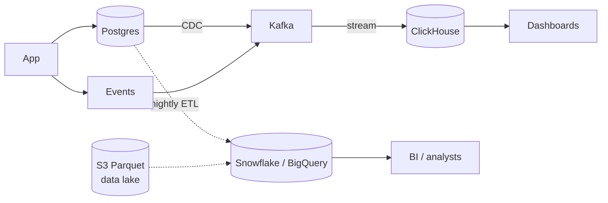

Analytical databases answer questions about **all** your data: revenue per country per month, funnel conversion, p95 latency per endpoint across a year. They store data by column instead of by row, so a query reads only the columns it needs.

<DbProfile id="olap" />

## OLTP vs OLAP

| | OLTP (Postgres, MySQL) | OLAP (ClickHouse, BigQuery, Snowflake) |
|---|---|---|
| Typical query | Fetch or update one order | SUM over 2 billion orders |
| Rows touched | A few, by key | Millions to billions |
| Columns touched | All of them | 2–5 of 100 |
| Writes | Many small transactions | Big batches or streams |
| Latency | Milliseconds | Hundreds of ms to seconds |
| Users | Your application | Analysts, dashboards, ML pipelines |

## Row vs column storage

```text
Row store (one page holds whole rows):
[ 1 | ada | DE | 2026-11-05 | 49.00 ] [ 2 | bob | US | 2026-11-05 | 12.50 ] ...
→ SUM(amount) still reads every column of every row

Column store (one file per column):
id:      1, 2, 3, 4, ...
country: DE, US, US, DE, ...        ← compresses ~10× (few distinct values)
amount:  49.00, 12.50, 8.00, ...    ← SUM reads only this file
```

Three things make columnar stores fast:

<StepCards>
  <StepCard n={1} title="Read less">
    Only the queried columns are read from disk. 3 of 100 columns means about 3% of the I/O.
  </StepCard>
  <StepCard n={2} title="Compress more">
    A column holds similar values, so run-length, dictionary and delta encoding shrink it 5–20×.
  </StepCard>
  <StepCard n={3} title="Compute in batches">
    Vectorized execution processes thousands of values per CPU instruction (SIMD), in parallel across nodes.
  </StepCard>
</StepCards>

## How the data looks

<DataModelView title="Ad clicks analytics">
<DataModelTab label="ClickHouse table">

```sql
CREATE TABLE clicks (
  event_time   DateTime,
  campaign_id  UInt64,
  country      LowCardinality(String),
  device       LowCardinality(String),
  cost_micros  UInt64
)
ENGINE = MergeTree
PARTITION BY toYYYYMM(event_time)          -- drop old months cheaply
ORDER BY (campaign_id, event_time);        -- sorting key = what you filter on
```

</DataModelTab>
<DataModelTab label="The query">

```sql
-- Clicks and spend per campaign per hour, last 90 days, over billions of rows
SELECT campaign_id,
       toStartOfHour(event_time) AS hour,
       count()                   AS clicks,
       sum(cost_micros) / 1e6    AS spend
FROM clicks
WHERE event_time > now() - INTERVAL 90 DAY
GROUP BY campaign_id, hour
ORDER BY hour;
```

</DataModelTab>
<DataModelTab label="Star schema">

```text
                 dim_date
                    │
dim_campaign ── fact_clicks ── dim_country
                    │
                dim_device

Fact table: one row per event (huge, append-only).
Dimension tables: descriptive attributes (small, joined in).
```

</DataModelTab>
</DataModelView>

## Getting data in

OLAP stores are fed from operational systems, not written to by your app's request path.



| Engine | Sweet spot |
|---|---|
| **ClickHouse, Apache Druid, Apache Pinot** | Real-time, user-facing analytics: fresh data, sub-second queries |
| **Snowflake, BigQuery, Redshift** | Warehouse for BI and ad-hoc SQL; storage separate from compute |
| **DuckDB** | Embedded analytics on one machine or straight off Parquet files |
| **Spark / Trino over a data lake** | Huge batch jobs over files in S3 (Iceberg, Delta Lake) |

## Workload scenarios

<ScenarioGrid>
  <ScenarioCard workload="Analytics" title="Ad click aggregation" problem="10B click events a day. Advertisers see near-real-time charts of clicks and spend by campaign, hour and country." pick="Kafka → ClickHouse (or Pinot), with materialized rollups">
    Stream events in batches and order by `(campaign_id, event_time)` so each advertiser's data is contiguous. Pre-aggregate per minute with materialized views, and keep raw data for reprocessing.
  </ScenarioCard>
  <ScenarioCard workload="Analytics" title="Analytics on the production database" problem="Analysts run heavy GROUP BY queries on the production Postgres replica, and app latency spikes every afternoon." pick="Move analytics to a warehouse fed by CDC">
    Row-store replicas aren't built for full scans, and they still share I/O and replication load. Stream changes to Snowflake, BigQuery or ClickHouse and point BI tools there.
  </ScenarioCard>
  <ScenarioCard workload="Not OLAP" title="Order lookup API" problem="A team wants to serve 'show my order 123' from the warehouse to save a database." pick="Keep it in OLTP">
    Warehouses are slow and expensive for many tiny point queries and single-row updates, and their data lags. User-facing lookups belong in the operational database.
  </ScenarioCard>
</ScenarioGrid>

## Common pitfalls

- **Single-row inserts** into a columnar store: batch them (thousands of rows per insert).
- **Using it as an OLTP database**: updates, deletes and point lookups are slow.
- **A wrong sort key** in ClickHouse or a missing partition filter in BigQuery means scanning (and paying for) everything.
- **Running analytics on the production DB** until it falls over.

## How to answer in an interview

> "Dashboards aggregate billions of events, so they won't run on Postgres. I'll stream events through **Kafka into ClickHouse**, partitioned by month and ordered by `(campaign_id, event_time)`, with per-minute materialized rollups. Raw events also land in S3 as Parquet for reprocessing."

## Related

[Choosing a Database](/system-design/databases/choosing-a-database) · [Time-Series Databases](/system-design/databases/time-series-databases) · [Object Storage](/system-design/databases/object-storage) · [CQRS & Event Sourcing](/system-design/patterns/cqrs-event-sourcing) · [Metrics & Logging case study](/system-design-case-studies/case-studies/metrics-and-logging)

## Further reading

- [ClickHouse: why it's so fast](https://clickhouse.com/docs/concepts/why-clickhouse-is-so-fast)
- [Dremel: interactive analysis of web-scale datasets (BigQuery's origin)](https://research.google/pubs/dremel-interactive-analysis-of-web-scale-datasets-2/)
- Martin Kleppmann, *Designing Data-Intensive Applications*, chapter 3 (column-oriented storage)

<InterviewQuestions>
  <InterviewQuestion question="Why are columnar databases faster for analytics?" category="Internals" level="Mid">
    An aggregate usually touches a few columns across many rows. Columnar storage reads only those columns, compresses each one well because values are similar, and processes values in vectorized batches. A row store has to read entire rows, every column, to compute the same sum.
  </InterviewQuestion>
  <InterviewQuestion question="How do you get data from your OLTP database into a warehouse?" category="Design" level="Mid">
    Either batch ETL/ELT (nightly snapshots or incremental extracts by updated_at), or change data capture that streams row changes through Kafka into the warehouse in near real time. CDC gives fresher data and less load on the source. Batch is simpler. Either way, model the data into facts and dimensions on arrival.
  </InterviewQuestion>
  <InterviewQuestion question="ClickHouse vs Snowflake: how do you choose?" category="Trade-offs" level="Senior">
    ClickHouse (or Druid/Pinot) suits real-time, user-facing analytics: high query concurrency, sub-second latency on fresh data, and you tune sort keys. Snowflake or BigQuery suit an organization-wide warehouse for BI and ad-hoc SQL, with elastic compute, easy joins across many datasets, and little ops, at higher per-query latency and cost.
  </InterviewQuestion>
</InterviewQuestions>
